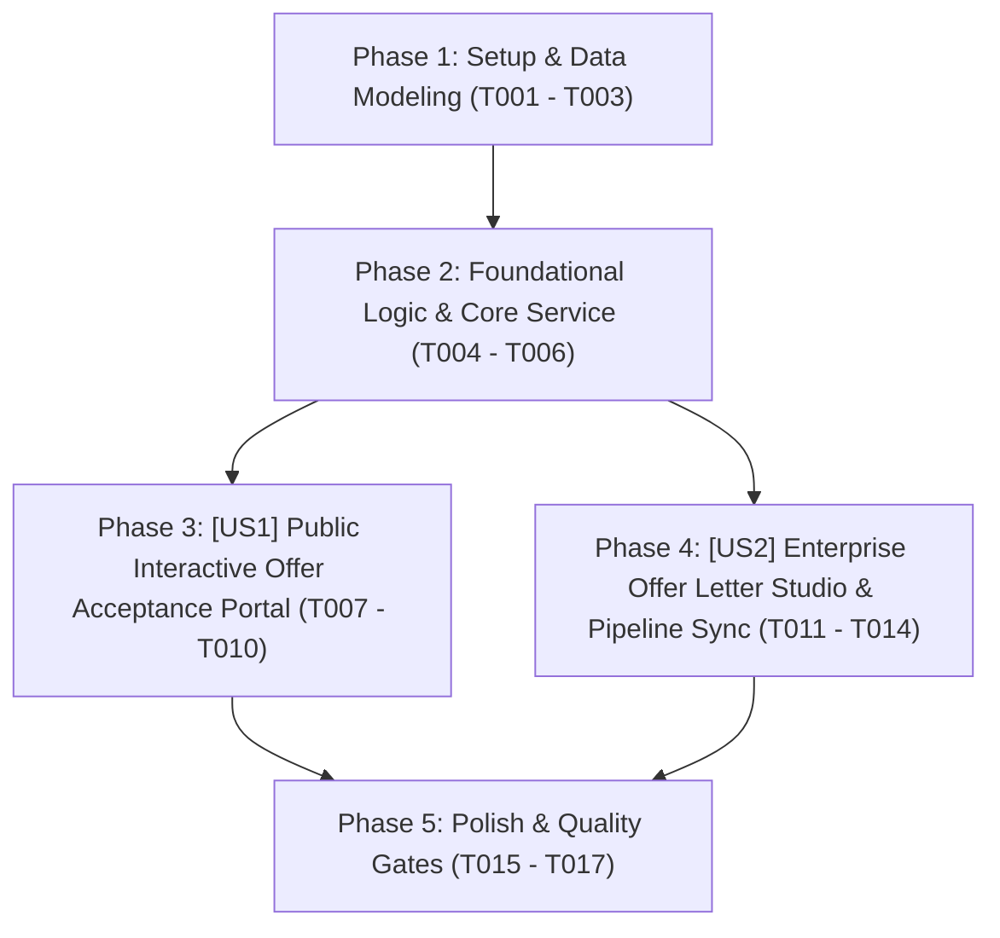

# Tasks: Cổng Chào Đón Nhận Việc Tương Tác Công Khai & Studio Thư Mời Doanh Nghiệp (Public Interactive Offer Portal & Enterprise Offer Letter Studio)

> **Feature Name:** Cổng Chào Đón Nhận Việc Tương Tác Công Khai & Studio Thư Mời Doanh Nghiệp (Public Interactive Offer Portal & Enterprise Offer Letter Studio)  
> **Plan Document:** [`docs/superpowers/plans/2026-11-09-public-offer-portal-and-letter-studio-plan.md`](file:///C:/Users/ADMIN/Desktop/STUDY/docs/superpowers/plans/2026-11-09-public-offer-portal-and-letter-studio-plan.md)  
> **Spec Directory:** [`docs/superpowers/specs/2026-11-09-public-offer-portal-and-letter-studio/`](file:///C:/Users/ADMIN/Desktop/STUDY/docs/superpowers/specs/2026-11-09-public-offer-portal-and-letter-studio/)  
> **Branch:** `profilehub_v1`  
> **Checklist Format Requirement:** `- [ ] [TaskID] [P?] [Story?] Description with file path`

---

## 🏛️ Dependencies & Story Execution Order

---

## Phase 1: Setup & Data Modeling

- [X] T001 Khai báo các interface và types `OfferLetter`, `OfferBenefitItem`, `OfferStatus`, `CreateOfferParams` trong [src/types/database.ts](file:///C:/Users/ADMIN/Desktop/STUDY/profilehub/src/types/database.ts)
- [X] T002 [P] Khởi tạo danh mục các mẫu phúc lợi chuẩn IT (`DEFAULT_OFFER_BENEFITS`) và template thư mời mẫu trong [src/services/offerTemplateBank.ts](file:///C:/Users/ADMIN/Desktop/STUDY/profilehub/src/services/offerTemplateBank.ts)
- [X] T003 [P] Cập nhật bộ hồ sơ tài liệu đặc tả Spec-Kit hoàn chỉnh (spec.md, data-model.md, contracts/offer-service-api.md, quickstart.md) trong [docs/superpowers/specs/2026-11-09-public-offer-portal-and-letter-studio/](file:///C:/Users/ADMIN/Desktop/STUDY/docs/superpowers/specs/2026-11-09-public-offer-portal-and-letter-studio/)

---

## Phase 2: Foundational Logic & Core Services (Blocking Prerequisites)

- [X] T004 Xây dựng service cốt lõi `offerLetterService.ts` hỗ trợ các phương thức: `createOffer`, `getOfferByToken`, `getOfferByCandidateId`, `acceptOffer`, `negotiateOffer`, `declineOffer`, và `getAllOffers` trong [src/services/offerLetterService.ts](file:///C:/Users/ADMIN/Desktop/STUDY/profilehub/src/services/offerLetterService.ts)
- [X] T005 [P] Viết bộ test đơn vị tự động `offerLetterService.test.ts` kiểm thử toàn diện việc sinh token ngẫu nhiên, tính toán hạn offer (hết hạn), ký số điện tử và chuyển trạng thái trong [src/services/offerLetterService.test.ts](file:///C:/Users/ADMIN/Desktop/STUDY/profilehub/src/services/offerLetterService.test.ts)
- [X] T006 [P] Tích hợp cơ chế liên lạc đồng bộ `pipelineSync.ts` để khi offer được chấp thuận sẽ tự động kích hoạt chuyển cột thẻ ứng viên sang `hired` trong [src/utils/pipelineSync.ts](file:///C:/Users/ADMIN/Desktop/STUDY/profilehub/src/utils/pipelineSync.ts)

---

## Phase 3: User Story 1 - Public Interactive Offer Acceptance Portal (P1 - Core Value & Virality)

**Story Goal:** Ứng viên (hoặc bất kỳ ai có link thư mời) có thể truy cập trực tiếp đường link công khai dạng `/offer/:token` mà không cần đăng nhập tài khoản; chiêm ngưỡng lời chào đón nồng nhiệt của Ban Giám Đốc kèm Tích Xanh doanh nghiệp; kiểm tra minh bạch chi tiết thu nhập (Gross/Net, Thử việc, Thưởng); gõ chữ ký số điện tử và bấm `[ 🎉 Đồng Ý Nhận Việc ]` để kích hoạt hiệu ứng pháo hoa Confetti rực rỡ và nhận thiệp chúc mừng chia sẻ mạng xã hội.  
**Independent Test Criteria:** Mở trình duyệt ẩn danh (Incognito), truy cập `/offer/off_sec_sample` ➔ Trang hiển thị ngay lập tức không bị văng về `/login`; nhập tên ký xác nhận ➔ Bắn pháo hoa Confetti, trạng thái chuyển thành "Đã Chấp Thuận" và lưu trữ dấu thời gian `signed_at`.

- [X] T007 [P] [US1] Xây dựng script hiệu ứng pháo hoa Canvas Confetti nhẹ nhàng độc lập (Zero-dependency) trong [src/utils/confettiEffect.ts](file:///C:/Users/ADMIN/Desktop/STUDY/profilehub/src/utils/confettiEffect.ts)
- [X] T008 [US1] Xây dựng trang xem thư mời công khai tương tác `PublicOfferPortal.tsx` hiển thị Banner doanh nghiệp, bảng phân tích thu nhập, thẻ quyền lợi và đồng hồ đếm ngược trong [src/pages/public/PublicOfferPortal.tsx](file:///C:/Users/ADMIN/Desktop/STUDY/profilehub/src/pages/public/PublicOfferPortal.tsx)
- [X] T009 [US1] Tích hợp form ký số điện tử, nút nhận việc, cơ chế gửi ghi chú phản hồi/thương lượng và nút in/tải PDF thư mời trong [src/pages/public/PublicOfferPortal.tsx](file:///C:/Users/ADMIN/Desktop/STUDY/profilehub/src/pages/public/PublicOfferPortal.tsx)
- [X] T010 [US1] Đăng ký tuyến đường công khai `/offer/:token` và `/offer/:token/preview` ngoài `ProtectedRoute` trong [src/App.tsx](file:///C:/Users/ADMIN/Desktop/STUDY/profilehub/src/App.tsx)

---

## Phase 4: User Story 2 - Enterprise Offer Letter Studio & Pipeline Integration (P2)

**Story Goal:** Nhà tuyển dụng (HR/Hiring Manager) có thể 1-click mở modal Studio từ thẻ ứng viên trên Kanban Pipeline để soạn thư mời chuẩn chỉnh; tự động nạp thông tin lương và vị trí từ Scorecard/Dossier; chọn gói phúc lợi và phát hành thư mời để lấy link công khai gửi cho ứng viên.  
**Independent Test Criteria:** Mở trang `/recruiter/pipeline`, bấm nút `[ ✉️ Soạn Offer ]` trên thẻ ứng viên ➔ Modal Studio mở ra; bấm `[ 🚀 Phát Hành Thư Mời ]` ➔ Tạo link công khai thành công, thẻ ứng viên hiển thị huy hiệu `[ ✉️ Đã Gửi Offer ]`.

- [X] T011 [P] [US2] Xây dựng component modal Studio `OfferLetterStudioModal.tsx` cho phép tùy biến chức danh, dải lương, phúc lợi và xem trước thư mời trong [src/components/recruiter/OfferLetterStudioModal.tsx](file:///C:/Users/ADMIN/Desktop/STUDY/profilehub/src/components/recruiter/OfferLetterStudioModal.tsx)
- [X] T012 [US2] Nhúng nút `[ ✉️ Soạn Offer ]` và huy hiệu trạng thái thư mời (`pending`, `accepted`, `negotiating`) trên từng thẻ ứng viên Kanban trong [src/pages/recruiter/CandidatePipeline.tsx](file:///C:/Users/ADMIN/Desktop/STUDY/profilehub/src/pages/recruiter/CandidatePipeline.tsx)
- [X] T013 [US2] Tích hợp nút sao chép link công khai và nút mở nhanh trang xem trước từ bên trong Pipeline trong [src/pages/recruiter/CandidatePipeline.tsx](file:///C:/Users/ADMIN/Desktop/STUDY/profilehub/src/pages/recruiter/CandidatePipeline.tsx)
- [X] T014 [US2] Lắng nghe sự kiện đồng bộ tự động để tự động kéo thẻ ứng viên sang cột `hired` ngay khi ứng viên ký chấp nhận ở trang ngoài trong [src/pages/recruiter/CandidatePipeline.tsx](file:///C:/Users/ADMIN/Desktop/STUDY/profilehub/src/pages/recruiter/CandidatePipeline.tsx)

---

## Phase 5: Polish & Quality Gates

- [X] T015 [P] Kiểm tra toàn vẹn kiểu dữ liệu tĩnh TypeScript với `npx tsc --noEmit` đạt 0 lỗi biên dịch
- [X] T016 [P] Chạy toàn bộ test suites tự động với `npx vitest run` đảm bảo 100% tests pass
- [X] T017 Đóng gói sản phẩm production với `npm run build` qua Vite bundle thành công
