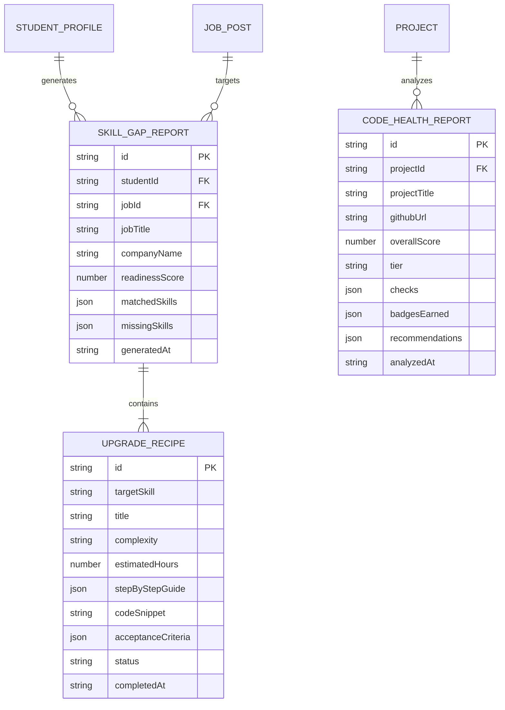

# Mô Hình Dữ Liệu: Chẩn Đoán Khoảng Cách Kỹ Năng & Kiểm Định Codebase
> **Mã đặc tả:** `SPEC-20261109-SKILL-GAP-UPGRADER`  
> **Nhánh Git:** `profilehub_v1`  
> **Tài liệu tham chiếu:** [`src/types/database.ts`](file:///C:/Users/ADMIN/Desktop/STUDY/profilehub/src/types/database.ts), [`research.md`](file:///C:/Users/ADMIN/Desktop/STUDY/docs/superpowers/specs/2026-11-09-skill-gap-and-project-upgrader/research.md)

---

## 1. Sơ Đồ Thực Thể Quan Hệ (Entity-Relationship Diagram)



---

## 2. Chi Tiết Kiểu Dữ Liệu TypeScript (`src/types/database.ts`)

```typescript
// ==========================================
// 1. Phân Loại Mức Độ Nghiêm Trọng Của Kỹ Năng
// ==========================================
export type SkillCriticality = 'critical' | 'recommended' | 'optional';
export type SkillCategory = 'backend' | 'frontend' | 'database' | 'devops' | 'testing' | 'other';
export type RecipeStatus = 'not_started' | 'in_progress' | 'completed';
export type HealthTier = 'A+ Production-Ready' | 'B Solid Junior' | 'C Needs Refactor';

// ==========================================
// 2. Kỹ Năng Đã Khớp & Kỹ Năng Còn Thiếu
// ==========================================
export interface MatchedSkillItem {
  name: string;
  source: 'cv' | 'project';
  projectTitle?: string;
}

export interface MissingSkillItem {
  name: string;
  criticality: SkillCriticality;
  category: SkillCategory;
  reason: string;
}

// ==========================================
// 3. Công Thức Nâng Cấp Đồ Án (Mini-Action Recipe)
// ==========================================
export interface ProjectUpgradeRecipe {
  id: string;
  targetSkill: string;
  title: string;
  complexity: 'Beginner' | 'Intermediate' | 'Advanced';
  estimatedHours: number;
  stepByStepGuide: string[];
  codeSnippet: string;
  acceptanceCriteria: string[];
  status: RecipeStatus;
  completedAt?: string;
}

// ==========================================
// 4. Báo Cáo Chẩn Đoán Skill Gap Tổng Thể
// ==========================================
export interface SkillGapReport {
  id: string;
  studentId: string;
  jobId: string;
  jobTitle: string;
  companyName: string;
  readinessScore: number; // 0 - 100
  matchedSkills: MatchedSkillItem[];
  missingSkills: MissingSkillItem[];
  upgradeRecipes: ProjectUpgradeRecipe[];
  generatedAt: string;
}

// ==========================================
// 5. Báo Cáo Sức Khỏe Mã Nguồn Codebase (Code Health)
// ==========================================
export interface CodeHealthCheckSummary {
  hasReadme: boolean;
  hasGitignore: boolean;
  hasTests: boolean;
  noLeakedEnv: boolean;
  hasCiCd: boolean;
  commitCadence: 'high' | 'moderate' | 'low';
}

export interface CodeHealthReport {
  id: string;
  projectId: string;
  projectTitle: string;
  githubUrl: string;
  overallScore: number; // 0 - 100
  tier: HealthTier;
  checks: CodeHealthCheckSummary;
  badgesEarned: string[]; // Ví dụ: ['Clean Code Verified', 'Security-Checked', 'Test-Ready']
  recommendations: string[];
  analyzedAt: string;
}
```

---

## 3. Khóa Lưu Trữ & Nguyên Tắc Tính Toàn Vẹn (Storage Keys & Invariants)

1. **Khóa lưu trữ `localStorage`:**
   - `profilehub_skill_gap_reports`: Mảng danh sách các `SkillGapReport`. Mỗi cặp `(studentId, jobId)` chỉ giữ báo cáo mới nhất.
   - `profilehub_code_health_reports`: Mảng danh sách các `CodeHealthReport`. Mỗi `projectId` chỉ lưu báo cáo được phân tích gần nhất.
2. **Nguyên tắc tính điểm sẵn sàng tuyển dụng (`readinessScore`):**
   - Base Score = (Số lượng matched skills / Tổng số required skills của Job) * 100.
   - Mỗi Recipe hoàn thành (`status: 'completed'`) cộng thêm điểm bù đắp vào `readinessScore` (tối đa đạt 100%).
3. **Nguyên tắc tính điểm sức khỏe codebase (`overallScore`):**
   - README có hướng dẫn cài đặt: +20 điểm.
   - Không rò rỉ `.env` và API keys: +30 điểm (Critical Security).
   - Có thư mục kiểm thử / Unit test: +25 điểm.
   - Có file `.gitignore` loại trừ node_modules: +15 điểm.
   - Có cấu hình CI/CD (`.github/workflows`): +10 điểm.
   - Tổng điểm: 0 - 100 điểm.
     - `>= 85`: `A+ Production-Ready`
     - `>= 60`: `B Solid Junior`
     - `< 60`: `C Needs Refactor`
