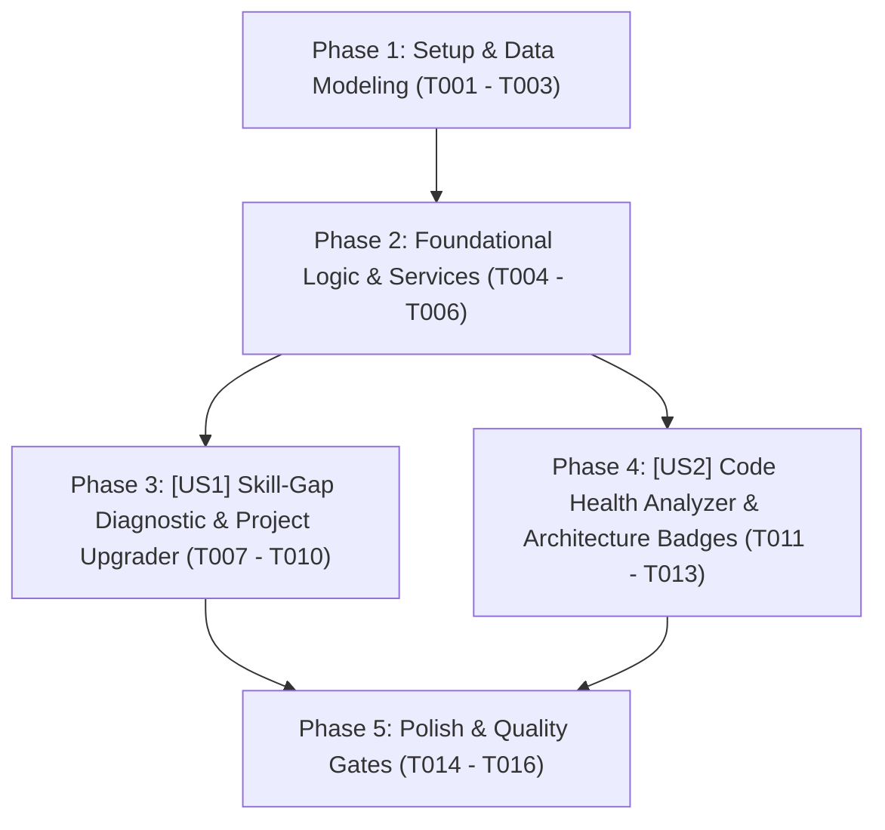

# Tasks: Chẩn Đoán Khoảng Cách Kỹ Năng & Trợ Lý Nâng Cấp Đồ Án (Skill-Gap Diagnostic & Project Upgrader)

> **Feature Name:** Chẩn Đoán Khoảng Cách Kỹ Năng, Công Thức Nâng Cấp Đồ Án & Kiểm Định Sức Khỏe Codebase (Skill-Gap Diagnostic, Project Upgrader & Code Health Analyzer)  
> **Plan Document:** [`docs/superpowers/plans/2026-11-09-skill-gap-and-project-upgrader-plan.md`](file:///C:/Users/ADMIN/Desktop/STUDY/docs/superpowers/plans/2026-11-09-skill-gap-and-project-upgrader-plan.md)  
> **Spec Directory:** [`docs/superpowers/specs/2026-11-09-skill-gap-and-project-upgrader/`](file:///C:/Users/ADMIN/Desktop/STUDY/docs/superpowers/specs/2026-11-09-skill-gap-and-project-upgrader/)  
> **Branch:** `profilehub_v1`  
> **Checklist Format Requirement:** `- [ ] [TaskID] [P?] [Story?] Description with file path`

---

## 🏛️ Dependencies & Story Execution Order

---

## Phase 1: Setup & Data Modeling

- [X] T001 Khai báo các interface và types `SkillGapReport`, `ProjectUpgradeRecipe`, `CodeHealthReport`, `SkillCriticality`, `HealthTier` trong [src/types/database.ts](file:///C:/Users/ADMIN/Desktop/STUDY/profilehub/src/types/database.ts)
- [X] T002 [P] Khởi tạo bộ dữ liệu mẫu công thức nâng cấp mã nguồn (Recipe Template Bank) cho Redis, Docker, Vitest, CI/CD, SQL Indexing trong [src/services/skillGapRecipes.ts](file:///C:/Users/ADMIN/Desktop/STUDY/profilehub/src/services/skillGapRecipes.ts)
- [X] T003 [P] Khởi tạo bộ hồ sơ tài liệu đặc tả Spec-Kit hoàn chỉnh (research.md, data-model.md, contracts/skill-gap-upgrader-api.md, quickstart.md) trong [docs/superpowers/specs/2026-11-09-skill-gap-and-project-upgrader/](file:///C:/Users/ADMIN/Desktop/STUDY/docs/superpowers/specs/2026-11-09-skill-gap-and-project-upgrader/)

---

## Phase 2: Foundational Logic & Core Services (Blocking Prerequisites)

- [X] T004 Xây dựng service `skillGapService.ts` hỗ trợ hàm `diagnoseSkillGap`, tính `readinessScore`, phân loại `matchedSkills`/`missingSkills` và lưu `localStorage` trong [src/services/skillGapService.ts](file:///C:/Users/ADMIN/Desktop/STUDY/profilehub/src/services/skillGapService.ts)
- [X] T005 [P] Xây dựng service `codeHealthService.ts` hỗ trợ hàm `analyzeCodeHealth`, chấm điểm theo 5 tiêu chí vàng (README, Gitignore, Security env, Unit Tests, CI/CD) và cấp huy hiệu trong [src/services/codeHealthService.ts](file:///C:/Users/ADMIN/Desktop/STUDY/profilehub/src/services/codeHealthService.ts)
- [X] T006 [P] Viết bộ test đơn vị tự động kiểm thử toàn diện `skillGapService.test.ts` và `codeHealthService.test.ts` trong [src/services/skillGapService.test.ts](file:///C:/Users/ADMIN/Desktop/STUDY/profilehub/src/services/skillGapService.test.ts)

---

## Phase 3: User Story 1 - Chẩn Đoán Skill-Gap & Công Thức Nâng Cấp Đồ Án (P1)

**Story Goal:** Sinh viên khi duyệt các tin tuyển dụng có thể 1-click bấm `[ ⚡ Chẩn Đoán Skill-Gap ]`, lập tức thấy điểm số tương thích, danh sách kỹ năng thiếu phân loại Critical/Recommended, và danh sách 3 công thức nâng cấp đồ án thực chiến (Recipes); khi hoàn thành, điểm sẵn sàng tự động tăng lên.  
**Independent Test Criteria:** Mở trang `/student/jobs`, chọn một Job bất kỳ và bấm `[ ⚡ Chẩn Đoán Skill-Gap ]`; modal mở ra với thanh đo `readinessScore`; tích chọn hoàn thành 1 recipe ➔ điểm số tăng ngay lập tức và dữ liệu được ghi nhớ trong `localStorage`.

- [X] T007 [P] [US1] Xây dựng component `SkillGapDiagnosticModal.tsx` hiển thị thanh đo `readinessScore`, 2 cột kỹ năng và danh sách Recipe Cards trong [src/components/student/SkillGapDiagnosticModal.tsx](file:///C:/Users/ADMIN/Desktop/STUDY/profilehub/src/components/student/SkillGapDiagnosticModal.tsx)
- [X] T008 [US1] Tích hợp nút bấm `[ ⚡ Chẩn Đoán Skill-Gap ]` và gắn state modal vào từng thẻ công việc trong [src/pages/student/StudentJobs.tsx](file:///C:/Users/ADMIN/Desktop/STUDY/profilehub/src/pages/student/StudentJobs.tsx)
- [X] T009 [US1] Kết nối logic `updateRecipeStatus` trong modal, tự động cập nhật điểm số `readinessScore` và phát hiệu ứng chúc mừng trong [src/components/student/SkillGapDiagnosticModal.tsx](file:///C:/Users/ADMIN/Desktop/STUDY/profilehub/src/components/student/SkillGapDiagnosticModal.tsx)
- [X] T010 [US1] Tích hợp nút hành động nhanh chuyển từ Modal sang Nộp hồ sơ may đo (Generate CV from JD) trong [src/components/student/SkillGapDiagnosticModal.tsx](file:///C:/Users/ADMIN/Desktop/STUDY/profilehub/src/components/student/SkillGapDiagnosticModal.tsx)

---

## Phase 4: User Story 2 - Kiểm Định Sức Khỏe Mã Nguồn & Cấp Huy Hiệu Codebase (P2)

**Story Goal:** Sinh viên trong trang Quản lý đồ án có thể 1-click bấm `[ 🔍 Kiểm Định Codebase ]` trên đồ án có liên kết GitHub để kiểm tra 5 tiêu chuẩn an toàn, nhận xếp hạng phân bậc `A+ Production-Ready` / `B Solid Junior` / `C Needs Refactor` và sao chép mã Markdown Badge nhúng vào GitHub README.  
**Independent Test Criteria:** Mở trang `/my-projects`, bấm `[ 🔍 Kiểm Định Codebase ]` trên một đồ án; modal mở ra hiển thị điểm số (ví dụ: `85/100`), danh sách checklist 5 tiêu chuẩn với icon xanh/đỏ và nút sao chép mã Markdown badge hoạt động tốt.

- [X] T011 [P] [US2] Xây dựng component `CodeHealthDiagnosticModal.tsx` hiển thị điểm số, xếp hạng phân bậc, bảng kiểm tra 5 tiêu chuẩn vàng và nút sao chép Markdown Badge trong [src/components/student/CodeHealthDiagnosticModal.tsx](file:///C:/Users/ADMIN/Desktop/STUDY/profilehub/src/components/student/CodeHealthDiagnosticModal.tsx)
- [X] T012 [US2] Tích hợp nút bấm `[ 🔍 Kiểm Định Codebase ]` vào từng thẻ đồ án trong [src/pages/student/MyProjects.tsx](file:///C:/Users/ADMIN/Desktop/STUDY/profilehub/src/pages/student/MyProjects.tsx)
- [X] T013 [US2] Hiển thị nhãn Huy hiệu Code Health (ví dụ: `A+ Production-Ready`) trực tiếp trên thẻ đồ án nếu đã có kết quả kiểm định trong [src/pages/student/MyProjects.tsx](file:///C:/Users/ADMIN/Desktop/STUDY/profilehub/src/pages/student/MyProjects.tsx)

---

## Phase 5: Polish & Quality Gates

- [X] T014 [P] Kiểm tra toàn vẹn kiểu dữ liệu tĩnh TypeScript với `npx tsc --noEmit` đạt 0 lỗi biên dịch
- [X] T015 [P] Chạy toàn bộ test suites tự động với `npx vitest run` đảm bảo 100% tests pass
- [X] T016 Đóng gói sản phẩm production với `npm run build` qua Vite bundle thành công
