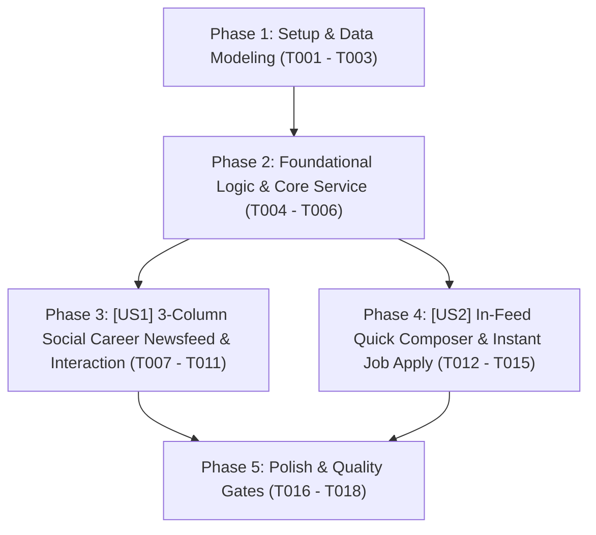

# Tasks: Mạng Xã Hội Nghề Nghiệp & Dòng Tin Tuyển Dụng Tương Tác (Social Career Community Feed)

> **Feature Name:** Mạng Xã Hội Nghề Nghiệp & Dòng Tin Tuyển Dụng Tương Tác Trên Trang Chủ (Social Career Community Feed)  
> **Plan Document:** [`docs/superpowers/plans/2026-11-09-social-career-community-feed-plan.md`](file:///C:/Users/ADMIN/Desktop/STUDY/docs/superpowers/plans/2026-11-09-social-career-community-feed-plan.md)  
> **Spec Directory:** [`docs/superpowers/specs/2026-11-09-social-career-community-feed/`](file:///C:/Users/ADMIN/Desktop/STUDY/docs/superpowers/specs/2026-11-09-social-career-community-feed/)  
> **Branch:** `profilehub_v1`  
> **Checklist Format Requirement:** `- [ ] [TaskID] [P?] [Story?] Description with file path`

---

## 🏛️ Dependencies & Story Execution Order

---

## Phase 1: Setup & Data Modeling

- [X] T001 Khai báo các interface và types `SocialPost`, `PostType`, `PostComment`, `FeedFilter`, `CreatePostParams` trong [src/types/database.ts](file:///C:/Users/ADMIN/Desktop/STUDY/profilehub/src/types/database.ts)
- [X] T002 [P] Khởi tạo kho bài viết thực tế phong phú làm dữ liệu ban đầu (`DEFAULT_SOCIAL_POSTS`) trong [src/services/socialSeedData.ts](file:///C:/Users/ADMIN/Desktop/STUDY/profilehub/src/services/socialSeedData.ts)
- [X] T003 [P] Cập nhật bộ hồ sơ tài liệu đặc tả Spec-Kit hoàn chỉnh (spec.md, data-model.md, contracts/social-feed-api.md, quickstart.md) trong [docs/superpowers/specs/2026-11-09-social-career-community-feed/](file:///C:/Users/ADMIN/Desktop/STUDY/docs/superpowers/specs/2026-11-09-social-career-community-feed/)

---

## Phase 2: Foundational Logic & Core Services (Blocking Prerequisites)

- [X] T004 Xây dựng service cốt lõi `socialFeedService.ts` hỗ trợ các hàm: `getPosts`, `createPost`, `toggleLikePost`, `toggleBookmarkPost`, `addComment`, `quickApplyJobFromPost` và đồng bộ Storage Event trong [src/services/socialFeedService.ts](file:///C:/Users/ADMIN/Desktop/STUDY/profilehub/src/services/socialFeedService.ts)
- [X] T005 [P] Viết bộ test đơn vị tự động `socialFeedService.test.ts` kiểm thử toàn diện lọc feed theo loại tin, tăng giảm like, bình luận và ứng tuyển 1-click trong [src/services/socialFeedService.test.ts](file:///C:/Users/ADMIN/Desktop/STUDY/profilehub/src/services/socialFeedService.test.ts)
- [X] T006 [P] Tích hợp cơ chế liên kết đẩy hồ sơ ứng tuyển từ bài đăng mạng xã hội vào Pipeline tuyển dụng qua `pipelineSync.ts` trong [src/utils/pipelineSync.ts](file:///C:/Users/ADMIN/Desktop/STUDY/profilehub/src/utils/pipelineSync.ts)

---

## Phase 3: User Story 1 - 3-Column Social Career Newsfeed & Interaction (P1 - Core Experience)

**Story Goal:** Người dùng (cả khách vãng lai lẫn thành viên đã đăng nhập) khi vào trang chủ `HomePage.tsx` sẽ thấy ngay một mạng xã hội việc làm sôi động theo bố cục 3 cột: Cột trái xem thông tin cá nhân & danh mục lọc; Cột giữa lướt dòng bài viết với các tin tuyển dụng có lương rõ ràng, đồ án bảo chứng và tin chúc mừng nhận việc; Cột phải xem danh sách việc làm hot; bấm like, lưu bài và bình luận ngay lập tức.  
**Independent Test Criteria:** Mở trang chủ `/` ➔ Dòng tin 3 cột hiển thị đầy đủ; bấm nút `[ ❤️ Thích ]` ➔ Số lượt thích tăng lên và đổi màu đỏ; chuyển tab `[ 💼 Việc Làm ]` ➔ Dòng tin chỉ lọc các bài tuyển dụng.

- [X] T007 [P] [US1] Xây dựng component Cột Trái `SocialSidebarLeft.tsx` hiển thị Mini Profile, điểm bảo chứng và menu bộ lọc loại bài viết trong [src/components/social/SocialSidebarLeft.tsx](file:///C:/Users/ADMIN/Desktop/STUDY/profilehub/src/components/social/SocialSidebarLeft.tsx)
- [X] T008 [P] [US1] Xây dựng component Cột Phải `SocialSidebarRight.tsx` hiển thị widget Việc Làm Hot nhất tuần và Top Đồ Án Điểm Cao trong [src/components/social/SocialSidebarRight.tsx](file:///C:/Users/ADMIN/Desktop/STUDY/profilehub/src/components/social/SocialSidebarRight.tsx)
- [X] T009 [US1] Xây dựng component thẻ bài viết đa năng `PostCard.tsx` hỗ trợ render bài Tuyển dụng, bài Đồ án, bài Vinh danh và khung bình luận trong [src/components/social/PostCard.tsx](file:///C:/Users/ADMIN/Desktop/STUDY/profilehub/src/components/social/PostCard.tsx)
- [X] T010 [US1] Tích hợp thanh tab chuyển đổi bộ lọc (`all`, `job_hiring`, `project_showcase`, `tech_discussion`) tại đầu dòng tin trong [src/pages/public/HomePage.tsx](file:///C:/Users/ADMIN/Desktop/STUDY/profilehub/src/pages/public/HomePage.tsx)
- [X] T011 [US1] Tái thiết kế toàn bộ trang chủ `HomePage.tsx` sang giao diện Mạng Xã Hội Việc Làm 3 Cột sống động trong [src/pages/public/HomePage.tsx](file:///C:/Users/ADMIN/Desktop/STUDY/profilehub/src/pages/public/HomePage.tsx)

---

## Phase 4: User Story 2 - In-Feed Quick Composer & Instant Job Apply (P2)

**Story Goal:** Thành viên có thể trực tiếp soạn bài chia sẻ kinh nghiệm hoặc khoe đồ án mới ngay tại hộp đăng bài ở đầu dòng tin; Ứng viên khi thấy bài đăng tuyển dụng phù hợp có thể bấm `[ 🚀 Ứng Tuyển Nhanh 1-Click ]` ngay trên bài viết để gửi hồ sơ vào Pipeline của nhà tuyển dụng mà không cần rời trang.  
**Independent Test Criteria:** Nhập nội dung vào hộp đăng bài và bấm `[ Đăng Bài ]` ➔ Bài viết xuất hiện ngay trên đầu feed; Bấm `[ 🚀 Ứng Tuyển Nhanh ]` trên bài tuyển dụng ➔ Hiển thị thông báo ứng tuyển thành công kèm mã hồ sơ bảo chứng.

- [X] T012 [P] [US2] Xây dựng component hộp soạn bài nhanh `CreatePostBox.tsx` cho phép chọn loại bài viết, gõ nội dung, gắn tags công nghệ và link demo trong [src/components/social/CreatePostBox.tsx](file:///C:/Users/ADMIN/Desktop/STUDY/profilehub/src/components/social/CreatePostBox.tsx)
- [X] T013 [US2] Tích hợp modal ứng tuyển nhanh 1-click `QuickApplyFromPostModal.tsx` xác nhận nộp CV và đồ án bảo chứng trong [src/components/social/QuickApplyFromPostModal.tsx](file:///C:/Users/ADMIN/Desktop/STUDY/profilehub/src/components/social/QuickApplyFromPostModal.tsx)
- [X] T014 [US2] Kết nối nút `[ 🚀 Ứng Tuyển Nhanh 1-Click ]` trên `PostCard.tsx` để kích hoạt nộp đơn và đồng bộ dữ liệu vào `CandidatePipeline.tsx` trong [src/components/social/PostCard.tsx](file:///C:/Users/ADMIN/Desktop/STUDY/profilehub/src/components/social/PostCard.tsx)
- [X] T015 [US2] Hỗ trợ nút `[ 🎯 Săn Ứng Viên / Mời Phỏng Vấn ]` trên các bài viết đồ án sinh viên để NTD gửi lời mời trực tiếp trong [src/components/social/PostCard.tsx](file:///C:/Users/ADMIN/Desktop/STUDY/profilehub/src/components/social/PostCard.tsx)

---

## Phase 5: Polish & Quality Gates

- [X] T016 [P] Kiểm tra toàn vẹn kiểu dữ liệu tĩnh TypeScript với `npx tsc --noEmit` đạt 0 lỗi biên dịch
- [X] T017 [P] Chạy toàn bộ test suites tự động với `npx vitest run` đảm bảo 100% tests pass
- [X] T018 Đóng gói sản phẩm production với `npm run build` qua Vite bundle thành công
