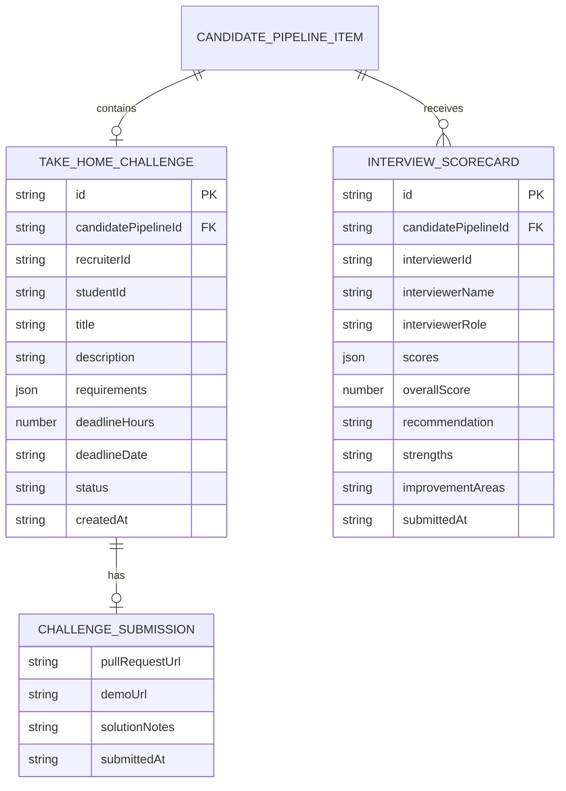

# Mô Hình Dữ Liệu: Thử Thách Kỹ Thuật & Bảng Chấm Điểm Phỏng Vấn Chuẩn Hóa
> **Mã đặc tả:** `SPEC-20261109-CHALLENGE-SCORECARD`  
> **Nhánh Git:** `profilehub_v1`  
> **Tài liệu tham chiếu:** [`src/types/database.ts`](file:///C:/Users/ADMIN/Desktop/STUDY/profilehub/src/types/database.ts), [`research.md`](file:///C:/Users/ADMIN/Desktop/STUDY/docs/superpowers/specs/2026-11-09-take-home-challenge-and-collaborative-scorecard/research.md)

---

## 1. Sơ Đồ Thực Thể Quan Hệ (Entity-Relationship Diagram)



---

## 2. Chi Tiết Kiểu Dữ Liệu TypeScript (`src/types/database.ts`)

```typescript
// ==========================================
// 1. Vòng Đời & Phân Loại Thử Thách Kỹ Thuật
// ==========================================
export type ChallengeStatus = 'issued' | 'submitted' | 'evaluated' | 'expired';

export interface ChallengeSubmission {
  pullRequestUrl: string;
  demoUrl?: string;
  solutionNotes: string;
  submittedAt: string;
}

export interface ChallengeEvaluation {
  score: number; // 0 - 100
  feedback: string;
  evaluatedBy: string;
  evaluatedAt: string;
}

export interface TakeHomeChallenge {
  id: string;
  candidatePipelineId: string;
  recruiterId: string;
  studentId: string;
  jobId: string;
  title: string;
  description: string;
  requirements: string[];
  deadlineHours: number; // 48, 72, 120
  deadlineDate: string; // ISO string
  status: ChallengeStatus;
  submission?: ChallengeSubmission;
  evaluation?: ChallengeEvaluation;
  createdAt: string;
}

// ==========================================
// 2. Bảng Chấm Điểm Phỏng Vấn (Scorecard)
// ==========================================
export type ScorecardRecommendation = 'strong_hire' | 'hire' | 'neutral' | 'no_hire';

export interface ScorecardCriteriaScores {
  architecture: number; // 1 - 5 sao
  codeDefense: number;  // 1 - 5 sao
  debugging: number;    // 1 - 5 sao
  communication: number;// 1 - 5 sao
  cultureFit: number;   // 1 - 5 sao
}

export interface InterviewScorecard {
  id: string;
  candidatePipelineId: string;
  interviewerId: string;
  interviewerName: string;
  interviewerRole: string; // 'Tech Lead' | 'HR Specialist' | 'Engineering Manager'
  scores: ScorecardCriteriaScores;
  overallScore: number; // 0 - 100 (tính bình quân trọng số các tiêu chí)
  recommendation: ScorecardRecommendation;
  strengths: string;
  improvementAreas: string;
  submittedAt: string;
}
```

---

## 3. Khóa Lưu Trữ & Nguyên Tắc Tính Toàn Vẹn (Storage Keys & Invariants)

1. **Khóa lưu trữ `localStorage`:**
   - Dữ liệu `take_home_challenge` và `scorecards` được gắn trực tiếp vào từng phần tử `CandidatePipelineItem` trong `profilehub_shared_pipeline`.
   - Cài đặt tùy chọn `profilehub_blind_screening_mode: boolean` ghi nhớ trạng thái bật/tắt chế độ sàng lọc ẩn danh của NTD.
2. **Quy tắc tính điểm Scorecard:**
   - Điểm số thang 1-5 được chuẩn hóa ra thang 100:  
     $$\text{OverallScore} = \frac{\text{architecture} + \text{codeDefense} + \text{debugging} + \text{communication} + \text{cultureFit}}{25} \times 100$$
   - Khi có nhiều thành viên trong hội đồng chấm điểm, điểm của ứng viên là trung bình cộng của các Scorecards.
3. **Quy tắc Ẩn Danh (Blind Screening Invariant):**
   - Mã ẩn danh được sinh theo công thức bất biến:  
     `Ứng viên #DEV-` + hash rút gọn 4 ký tự cuối của `candidate.student.id`.
   - Khi bật Blind Screening, giao diện che toàn bộ ảnh đại diện, email, số điện thoại, và tên trường học để người xem tập trung 100% vào chất lượng kỹ thuật.
