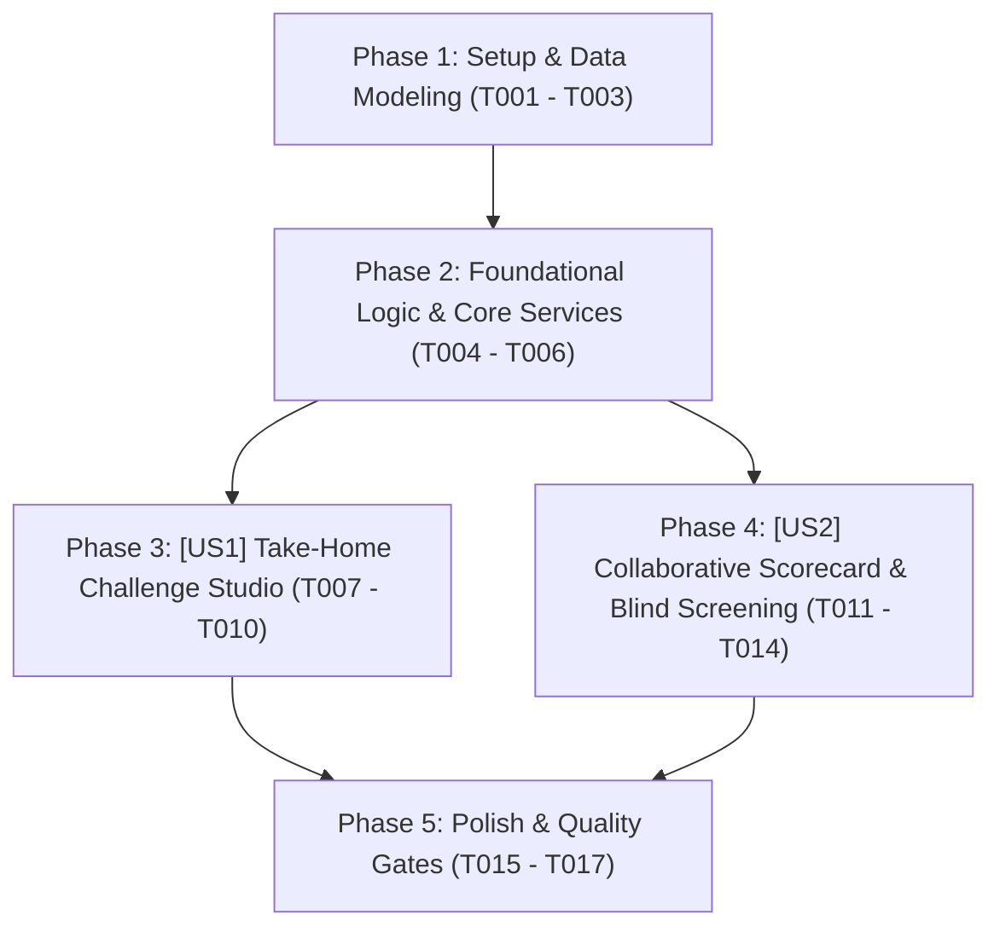

# Tasks: Thử Thách Kỹ Thuật Thực Chiến & Bảng Chấm Điểm Phỏng Vấn Chuẩn Hóa (Challenge Studio, Scorecard & Blind Screening)

> **Feature Name:** Thử Thách Kỹ Thuật Gắn Đồ Án, Bảng Chấm Điểm Phỏng Vấn Chuẩn Hóa & Chế Độ Sàng Lọc Ẩn Danh (Evidence-Based Take-Home Challenge Studio, Collaborative Scorecard & Blind Screening)  
> **Plan Document:** [`docs/superpowers/plans/2026-11-09-take-home-challenge-and-collaborative-scorecard-plan.md`](file:///C:/Users/ADMIN/Desktop/STUDY/docs/superpowers/plans/2026-11-09-take-home-challenge-and-collaborative-scorecard-plan.md)  
> **Spec Directory:** [`docs/superpowers/specs/2026-11-09-take-home-challenge-and-collaborative-scorecard/`](file:///C:/Users/ADMIN/Desktop/STUDY/docs/superpowers/specs/2026-11-09-take-home-challenge-and-collaborative-scorecard/)  
> **Branch:** `profilehub_v1`  
> **Checklist Format Requirement:** `- [ ] [TaskID] [P?] [Story?] Description with file path`

---

## 🏛️ Dependencies & Story Execution Order

---

## Phase 1: Setup & Data Modeling

- [X] T001 Khai báo các interface và types `TakeHomeChallenge`, `ChallengeSubmission`, `ChallengeEvaluation`, `InterviewScorecard`, `ScorecardCriteriaScores`, `ScorecardRecommendation` trong [src/types/database.ts](file:///C:/Users/ADMIN/Desktop/STUDY/profilehub/src/types/database.ts)
- [X] T002 [P] Mở rộng union types của `PipelineBroadcastEvent` hỗ trợ các sự kiện `'CHALLENGE_ISSUED'`, `'CHALLENGE_SUBMITTED'`, `'SCORECARD_RECORDED'` trong [src/utils/pipelineSync.ts](file:///C:/Users/ADMIN/Desktop/STUDY/profilehub/src/utils/pipelineSync.ts)
- [X] T003 [P] Khởi tạo bộ hồ sơ tài liệu đặc tả Spec-Kit hoàn chỉnh (research.md, data-model.md, contracts/challenge-scorecard-api.md, quickstart.md) trong [docs/superpowers/specs/2026-11-09-take-home-challenge-and-collaborative-scorecard/](file:///C:/Users/ADMIN/Desktop/STUDY/docs/superpowers/specs/2026-11-09-take-home-challenge-and-collaborative-scorecard/)

---

## Phase 2: Foundational Logic & Core Services (Blocking Prerequisites)

- [X] T004 Xây dựng service `challengeScorecardService.ts` hỗ trợ hàm `issueChallenge`, `submitChallengeSolution`, `evaluateChallenge`, `submitScorecard`, `calculateConsensus`, `getBlindCandidateInfo` trong [src/services/challengeScorecardService.ts](file:///C:/Users/ADMIN/Desktop/STUDY/profilehub/src/services/challengeScorecardService.ts)
- [X] T005 [P] Khởi tạo ngân hàng mẫu đề bài thử thách kỹ thuật (Challenge Template Bank) cho Backend, Frontend, DevOps trong [src/services/challengeTemplates.ts](file:///C:/Users/ADMIN/Desktop/STUDY/profilehub/src/services/challengeTemplates.ts)
- [X] T006 [P] Viết bộ test đơn vị tự động kiểm thử toàn diện `challengeScorecardService.test.ts` trong [src/services/challengeScorecardService.test.ts](file:///C:/Users/ADMIN/Desktop/STUDY/profilehub/src/services/challengeScorecardService.test.ts)

---

## Phase 3: User Story 1 - Take-Home Challenge Studio (Giao & Nộp Thử Thách Kỹ Thuật Gắn Đồ Án) (P1)

**Story Goal:** Nhà tuyển dụng có thể 1-click giao thử thách kỹ thuật gắn liền với repo đồ án của ứng viên với hạn chót 48h/72h; sinh viên nhận thông báo và nộp link GitHub Pull Request; thẻ Kanban tự động cập nhật trạng thái thời gian thực.  
**Independent Test Criteria:** Mở trang `/recruiter/pipeline`, bấm `[ 📝 Giao Thử Thách ]` trên thẻ ứng viên cột Screening, chọn template và gửi; thẻ ứng viên xuất hiện huy hiệu `⏱️ Thử thách 48h (Đang làm)`; mở modal nộp bài của ứng viên, nhập link GitHub PR và bấm gửi ➔ thẻ lập tức chuyển sang trạng thái `✅ Đã nộp PR`.

- [X] T007 [P] [US1] Xây dựng component `IssueChallengeModal.tsx` cho phép NTD chọn template bài toán, đặt deadline (48h/72h) và gửi đến ứng viên trong [src/components/recruiter/IssueChallengeModal.tsx](file:///C:/Users/ADMIN/Desktop/STUDY/profilehub/src/components/recruiter/IssueChallengeModal.tsx)
- [X] T008 [P] [US1] Xây dựng component `SubmitChallengeModal.tsx` cho phép sinh viên xem đề bài, theo dõi đồng hồ đếm ngược và nộp link GitHub PR trong [src/components/student/SubmitChallengeModal.tsx](file:///C:/Users/ADMIN/Desktop/STUDY/profilehub/src/components/student/SubmitChallengeModal.tsx)
- [X] T009 [US1] Tích hợp nút bấm `[ 📝 Giao Thử Thách ]` và huy hiệu trạng thái thử thách (`⏱️ Đang làm`, `✅ Đã nộp PR`) vào từng thẻ ứng viên trong [src/pages/recruiter/CandidatePipeline.tsx](file:///C:/Users/ADMIN/Desktop/STUDY/profilehub/src/pages/recruiter/CandidatePipeline.tsx)
- [X] T010 [US1] Tích hợp nút `[ 🚀 Nộp Bài Giải Thử Thách ]` vào thẻ ứng tuyển của sinh viên trong [src/components/student/ApplicationKanbanBoard.tsx](file:///C:/Users/ADMIN/Desktop/STUDY/profilehub/src/components/student/ApplicationKanbanBoard.tsx)

---

## Phase 4: User Story 2 - Collaborative Scorecard & Blind Screening (Chấm Điểm Phỏng Vấn & Sàng Lọc Ẩn Danh) (P2)

**Story Goal:** Người phỏng vấn có thể chấm điểm phỏng vấn theo 5 tiêu chuẩn vàng với giao diện sao, đưa ra đề xuất Strong Hire/Hire và xem điểm đồng thuận; công tắc Blind Screening cho phép ẩn danh tính để sàng lọc khách quan dựa trên năng lực thực chất.  
**Independent Test Criteria:** Mở trang `/recruiter/pipeline`, bấm `[ 📊 Chấm Điểm Scorecard ]` tại cột Phỏng vấn, chấm 5 tiêu chí (4.5/5 sao) và chọn `Strong Hire` ➔ thẻ ứng viên hiển thị huy hiệu `🌟 Scorecard: 90/100 (Strong Hire)`; gạt công tắc `[ 🕶️ Chế Độ Ẩn Danh ]` ➔ tên và avatar chuyển thành mã hóa `Ứng viên #DEV-XXXX`, giữ nguyên điểm số kỹ thuật.

- [X] T011 [P] [US2] Xây dựng component `InterviewScorecardModal.tsx` hỗ trợ giao diện đánh giá 5 sao cho 5 tiêu chí vàng và chọn khuyến nghị tuyển dụng trong [src/components/recruiter/InterviewScorecardModal.tsx](file:///C:/Users/ADMIN/Desktop/STUDY/profilehub/src/components/recruiter/InterviewScorecardModal.tsx)
- [X] T012 [US2] Tích hợp nút `[ 📊 Bảng Chấm Điểm Scorecard ]` và hiển thị huy hiệu Consensus Score trực tiếp trên thẻ ứng viên cột Phỏng vấn trong [src/pages/recruiter/CandidatePipeline.tsx](file:///C:/Users/ADMIN/Desktop/STUDY/profilehub/src/pages/recruiter/CandidatePipeline.tsx)
- [X] T013 [US2] Xây dựng công tắc `[ 🕶️ Chế Độ Ẩn Danh (Blind Screening) ]` che avatar, tên trường, email và mã hóa tên ứng viên trong [src/pages/recruiter/CandidatePipeline.tsx](file:///C:/Users/ADMIN/Desktop/STUDY/profilehub/src/pages/recruiter/CandidatePipeline.tsx)
- [X] T014 [US2] Áp dụng chế độ Blind Screening vào trang tìm kiếm ứng viên [src/pages/recruiter/CandidateSearch.tsx](file:///C:/Users/ADMIN/Desktop/STUDY/profilehub/src/pages/recruiter/CandidateSearch.tsx)

---

## Phase 5: Polish & Quality Gates

- [X] T015 [P] Kiểm tra toàn vẹn kiểu dữ liệu tĩnh TypeScript với `npx tsc --noEmit` đạt 0 lỗi biên dịch
- [X] T016 [P] Chạy toàn bộ test suites tự động với `npx vitest run` đảm bảo 100% tests pass
- [X] T017 Đóng gói sản phẩm production với `npm run build` qua Vite bundle thành công
