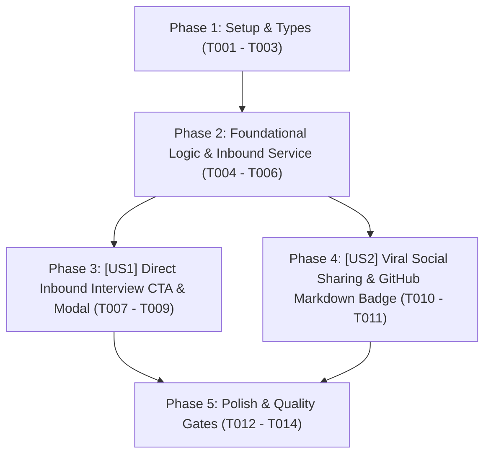

# Tasks: Cổng Lan Tỏa Hồ Sơ & Mời Phỏng Vấn Trực Tiếp Từ Public Verification (Viral Portfolio & Direct Interview Gateway)

> **Feature Name:** Cổng Lan Tỏa Hồ Sơ & Mời Phỏng Vấn Trực Tiếp: Direct Interview Invite CTA, Inbound Pipeline Sync & Viral Social Sharing (Viral Portfolio & Direct Interview Gateway)  
> **Plan Document:** [`docs/superpowers/plans/2026-11-09-viral-portfolio-interview-gateway-plan.md`](file:///C:/Users/ADMIN/Desktop/STUDY/docs/superpowers/plans/2026-11-09-viral-portfolio-interview-gateway-plan.md)  
> **Spec Directory:** [`docs/superpowers/specs/2026-11-09-viral-portfolio-interview-gateway/`](file:///C:/Users/ADMIN/Desktop/STUDY/docs/superpowers/specs/2026-11-09-viral-portfolio-interview-gateway/)  
> **Branch:** `profilehub_v1`  
> **Checklist Format Requirement:** `- [ ] [TaskID] [P?] [Story?] Description with file path`

---

## 🏛️ Dependencies & Story Execution Order

---

## Phase 1: Setup & Data Modeling

- [X] T001 Khai báo interface `InboundInterviewInvite` mở rộng trong [src/types/database.ts](file:///C:/Users/ADMIN/Desktop/STUDY/profilehub/src/types/database.ts)
- [X] T002 [P] Mở rộng union types của `PipelineBroadcastEvent` hỗ trợ sự kiện Inbound Invite trong [src/utils/pipelineSync.ts](file:///C:/Users/ADMIN/Desktop/STUDY/profilehub/src/utils/pipelineSync.ts)
- [X] T003 [P] Khởi tạo bộ hồ sơ tài liệu đặc tả Spec-Kit hoàn chỉnh (research.md, data-model.md, contracts/viral-gateway-api.md, quickstart.md) trong [docs/superpowers/specs/2026-11-09-viral-portfolio-interview-gateway/](file:///C:/Users/ADMIN/Desktop/STUDY/docs/superpowers/specs/2026-11-09-viral-portfolio-interview-gateway/)

---

## Phase 2: Foundational Logic & Inbound Service Layer (Blocking Prerequisites)

- [X] T004 Xây dựng hàm `submitInboundInterviewInvite` nạp hồ sơ vào `CandidatePipelineItem` (kèm tag `[Inbound từ Cổng Bảo Chứng]`) và phát thông điệp broadcast `INTERVIEW_SCHEDULED` trong [src/utils/pipelineSync.ts](file:///C:/Users/ADMIN/Desktop/STUDY/profilehub/src/utils/pipelineSync.ts)
- [X] T005 [P] Xây dựng helper `getPublicShareUrls` tạo link chia sẻ LinkedIn và đoạn mã Shields.io Markdown badge cho GitHub `README.md` trong [src/services/verificationService.ts](file:///C:/Users/ADMIN/Desktop/STUDY/profilehub/src/services/verificationService.ts)
- [X] T006 Bổ sung bộ test đơn vị tự động kiểm thử luồng `submitInboundInterviewInvite` và `getPublicShareUrls` trong [src/utils/pipelineSync.test.ts](file:///C:/Users/ADMIN/Desktop/STUDY/profilehub/src/utils/pipelineSync.test.ts)

---

## Phase 3: User Story 1 - Direct Inbound Interview CTA & Modal (P1 - Mời Phỏng Vấn Trực Tiếp)

**Story Goal:** Nhà tuyển dụng khi quét mã QR trên CV hoặc xem đồ án trên web có thể 1-click gửi lời mời phỏng vấn trực tiếp kèm ngày giờ và link Google Meet, tự động đẩy hồ sơ vào pipeline và kích hoạt thông báo đẩy đến sinh viên.  
**Independent Test Criteria:** Mở trang `/verify/:code`, hiển thị nút `[ 🏢 Mời Phỏng Vấn Trực Tiếp ]` với style gradient tím nổi bật; bấm vào mở modal nhập thông tin công ty, ngày hẹn, link Meet; bấm gửi hiển thị toast thành công; tab của sinh viên lập tức nhận thông báo đẩy Web Notification và chấm đỏ chuông nhấp nháy.

- [X] T007 [US1] Xây dựng component `DirectInterviewInviteModal.tsx` hỗ trợ form nhập công ty, email, chức danh, ngày giờ hẹn, link Meet và lời nhắn trong [src/components/public/DirectInterviewInviteModal.tsx](file:///C:/Users/ADMIN/Desktop/STUDY/profilehub/src/components/public/DirectInterviewInviteModal.tsx)
- [X] T008 [US1] Tích hợp nút bấm `[ 🏢 Mời Phỏng Vấn Trực Tiếp ]` và state quản lý modal vào [src/pages/public/PublicVerificationView.tsx](file:///C:/Users/ADMIN/Desktop/STUDY/profilehub/src/pages/public/PublicVerificationView.tsx)
- [X] T009 [US1] Kết nối submit modal với `submitInboundInterviewInvite`, hiển thị toast phản hồi và đóng modal trong [src/pages/public/PublicVerificationView.tsx](file:///C:/Users/ADMIN/Desktop/STUDY/profilehub/src/pages/public/PublicVerificationView.tsx)

---

## Phase 4: User Story 2 - Viral Social Sharing & GitHub Markdown Badge (P2 - Lan Tỏa Đồ Án)

**Story Goal:** Sinh viên dễ dàng khoe thành tích đồ án đã được bảo chứng lên LinkedIn (với bài viết mẫu soạn sẵn) hoặc sao chép mã Markdown Badge dán vào `README.md` trên GitHub cá nhân.  
**Independent Test Criteria:** Bấm nút `[ 🔗 Lan Tỏa & Khoe Đồ Án ]` trên `/verify/:code`; modal mở ra có tab sao chép mã Markdown Badge (đúng định dạng Shields.io dẫn về link verify) và nút mở cửa sổ chia sẻ LinkedIn kèm tiêu đề đồ án.

- [X] T010 [P] [US2] Xây dựng component `ViralShareBadgeModal.tsx` hỗ trợ sao chép link rút gọn, mã Markdown GitHub Badge và nút mở popup LinkedIn Share trong [src/components/public/ViralShareBadgeModal.tsx](file:///C:/Users/ADMIN/Desktop/STUDY/profilehub/src/components/public/ViralShareBadgeModal.tsx)
- [X] T011 [US2] Tích hợp nút bấm `[ 🔗 Lan Tỏa & Khoe Đồ Án ]` và modal tương ứng vào [src/pages/public/PublicVerificationView.tsx](file:///C:/Users/ADMIN/Desktop/STUDY/profilehub/src/pages/public/PublicVerificationView.tsx)

---

## Phase 5: Polish & Quality Gates

- [X] T012 [P] Kiểm tra toàn vẹn kiểu dữ liệu tĩnh TypeScript với `npx tsc --noEmit` đạt 0 lỗi biên dịch
- [X] T013 [P] Chạy toàn bộ test suites tự động với `npx vitest run` đảm bảo 100% tests pass
- [X] T014 Đóng gói sản phẩm production với `npm run build` qua Vite bundle thành công
