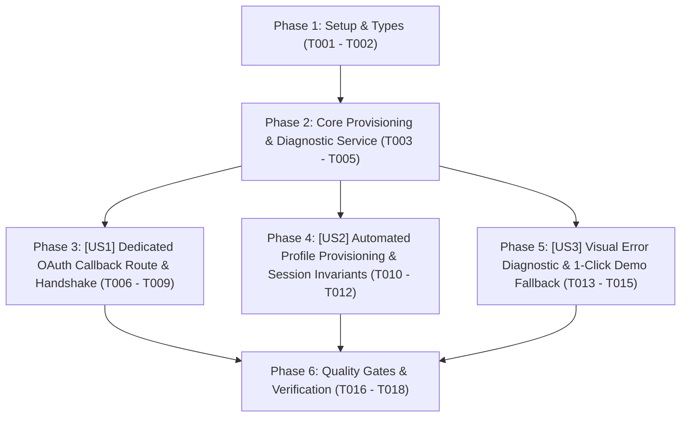

# Tasks: Cơ Chế Đăng Ký / Đăng Nhập Google & OAuth Bền Vững, Tự Động Khởi Tạo Hồ Sơ & Chẩn Đoán Lỗi Trực Quan (Google & Social OAuth Resilience, Auto-Provisioning & Diagnostic Flow)

> **Feature Name:** Google & Social OAuth Resilience, Auto-Provisioning & Diagnostic Flow  
> **Plan Document:** [`docs/superpowers/specs/2026-11-11-google-oauth-resilience-and-auto-provisioning/plan.md`](file:///C:/Users/ADMIN/Desktop/STUDY/docs/superpowers/specs/2026-11-11-google-oauth-resilience-and-auto-provisioning/plan.md)  
> **Spec Directory:** [`docs/superpowers/specs/2026-11-11-google-oauth-resilience-and-auto-provisioning/`](file:///C:/Users/ADMIN/Desktop/STUDY/docs/superpowers/specs/2026-11-11-google-oauth-resilience-and-auto-provisioning/)  
> **Branch:** `profilehub_v1`  
> **Checklist Format Requirement:** `- [ ] [TaskID] [P?] [Story?] Description with file path`

---

## 🏛️ Dependencies & Story Execution Order

---

## Phase 1: Setup & Types

- [X] T001 Khai báo interface `OAuthRawMetadata`, `OAuthDiagnosticInfo`, `ProvisioningResult` trong [src/types/database.ts](file:///C:/Users/ADMIN/Desktop/STUDY/profilehub/src/types/database.ts)
- [X] T002 [P] Khởi tạo tệp chứa các mã lỗi chuẩn của Supabase và Google OAuth trong [src/services/oauthErrorCatalog.ts](file:///C:/Users/ADMIN/Desktop/STUDY/profilehub/src/services/oauthErrorCatalog.ts)

---

## Phase 2: Foundational Logic & Core Service (TDD)

- [X] T003 [P] Viết bộ kiểm thử đơn vị tự động `oauthProvisioningService.test.ts` kiểm thử việc phân tích lỗi URL, trích xuất họ tên từ Google metadata và logic tạo hồ sơ lũy thừa (Idempotency) trong [src/services/oauthProvisioningService.test.ts](file:///C:/Users/ADMIN/Desktop/STUDY/profilehub/src/services/oauthProvisioningService.test.ts)
- [X] T004 [P] Xây dựng service `oauthProvisioningService.ts` chứa hàm `parseOAuthErrorFromUrl` phân tích search/hash params và trả về `OAuthDiagnosticInfo` trong [src/services/oauthProvisioningService.ts](file:///C:/Users/ADMIN/Desktop/STUDY/profilehub/src/services/oauthProvisioningService.ts)
- [X] T005 [P] Xây dựng hàm `provisionOAuthUserProfile` trong `oauthProvisioningService.ts` thực hiện upsert an toàn vào `public.users` và `public.student_profiles` trong [src/services/oauthProvisioningService.ts](file:///C:/Users/ADMIN/Desktop/STUDY/profilehub/src/services/oauthProvisioningService.ts)

---

## Phase 3: User Story 1 - Dedicated OAuth Callback Route & Handshake (P1)

**Story Goal:** Người dùng sau khi đăng nhập trên Google sẽ được redirect về trang tiếp nhận chuyên dụng `/auth/callback` thay vì bị redirect thẳng vào `/dashboard`, giải quyết triệt để xung đột race-condition giữa việc parse access token và kiểm tra quyền trong Protected Route.  
**Independent Test Criteria:** Truy cập `/auth/callback#access_token=...` ➔ trang hiển thị spinner đồng bộ mượt mà, chờ session xác nhận thành công và tự động đẩy người dùng vào đúng Dashboard theo vai trò mà không bao giờ bị đá ngược về `/login`.

- [X] T006 [P] [US1] Xây dựng trang component `AuthCallback.tsx` tiếp nhận URL hash/code, lắng nghe `onAuthStateChange` và thực hiện handshake an toàn trong [src/pages/auth/AuthCallback.tsx](file:///C:/Users/ADMIN/Desktop/STUDY/profilehub/src/pages/auth/AuthCallback.tsx)
- [X] T007 [US1] Đăng ký tuyến đường công khai `<Route path="/auth/callback" element={<AuthCallback />} />` trong [src/App.tsx](file:///C:/Users/ADMIN/Desktop/STUDY/profilehub/src/App.tsx)
- [X] T008 [P] [US1] Cập nhật tham số `redirectTo` của Google và GitHub trong [src/pages/auth/Register.tsx](file:///C:/Users/ADMIN/Desktop/STUDY/profilehub/src/pages/auth/Register.tsx) trỏ về `${window.location.origin}/auth/callback`
- [X] T009 [P] [US1] Cập nhật tham số `redirectTo` của Google và GitHub trong [src/pages/auth/Login.tsx](file:///C:/Users/ADMIN/Desktop/STUDY/profilehub/src/pages/auth/Login.tsx) trỏ về `${window.location.origin}/auth/callback`

---

## Phase 4: User Story 2 - Automated User & Student Profile Provisioning (P1)

**Story Goal:** Tài khoản mới đăng ký lần đầu qua Google/GitHub OAuth được tự động cấp phát tài khoản trong `public.users` và hồ sơ sinh viên trong `public.student_profiles`, giữ nguyên avatar và họ tên lấy từ Google, tránh tình trạng tài khoản "rỗng" sau khi đăng nhập.  
**Independent Test Criteria:** Đăng nhập tài khoản Google mới tinh ➔ vào Dashboard thấy ngay tên hiển thị và avatar chính xác từ tài khoản Google; truy vấn bảng `student_profiles` có đầy đủ thông tin `is_open_to_work = true`.

- [X] T010 [US2] Tích hợp gọi `provisionOAuthUserProfile` ngay bên trong `AuthCallback.tsx` trước khi điều hướng người dùng vào Dashboard đích tại [src/pages/auth/AuthCallback.tsx](file:///C:/Users/ADMIN/Desktop/STUDY/profilehub/src/pages/auth/AuthCallback.tsx)
- [X] T011 [US2] Bổ sung cơ chế auto-provisioning kiểm tra dự phòng (Self-healing Fallback) trong `fetchUserRole` của [src/context/AuthProvider.tsx](file:///C:/Users/ADMIN/Desktop/STUDY/profilehub/src/context/AuthProvider.tsx) khi user đã xác thực nhưng bảng `public.users` chưa có bản ghi
- [X] T012 [P] [US2] Viết kiểm thử tích hợp mô phỏng luồng đăng ký Google OAuth mới và kiểm tra việc tự động nạp dữ liệu vào `student_profiles` trong [src/services/oauthProvisioningService.test.ts](file:///C:/Users/ADMIN/Desktop/STUDY/profilehub/src/services/oauthProvisioningService.test.ts)

---

## Phase 5: User Story 3 - Visual Error Diagnostic & 1-Click Demo Fallback (P2)

**Story Goal:** Khi Google hoặc Supabase trả về lỗi (ví dụ chưa Publish App, sai Redirect URI, hoặc người dùng hủy), hệ thống không bị trắng trang mà hiển thị Card chẩn đoán lỗi trực quan với hướng dẫn cụ thể và nút "Trải nghiệm ngay chế độ Demo 1-Click".  
**Independent Test Criteria:** Truy cập `/auth/callback?error=access_denied&error_description=User+cancelled` ➔ hiển thị bảng thông báo lỗi màu đỏ/cam rõ ràng, bấm nút *"Trải nghiệm Demo"* lập tức kích hoạt tài khoản sinh viên mẫu và vào Dashboard thành công.

- [X] T013 [P] [US3] Xây dựng UI component `OAuthDiagnosticCard.tsx` hiển thị mã lỗi, nguyên nhân chi tiết và các bước khắc phục trong [src/components/auth/OAuthDiagnosticCard.tsx](file:///C:/Users/ADMIN/Desktop/STUDY/profilehub/src/components/auth/OAuthDiagnosticCard.tsx)
- [X] T014 [US3] Nhúng `OAuthDiagnosticCard` vào `AuthCallback.tsx` khi phát hiện URL chứa tham số lỗi trong [src/pages/auth/AuthCallback.tsx](file:///C:/Users/ADMIN/Desktop/STUDY/profilehub/src/pages/auth/AuthCallback.tsx)
- [X] T015 [US3] Thêm nút hành động nhanh *"Trải nghiệm ngay bản Demo"* kích hoạt `profilehub_demo_mode = true` trong [src/components/auth/OAuthDiagnosticCard.tsx](file:///C:/Users/ADMIN/Desktop/STUDY/profilehub/src/components/auth/OAuthDiagnosticCard.tsx)

---

## Phase 6: Polish, Integration Testing & Quality Gates

- [X] T016 [P] Chạy toàn diện bộ kiểm thử `npm run test` đảm bảo toàn bộ các test cases mới và cũ pass 100% không gây regression
- [X] T017 [P] Chạy kiểm tra kiểu `npx tsc --noEmit` đạt 0 lỗi biên dịch
- [X] T018 Cập nhật tài liệu hướng dẫn cấu hình Google Cloud & Supabase Redirect URLs chi tiết trong [docs/superpowers/specs/2026-11-11-google-oauth-resilience-and-auto-provisioning/quickstart.md](file:///C:/Users/ADMIN/Desktop/STUDY/docs/superpowers/specs/2026-11-11-google-oauth-resilience-and-auto-provisioning/quickstart.md)
