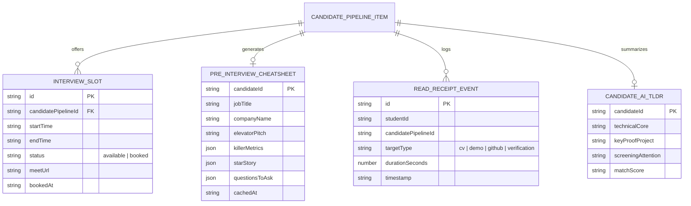

# Mô Hình Dữ Liệu: Bộ Tiện Ích Siêu Tốc Độ Tuyển Dụng Dành Cho Sinh Viên & HR
> **Mã đặc tả:** `SPEC-20261111-VELOCITY-SUITE`  
> **Nhánh Git:** `profilehub_v1`  
> **Tài liệu tham chiếu:** [`docs/superpowers/specs/2026-11-11-student-hr-convenience-and-velocity-suite/research.md`](file:///C:/Users/ADMIN/Desktop/STUDY/docs/superpowers/specs/2026-11-11-student-hr-convenience-and-velocity-suite/research.md), [`src/types/database.ts`](file:///C:/Users/ADMIN/Desktop/STUDY/profilehub/src/types/database.ts)

---

## 1. Sơ Đồ Thực Thể Mở Rộng (Extended Entity Diagram)



---

## 2. Chi Tiết Kiểu Dữ Liệu TypeScript Mở Rộng

```typescript
// ==========================================
// 1. Khung Giờ Phỏng Vấn (Smart Slot Picker)
// ==========================================
export interface InterviewSlot {
  id: string;
  candidatePipelineId: string;
  startTime: string; // ISO 8601
  endTime: string;   // ISO 8601
  status: 'available' | 'booked';
  meetUrl?: string;
  bookedAt?: string;
}

// ==========================================
// 2. Thẻ Tác Chiến 60s Bỏ Túi (Pre-Interview Cheat-Sheet)
// ==========================================
export interface PreInterviewCheatSheet {
  candidateId: string;
  candidateName: string;
  jobTitle: string;
  companyName: string;
  elevatorPitch: string;
  killerMetrics: Array<{
    label: string;
    value: string;
    source: 'lighthouse' | 'rps' | 'coverage' | 'db_index' | 'custom';
  }>;
  starStory: {
    situationTask: string;
    actionTaken: string;
    quantifiedResult: string;
  };
  questionsToAsk: string[];
  cachedAt: string;
}

// ==========================================
// 3. Tóm Tắt Chân Dung 10 Giây (10-Second Candidate AI TL;DR)
// ==========================================
export interface CandidateAiTLDR {
  candidateId: string;
  technicalCore: string;      // VD: "React/TypeScript + Redux Toolkit"
  keyProofProject: string;    // VD: "E-Commerce App (Live Demo + 120 commits)"
  screeningAttention: string; // VD: "Chưa thấy kinh nghiệm triển khai Docker"
  matchScore: number;         // 0 - 100
}

// ==========================================
// 4. Mẫu Email Hàng Loạt (Batch Outbound Template)
// ==========================================
export interface BatchEmailTemplate {
  id: string;
  title: string;
  subject: string;
  body: string;
  category: 'interview_invite' | 'challenge_issue' | 'offer_letter' | 'rejection_courtesy';
}

// ==========================================
// 5. Radar Đọc Hồ Sơ Thời Gian Thực (Read Receipt Event)
// ==========================================
export interface ReadReceiptEvent {
  id: string;
  studentId: string;
  candidatePipelineId?: string;
  targetType: 'cv' | 'live_demo' | 'github_repo' | 'verify_page';
  durationSeconds: number;
  timestamp: string;
  anonymousLabel: string; // VD: "Nhà tuyển dụng Công ty Fintech"
}
```
