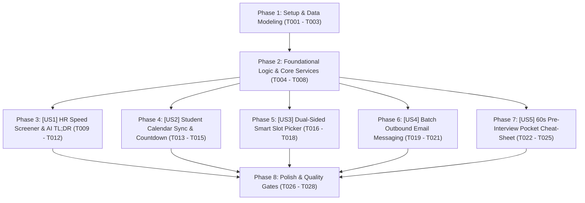

# Tasks: Bộ Tiện Ích Siêu Tốc Độ Tuyển Dụng Dành Cho Sinh Viên & HR (Student & HR Convenience & Velocity Suite)

> **Feature Name:** Bộ Tiện Ích Siêu Tốc Độ Tuyển Dụng: Speed Screener Phím Tắt, Đồng Bộ Google/iCal Calendar, Smart Slot Picker, Batch Outbound Email & Thẻ Tác Chiến 60s  
> **Plan Document:** [`docs/superpowers/specs/2026-11-11-student-hr-convenience-and-velocity-suite/research.md`](file:///C:/Users/ADMIN/Desktop/STUDY/docs/superpowers/specs/2026-11-11-student-hr-convenience-and-velocity-suite/research.md)  
> **Spec Directory:** [`docs/superpowers/specs/2026-11-11-student-hr-convenience-and-velocity-suite/`](file:///C:/Users/ADMIN/Desktop/STUDY/docs/superpowers/specs/2026-11-11-student-hr-convenience-and-velocity-suite/)  
> **Branch:** `profilehub_v1`  
> **Checklist Format Requirement:** `- [ ] [TaskID] [P?] [Story?] Description with file path`

---

## 🏛️ Dependencies & Story Execution Order

---

## Phase 1: Setup & Data Modeling

- [X] T001 Khai báo các interface và types `InterviewSlot`, `PreInterviewCheatSheet`, `CandidateAiTLDR`, `BatchEmailTemplate`, `ReadReceiptEvent` trong [src/types/database.ts](file:///C:/Users/ADMIN/Desktop/STUDY/profilehub/src/types/database.ts)
- [X] T002 [P] Mở rộng union types của `PipelineBroadcastEvent` hỗ trợ các sự kiện `'INTERVIEW_SLOT_OFFERED'`, `'INTERVIEW_SLOT_CONFIRMED'`, `'READ_RECEIPT_PING'` trong [src/utils/pipelineSync.ts](file:///C:/Users/ADMIN/Desktop/STUDY/profilehub/src/utils/pipelineSync.ts)
- [X] T003 [P] Khởi tạo tệp ngân hàng mẫu email tuyển dụng hàng loạt (Batch Outbound Templates) cho các kịch bản HR trong [src/services/batchEmailTemplates.ts](file:///C:/Users/ADMIN/Desktop/STUDY/profilehub/src/services/batchEmailTemplates.ts)

---

## Phase 2: Foundational Logic & Core Services (Blocking Prerequisites)

- [X] T004 [P] Xây dựng service `calendarExportService.ts` tạo URL Google Calendar và Blob file `.ics` chuẩn RFC 5545 trong [src/services/calendarExportService.ts](file:///C:/Users/ADMIN/Desktop/STUDY/profilehub/src/services/calendarExportService.ts)
- [X] T005 [P] Viết bộ kiểm thử đơn vị tự động `calendarExportService.test.ts` kiểm định định dạng ngày tháng và timezone trong [src/services/calendarExportService.test.ts](file:///C:/Users/ADMIN/Desktop/STUDY/profilehub/src/services/calendarExportService.test.ts)
- [X] T006 [P] Xây dựng service `speedScreenerService.ts` quản lý pre-fetch bộ đệm, điều hướng phím tắt `J`/`K` và xử lý chuyển trạng thái trong [src/services/speedScreenerService.ts](file:///C:/Users/ADMIN/Desktop/STUDY/profilehub/src/services/speedScreenerService.ts)
- [X] T007 [P] Viết bộ kiểm thử đơn vị tự động `speedScreenerService.test.ts` trong [src/services/speedScreenerService.test.ts](file:///C:/Users/ADMIN/Desktop/STUDY/profilehub/src/services/speedScreenerService.test.ts)
- [X] T008 [P] Xây dựng service `batchEmailService.ts` thực hiện regex merge tags `{candidate_name}`, `{job_title}`, `{top_project_name}` và xuất mailto trong [src/services/batchEmailService.ts](file:///C:/Users/ADMIN/Desktop/STUDY/profilehub/src/services/batchEmailService.ts)

---

## Phase 3: User Story 1 - HR Speed Screener & AI TL;DR (Duyệt Hồ Sơ Thần Tốc Bằng Phím Tắt) (P1)

**Story Goal:** Nhà tuyển dụng có thể duyệt hàng loạt hồ sơ ứng viên bằng giao diện chia đôi (Split View) kết hợp phím tắt bàn phím `J`/`K`/`A`/`T`/`R`/`O` với độ trễ phản hồi $< 50ms$; mỗi thẻ hiển thị tóm tắt 3 gạch đầu dòng AI TL;DR giúp ra quyết định nhanh chóng.  
**Independent Test Criteria:** Mở trang `/recruiter/pipeline`, nhấn phím `Space` để mở Speed Screener; dùng phím `J` và `K` chuyển ứng viên mượt mà không tải lại trang; nhấn `A` chuyển ứng viên sang Phỏng vấn; nhấn `Esc` đóng modal và thấy Kanban đã cập nhật.

- [X] T009 [P] [US1] Xây dựng hook `useSpeedScreenerKeyboard.ts` lắng nghe phím tắt `J`, `K`, `A`, `T`, `R`, `O`, `Esc` trong [src/hooks/useSpeedScreenerKeyboard.ts](file:///C:/Users/ADMIN/Desktop/STUDY/profilehub/src/hooks/useSpeedScreenerKeyboard.ts)
- [X] T010 [P] [US1] Xây dựng component `CandidateAiTldrBadge.tsx` hiển thị 3 gạch đầu dòng năng lực đính kèm trên thẻ ứng viên trong [src/components/recruiter/CandidateAiTldrBadge.tsx](file:///C:/Users/ADMIN/Desktop/STUDY/profilehub/src/components/recruiter/CandidateAiTldrBadge.tsx)
- [X] T011 [US1] Xây dựng modal `SpeedScreenerModal.tsx` bố cục chia đôi (Split View) với danh sách ứng viên bên trái và CV + Live Demo bên phải trong [src/components/recruiter/SpeedScreenerModal.tsx](file:///C:/Users/ADMIN/Desktop/STUDY/profilehub/src/components/recruiter/SpeedScreenerModal.tsx)
- [X] T012 [US1] Tích hợp nút kích hoạt `[ ⚡ Speed Screener (Phím tắt) ]` trên thanh công cụ và phím `Space` tại [src/pages/recruiter/CandidatePipeline.tsx](file:///C:/Users/ADMIN/Desktop/STUDY/profilehub/src/pages/recruiter/CandidatePipeline.tsx)

---

## Phase 4: User Story 2 - Student Calendar Sync & Challenge Deadline Countdown (Đồng Bộ Lịch & Đếm Ngược) (P1)

**Story Goal:** Sinh viên có thể 1-click thêm lịch phỏng vấn vào Google Calendar hoặc tải file `.ics` cho Apple Calendar/Outlook; đồng hồ đếm ngược hạn chót nộp bài test hiển thị trực quan 3 màu giúp không bị lỡ hạn.  
**Independent Test Criteria:** Tại Dashboard hoặc Sổ tay phỏng vấn, bấm nút `[ 📅 Thêm vào Google Calendar ]` ➔ mở tab mới với thông tin giờ họp và link Google Meet điền sẵn; xem bài test có hạn chót 48h ➔ hiển thị đồng hồ đếm ngược chính xác theo thời gian thực.

- [X] T013 [P] [US2] Xây dựng component `CalendarSyncDropdown.tsx` chứa nút bấm 1-click thêm vào Google Calendar và tải file `.ics` trong [src/components/student/CalendarSyncDropdown.tsx](file:///C:/Users/ADMIN/Desktop/STUDY/profilehub/src/components/student/CalendarSyncDropdown.tsx)
- [X] T014 [P] [US2] Xây dựng component `ChallengeCountdownWidget.tsx` hiển thị đồng hồ đếm ngược hạn chót bài test 3 màu trực quan trong [src/components/student/ChallengeCountdownWidget.tsx](file:///C:/Users/ADMIN/Desktop/STUDY/profilehub/src/components/student/ChallengeCountdownWidget.tsx)
- [X] T015 [US2] Tích hợp nút đồng bộ lịch và widget đếm ngược vào thẻ sự kiện phỏng vấn / bài test trên [src/pages/student/Dashboard.tsx](file:///C:/Users/ADMIN/Desktop/STUDY/profilehub/src/pages/student/Dashboard.tsx) và [src/components/student/ApplicationKanbanBoard.tsx](file:///C:/Users/ADMIN/Desktop/STUDY/profilehub/src/components/student/ApplicationKanbanBoard.tsx)

---

## Phase 5: User Story 3 - Dual-Sided Smart Slot Picker (Chọn Khung Giờ Phỏng Vấn Tự Động) (P1)

**Story Goal:** HR mở 3 đến 5 khung giờ rảnh của công ty khi kéo ứng viên vào vòng Phỏng vấn; Sinh viên chọn 1 khung giờ vừa vặn với lịch học; hệ thống tự động khóa lịch, sinh link Google Meet và đồng bộ cho cả hai bên mà không cần email qua lại.  
**Independent Test Criteria:** HR chọn 3 slot phỏng vấn và gửi; sinh viên mở Dashboard thấy danh sách slot, nhấp chọn slot 2 và bấm xác nhận ➔ thẻ trên Kanban của HR lập tức cập nhật trạng thái `Đã Chốt Lịch` kèm khung giờ đã chọn.

- [X] T016 [P] [US3] Xây dựng component `SmartSlotPickerModal.tsx` cho phép HR chọn 3-5 khung giờ rảnh và gửi đến ứng viên trong [src/components/recruiter/SmartSlotPickerModal.tsx](file:///C:/Users/ADMIN/Desktop/STUDY/profilehub/src/components/recruiter/SmartSlotPickerModal.tsx)
- [X] T017 [P] [US3] Xây dựng component `CandidateSlotBookingModal.tsx` cho phép sinh viên xem các khung giờ và bấm chọn 1 khung giờ trong [src/components/student/CandidateSlotBookingModal.tsx](file:///C:/Users/ADMIN/Desktop/STUDY/profilehub/src/components/student/CandidateSlotBookingModal.tsx)
- [X] T018 [US3] Tích hợp luồng chọn slot tự động khi kéo thả ứng viên vào cột Phỏng Vấn trên [src/pages/recruiter/CandidatePipeline.tsx](file:///C:/Users/ADMIN/Desktop/STUDY/profilehub/src/pages/recruiter/CandidatePipeline.tsx) và thông báo trên [src/pages/student/Dashboard.tsx](file:///C:/Users/ADMIN/Desktop/STUDY/profilehub/src/pages/student/Dashboard.tsx)

---

## Phase 6: User Story 4 - Batch Outbound Email Messaging with Merge Tags (Email Tuyển Dụng Hàng Loạt) (P2)

**Story Goal:** Nhà tuyển dụng có thể tích chọn nhiều ứng viên trên Kanban để gửi email mời phỏng vấn, giao bài test hoặc thư từ chối cảm ơn với nội dung tự động cá nhân hóa theo từng ứng viên (`{candidate_name}`, `{job_title}`, `{top_project_name}`).  
**Independent Test Criteria:** Tại cột Từ Chối, tích chọn 3 ứng viên, bấm `[ ✉️ Gửi Email Hàng Loạt ]`, chọn mẫu Thư Cảm Ơn ➔ xem trước nội dung hiển thị đúng tên từng người; bấm `Sao Chép` hoặc `Mở mailto` hoạt động chuẩn xác.

- [X] T019 [P] [US4] Viết bộ kiểm thử đơn vị tự động `batchEmailService.test.ts` kiểm tra độ chuẩn xác của việc thay thế thẻ biến động trong [src/services/batchEmailService.test.ts](file:///C:/Users/ADMIN/Desktop/STUDY/profilehub/src/services/batchEmailService.test.ts)
- [X] T020 [P] [US4] Xây dựng component `BatchEmailModal.tsx` hỗ trợ chọn mẫu, xem trước nội dung đã merge và nút gửi mailto / sao chép trong [src/components/recruiter/BatchEmailModal.tsx](file:///C:/Users/ADMIN/Desktop/STUDY/profilehub/src/components/recruiter/BatchEmailModal.tsx)
- [X] T021 [US4] Thêm thanh công cụ chọn nhiều thẻ (Multi-Select Toolbar) trên từng cột Kanban trong [src/pages/recruiter/CandidatePipeline.tsx](file:///C:/Users/ADMIN/Desktop/STUDY/profilehub/src/pages/recruiter/CandidatePipeline.tsx)

---

## Phase 7: User Story 5 - 60s Pre-Interview Pocket Cheat-Sheet (Thẻ Tác Chiến Bỏ Túi Ngoại Tuyến) (P2)

**Story Goal:** Sinh viên có thể mở bảng tóm tắt bỏ túi dạng Flashcard trên điện thoại trước giờ phỏng vấn để ôn nhanh 3 câu Elevator Pitch, 3 chỉ số kỹ thuật đinh của đồ án, 1 câu chuyện STAR và 3 câu hỏi hỏi ngược nhà tuyển dụng; dữ liệu hoạt động mượt mà ngay cả khi ngoại tuyến.  
**Independent Test Criteria:** Bấm nút `[ ⚡ Thẻ Tác Chiến 60s ]` trên Dashboard ➔ mở Flashcard di động với 4 khối thông tin cô đọng; ngắt kết nối mạng và mở lại ➔ dữ liệu vẫn hiển thị nguyên vẹn từ LocalStorage cache.

- [X] T022 [P] [US5] Xây dựng service `preInterviewCheatSheetService.ts` trích xuất 4 khối STAR + số liệu đinh + câu hỏi ngược và cache LocalStorage trong [src/services/preInterviewCheatSheetService.ts](file:///C:/Users/ADMIN/Desktop/STUDY/profilehub/src/services/preInterviewCheatSheetService.ts)
- [X] T023 [P] [US5] Viết bộ kiểm thử đơn vị tự động `preInterviewCheatSheetService.test.ts` trong [src/services/preInterviewCheatSheetService.test.ts](file:///C:/Users/ADMIN/Desktop/STUDY/profilehub/src/services/preInterviewCheatSheetService.test.ts)
- [X] T024 [US5] Xây dựng component `PreInterviewCheatSheetModal.tsx` dạng Flashcard trượt cảm ứng tối ưu cho mobile trong [src/components/student/PreInterviewCheatSheetModal.tsx](file:///C:/Users/ADMIN/Desktop/STUDY/profilehub/src/components/student/PreInterviewCheatSheetModal.tsx)
- [X] T025 [US5] Tích hợp nút `[ ⚡ Thẻ Tác Chiến 60s ]` vào thẻ phỏng vấn trên [src/pages/student/Dashboard.tsx](file:///C:/Users/ADMIN/Desktop/STUDY/profilehub/src/pages/student/Dashboard.tsx)

---

## Phase 8: Polish, Integration Testing & Quality Gates (Final Phase)

- [X] T026 [P] Chạy toàn diện bộ kiểm thử `npm run test` đảm bảo 100% test cases pass không gây regression
- [X] T027 [P] Chạy kiểm tra kiểu `npx tsc --noEmit` đạt 0 lỗi biên dịch
- [X] T028 Cập nhật kịch bản kiểm thử thực tế và nghiệm thu trong [docs/superpowers/specs/2026-11-11-student-hr-convenience-and-velocity-suite/quickstart.md](file:///C:/Users/ADMIN/Desktop/STUDY/docs/superpowers/specs/2026-11-11-student-hr-convenience-and-velocity-suite/quickstart.md)
