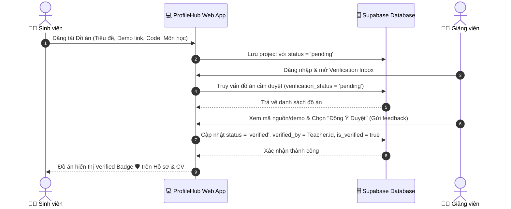
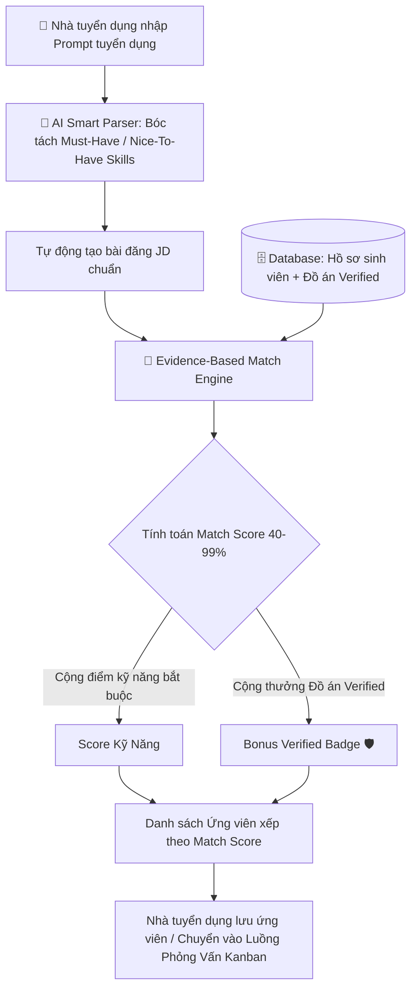
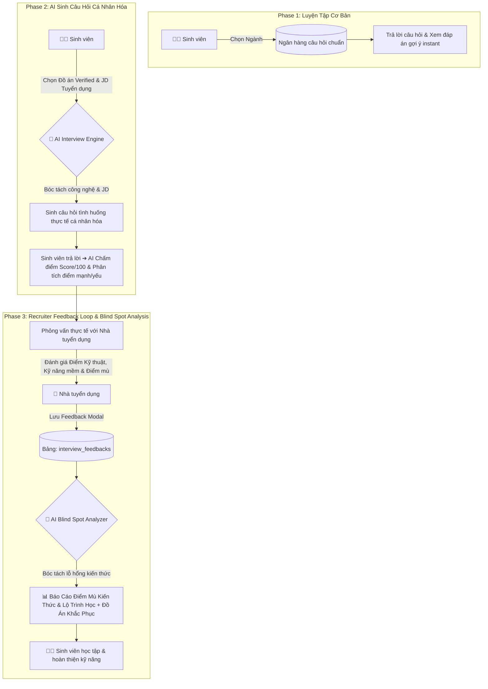

# 📋 System Design Specification & Comprehensive Architecture Document
## Project: PROFILEHUB - Verified Academic & Career Platform

---

## 1. Tổng Quan & Mục Tiêu Hệ Thống (Executive Summary)

**PROFILEHUB** là nền tảng mạng xã hội và tuyển dụng học thuật chuyên biệt dành cho hệ sinh thái **Sinh viên - Giảng viên - Nhà tuyển dụng**.

Hệ thống giải quyết 3 bài toán lớn nhất trong tuyển dụng nhân sự trẻ và kết nối nhà trường - doanh nghiệp:
1. **Tính xác thực của đồ án & kỹ năng (Academic Verification):** Giảng viên trực tiếp đánh giá, chấm điểm và xác thực đồ án sinh viên làm thật 100%, đính kèm nhãn **Verified Badge 🛡️**.
2. **Khả năng tuyển dụng theo bằng chứng (Evidence-Based AI Matching):** Nhà tuyển dụng tìm kiếm ứng viên dựa trên bằng chứng đồ án thực tế đã kiểm định thay vì CV thổi phồng. AI tự động so khớp JD với kỹ năng ứng viên.
3. **Luyện tập phỏng vấn AI & Vòng lặp phản hồi (AI Interview Prep & Recruiter Feedback Loop):** Sinh viên được rèn luyện phỏng vấn cá nhân hóa theo từng đồ án verified, đồng thời nhận báo cáo **Điểm mù kiến thức (Knowledge Blind Spots)** từ phản hồi phỏng vấn thực tế của Nhà tuyển dụng.

---

## 2. Kiến Trúc Phân Quyền & Các Trang Chức Năng (Role-Based Features)

### 2.1 Kiến trúc Giao diện Đồng bộ (Single-Layout Architecture)
Tất cả các route được bảo vệ nằm trong `MainLayout.tsx` với thanh điều hướng `Sidebar.tsx` duy nhất, giúp giao diện đồng bộ 100%, không bị trùng lặp sidebar hoặc nhảy giao diện giữa các trang.

---

### 2.2 Chi Tiết Chức Năng Theo Vai Trò

| Vai trò | Phân vùng Route | Danh sách Chức năng Hiện có |
| :--- | :--- | :--- |
| **👨‍🎓 Sinh viên (`student`)** | `/dashboard`<br>`/profile`<br>`/projects`<br>`/certificates`<br>`/achievements`<br>`/cv-builder`<br>`/interview-prep` | • **Dashboard tổng quan:** Xem chỉ số đồ án, chứng chỉ, giải thưởng, trạng thái kiểm định.<br>• **Hồ sơ cá nhân:** Cập nhật thông tin, GPA, chuyên ngành, kỹ năng, Bio, danh thiếp số & Mã QR code độc bản.<br>• **Quản lý Đồ án:** Thêm/sửa/xóa đồ án, thay thế ảnh ảo bằng **Bản đọc trước file/tài liệu (ProjectFilePreviewHeader & In-app Document Reader Modal)**, đính kèm link Demo/GitHub, phân vai trò & gửi yêu cầu xác thực tới Giảng viên.<br>• **Chứng chỉ & Thành tích:** Quản lý bằng cấp chuyên môn, ngoại ngữ và giải thưởng.<br>• **AI CV Builder:** Dán JD ➔ AI trích xuất kỹ năng, đồ án verified, tính Match Score. Hỗ trợ **4 mẫu giao diện CV độc đáo** (Modern Classic, Minimalist, Tech Specialist, Executive Academic) & xuất PDF in chuẩn A4 (ẩn toàn bộ bộ điều hướng/sidebar).<br>• **🎯 Luyện Phỏng Vấn AI & Phân Tích Điểm Mù:** 3 chế độ (Ngân hàng câu hỏi chuẩn, AI sinh câu hỏi cá nhân hóa theo Đồ án Verified & JD, Báo cáo Điểm mù kiến thức từ Recruiter). |
| **👨‍🏫 Giảng viên (`teacher`)** | `/dashboard`<br>`/teacher/profile`<br>`/teacher/inbox` | • **Dashboard Bộ Môn:** Thống kê đồ án thuộc khoa/bộ môn quản lý.<br>• **Chỉnh sửa Thông tin Giảng viên:** Điền thông tin cá nhân, Học hàm/Học vị, Trường, Bộ môn/Khoa phụ trách, Môn học giảng dạy.<br>• **Verification Inbox:** Duyệt/từ chối đồ án sinh viên gửi tới, nhập nhận xét chi tiết và cấp nhãn **Verified Badge 🛡️**. |
| **🏢 Nhà tuyển dụng (`recruiter`)** | `/dashboard`<br>`/recruiter/profile`<br>`/recruiter/ai-assistant`<br>`/recruiter/search`<br>`/recruiter/pipeline`<br>`/recruiter/saved`<br>`/recruiter/jobs` | • **Dashboard Tuyển dụng:** Thống kê luồng tuyển dụng, ứng viên mới và tin tuyển dụng active.<br>• **Hồ Sơ Doanh Nghiệp:** Cập nhật Tên công ty, Lĩnh vực, Quy mô, Địa chỉ, Website, Logo & Giới thiệu doanh nghiệp.<br>• **AI Tuyển Dụng Smart:** Bóc tách prompt tuyển dụng tự động, tạo JD chuẩn và tính toán Match Score (Evidence-Based Candidate Matching).<br>• **Tìm Ứng Viên Verified:** Tìm kiếm & lọc ứng viên theo bộ kỹ năng, trường học, số lượng đồ án verified.<br>• **Quản Lý Tin Tuyển Dụng (JDs):** Đăng tải và quản lý các vị trí tuyển dụng.<br>• **Ứng Viên Đã Lưu:** Lưu trữ ứng viên tiềm năng vào thư mục tùy chỉnh.<br>• **Luồng Tuyển Dụng & Feedback Loop:** Quản lý Pipeline dạng Kanban, ghi chú bảo mật và **gửi Phản hồi Phỏng vấn (Recruiter Feedback)** về Điểm kỹ thuật, Kỹ năng mềm & Điểm mù kiến thức cho Sinh viên. |

---

## 3. Quy Trình Luồng Hoạt Động (Workflows & Sequence Diagrams)

### 3.1 Quy Trình Xác Thực Đồ Án (Academic Verification Workflow)



---

### 3.2 Quy Trình AI Matching & Tuyển Dụng Dựa Trên Bằng Chứng (Evidence-Based Matching Workflow)



---

### 3.3 Quy Trình Luyện Phỏng Vấn AI & Vòng Lặp Phản Hồi (AI Interview & Feedback Loop Workflow)



---

## 4. Cơ Sở Dữ Liệu Chi Tiết (Database Schema - Supabase PostgreSQL)

### 4.1 Danh Sách Các Bảng Dữ Liệu Core

```sql
-- 1. Bảng Người Dùng (Core Users)
CREATE TABLE IF NOT EXISTS public.users (
  id UUID PRIMARY KEY DEFAULT uuid_generate_v4(),
  email TEXT UNIQUE NOT NULL,
  full_name TEXT NOT NULL,
  role TEXT CHECK (role IN ('student', 'teacher', 'recruiter')) NOT NULL DEFAULT 'student',
  avatar_url TEXT,
  bio TEXT,
  created_at TIMESTAMP WITH TIME ZONE DEFAULT NOW()
);

-- 2. Bảng Hồ Sơ Sinh Viên (Student Profiles)
CREATE TABLE IF NOT EXISTS public.student_profiles (
  id UUID PRIMARY KEY REFERENCES public.users(id) ON DELETE CASCADE,
  full_name TEXT,
  avatar_url TEXT,
  bio TEXT,
  major TEXT,
  university TEXT,
  gpa TEXT,
  skills TEXT[] DEFAULT '{}'::TEXT[],
  username TEXT UNIQUE,
  qr_code_url TEXT,
  updated_at TIMESTAMP WITH TIME ZONE DEFAULT NOW()
);

-- 3. Bảng Đồ Án / Dự Án Sinh Viên (Projects)
CREATE TABLE IF NOT EXISTS public.projects (
  id UUID PRIMARY KEY DEFAULT uuid_generate_v4(),
  student_id UUID NOT NULL REFERENCES public.users(id) ON DELETE CASCADE,
  title TEXT NOT NULL,
  description TEXT,
  thumbnail_url TEXT,
  demo_url TEXT,
  github_url TEXT,
  project_type TEXT,
  score TEXT,
  is_verified BOOLEAN DEFAULT FALSE,
  verification_status TEXT CHECK (verification_status IN ('pending', 'verified', 'rejected')) DEFAULT 'pending',
  verified_by UUID REFERENCES public.users(id) ON DELETE SET NULL,
  teacher_feedback TEXT,
  verified_at TIMESTAMP WITH TIME ZONE,
  role TEXT,
  team_size TEXT,
  instructor TEXT,
  tags TEXT[] DEFAULT '{}'::TEXT[],
  created_at TIMESTAMP WITH TIME ZONE DEFAULT NOW()
);

-- 4. Bảng Chứng Chỉ & Thành Tích (Certificates & Achievements)
CREATE TABLE IF NOT EXISTS public.certificates (
  id UUID PRIMARY KEY DEFAULT uuid_generate_v4(),
  user_id UUID NOT NULL REFERENCES public.users(id) ON DELETE CASCADE,
  title TEXT NOT NULL,
  issuer TEXT NOT NULL,
  category TEXT,
  date_awarded TEXT,
  rank TEXT,
  description TEXT,
  is_featured BOOLEAN DEFAULT FALSE,
  image_url TEXT,
  created_at TIMESTAMP WITH TIME ZONE DEFAULT NOW()
);

CREATE TABLE IF NOT EXISTS public.achievements (
  id UUID PRIMARY KEY DEFAULT uuid_generate_v4(),
  user_id UUID NOT NULL REFERENCES public.users(id) ON DELETE CASCADE,
  title TEXT NOT NULL,
  category TEXT NOT NULL,
  level TEXT,
  date_awarded TEXT,
  description TEXT,
  is_featured BOOLEAN DEFAULT FALSE,
  verified BOOLEAN DEFAULT FALSE,
  image_url TEXT,
  created_at TIMESTAMP WITH TIME ZONE DEFAULT NOW()
);

-- 5. Bảng Tin Tuyển Dụng Của Doanh Nghiệp (Recruiter Jobs)
CREATE TABLE IF NOT EXISTS public.recruiter_jobs (
  id UUID PRIMARY KEY DEFAULT uuid_generate_v4(),
  recruiter_id UUID NOT NULL REFERENCES public.users(id) ON DELETE CASCADE,
  title TEXT NOT NULL,
  department TEXT,
  location TEXT,
  required_skills TEXT[] DEFAULT '{}'::TEXT[],
  description TEXT,
  status TEXT CHECK (status IN ('active', 'closed')) DEFAULT 'active',
  created_at TIMESTAMP WITH TIME ZONE DEFAULT NOW()
);

-- 6. Bảng Phản Hồi Phỏng Vấn Thực Tế Từ Nhà Tuyển Dụng (Interview Feedbacks - Phase 3)
CREATE TABLE IF NOT EXISTS public.interview_feedbacks (
  id UUID PRIMARY KEY DEFAULT uuid_generate_v4(),
  recruiter_id UUID NOT NULL REFERENCES public.users(id) ON DELETE CASCADE,
  recruiter_name TEXT,
  company_name TEXT,
  student_id UUID NOT NULL REFERENCES public.users(id) ON DELETE CASCADE,
  job_id UUID REFERENCES public.recruiter_jobs(id) ON DELETE SET NULL,
  technical_score INT DEFAULT 0 CHECK (technical_score BETWEEN 1 AND 10),
  soft_skills_score INT DEFAULT 0 CHECK (soft_skills_score BETWEEN 1 AND 10),
  recruiter_comment TEXT NOT NULL,
  blind_spots TEXT[] DEFAULT '{}'::TEXT[],
  created_at TIMESTAMP WITH TIME ZONE DEFAULT NOW()
);

-- 7. Bảng Quản Lý Luồng Tuyển Dụng (Candidate Pipeline Kanban)
CREATE TABLE IF NOT EXISTS public.recruiter_pipeline (
  id UUID PRIMARY KEY DEFAULT uuid_generate_v4(),
  recruiter_id UUID NOT NULL REFERENCES public.users(id) ON DELETE CASCADE,
  student_id UUID NOT NULL REFERENCES public.users(id) ON DELETE CASCADE,
  job_id UUID REFERENCES public.recruiter_jobs(id) ON DELETE SET NULL,
  stage TEXT CHECK (stage IN ('discovered', 'shortlisted', 'contacted', 'interview', 'hired')) DEFAULT 'discovered',
  private_notes TEXT,
  created_at TIMESTAMP WITH TIME ZONE DEFAULT NOW(),
  updated_at TIMESTAMP WITH TIME ZONE DEFAULT NOW()
);
```

---

## 5. Cấu Trúc Thư Mục Dự Án (Source Code Architecture)

```
portfolio-web/
├── src/
│   ├── assets/                      # Hình ảnh & tài nguyên tĩnh
│   ├── components/
│   │   ├── auth/                    # Components Xác thực người dùng
│   │   ├── certificates/            # UI danh sách & Modal thêm Chứng chỉ
│   │   ├── common/                  # Verified Badge, Loading Spinner, Cards
│   │   ├── cv/                      # Render CV Template, Bar điểm ATS Score
│   │   ├── layout/                  # MainLayout, Sidebar đồng bộ
│   │   ├── projects/                # Add/Edit Project Modal
│   │   ├── recruiter/               # RecruiterFeedbackModal (Feedback Loop)
│   │   └── qr/                      # Digital Business Card & Smart QR Code
│   ├── context/
│   │   └── AuthProvider.tsx         # Xử lý Supabase Authentication State
│   ├── pages/
│   │   ├── auth/                    # Login, Register, Logout
│   │   ├── student/                 # Dashboard, MyProfile, MyProjects, Certificates, MyAchievements, CVBuilder, AIInterviewPrep
│   │   ├── teacher/                 # TeacherProfile, VerificationInbox
│   │   └── recruiter/               # RecruiterProfile, AIRecruitmentAssistant, CandidateSearch, CandidatePipeline, SavedCandidates, JobManagement
│   ├── services/
│   │   ├── supabase.ts              # Khởi tạo Supabase Client
│   │   ├── aiCvService.ts           # Service trích xuất CV & Match JD
│   │   ├── aiRecruitmentService.ts  # Service AI Tuyển dụng & Evidence-Based Match
│   │   ├── aiInterviewService.ts    # Service sinh câu hỏi phỏng vấn & chấm điểm AI
│   │   └── feedbackService.ts       # Service lưu nhận xét phỏng vấn & phân tích Blind Spots
│   ├── types/
│   │   └── database.ts              # TypeScript Models & Database Interfaces
│   └── App.tsx                      # Cấu hình Router với MainLayout tập trung
```

---

## 6. Tiêu Chuẩn Chất Lượng & Quy Trình Kiểm Thử (QA & Coding Standards)

1. **Kiểm thử Type-Safety & Code Style:**
   - Mọi tính năng mới bắt buộc qua 2 bước kiểm tra tự động trước khi bàn giao:
     - `npx tsc --noEmit` (Không có lỗi biên dịch TypeScript).
     - `npm run lint` (Không có lỗi ESLint).
2. **Đồng bộ Giao diện (UI Consistency):**
   - Không xuất hiện hiệu ứng nhảy giao diện hoặc lặp 2 sidebar khi chuyển trang nhờ kiến trúc `MainLayout.tsx`.
3. **Phản hồi Client Instant (Fallback Reactivity):**
   - Mọi thao tác lưu dữ liệu đều hỗ trợ lưu đồng thời vào Supabase DB và đệm LocalStorage fallback đảm bảo trải nghiệm người dùng liền mạch 100%.
