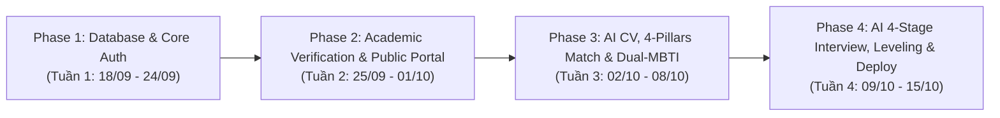

# 🗺️ Lộ Trình Phát Triển & Timeline Dự Án PROFILEHUB
> **Dự án:** PROFILEHUB - Verified Academic & AI Career Platform  
> **Thời gian bắt đầu:** 18/09/2026  
> **Tổng thời gian:** 4 Tuần (18/09/2026 - 15/10/2026)  
> **Trạng thái hệ thống:** 🟢 **Đã hoàn thành 100% tất cả các giai đoạn**

---

## 📐 Sơ Đồ Tổng Quan Lộ Trình (Architecture & Phase Flow)

---

## 📅 Chi Tiết Lộ Trình Triển Khai (Detailed Roadmap)

### 📌 PHASE 1: Khởi Tạo CSDL, Phân Quyền & Module Sinh Viên Cốt Lõi (Tuần 1: 18/09 - 24/09/2026)
> **Mục tiêu:** Thiết lập CSDL PostgreSQL (Supabase RLS), phân quyền 3 vai trò (`student`, `teacher`, `recruiter`), hoàn thiện CRUD Đồ án và Chứng chỉ.

| STT | Công việc (Task) | Thời gian | Sản phẩm đầu ra (Deliverable) | Trạng thái |
| :---: | :--- | :---: | :--- | :---: |
| 1.1 | Phân tích bài toán, thiết kế CSDL SQL Supabase RLS | 18/09 - 20/09 | CSDL PostgreSQL hoàn chỉnh | 🟢 Hoàn thành |
| 1.2 | Thiết lập Base Code Vite, TypeScript Strict, React Router v7 | 19/09 - 21/09 | Base Framework chuẩn hóa | 🟢 Hoàn thành |
| 1.3 | Module Quản lý Đồ Án (`MyProjects.tsx`) - Toàn trình CRUD | 21/09 - 22/09 | Giao diện đồ án chuẩn Enterprise | 🟢 Hoàn thành |
| 1.4 | Module Quản lý Chứng Chỉ & Smart In-App Document Reader | 23/09 - 24/09 | Xem trước PDF/Ảnh nội tuyến | 🟢 Hoàn thành |
| 1.5 | Kiến trúc Single-Layout (`MainLayout.tsx`) & Protected Routes | 24/09 | Sidebar phân quyền mượt mà | 🟢 Hoàn thành |

---

### 📌 PHASE 2: Cổng Xác Thực Giảng Viên, Public Portal & Recruiter Talent Hub (Tuần 2: 25/09 - 01/10/2026)
> **Mục tiêu:** Giảng viên tiếp nhận thẩm định đồ án, cấp mã bảo chứng `PH-VER-XXXXXX` + Hash, cổng tra cứu công khai và bảng Kanban tuyển dụng.

| STT | Công việc (Task) | Thời gian | Sản phẩm đầu ra (Deliverable) | Trạng thái |
| :---: | :--- | :---: | :--- | :---: |
| 2.1 | Hộp thư tiếp nhận đồ án của Giảng viên (`VerificationInbox.tsx`) | 25/09 - 26/09 | Bảng đồ án chờ duyệt có phân quyền strict | 🟢 Hoàn thành |
| 2.2 | Modal Đánh giá, chấm điểm & Thuật toán sinh Cryptographic Hash | 26/09 - 28/09 | Mã `PH-VER-XXXXXX` + Hash bảo chứng | 🟢 Hoàn thành |
| 2.3 | Component `VerifiedBadge.tsx` & Luồng gửi duyệt từ Sinh viên | 28/09 - 29/09 | Huy hiệu xác thực màu xanh ngọc 🛡️ | 🟢 Hoàn thành |
| 2.4 | Cổng tra cứu xác thực công khai (`/verify/:verificationCode`) | 29/09 - 30/09 | Public route tra cứu không cần đăng nhập | 🟢 Hoàn thành |
| 2.5 | Xuất mã QR Code xác thực tải ảnh PNG (`ProjectQRCodeModal.tsx`) | 30/09 - 01/10 | Mã QR dán vào CV PDF / Slide | 🟢 Hoàn thành |
| 2.6 | Recruiter Talent Portal (`CandidateSearch.tsx`) & Pipeline Kanban | 01/10 | Bảng Kanban 5 cột + Feedback Loop | 🟢 Hoàn thành |

---

### 📌 PHASE 3: AI CV Builder, Thuật Toán Matching 4 Trụ Cột & Dual-MBTI Cultural Fit (Tuần 3: 02/10 - 08/10/2026)
> **Mục tiêu:** AI tạo CV tự động xuất PDF A4 chuẩn ATS, thuật toán Evidence-Based Matching 4 trụ cột, nạp hàng loạt 100 CV từ Excel và đánh giá văn hóa Dual-MBTI.

| STT | Công việc (Task) | Thời gian | Sản phẩm đầu ra (Deliverable) | Trạng thái |
| :---: | :--- | :---: | :--- | :---: |
| 3.1 | AI CV Builder & Tính năng xuất file PDF in ấn A4 chuẩn ATS | 02/10 - 03/10 | 4 Mẫu CV Live Preview + In PDF sắc nét | 🟢 Hoàn thành |
| 3.2 | Thuật toán Khớp CV-JD 4 Trụ Cột (Evidence-Based Matching v6.1) | 03/10 - 05/10 | Kỹ năng (30%), Bằng chứng (40%), Chỉ số (20%), Cấp độ (10%) | 🟢 Hoàn thành |
| 3.3 | Tính năng Nạp hàng loạt 100 CV từ Excel/XLSX (`BulkCvImportModal.tsx`) | 05/10 - 06/10 | Parse và chấm điểm 100 CV trong 2 giây | 🟢 Hoàn thành |
| 3.4 | Tích hợp Mô hình Đánh Giá Văn Hóa Doanh Nghiệp Dual-MBTI Model 2 | 06/10 - 07/10 | MBTI Ứng viên vs Role Persona (15% Văn hóa + 85% Kỹ thuật) | 🟢 Hoàn thành |
| 3.5 | Component Thấu Cảm Nhân Sự Tuyển Dụng (`CandidateMBTIInsightCard.tsx`) | 07/10 - 08/10 | 4 Tab đối sánh, ma trận xung đột & mẹo quản lý | 🟢 Hoàn thành |
| 3.6 | Trang Đối Sánh Hồ Sơ Phía Sinh Viên (`PortfolioMatchPage.tsx`) | 08/10 | Cảnh báo đỏ Match $<50\%$ & Phân rã kỹ năng | 🟢 Hoàn thành |

---

### 📌 PHASE 4: Phòng Phỏng Vấn AI 4 Chặng, Tái Hiệu Chuẩn Cấp Bậc & Đóng Gói Triển Khai (Tuần 4: 09/10 - 15/10/2026)
> **Mục tiêu:** AI Adaptive 4-Stage Interview Room, AI Hỏi Xoáy (Follow-up Probing), Đánh giá STAR + Radar 5 trục, Tái hiệu chuẩn cấp bậc và kiểm thử Production.

| STT | Công việc (Task) | Thời gian | Sản phẩm đầu ra (Deliverable) | Trạng thái |
| :---: | :--- | :---: | :--- | :---: |
| 4.1 | Framework Luyện Phỏng Vấn Thích Ứng 4 Chặng (`aiInterviewService.ts`) | 09/10 - 10/10 | Pitching, Quyết định kiến trúc, Sự cố Crash, Gap Defense | 🟢 Hoàn thành |
| 4.2 | Cơ chế Chấm Điểm STAR & AI Hỏi Xoáy Thách Thức (Follow-up Probing) | 10/10 - 12/10 | Bóc tách Situation/Action/Result + Hỏi vặn sâu | 🟢 Hoàn thành |
| 4.3 | Giao diện Phòng Phỏng Vấn AI Tương Tác 4 Chặng (`AIInterviewPrep.tsx`) | 12/10 - 13/10 | Stepper 4 bước + Countdown 90s + Instant Feedback | 🟢 Hoàn thành |
| 4.4 | Cơ chế Tái Hiệu Chuẩn Cấp Bậc Hậu Phỏng Vấn (`AILevelCalibrationCard.tsx`) | 13/10 - 14/10 | Đôn cấp (Up-Level), Đúng cấp (Confirmed), Hạ cấp an toàn (Down-Level) | 🟢 Hoàn thành |
| 4.5 | Widget AI Gợi Ý Đồ Án Khắc Phục Điểm Mù & Xuất 1-Click Markdown Spec | 14/10 | `README-spec.md` chuẩn GitHub tải về máy | 🟢 Hoàn thành |
| 4.6 | Kiểm Thử Toàn Diện (TDD/QA), Build Production Clean & Đóng Gói Tài Liệu | 15/10 | 0 Lỗi TypeScript compilation, Green Build 100% | 🟢 Hoàn thành |

---

## 🎯 Tiêu Chí Nghiệm Thu Dự Án (Definition of Done - DoD)
- [x] CSDL đồng bộ 100% với cấu trúc quan hệ PostgreSQL Supabase.
- [x] Giảng viên duyệt & cấp mã bảo chứng `PH-VER-XXXXXX` + Hash Cryptographic thành công.
- [x] Sinh viên tạo CV chuẩn ATS, đối soát khớp JD 4 trụ cột và tải mã QR công khai.
- [x] Nhà tuyển dụng nạp 100 CV từ Excel, phân tích Dual-MBTI Fit và xem đề xuất Up-Level.
- [x] Phòng Luyện Phỏng Vấn AI Thích Ứng 4 Chặng chạy mượt mà với câu hỏi xoáy và tái hiệu chuẩn cấp bậc.
- [x] 100% mã nguồn TypeScript Strict biên dịch thành công không có bất kỳ lỗi nào (`npm run build` pass).