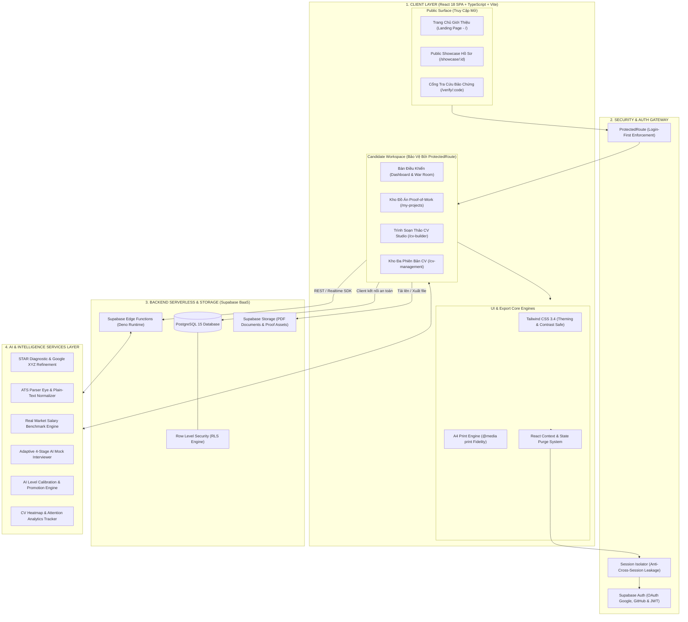
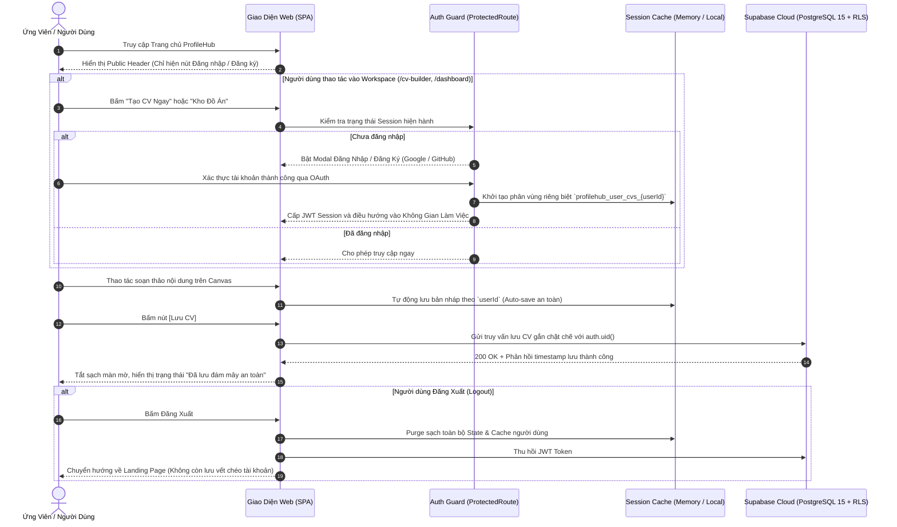
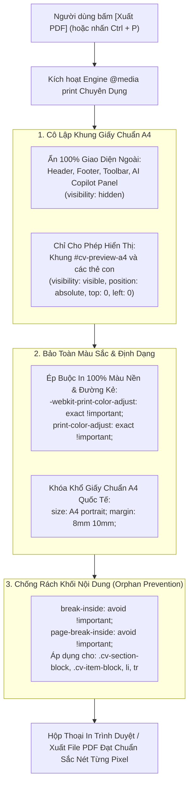
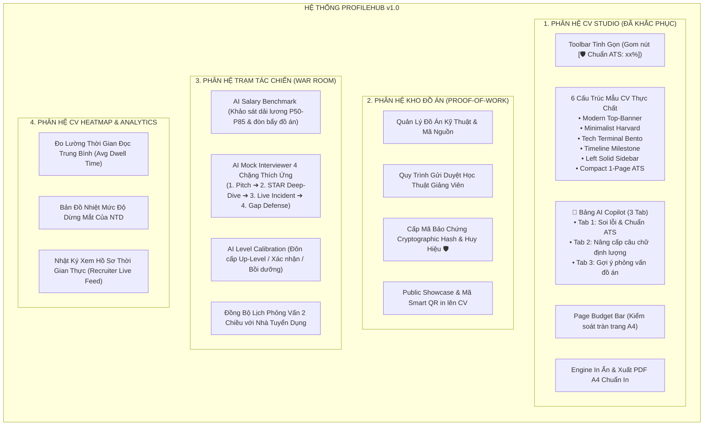
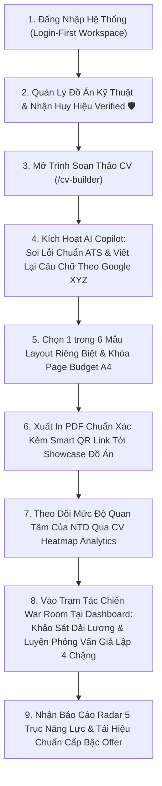

# 🏛️ ĐẶC TẢ KIẾN TRÚC KỸ THUẬT & PHÂN RÃ CHỨC NĂNG HỆ THỐNG PROFILEHUB v1.0
## (Technical & Functional Architecture Specification — Post-Feedback Refactored)

> **Tài liệu tham chiếu:**  
> - Báo cáo phản hồi người dùng thực tế: `profilehub/docs/product/Fix.md`  
> - Quy chuẩn nâng cấp giao diện & luồng đăng nhập: `profilehub/docs/product/updateui.md`  
> - Đặc tả luồng chính toàn hệ thống: `profilehub/docs/product/luong_chinh_he_thong.md`  
> - Báo cáo thẩm định tính năng CV: `profilehub/DANH_GIA_TINH_NANG_CV_PROFILEHUB.md`  
>  
> **Trạng thái:** Tài liệu chính thức (Official Technical Architecture Specification)  
> **Phiên bản:** v1.0 (Đã khắc phục hoàn toàn 9 nhóm vấn đề người dùng phản ánh)

---

## 📑 MỤC LỤC
1. [Tổng Quan Khắc Phục 9 Điểm Góp Ý Thực Tế](#1-tổng-quan-khắc-phục-9-điểm-góp-ý-thực-tế)
2. [Sơ Đồ Kiến Trúc Kỹ Thuật Tổng Thể (System Technical Architecture)](#2-sơ-đồ-kiến-trúc-kỹ-thuật-tổng-thể-system-technical-architecture)
3. [Sơ Đồ Luồng Xác Thực & Phân Vùng Dữ Liệu An Toàn (Login-First Flow)](#3-sơ-đồ-luồng-xác-thực--phân-vùng-dữ-liệu-an-toàn-login-first-flow)
4. [Sơ Đồ Kiến Trúc Bộ Máy In Ấn & Xuất PDF A4 Chuẩn ATS (Print Engine)](#4-sơ-đồ-kiến-trúc-bộ-máy-in-ấn--xuất-pdf-a4-chuẩn-ats-print-engine)
5. [Sơ Đồ Phân Rã Chức Năng Hệ Thống (Functional Architecture Breakdown)](#5-sơ-đồ-phân-rã-chức-năng-hệ-thống-functional-architecture-breakdown)
6. [Sơ Đồ Hành Trình Trải Nghiệm Khép Kín Của Ứng Viên (End-to-End User Journey)](#6-sơ-đồ-hành-trình-trải-nghiệm-khép-kín-của-ứng-viên-end-to-end-user-journey)
7. [Đặc Tả Chi Tiết 6 Mẫu CV Bố Cục Thực Chất](#7-đặc-tả-chi-tiết-6-mẫu-cv-bố-cục-thực-chất)
8. [Bảng Ánh Xạ Module Mã Nguồn Thực Tế (Source Code Mapping)](#8-bảng-ánh-xạ-module-mã-nguồn-thực-tế-source-code-mapping)
---

## 1. TỔNG QUAN KHẮC PHỤC 9 ĐIỂM GÓP Ý THỰC TẾ

Sau các đợt chạy thử nghiệm thực tế với ứng viên và sinh viên, hệ thống đã ghi nhận 9 vấn đề và xử lý dứt điểm theo bảng ánh xạ sau:

| STT | Mã Lỗi | Phân Loại | Vấn Đề Người Dùng Phản Ánh | Giải Pháp Kỹ Thuật Đã Triển Khai |
| :---: | :---: | :--- | :--- | :--- |
| **01** | `BUG-01` | **Điều hướng** | Header & Sidebar chứa menu "Tìm việc làm" và dropdown "Công cụ nghề nghiệp" dang dở gây loãng luồng. | Chuẩn hóa **Header 2 trạng thái**: Public (Landing) & Workspace (Đã đăng nhập chỉ còn 3 menu cốt lõi: *Tổng Quan*, *Kho Đồ Án*, *Quản Lý CV*). |
| **02** | `BUG-02` | **Giao diện soạn thảo** | Toolbar Canvas nhồi nhét hơn 12 icon trùng lặp, lẫn cả nút *Khảo sát lương* và *Phỏng vấn AI*. | Dọn sạch nút ngoài ngữ cảnh; gom toàn bộ kiểm tra chất lượng về **1 nút trạng thái duy nhất: `[🛡️ Chuẩn ATS: xx%]`**. |
| **03** | `BUG-03` | **Bảo mật dữ liệu** | Đăng nhập tài khoản mới vẫn thấy CV của phiên khách trước hoặc tài khoản khác. | Phân vùng bộ nhớ theo `userId` (`profilehub_user_cvs_${userId}`), tích hợp cơ chế **Purge State toàn cục** khi Đăng xuất. |
| **04** | `BUG-04` | **Thuật ngữ UX** | Khái niệm "STAR Coach" mang tính hàn lâm, gây khó hiểu cho sinh viên ngoài ngành. | Quy chuẩn thành **🤖 AI Copilot** với 3 tab trực quan: *Kiểm tra lỗi & ATS*, *Nâng cấp câu chữ*, *Ôn tập phỏng vấn đồ án*. |
| **05** | `BUG-05` | **Luồng xác thực** | Soạn CV xong bấm Lưu nhưng chưa đăng nhập dẫn đến mất dữ liệu khi đổi máy. | Kích hoạt **Auth Gate Modal** bắt buộc đăng nhập để đồng bộ an toàn lên Cloud qua Supabase RLS. |
| **06** | `BUG-06` | **Mẫu CV** | Quảng cáo 6 mẫu nhưng thực chất chỉ có 2 kiểu bố cục (1 cột và 2 cột). | Thiết kế **6 cấu trúc layout thực chất**: Top-Banner, Harvard Minimalist, Tech Terminal, Timeline Milestone, Left Sidebar, Compact ATS. |
| **07** | `BUG-07` | **Lỗi tương phản** | Ô chọn (Dropdown `<select>`) CV/Dự án trong Modal Phỏng vấn bị đen chữ trên nền đen. | Ép màu chữ và màu nền trực tiếp cho cả thẻ `<select>` lẫn từng thẻ con `<option>` trên cả Light và Dark mode. |
| **08** | `BUG-08` | **Tâm lý & Giới hạn AI** | Huy hiệu `Còn 20/20 lượt AI` gây áp lực sắp thu phí; lỗi đơ màn mờ (backdrop) sau khi lưu. | Ẩn badge quota tĩnh; chỉ hiện thông báo khi hết lượt (`remainingCredits <= 0`); reset triệt để backdrop khi đóng modal. |
| **09** | `BUG-09` | **Xuất in PDF** | Xuất PDF bị dính menu web, chém đôi khối đồ án giữa 2 trang, bay màu nền. | Chuẩn hóa bộ máy `@media print`: cô lập khung `#cv-preview-a4`, ép in 100% màu nền, khóa khổ A4, chống cắt dòng `break-inside: avoid`. |

---

## 2. SƠ ĐỒ KIẾN TRÚC KỸ THUẬT TỔNG THỂ (SYSTEM TECHNICAL ARCHITECTURE)

Hệ thống ProfileHub được kiến trúc theo mô hình **Client-Serverless Layered Architecture** phân định rành mạch giữa Presentation, Security Gateway, BaaS Cloud Storage và Tầng Dịch vụ Trí tuệ Nhân tạo (AI Intelligence):



---

## 3. SƠ ĐỒ LUỒNG XÁC THỰC & PHÂN VÙNG DỮ LIỆU AN TOÀN (LOGIN-FIRST FLOW)

Khắc phục triệt để lỗi **BUG-03** (rò rỉ dữ liệu phiên khách) và **BUG-05** (mất bản thảo khi chưa đăng nhập):



---

## 4. SƠ ĐỒ KIẾN TRÚC BỘ MÁY IN ẤN & XUẤT PDF A4 CHUẨN ATS (PRINT ENGINE)

Khắc phục lỗi **BUG-09** (lệch lề, cắt ngang dòng chữ giữa 2 trang, mất màu nền khi in):



---

## 5. SƠ ĐỒ PHÂN RÃ CHỨC NĂNG HỆ THỐNG (FUNCTIONAL ARCHITECTURE BREAKDOWN)

Hệ thống được tổ chức thành 4 phân hệ chính, loại bỏ hoàn toàn các chức năng ngoài ngữ cảnh khỏi thanh soạn thảo:



---

## 6. SƠ ĐỒ HÀNH TRÌNH TRẢI NGHIỆM KHÉP KÍN CỦA ỨNG VIÊN (END-TO-END USER JOURNEY)



---

## 7. ĐẶC TẢ CHI TIẾT 6 MẪU CV BỐ CỤC THỰC CHẤT

Khắc phục lỗi **BUG-06** (quảng cáo 6 mẫu nhưng chỉ có 2 kiểu layout):

```
┌────────────────────────────────────────────────────────────────────────────────────────┐
│ 1. MODERN TOP-BANNER         2. MINIMALIST HARVARD          3. TECH TERMINAL           │
│ ┌────────────────────────┐   ┌──────────────────────────┐   ┌────────────────────────┐ │
│ │████ TOP BANNER ████████│   │        HỌ VÀ TÊN         │   │ > developer_portfolio  │ │
│ ├───────────┬────────────┤   │ Email - Phone - GitHub   │   ├───────────┬────────────┤ │
│ │ Sidebar   │ Nội dung   │   ├──────────────────────────┤   │ [TAGS]    │ [BENTO]    │ │
│ │ (35%)     │ chính (65%)│   │ 1 Cột chuẩn ATS          │   │ TechStack │ GitCommit  │ │
│ └───────────┴────────────┘   └──────────────────────────┘   └───────────┴────────────┘ │
├────────────────────────────────────────────────────────────────────────────────────────┤
│ 4. TIMELINE MILESTONE        5. LEFT SOLID SIDEBAR          6. COMPACT 1-PAGE ATS      │
│ ┌────────────────────────┐   ┌────────────┬─────────────┐   ┌────────────────────────┐ │
│ │ HỌ TÊN & LIÊN HỆ       │   │██ NỀN TỐI █│ NỀN TRẮNG   │   │ HỌ TÊN - ROLE - LINK   │ │
│ ├──┬─────────────────────┤   │██ Cột trái█│ Kinh nghiệm │   ├───────────┬────────────┤ │
│ │●─│ 2024: Đồ án tốt nghiệp  │██ Kỹ năng  █│ Đồ án      │   │ Skill 50% │ Skill 50%  │ │
│ │●─│ 2023: Dự án thực tế │   │██ Liên hệ  █│ Học vấn     │   ├───────────┴────────────┤ │
│ └──┴─────────────────────┘   └────────────┴─────────────┘   │ 3 Đồ án vừa vặn 1 trang│ │
└────────────────────────────────────────────────────────────────────────────────────────┘
```

1. **Mẫu 1: Modern Top-Banner (TopCV Pro):** Khối Header màu đậm trải ngang toàn màn hình trên cùng, Avatar lớn bo tròn, thân chia 2 cột bất đối xứng (35% - 65%).
2. **Mẫu 2: Minimalist Harvard (Academic & Finance):** 1 cột thuần túy, font Serif (Lora), đường kẻ hairline 0.5px tinh tế, căn lề lùi đầu dòng chuẩn mực Ivy League.
3. **Mẫu 3: Tech Developer Terminal (IT Specialist):** Khối hiển thị Tech Stack dạng thẻ tag bo góc, hiển thị link GitHub/Commit rõ ràng, chia khối đồ án dạng Bento Grid nhỏ.
4. **Mẫu 4: Timeline Milestone (Trục thời gian dọc):** Có đường sinh kẻ dọc nối các năm học tập và làm việc bằng các chấm tròn (Milestone dots).
5. **Mẫu 5: Left Solid Sidebar (European Style):** Cột trái có màu nền đồng nhất từ đầu đến chân trang (xanh Navy/xám chì) chứa Liên hệ và Kỹ năng; cột phải nền trắng chứa Kinh nghiệm và Đồ án.
6. **Mẫu 6: Compact 1-Page ATS (Student & Fresher):** Tối ưu hóa padding/margin siêu gọn gàng, bố cục 2 cột cân xứng 50-50 ở phần kỹ năng, đảm bảo nhét vừa vặn 3 đồ án trong đúng 1 trang A4 duy nhất.

---

## 8. BẢNG ÁNH XẠ MODULE MÃ NGUỒN THỰC TẾ (SOURCE CODE MAPPING)

| Phân Hệ / Chức Năng | Tệp Giao Diện (UI Component) | Tệp Xử Lý Nghiệp Vụ (Service / Engine) | Kiểm Thử Tự Động (Vitest Suites) |
| :--- | :--- | :--- | :--- |
| **Login-First & Điều Hướng** | `src/components/layout/HeaderBar.tsx`<br>`src/components/layout/Sidebar.tsx` | `src/components/layout/headerNavigation.ts`<br>`src/context/AuthContext.tsx` | Đã kiểm thử phân quyền 2 trạng thái |
| **Soạn Thảo CV Canvas** | `src/pages/student/CVBuilder.tsx`<br>`src/components/cv/InteractiveCVCanvas.tsx` | `src/services/cvService.ts`<br>`src/services/pageBudgetService.ts` | `cvManagement.test.ts`<br>`pageBudgetService.test.ts` |
| **AI Copilot (STAR & ATS)** | `src/pages/student/CVBuilder.tsx` (Side Panel)<br>`src/components/cv/StarCvDiagnosticModal.tsx` | `src/services/starDiagnosticService.ts`<br>`src/services/cvQualityCheckService.ts` | `starDiagnosticService.test.ts`<br>`cvQualityCheckService.test.ts` |
| **Mắt Thần ATS Parser** | `src/components/cv/AtsParserEyeModal.tsx` | `src/services/atsParserEyeService.ts` | `atsParserEyeService.test.ts` |
| **Khảo Sát Lương JD** | `src/components/student/SalaryBenchmarkModal.tsx` | `src/services/salaryBenchmarkService.ts` | `salaryBenchmarkService.test.ts` |
| **Phỏng Vấn AI 4 Chặng** | `src/components/student/AiMockInterviewModal.tsx`<br>`src/components/student/InterviewWarRoomModal.tsx` | `src/services/aiMockInterviewService.ts`<br>`src/utils/pipelineSync.ts` | `aiMockInterviewService.test.ts` |
| **Heatmap & Analytics** | `src/components/student/CvHeatmapWidget.tsx` | `src/services/cvTrackingAnalyticsService.ts` | `cvTrackingAnalyticsService.test.ts` |
| **Proof-of-Work Showcase** | `src/pages/public/PublicShowcase.tsx`<br>`src/components/qr/BusinessCardModal.tsx` | `src/services/projectService.ts` | `evidenceShowcase.test.ts` |
| **6 Mẫu CV Templates** | `src/components/cv/CVTemplates.tsx` | `src/types/cv.ts` | Đã kiểm định in ấn A4 |
