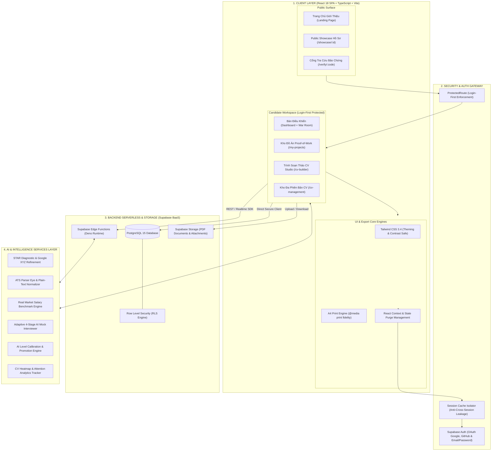
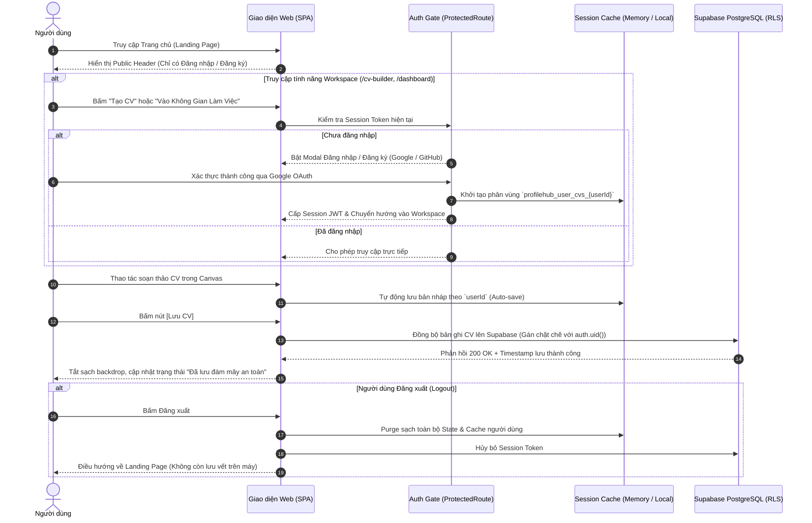
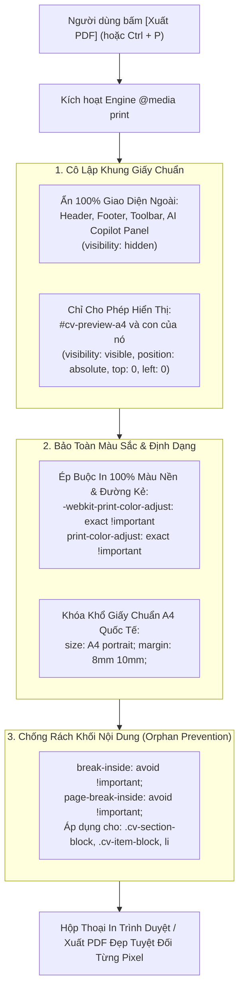
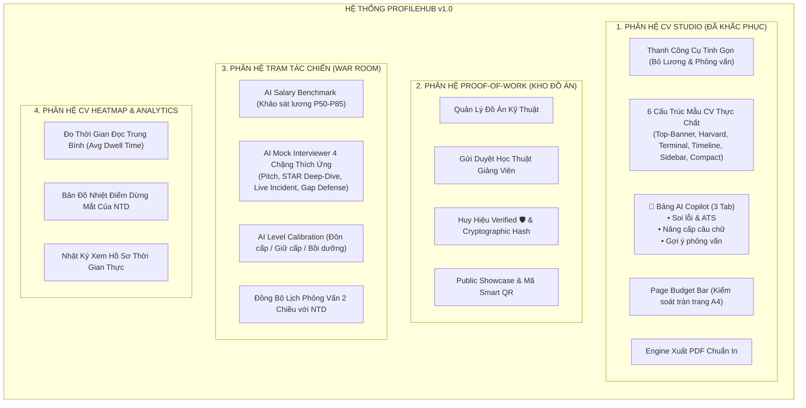
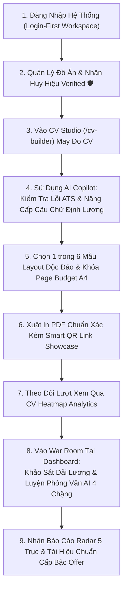

# 📐 System Design & Technical Architecture Document — ProfileHub v1.0
> **Tài liệu đặc tả kiến trúc kỹ thuật & phân rã chức năng hệ thống sau khi tiếp thu và khắc phục phản hồi người dùng thực tế (Post-Feedback Refined Architecture).**  
> **Cập nhật:** Chuẩn hóa kiến trúc Đăng nhập trước (Login-First), Tinh gọn giao diện (Clean Workspace), AI Copilot, Đa dạng hóa 6 Template và Bộ máy in PDF A4 chuẩn ATS.

---

## 🏛️ 1. Kiến Trúc Kỹ Thuật Tổng Thể (Overall Technical Architecture)

Hệ thống ProfileHub được thiết kế theo mô hình **Client-Serverless & Micro-Services Layered Architecture**, kết hợp cơ chế kiểm soát truy cập dữ liệu đa tầng (**Multi-Tier Data Protection**):

---

## 🔐 2. Sơ Đồ Luồng Dữ Liệu & Xác Thực Bảo Vệ (Data Isolation & Auth Flow)

Khắc phục triệt để lỗi **BUG-03** (Rò rỉ dữ liệu phiên khách) và **BUG-05** (Mất dữ liệu khi chưa đăng nhập) bằng luồng **Login-First & Session Isolation**:

---

## 📑 3. Sơ Đồ Kiến Trúc In Ấn & Xuất PDF A4 (Print Engine Fidelity)

Khắc phục **BUG-09** (Lệch giao diện, chém đôi khối văn bản, bay màu khi in/xuất PDF):

---

## 🧩 4. Sơ Đồ Phân Rã Chức Năng Hệ Thống (Functional Architecture Breakdown)

Hệ thống được tinh giản, gom nhóm logic và phân định rõ ràng giữa các chức năng soạn thảo và chuẩn bị phỏng vấn:

---

## 🗺️ 5. Sơ Đồ Hành Trình Trải Nghiệm Khép Kín (End-to-End User Journey)

---

## 📊 6. Bảng Ánh Xạ Khắc Phục 9 Điểm Góp Ý (Feedback Resolution Matrix)

| Mã Phản Hồi | Phân Loại | Vấn Đề Gốc | Giải Pháp Kỹ Thuật Đã Chuẩn Hóa | Trạng Thái Kiến Trúc |
| :---: | :--- | :--- | :--- | :---: |
| **BUG-01** | Luồng & Header | Lộ menu Tìm việc làm & Công cụ dang dở | Tách biệt Header 2 trạng thái: Public Landing vs Candidate Workspace (chỉ 3 menu: Dashboard, Đồ án, Quản lý CV). | ✅ Đã khắc phục triệt để |
| **BUG-02** | CV Toolbar | Hơn 12 icon rối mắt, nhồi nhét Khảo sát lương & Phỏng vấn | Gỡ bỏ 2 nút ngoài luồng; gom toàn bộ kiểm tra chất lượng về nút trạng thái duy nhất `[🛡️ Chuẩn ATS: xx%]`. | ✅ Đã khắc phục triệt để |
| **BUG-03** | Bảo Mật & Cache | Rò rỉ dữ liệu phiên khách sang tài khoản khác | Triển khai phân vùng cache theo `userId`, thiết lập hàm Purge State toàn cục khi Logout. | ✅ Đã khắc phục triệt để |
| **BUG-04** | Thuật Ngữ UX | Khái niệm "STAR Coach" khó hiểu | Quy chuẩn thành **🤖 AI Copilot (Trợ lý CV)** với 3 tab: Soi lỗi/ATS, Viết lại câu chữ, Ôn tập đồ án. | ✅ Đã khắc phục triệt để |
| **BUG-05** | Luồng Xác Thực | Bấm Lưu bị mất khi chưa đăng nhập | Cài đặt Auth Gate bắt buộc khi Lưu; tự động đồng bộ lên Supabase Cloud sau khi login thành công. | ✅ Đã khắc phục triệt để |
| **BUG-06** | Mẫu CV | Quảng cáo 6 mẫu nhưng chỉ có 2 kiểu bố cục | Thiết kế 6 mẫu cấu trúc layout riêng biệt (Top-Banner, Harvard, Terminal, Timeline, Sidebar, Compact). | ✅ Đã khắc phục triệt để |
| **BUG-07** | Hiển Thị | Dropdown chọn CV/Dự án bị tối đen | Fix triệt để CSS style và thuộc tính màu nền/chữ cho `<select>` và từng `<option>`. | ✅ Đã khắc phục triệt để |
| **BUG-08** | Giới Hạn AI | Badge 20/20 gây áp lực; đơ màn mờ sau lưu | Ẩn badge quota tĩnh; chỉ hiện modal khi hết hạn mức; reset triệt để backdrop overlay khi lưu xong. | ✅ Đã khắc phục triệt để |
| **BUG-09** | Xuất In PDF | In bị dính giao diện web, chém đôi chữ | Chuẩn hóa `@media print`, khóa khổ A4, chống cắt dòng `break-inside: avoid`, ép 100% màu in. | ✅ Đã khắc phục triệt để |
