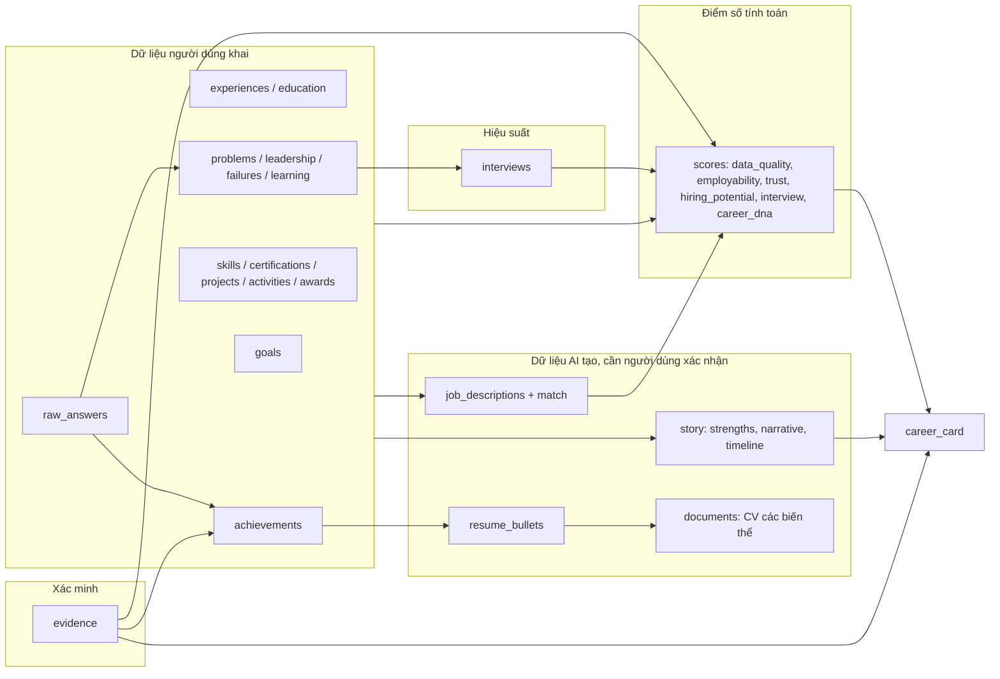

# Career Data Model v1

**Dự án:** ProfileHub, Career OS
**Đi kèm:**

| File | Vai trò |
|---|---|
| `career_profile_v1.schema.json` | JSON Schema (draft 2020-12), nguồn chuẩn để validate dữ liệu |
| `career_profile_v1.example.json` | Ví dụ hồ sơ mẫu (ngành Marketing, đang ở Stage 2 của Discovery) |
| `career_discovery_question_bank_v1.md` | Mã câu hỏi (`ACH-01`, `IT-PS-01`…) được ánh xạ vào model ở mục 4 |
| `career_discovery_flow_v1.md` | Flow và cách chấm điểm dữ liệu, được chuẩn hóa thành công thức ở mục 6 |

---

## 1. Nguyên tắc thiết kế

1. **Một model cho mọi chức năng.** Discovery ghi, CV Builder, Interview Coach, Career Card, Intelligence Engine đọc (và một số ghi thêm phần của mình).
2. **Mọi dữ liệu đều có nguồn gốc (provenance).** Mỗi thực thể quan trọng mang `meta`: ai nói, từ câu hỏi nào, ước lượng hay chính xác, đã xác minh chưa.
3. **Tách "dữ liệu người dùng khai" khỏi "dữ liệu AI suy ra" và "điểm số tính toán".** Điểm số luôn là dữ liệu dẫn xuất, tính lại được, không cho người dùng sửa tay.
4. **Truy vết hai chiều.** Mỗi đoạn trong CV, câu trong narrative, điểm số đều trỏ ngược về thực thể nguồn (`source_refs`). Nhờ đó không có chuyện AI thêm thông tin không có trong hồ sơ.
5. **Mặc định riêng tư.** `visibility` mặc định là `private`. Career Card chỉ hiển thị phần người dùng chủ động mở.
6. **Có version.** `schema_version` ở hồ sơ, `formula_version` và `rubric_version` ở mọi điểm số, để so sánh và hiệu chuẩn theo thời gian.

---

## 2. Cấu trúc tổng thể



### Các khối chính trong schema

| Khối (path) | Nội dung | Ghi bởi |
|---|---|---|
| `user`, `profile` | Thông tin cơ bản, ngành (tối đa 2), level, persona | Onboarding (Stage 0) |
| `discovery` | Trạng thái flow: stage, hàng đợi deep-dive, phiên, các khoảng trống (`gaps`) | Discovery Engine |
| `raw_answers` | Câu trả lời gốc theo `question_id` | Discovery Engine |
| `experiences`, `education` | Khung kinh nghiệm và học vấn | Stage 1-2 |
| `achievements` | Thành tích dạng STAR, số liệu, điểm chất lượng, bullet CV | Stage 2, Achievement Extractor |
| `problems`, `leadership`, `failures`, `learning` | Kho câu chuyện cho phỏng vấn hành vi | Stage 2, 4 |
| `skills`, `certifications`, `projects`, `activities`, `awards` | Dữ liệu nền tảng | Stage 3 |
| `industry_data` | Dữ liệu đặc thù ngành (khóa là mã ngành: `IT`, `MKT`…) | Industry Modules |
| `goals` | Mục tiêu, vị trí đích, khoảng cách, ràng buộc | Stage 5 |
| `story` | Timeline, bước ngoặt, thế mạnh, narrative | Stage 6 |
| `evidence` | Bằng chứng (chứng chỉ, tài liệu, link, lời xác nhận), trỏ tới thực thể mà nó chứng minh | Người dùng tải lên, tích hợp |
| `job_descriptions` | JD đã phân tích và kết quả match | JD Intelligence |
| `documents` | CV đã sinh (ATS, Recruiter, Manager, Executive) kèm audit | Resume Builder, Auditor |
| `interviews` | Phiên luyện phỏng vấn, điểm từng câu | Interview Coach |
| `scores` | Điểm dẫn xuất | Career Intelligence Engine |
| `career_card` | Cấu hình hiển thị Career Card, QR, Recruiter View | Career Card |
| `consents` | Đồng ý xử lý dữ liệu, hiển thị công khai, theo dõi lượt xem… | Hệ thống |

---

## 3. Metadata nguồn gốc và xác minh

Đây là phần làm nên Trust Score và Verified Evidence. Mọi thực thể chính (achievement, experience, skill, certification, story…) có trường `meta`.

```json
"meta": {
  "source_type": "user_stated",
  "source_question_ids": ["ACH-01", "MKT-IMP-02"],
  "raw_answer_ids": ["raw_01", "raw_02"],
  "estimated": true,
  "confidence": "medium",
  "verification": { "status": "self_reported" },
  "visibility": "private",
  "created_at": "...",
  "updated_at": "..."
}
```

### 3.1 `source_type`

| Giá trị | Ý nghĩa |
|---|---|
| `user_stated` | Người dùng tự nói trong Discovery |
| `ai_inferred` | AI suy ra (ví dụ thế mạnh, DNA signal, kỹ năng mềm) |
| `imported_cv` / `imported_linkedin` | Nhập từ CV hoặc LinkedIn |
| `third_party` | Do bên thứ ba cung cấp (nhà tuyển dụng, người xác nhận) |

### 3.2 Thang xác minh (`verification.status`)

| Trạng thái | Điều kiện | Trọng số trong Trust Score |
|---|---|---|
| `self_reported` | Người dùng tự khai (mặc định) | 0 |
| `evidence_attached` | Có ít nhất 1 bằng chứng trong `evidence[]` trỏ tới thực thể này | 0.6 |
| `third_party_verified` | Đã kiểm tra qua mã chứng chỉ, link kiểm chứng, người tham chiếu xác nhận hoặc tích hợp hệ thống (`verification.method`) | 1.0 |
| `disputed` | Có mâu thuẫn hoặc bị phản ánh | trừ điểm |

### 3.3 Ước lượng số liệu

- Số liệu người dùng không chắc: `Metric.estimated = true` và (nếu cả thực thể dựa vào số ước lượng) `meta.estimated = true`.
- CV hiển thị số ước lượng kèm ký hiệu "~" hoặc "khoảng", do người dùng duyệt.
- Số ước lượng chỉ được nâng lên `third_party_verified` sau khi có bằng chứng xác nhận đúng con số đó, khi đó gỡ cờ `estimated`.

---

## 4. Ánh xạ Question Bank sang Data Model

| Mã câu hỏi | Đường dẫn dữ liệu |
|---|---|
| ACH-01 | `achievements[].title` |
| ACH-02 | `achievements[].role`, `achievements[].star.actions` |
| ACH-03 | `evidence[]` (type `testimonial`/`document`) với `supports` trỏ tới achievement; `achievements[].evidence_ids` |
| ACH-04 | `awards[]` |
| ACH-05 | `achievements[].beyond_scope` |
| IMP-01 | `achievements[].result.metrics[]` |
| IMP-02 | `achievements[].result.before_after` |
| IMP-03 | `achievements[].result.scale` |
| IMP-04 | `achievements[].result.qualitative` |
| IMP-05 | `achievements[].result.sustainability` |
| LEAD-01 | `leadership[].scope` |
| LEAD-02 | `leadership[].method` |
| LEAD-03 | `leadership[].conflict_story` |
| LEAD-04 | `leadership[].mentoring` |
| LEAD-05 | `leadership[]` với `formal: false` |
| PS-01, PS-02, PS-03, PS-04, PS-05 | `problems[].star`, `analysis`, `options` + `decision_rationale`, `reflection`, `involved_ambiguity` |
| LRN-01 | `learning[]` với `kind: self_taught` |
| LRN-02, LRN-03 | `failures[].story`, `lesson`, `applied_afterwards` |
| LRN-04 | `learning[]` với `kind: feedback_handling` |
| LRN-05 | `learning[]` với `kind: current_goal` |
| LRN-06 | `certifications[]` |
| GOAL-01 | `goals.short_term`, `goals.long_term` |
| GOAL-02 | `goals.priorities` |
| GOAL-03 | `goals.culture_fit` |
| GOAL-04 | `goals.target_roles`, `goals.gaps` |
| GOAL-05 | `goals.constraints` |
| EXP-01 | `experiences[]` |
| EXP-02 | `experiences[].responsibilities`, `highlight` |
| SKL-01 | `skills.hard[]` |
| SKL-02 | `skills.soft[]` |
| ACT-01 | `activities[]` |
| PRJ-01, PRJ-02 | `projects[]` (`motivation`, `stack_or_methods`, `links`) |
| STORY-01, STORY-02 | `story.timeline[]` |
| STORY-03 | `story.turning_points[]` |
| STORY-04 | `story.strengths[]` (`origin: user_stated`) |
| STORY-05 | `story.narrative.hook` |
| STORY-06 | `story.narrative.theme` |
| Câu hỏi ngành `[MÃ]-*` | Số liệu vào `achievements[].result.metrics[]`; phần còn lại vào `industry_data.[MÃ]` |

Mỗi câu trả lời được ghi vào `raw_answers` với `question_id`, và bản ghi có cấu trúc lưu lại `raw_answer_ids` để truy vết.

---

## 5. Quy tắc bất biến (Invariants)

Đây là các quy tắc hệ thống phải kiểm tra khi ghi hoặc sinh output. Nên cài thành validation ngoài JSON Schema.

| # | Quy tắc | Lý do |
|---|---|---|
| 1 | Mỗi `resume_bullet` chỉ được đưa vào CV khi `user_approved = true` | Người dùng chịu trách nhiệm nội dung CV |
| 2 | Mỗi block trong `documents[].blocks` phải có ≥ 1 `source_refs` hợp lệ | Không cho AI thêm thông tin không có nguồn |
| 3 | Mọi con số trong bullet phải có trong `Metric` tương ứng; nếu là ước lượng phải có `contains_estimated_figures = true` | Chống bịa số liệu |
| 4 | Dữ liệu `ai_inferred` (thế mạnh, DNA, kỹ năng mềm suy ra) chỉ được hiển thị ra ngoài (Career Card, CV) sau khi `confirmed_by_user = true` | Người dùng kiểm soát hình ảnh của mình |
| 5 | `verification.status` ≥ `evidence_attached` yêu cầu tồn tại `evidence[]` có `supports` trỏ tới thực thể đó | Tính nhất quán |
| 6 | Trường `scores.*` chỉ do hệ thống ghi, mỗi điểm có `formula_version` và `explanation` | Điểm phải giải thích được |
| 7 | `visibility` mặc định `private`. Career Card chỉ hiển thị phần có visibility ≥ mức của người xem | Quyền riêng tư |
| 8 | `scores.hiring_potential` có `status: experimental` không được đưa vào Recruiter View | Chưa hiệu chuẩn |
| 9 | Evidence chứa thông tin định danh khách hàng/bệnh nhân/bí mật công ty cần `sensitive_data_redacted = true` trước khi hiển thị | Bảo mật (ngành MED, FIN, IT) |
| 10 | Rút lại consent `public_profile` hoặc `recruiter_visibility` thì mọi `visibility` liên quan tự hạ về `private` | Tuân thủ đồng ý |
| 11 | Xóa hồ sơ phải xóa cả `raw_answers`, `interviews` (transcript, voice) và evidence file | Quyền xóa dữ liệu |

---

## 6. Công thức điểm số v1

Tất cả công thức là **phiên bản khởi đầu để thử nghiệm**. Số liệu và trọng số cần hiệu chuẩn với dữ liệu thật. Mỗi điểm lưu kèm `components` (từng thành phần và trọng số) và `explanation` (lý do để hiển thị cho người dùng).

### 6.1 Achievement Quality (`achievements[].quality`)

Giữ nguyên rubric của Discovery Flow, `rubric_version: "ach-1.0"`:

| Tiêu chí | Tối đa |
|---|---|
| Bối cảnh rõ (situation/task) | 15 |
| Vai trò cá nhân rõ | 20 |
| Hành động cụ thể (≥ 2) | 20 |
| Kết quả định lượng (xác nhận: 30, ước lượng: 20, định tính: 10) | 30 |
| Bằng chứng/xác nhận | 10 |
| Liên quan vị trí đích | 5 |

Nhãn: `≥ 80` strong, `60-79` acceptable, `40-59` needs_work, `< 40` weak.

### 6.2 Data Quality (`scores.data_quality`), `dq-1.0`

Trung bình có trọng số theo 9 nhóm (giữ nguyên bảng của Flow): Achievements và Impact 30%, Experience 10%, Skills 10%, Problem Solving 10%, Leadership 5%, Learning và Failure 10%, Projects/Activities/Certs 5%, Career Goal 10%, Career Story 10%.

`readiness.cv` và `readiness.interview` dùng các ngưỡng (Gate) trong Flow mục 7 (65 và 70). `missing[]` liệt kê điều kiện chưa đạt, dùng để gap-filling.

### 6.3 Trust Score (`scores.trust`), `trust-1.0`

Đo **độ đáng tin của hồ sơ**, không đo năng lực.

| Thành phần | Trọng số | Cách tính |
|---|---|---|
| Verification rate | 35% | Trung bình trọng số xác minh (mục 3.2) trên achievements, certifications, awards, experiences |
| Evidence coverage | 20% | % achievements có ≥ 1 evidence |
| Consistency | 20% | 100 trừ điểm phạt: timeline chồng lấn/khoảng trống chưa giải thích, số liệu bất thường đã bị gắn cờ, mâu thuẫn giữa câu trả lời và hồ sơ |
| Specificity | 15% | % metric có `baseline` và `period`; số ước lượng tính 0.5 |
| Freshness | 10% | % thực thể được cập nhật hoặc xác minh trong 24 tháng gần nhất |

`disputed` trừ trực tiếp vào Verification rate. Người dùng ước lượng số liệu **đúng cách** (đã gắn cờ) không bị phạt thêm ngoài mức hệ số 0.5 ở Specificity, để không khuyến khích khai khống.

### 6.4 Employability Score (`scores.employability`), `emp-1.0`

Đo **mức sẵn sàng ứng tuyển**.

| Thành phần | Trọng số | Nguồn |
|---|---|---|
| Data quality overall | 35% | `scores.data_quality.overall` |
| Achievement strength | 25% | Trung bình điểm 3 achievement tốt nhất |
| Skills demonstrated | 10% | % kỹ năng chuyên môn có `proficiency_basis` khác `self_rated` hoặc có ví dụ |
| Target fit | 20% | Điểm match JD gần nhất cho vị trí đích (bỏ nếu chưa có JD) |
| Interview readiness | 10% | `scores.interview.overall` (bỏ nếu chưa luyện) |

- Thành phần `null` bị loại và trọng số còn lại được chuẩn hóa lại.
- `value = null`, `band = insufficient_data` nếu có ít hơn 2 achievements.
- Band: `< 50` low, `50-74` medium, `≥ 75` high.

### 6.5 Hiring Potential Score (`scores.hiring_potential`)

**Chưa tính ở v1.** Trường có sẵn nhưng để `value: null`, `status: experimental`. Điểm này chỉ có ý nghĩa khi đối chiếu được với kết quả tuyển dụng thật (được mời phỏng vấn, nhận offer). Cần dữ liệu đó trước khi định nghĩa công thức và hứa với người dùng hay nhà tuyển dụng.

### 6.6 Interview Score (`scores.interview`), `int-1.0`

- Mỗi câu trả lời chấm 5 tiêu chí (0-5): structure, specificity, personal_role, impact, relevance. `answer.score = tổng / 25 × 100`.
- `overall` = trung bình các phiên gần nhất (ưu tiên 5 phiên).
- `by_competency` = trung bình theo `competency`.
- **Blind spot:** competency có ≥ 3 câu trả lời trong ≥ 3 phiên khác nhau và (trung bình < 60 **hoặc** thấp hơn overall ≥ 15 điểm).
- Voice metrics (`confidence`, `clarity`, `pace_wpm`, `filler_rate`) lưu riêng, không trộn vào `answer.score` ở v1.

### 6.7 Career DNA (`scores.career_dna`), `dna-1.0`

Sáu loại: `builder`, `leader`, `operator`, `strategist`, `analyst`, `creator`.

| DNA | Dấu hiệu |
|---|---|
| builder | Tạo mới sản phẩm, hệ thống, chiến dịch, quy trình từ đầu |
| leader | Dẫn dắt, đào tạo, giải quyết xung đột, tạo ảnh hưởng lên người khác |
| operator | Cải thiện hiệu suất, độ ổn định, chi phí, tuân thủ quy trình |
| strategist | Lập kế hoạch, phân bổ nguồn lực, ra quyết định định hướng |
| analyst | Dùng dữ liệu để chẩn đoán, dự báo, ra khuyến nghị |
| creator | Ý tưởng nội dung, thiết kế, sáng tạo gốc |

Cách tính:
1. Mỗi achievement, leadership, project có `dna_signals`. Lúc đầu AI gán, người dùng thấy và có thể chỉnh.
2. Trọng số mỗi mục = `quality.score / 100`.
3. `distribution` = tổng trọng số mỗi loại, chuẩn hóa về tổng 1.
4. `primary` = loại cao nhất nếu `≥ 0.35`. `secondary` = loại thứ hai nếu `≥ 0.20`. Ngược lại `null`.
5. Chỉ tính khi có ≥ 3 mục có `quality.score ≥ 60`.

`supporting_refs` phải liệt kê các thực thể đã tạo nên kết quả, để giải thích được "vì sao bạn là Builder".

---

## 7. Chức năng nào đọc/ghi phần nào

| Chức năng | Đọc | Ghi |
|---|---|---|
| Career Discovery Engine | `discovery`, `profile`, `scores.data_quality` | `raw_answers`, `experiences`, `achievements`, `problems`, `leadership`, `failures`, `learning`, `skills`, `goals`, `story`, `discovery.gaps` |
| Achievement Extractor | `raw_answers`, `achievements.star/result` | `achievements[].resume_bullets` (chờ duyệt), `categories`, `dna_signals` |
| Evidence Engine | `achievements`, `certifications`, `evidence` | `achievements[].categories`, `evidence[]`, `meta.verification` |
| Resume Auditor | `documents`, `achievements`, `evidence` | `documents[].audit` |
| JD Intelligence | `job_descriptions`, `skills`, `achievements`, `experiences` | `job_descriptions[].parsed`, `match` |
| Dynamic Resume Builder | `achievements` (bullets đã duyệt), `experiences`, `skills`, `story`, `job_descriptions` | `documents[]` |
| Interview Coach | `problems`, `leadership`, `failures`, `achievements`, `story`, `job_descriptions`, `goals` | `interviews[]` |
| Blind Spot Analyzer, Growth Tracking | `interviews` | `scores.interview` |
| Career Intelligence Engine | Toàn bộ hồ sơ | `scores.*` |
| Career Card, Recruiter View | `story`, `achievements` (visibility phù hợp), `evidence`, `scores`, `career_card` | `career_card` |
| Career Analytics | `career_card`, `consents` | Bảng sự kiện riêng (xem mục 9) |

---

## 8. Ví dụ ngắn: một thành tích đi qua model

Người dùng nói: *"Bán được khoảng 2000 đơn trong tháng đầu, ngân sách 150 triệu."*

1. Ghi `raw_answers[raw_02]` với `question_id: "MKT-IMP-02"`.
2. Tạo `achievements[ach_01].star.metrics` gồm 2 metric; "2000 đơn" có `estimated: true`.
3. Chấm `quality.score = 65` (acceptable): thiếu bằng chứng và baseline.
4. Đặt `discovery.gaps` gợi ý hỏi `ACH-03` (bằng chứng) ở bước sau.
5. Extractor sinh `resume_bullets` với `user_approved: false`, `contains_estimated_figures: true`.
6. Người dùng duyệt, bullet mới được đưa vào CV, hiển thị "khoảng 2.000 đơn".
7. Sau này người dùng tải báo cáo từ Facebook Ads, tạo `evidence[]`, trạng thái lên `evidence_attached`, Trust Score tăng.

Xem đầy đủ trong `career_profile_v1.example.json`.

---

## 9. Gợi ý lưu trữ và triển khai

- **Tách theo tần suất thay đổi và kích thước:**
  - Hồ sơ chính (profile, experiences, achievements, skills…) một document hoặc nhóm bảng, cập nhật nhiều trong Discovery.
  - `interviews` tách collection/bảng riêng vì tăng nhanh. Transcript và file voice lưu ở kho file, trong model chỉ giữ tham chiếu.
  - `raw_answers` có thể tách để dễ xóa theo quyền riêng tư.
  - **Career Analytics** (lượt scan QR, ai xem, tải CV) là bảng sự kiện riêng, không nằm trong hồ sơ. Chỉ ghi khi có consent `analytics_tracking`, và cần quyết định công ty xem có được hiển thị định danh hay không.
- **Lưu lịch sử thay đổi** (audit log) với `achievements`, `evidence`, `verification`, vì Trust Score phụ thuộc lịch sử.
- **Điểm số tính lại** khi dữ liệu nguồn đổi, chạy nền. Lưu `formula_version` để hiển thị "điểm cũ tính bằng công thức cũ".
- **Kiểm tra dữ liệu ở 2 tầng:** JSON Schema cho cấu trúc, code cho các quy tắc ở mục 5 (tham chiếu chéo, ràng buộc).
- **ID có tiền tố** (`exp_`, `ach_`, `ev_`…) để đọc log dễ hơn. Schema chỉ yêu cầu chuỗi 3-64 ký tự, có thể siết thành pattern nếu team muốn.

---

## 10. Quyết định cần chốt trước khi triển khai

| # | Vấn đề | Ảnh hưởng |
|---|---|---|
| 1 | **Cơ chế xác minh:** chứng chỉ có mã kiểm tra được không? Người tham chiếu xác nhận bằng cách nào (email, link)? Tích hợp hệ thống nào (LinkedIn, GitHub, hệ thống ATS)? | Trust Score và Verified Evidence có ý nghĩa thật hay chỉ mang tính hình thức |
| 2 | **Ngôn ngữ dữ liệu:** dữ liệu lưu bằng ngôn ngữ người dùng nói, CV tiếng Anh sinh từ đó. Có cần lưu song ngữ cho từng bullet không? | Chất lượng CV tiếng Anh, độ phức tạp model |
| 3 | **Người dùng có sửa được `dna_signals` và `categories` AI gán không?** | Độ tin cậy Career DNA |
| 4 | **Recruiter thấy điểm nào?** Chỉ Trust và Interview, hay cả Employability? | Rủi ro hiểu sai điểm số, tranh chấp |
| 5 | **Career Analytics có hiển thị danh tính công ty/nhà tuyển dụng xem hồ sơ không?** | Quyền riêng tư của cả hai phía, pháp lý |
| 6 | **Thời gian lưu dữ liệu và xóa** (đặc biệt voice, transcript) | Tuân thủ quy định bảo vệ dữ liệu cá nhân |
| 7 | **Hiệu chuẩn công thức:** cần quy trình thu thập phản hồi (CV nhận được bao nhiêu phản hồi tích cực, phỏng vấn thực tế) để chỉnh trọng số | Điểm số có dự báo được kết quả hay không |
| 8 | **Nhiều ngành:** `industry_data` đang là object tự do theo mã ngành. Có cần schema chi tiết từng ngành ở v2 không? | Khả năng phân tích và so sánh theo ngành |

---

## 11. Bước tiếp theo đề xuất

1. Team review schema, chốt các mục ở phần 10.
2. Viết bộ test dữ liệu mẫu cho 3-4 ngành (IT, Marketing, Sales, Fresher) để thử schema và công thức.
3. Cài validator (JSON Schema + các quy tắc ở mục 5).
4. Bắt đầu MVP: Discovery, Achievement Extractor, Resume Builder, JD Intelligence, Resume Auditor.
