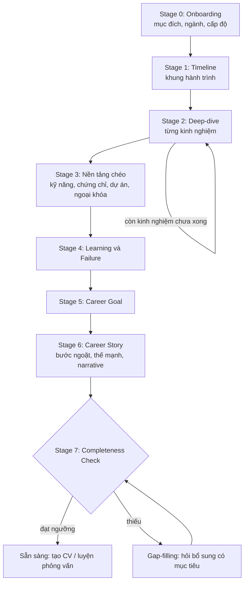

# Career Discovery Flow v1

**Dự án:** AI CV Builder & AI Interview Coach
**Đi kèm:** `career_discovery_question_bank_v1.md` (các mã câu hỏi như ACH-01, IT-PS-01… lấy từ file này)

## 1. Mục tiêu và nguyên tắc

**Mục tiêu:** dẫn người dùng qua một cuộc hội thoại có cấu trúc để thu thập đủ dữ liệu chất lượng, làm đầu vào cho tạo CV và luyện phỏng vấn.

**Nguyên tắc thiết kế**

1. **Hỏi theo câu chuyện, không hỏi như biểu mẫu.** Mỗi lần chỉ 1 câu chính.
2. **Đào sâu ít, nhưng chắc.** Chọn 3-5 kinh nghiệm quan trọng nhất để deep-dive, không hỏi dàn trải.
3. **Không bịa.** Số liệu không chắc phải gắn `estimated: true`. AI không tự thêm thành tích.
4. **Người dùng kiểm soát.** Luôn có nút "Bỏ qua", "Để sau", "Tôi không có". Không ép trả lời.
5. **Lưu tiến độ.** Chia thành các phiên ngắn (10-20 phút), có thể dừng và tiếp tục.
6. **Mỗi câu trả lời đều phục vụ output.** Hỏi gì thì phải biết dữ liệu đó đi vào phần nào của CV hoặc câu trả lời phỏng vấn.

---

## 2. Tổng quan flow



| Stage | Tên | Thời lượng gợi ý | Kết quả |
|---|---|---|---|
| 0 | Onboarding | 2 phút | Hồ sơ phân loại (persona) |
| 1 | Timeline | 3-5 phút | Danh sách mốc nghề nghiệp |
| 2 | Deep-dive (lặp) | 5-8 phút mỗi kinh nghiệm | Achievement/Impact đạt chuẩn STAR |
| 3 | Nền tảng chéo | 4-6 phút | Skills, certs, projects, activities |
| 4 | Learning và Failure | 3-5 phút | Câu chuyện thất bại và bài học |
| 5 | Career Goal | 3 phút | Mục tiêu, vị trí đích, khoảng cách |
| 6 | Career Story | 5 phút | Timeline có ý nghĩa, thế mạnh, narrative |
| 7 | Completeness Check | tự động | Điểm chất lượng, danh sách thiếu |

**Phân phiên gợi ý:** Phiên 1 = Stage 0-2 (kinh nghiệm 1). Phiên 2 = Stage 2 (các kinh nghiệm còn lại). Phiên 3 = Stage 3-6. Phiên 4 = Stage 7 và xác nhận.

---

## 3. Chi tiết từng Stage

### Stage 0: Onboarding

**Mục đích:** biết người dùng cần gì và là ai để chọn nhánh hỏi.

| Bước | Nội dung | Lưu vào |
|---|---|---|
| 0.1 | Giải thích ngắn: AI sẽ hỏi gì, mất bao lâu, dữ liệu dùng để làm gì | (consent) |
| 0.2 | Mục đích: `CV` / `Phỏng vấn` / `Cả hai` | `session.purpose` |
| 0.3 | Ngành (chọn 1-2 trong 10 module) | `profile.industry[]` |
| 0.4 | Cấp độ: Sinh viên/mới ra trường, 1-3 năm, 3-7 năm, 7+ năm/quản lý, Chuyển ngành | `profile.level` |
| 0.5 | Vị trí mục tiêu (có thể để trống, hỏi lại ở Stage 5) | `goals.target_role` |
| 0.6 | Ngôn ngữ CV/phỏng vấn: Việt / Anh / Song ngữ | `session.language` |
| 0.7 | Có tải CV cũ/LinkedIn không? (tùy chọn) | `raw.cv_upload` |

**Nếu người dùng đã upload CV cũ:** AI tự trích xuất khung Timeline (EXP-01), rồi chỉ hỏi xác nhận và bổ sung ở Stage 1 thay vì hỏi từ đầu.

**Persona (quyết định nhánh):**

| Persona | Điều kiện | Điều chỉnh flow |
|---|---|---|
| P1: Fresher | Sinh viên/mới ra trường, dưới 1 năm kinh nghiệm | Dùng module `FRS`; ưu tiên ACT, PRJ, LEAD-05; deep-dive đồ án, CLB, thực tập |
| P2: Junior/Mid | 1-7 năm | Flow chuẩn |
| P3: Senior/Manager | 7+ năm hoặc có quản lý | Tăng trọng số LEAD, PS-03, PS-05; deep-dive tối đa 5 kinh nghiệm gần nhất |
| P4: Career changer | Chuyển ngành | Thêm `FRS-CHG-01`, `FRS-TRF-01`, `FRS-MOT-01`; nhấn mạnh transferable skills |

---

### Stage 1: Timeline

**Mục đích:** dựng khung để các câu sau có chỗ bám.

| Bước | Câu hỏi | Ghi chú |
|---|---|---|
| 1.1 | STORY-01 (kể hành trình theo thời gian) | Người dùng tự do kể, AI không ngắt |
| 1.2 | EXP-01 (chuẩn hóa: công ty, chức danh, thời gian) | AI tóm tắt thành bảng để người dùng sửa |
| 1.3 | Xác nhận khoảng trống thời gian (>3 tháng) | Hỏi nhẹ nhàng, không phán xét. Người dùng có thể bỏ qua |
| 1.4 | **Chọn kinh nghiệm để deep-dive** | AI đề xuất 3-5 mục (gần nhất, dài nhất, phù hợp nhất với vị trí đích); người dùng đồng ý hoặc đổi |

**Dữ liệu ra:** `timeline[]`, `experience[]` (khung), `deep_dive_queue[]`.

---

### Stage 2: Deep-dive từng kinh nghiệm (vòng lặp)

Lặp cho mỗi mục trong `deep_dive_queue`. Đây là stage quan trọng nhất.

**Trình tự trong mỗi vòng**

| Bước | Câu hỏi | Ghi chú |
|---|---|---|
| 2.1 | EXP-02 (3 việc chính, 1 việc làm tốt nhất) | Mở đầu dễ trả lời |
| 2.2 | ACH-01, ACH-02 | Chọn 1-2 thành tích |
| 2.3 | IMP-01, IMP-02 | Định lượng |
| 2.4 | Câu hỏi ngành: `[ngành]-IMP-*`, `[ngành]-ACH-*` | Đào sâu KPI đặc thù |
| 2.5 | PS-01, PS-04 (P0). Thêm PS-02, PS-03 nếu mục đích có Phỏng vấn | Tình huống khó |
| 2.6 | LEAD-01 hoặc LEAD-05 (nếu có dấu hiệu dẫn dắt) | Điều kiện ở mục 4 |
| 2.7 | Câu hỏi ngành: `[ngành]-PS-*`, `[ngành]-TECH-*` | Chỉ hỏi nếu còn thiếu |
| 2.8 | AI tóm tắt lại bằng cấu trúc STAR, người dùng xác nhận/sửa | Bắt buộc |

**Kết quả mỗi vòng:** 1-3 bản ghi `achievements[]` có điểm chất lượng (mục 6), 0-1 bản ghi `problems[]`, 0-1 bản ghi `leadership[]`.

**Điều kiện thoát vòng sớm:** người dùng nói "không còn gì" hoặc đã có ≥ 2 achievement đạt điểm ≥ 70 cho kinh nghiệm đó.

**Bản tóm tắt STAR AI trình bày (mẫu):**

```
Situation: <bối cảnh>
Task: <nhiệm vụ / vai trò của bạn>
Action: <việc bạn trực tiếp làm>
Result: <kết quả + số liệu (estimated nếu ước lượng)>
Bạn thấy đúng chưa? Có gì cần sửa hoặc bổ sung không?
```

---

### Stage 3: Nền tảng chéo

**Mục đích:** thu thập dữ liệu không thuộc riêng kinh nghiệm nào.

| Bước | Câu hỏi | Điều kiện |
|---|---|---|
| 3.1 | SKL-01 (kỹ năng chuyên môn, tự chấm 1-5 + ví dụ) | Luôn hỏi |
| 3.2 | SKL-02 (kỹ năng mềm + tình huống chứng minh) | Luôn hỏi |
| 3.3 | LRN-06 (chứng chỉ, khóa học) | Luôn hỏi |
| 3.4 | PRJ-01, PRJ-02 (dự án cá nhân) | Luôn hỏi với P1, P4; P2/P3 hỏi nếu người dùng có |
| 3.5 | ACT-01 (ngoại khóa) | P0 với P1; P1 với persona khác |
| 3.6 | ACH-04 (giải thưởng, học bổng) | Luôn hỏi 1 lần |

**Quy tắc:** kỹ năng nào xuất hiện ở Stage 2 rồi thì AI tự điền sẵn và chỉ hỏi xác nhận, không hỏi lại từ đầu.

---

### Stage 4: Learning và Failure

**Mục đích:** lấy dữ liệu cho phỏng vấn hành vi. CV ít dùng, nhưng đây là phần giúp người dùng trả lời tốt nhất.

| Bước | Câu hỏi | Điều kiện |
|---|---|---|
| 4.1 | LRN-01 (kỹ năng tự học) | Luôn hỏi |
| 4.2 | LRN-02, LRN-03 (thất bại và bài học) | Bắt buộc nếu mục đích có Phỏng vấn; tùy chọn nếu chỉ CV |
| 4.3 | LRN-04 (feedback tiêu cực) | Mục đích có Phỏng vấn |
| 4.4 | LEAD-03 (xung đột nhóm) | Mục đích có Phỏng vấn, persona P2/P3 |
| 4.5 | PS-05 (quyết định khi thiếu thông tin) | Persona P3 |

**Lưu ý cảm xúc:** trước LRN-02, AI mở bằng một câu bình thường hóa ("Ai cũng có những lần chưa như ý, và nhà tuyển dụng thường đánh giá cao cách bạn học từ đó"). Nếu người dùng ngần ngại, cho phép chọn một thất bại nhỏ hơn.

---

### Stage 5: Career Goal

| Bước | Câu hỏi | Ghi chú |
|---|---|---|
| 5.1 | GOAL-04 (vị trí đích và khoảng cách) | Nếu Stage 0 đã có, chỉ hỏi phần "còn thiếu gì" |
| 5.2 | GOAL-01 (1 năm, 3-5 năm) | Luôn hỏi |
| 5.3 | GOAL-02 (ưu tiên công việc tiếp theo) | Luôn hỏi |
| 5.4 | GOAL-03, GOAL-05 (văn hóa, ràng buộc) | Mục đích có Phỏng vấn |
| 5.5 | LRN-05 (đang muốn học gì) | Tùy chọn |

**Dùng dữ liệu:** `goals.target_role` là căn cứ để AI chọn thành tích nào đặt lên đầu CV và câu hỏi phỏng vấn nào sẽ luyện.

---

### Stage 6: Career Story

**Mục đích:** biến dữ liệu rời rạc thành câu chuyện nhất quán.

| Bước | Hành động | Ai làm |
|---|---|---|
| 6.1 | STORY-03 (bước ngoặt) | Hỏi người dùng |
| 6.2 | STORY-04 (3 thế mạnh mọi người hay khen) | Hỏi người dùng |
| 6.3 | STORY-02, STORY-06 (động lực, giá trị xuyên suốt) | Hỏi người dùng (P2/P3, hoặc mục đích có Phỏng vấn) |
| 6.4 | **Tổng hợp thế mạnh:** AI đối chiếu STORY-04 với bằng chứng từ Stage 2-4, đề xuất 3-5 thế mạnh kèm bằng chứng | AI làm, người dùng xác nhận |
| 6.5 | **Sinh Career Narrative** (bản nháp 3-4 câu + bản 30 giây) | AI làm |
| 6.6 | STORY-05 (người dùng chỉnh "điều muốn nhà tuyển dụng nhớ") | Người dùng |
| 6.7 | Chốt narrative sau khi người dùng chỉnh | Người dùng xác nhận |

**Cấu trúc Career Narrative gợi ý:**

```
[Hiện tại] Tôi là <vai trò>, <số năm> năm trong <lĩnh vực>.
[Thế mạnh] Tôi mạnh ở <thế mạnh 1> và <thế mạnh 2>, ví dụ <thành tích tiêu biểu + số liệu>.
[Hành trình / Bước ngoặt] <bước ngoặt> đã dẫn tôi đến <định hướng hiện tại>.
[Hướng tới] Tôi đang tìm cơ hội <vị trí đích> để <giá trị muốn tạo ra>.
```

**Quy tắc:** mọi câu trong narrative phải truy ngược được về dữ liệu người dùng đã cung cấp (`source_ids`).

---

### Stage 7: Completeness Check

Chạy tự động sau Stage 6 (và có thể chạy sớm để gợi ý tiến độ). Xem chi tiết điểm ở mục 6.

1. Tính điểm từng nhóm dữ liệu và điểm tổng.
2. So với ngưỡng theo mục đích (mục 7).
3. Nếu đạt: hiển thị "Hồ sơ sẵn sàng" và cho chọn tạo CV hoặc luyện phỏng vấn.
4. Nếu thiếu: liệt kê tối đa 3 thiếu sót quan trọng nhất, hỏi bổ sung (gap-filling), rồi chạy lại.
5. Người dùng luôn có thể chọn **"Tạo luôn với dữ liệu hiện có"**. AI cảnh báo phần nào sẽ yếu.

---

## 4. Điều kiện rẽ nhánh

| Điều kiện | Hành động |
|---|---|
| Purpose = CV | Bỏ hoặc để tùy chọn: LEAD-02, LEAD-03, PS-02, PS-03, PS-05, LRN-04, GOAL-03, GOAL-05, STORY-02, STORY-06 |
| Purpose = Phỏng vấn | Bắt buộc: LRN-02, LRN-03, PS-02, PS-03, LEAD-03. Có thể bỏ: ACH-03, ACH-04, PRJ-02 |
| Level = Fresher | Dùng module `FRS`; thay "kinh nghiệm" bằng đồ án, thực tập, CLB, làm thêm ở Stage 2 |
| Người dùng nhắc "quản lý", "dẫn dắt", "team lead", "phụ trách nhóm" | Chèn LEAD-01 đến LEAD-04 trong vòng deep-dive hiện tại |
| Người dùng nhắc "chiến dịch", "doanh số", "deploy", "khách hàng lớn"… | Chèn câu hỏi ngành liên quan |
| Người dùng chọn 2 ngành | Hỏi module ngành chính đầy đủ, ngành phụ chỉ P0 |
| Người dùng chuyển ngành | Thêm `FRS-CHG-01`, `FRS-TRF-01`, `FRS-MOT-01` ngay sau Stage 1 |
| Người dùng trả lời "không có số liệu" | Kích hoạt hướng dẫn ước lượng (mục 5), fallback IMP-04 |
| Người dùng trả lời "không có/không nhớ" ≥ 3 lần liên tiếp | Chuyển sang nhánh gợi mở (đưa ví dụ mẫu) hoặc đề nghị chuyển sang phần khác |
| Kinh nghiệm cũ hơn 7 năm | Chỉ hỏi EXP-02 và 1 thành tích, không deep-dive |
| Người dùng đã upload CV | Điền sẵn Stage 1 và một phần SKL, chỉ hỏi xác nhận |

---

## 5. Quy tắc hội thoại của AI

**Nhịp hỏi**

- Mỗi lượt: 1 câu hỏi chính, kèm tối đa 1 câu gợi ví dụ.
- Sau mỗi câu trả lời hữu ích: xác nhận ngắn ("Đã ghi nhận…") rồi hỏi tiếp, không lặp lại toàn bộ.
- Sau mỗi 5-7 câu: tóm tắt tiến độ ("Bạn đã hoàn thành 2/4 kinh nghiệm").

**Khi nào probe (Phần 5 của Question Bank)**

| Dấu hiệu | Probe |
|---|---|
| Câu trả lời dưới ~15 từ cho câu P0 | Cụ thể hóa |
| Có kết quả nhưng không có số hoặc mức độ | Định lượng |
| Dùng "chúng tôi", "nhóm mình" liên tục | Vai trò cá nhân |
| Thành tích không có bối cảnh | Bối cảnh |
| Kể sự việc nhưng không nói kết quả | Hệ quả |
| Tự nhận thành tích lớn nhưng không có dấu vết | Bằng chứng (nhẹ nhàng) |

- Tối đa **2 probe** cho mỗi câu. Sau đó ghi nhận những gì có và chuyển tiếp, để `gap` lại cho Stage 7.

**Khi người dùng không có số liệu**

1. Gợi ý cách ước lượng: "Khoảng bao nhiêu người/lần/tiền? Tăng gấp đôi hay chỉ nhích nhẹ?"
2. Cho chọn khoảng: `<10%`, `10-30%`, `30-50%`, `>50%`.
3. Ghi `estimated: true` và `confidence: low/medium`.
4. Nếu vẫn không có: dùng IMP-04 (tác động định tính).
5. Không bao giờ tự thêm con số người dùng chưa xác nhận.

**Khi câu trả lời có dấu hiệu phóng đại hoặc mâu thuẫn**

- Hỏi lại trung tính: "Bạn giúp mình làm rõ mốc thời gian này nhé…"
- Không buộc tội. Nếu vẫn không rõ, gắn `verified: false` và không đưa vào CV ở dạng khẳng định mạnh.

**Bảo vệ dữ liệu nhạy cảm**

- Nhắc người dùng không nhập thông tin định danh của bệnh nhân, khách hàng, bí mật công ty (đặc biệt ngành `MED`, `FIN`, `IT`).
- Cho phép ẩn danh hóa: "một ngân hàng top 5", "một khách hàng lớn trong ngành bán lẻ".

---

## 6. Chấm điểm chất lượng dữ liệu

### 6.1 Điểm cho mỗi Achievement (0-100)

| Tiêu chí | Điểm | Cách chấm |
|---|---|---|
| Bối cảnh rõ (Situation/Task) | 15 | Có mô tả tình huống, mục tiêu |
| Vai trò cá nhân rõ | 20 | Nêu được việc *bản thân* làm, không chỉ "nhóm" |
| Hành động cụ thể | 20 | Có ≥ 2 hành động/quyết định cụ thể |
| Kết quả có số liệu | 30 | Có số (đã xác nhận: 30; ước lượng: 20; chỉ định tính: 10) |
| Bằng chứng/xác nhận | 10 | Có người xác nhận, tài liệu, link |
| Liên quan vị trí đích | 5 | Khớp với `goals.target_role` |

**Nhãn:** `≥ 80` Mạnh · `60-79` Đạt · `40-59` Cần bổ sung · `< 40` Yếu

### 6.2 Điểm theo nhóm dữ liệu (0-100)

| Nhóm | Trọng số | Cách tính gợi ý |
|---|---|---|
| Achievements và Impact | 30% | Trung bình 3 achievement tốt nhất |
| Experience (khung) | 10% | Đủ công ty, chức danh, thời gian, trách nhiệm |
| Skills (hard và soft) | 10% | Có ví dụ chứng minh cho ≥ 70% kỹ năng chính |
| Problem Solving | 10% | ≥ 2 câu chuyện đủ STAR |
| Leadership | 5% | ≥ 1 câu chuyện (chính thức hoặc không chính thức) |
| Learning và Failure | 10% | ≥ 1 thất bại có bài học và ứng dụng |
| Projects, Activities, Certs | 5% | Có ít nhất 1 mục, hoặc người dùng xác nhận "không có" |
| Career Goal | 10% | Có vị trí đích + ngắn hạn + khoảng cách |
| Career Story | 10% | Có bước ngoặt, thế mạnh xác nhận, narrative chốt |

Nhóm người dùng xác nhận "không có" tính là **đã trả lời** (điểm đầy đủ về độ đầy đủ nhưng không cộng chất lượng).

---

## 7. Ngưỡng sẵn sàng (Readiness Gates)

### Gate CV

| Điều kiện | Yêu cầu tối thiểu |
|---|---|
| Achievements | ≥ 3, trong đó ≥ 2 có điểm ≥ 60 |
| Kết quả định lượng | ≥ 50% achievement có số (đã xác nhận hoặc ước lượng) |
| Experience | Đủ khung cho mọi mục trong 5 năm gần nhất |
| Skills | ≥ 5 kỹ năng chuyên môn, mỗi kỹ năng có mức độ |
| Career Goal | Có `target_role` |
| Điểm tổng | ≥ 65 |

Fresher: thay "≥ 3 achievements" bằng "≥ 3 mục trong achievements/projects/activities" và giảm yêu cầu định lượng xuống 30%.

### Gate Phỏng vấn

| Điều kiện | Yêu cầu tối thiểu |
|---|---|
| Câu chuyện STAR hoàn chỉnh | ≥ 5, phủ ít nhất 4/6 nhóm: Achievement, Leadership, Problem Solving, Conflict, Failure, Learning |
| Failure story | ≥ 1 đầy đủ bài học và ứng dụng |
| Career narrative | Đã chốt bản 30 giây |
| Career Goal và lý do chọn vị trí | Có |
| Điểm tổng | ≥ 70 |

### Trạng thái

| Điểm tổng | Trạng thái | Hành động hệ thống |
|---|---|---|
| ≥ ngưỡng gate | Sẵn sàng | Cho phép tạo output |
| Gate - 15 đến Gate | Gần đủ | Đề xuất tối đa 3 câu bổ sung, cho phép "tạo luôn" |
| < Gate - 15 | Chưa đủ | Tiếp tục discovery; nếu người dùng ép tạo, cảnh báo rõ phần yếu |

---

## 8. Điều kiện dừng và nối phiên

**Dừng phiên (lưu tiến độ) khi**

- Người dùng nhấn "Để sau" hoặc không phản hồi 10 phút.
- Đã hỏi > 25 câu chính trong một phiên (chống mệt mỏi), AI đề nghị nghỉ.
- Vừa hoàn thành một Stage.

**Kết thúc Discovery khi**

- Đạt Readiness Gate và người dùng xác nhận, hoặc
- Người dùng chọn "Tạo luôn với dữ liệu hiện có".

**Khi quay lại phiên sau**

1. Chào và tóm tắt: "Lần trước bạn hoàn thành X, còn thiếu Y."
2. Hiển thị thanh tiến độ theo Stage.
3. Hỏi tiếp từ điểm dừng, không hỏi lại các câu đã có.

**Khi người dùng cập nhật sau này** (đổi việc, có thành tích mới): chỉ chạy mini-flow gồm Stage 1 (cập nhật timeline), Stage 2 (kinh nghiệm mới), Stage 5, Stage 7.

---

## 9. Output của mỗi Stage (handoff sang Data Model)

| Stage | Trường dữ liệu chính được ghi |
|---|---|
| 0 | `session`, `profile.industry`, `profile.level`, `goals.target_role` |
| 1 | `timeline[]`, `experience[]`, `deep_dive_queue[]` |
| 2 | `achievements[]`, `impact`, `problems[]`, `leadership[]`, `industry.*` |
| 3 | `skills`, `certifications[]`, `projects[]`, `activities[]`, `awards[]` |
| 4 | `learning[]`, `failures[]`, `problems[].ambiguity`, `leadership[].conflict_story` |
| 5 | `goals.*` |
| 6 | `turning_points[]`, `strengths`, `narrative` |
| 7 | `quality_scores`, `readiness`, `gaps[]` |

Mỗi bản ghi nên mang theo metadata: `source_question_id`, `estimated`, `verified`, `confidence`, `updated_at`. Đây là đầu vào cho **Career Data Model v1** (deliverable tiếp theo).

---

## 10. Ví dụ hội thoại ngắn (Stage 2, ngành Marketing)

> **AI:** Trong thời gian làm ở công ty ABC, chiến dịch nào bạn thấy tự hào nhất?
> **User:** Chiến dịch ra mắt sản phẩm mới, khá thành công.
> **AI:** Nghe hay đấy. "Thành công" ở đây cụ thể là gì? Ví dụ số lượt tiếp cận, đơn hàng hoặc doanh thu? *(probe: định lượng)*
> **User:** Bán được khoảng 2000 đơn trong tháng đầu.
> **AI:** Tốt. Còn phần nào do riêng bạn phụ trách trong chiến dịch này? *(probe: vai trò cá nhân)*
> **User:** Mình lên kế hoạch nội dung và chạy Facebook Ads, ngân sách khoảng 150 triệu.
> **AI:** Vậy là bạn phụ trách nội dung và quảng cáo Facebook với ngân sách 150 triệu, ra khoảng 2000 đơn trong tháng đầu. Mình tính ra chi phí mỗi đơn khoảng 75 nghìn. Con số 2000 đơn là chính xác hay ước lượng?
> **User:** Ước lượng, chính xác là 1.9-2.1 nghìn.
> **AI:** Mình ghi là "~2.000 đơn (ước lượng)" nhé. *(ghi `estimated: true`)* Tiếp theo: lúc đó có khó khăn nào khiến chiến dịch suýt không đạt mục tiêu không?

---

## 11. Việc cần quyết định trước khi triển khai

| # | Câu hỏi cho team | Ảnh hưởng |
|---|---|---|
| 1 | Discovery chạy dạng chat tự do hay giao diện từng bước có thẻ chọn? | Cách AI điều hướng và lưu dữ liệu |
| 2 | Có bắt buộc khai thác đủ Stage 4 (failure) cho người chỉ làm CV không? | Độ dài flow |
| 3 | Ngưỡng điểm 65/70 đã hợp lý chưa, cần thử với người dùng thật | Tỷ lệ hoàn thành flow |
| 4 | Ngôn ngữ song ngữ Việt-Anh: hỏi bằng tiếng Việt, lưu dữ liệu bằng ngôn ngữ nào? | Data Model và chất lượng CV tiếng Anh |
| 5 | Xử lý thông tin nhạy cảm và thời gian lưu dữ liệu | Pháp lý, niềm tin người dùng |
