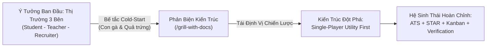
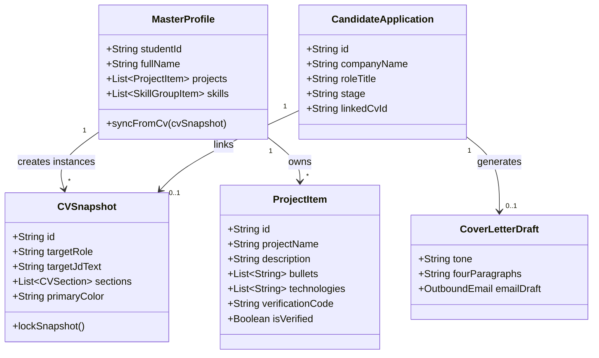
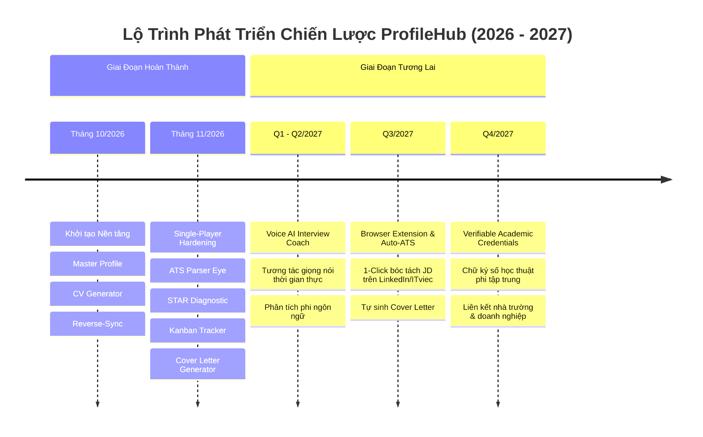

# 🚀 Kế Hoạch Phát Triển Dự Án ProfileHub: Từ Khởi Nguồn Ý Tưởng, Hiện Tại Đến Tương Lai
> **Tài liệu Phân tích Nghiệp vụ, Kiến trúc Miền & Lộ trình Sản phẩm Chuẩn Doanh nghiệp**  
> **Dự án:** ProfileHub — Evidence-Based Career Platform  
> **Tác giả:** Phạm Thái Bảo (MSSV: 22114919) — Trường Đại học Hoa Sen / Công ty TNHH Alpaca Solutions  
> **Phiên bản:** v2.5 Enterprise — Cập nhật toàn diện Tháng 11/2026  
> **File Word đính kèm:** [`KE_HOACH_PHAT_TRIEN_DU_AN_PROFILEHUB.docx`](file:///C:/Users/ADMIN/Desktop/STUDY/profilehub/docs/product/KE_HOACH_PHAT_TRIEN_DU_AN_PROFILEHUB.docx)

---

## 1. Bối Cảnh Khởi Nguồn & Triết Lý Nền Tảng (The Origin & Philosophy)

### 1.1. Khởi nguồn từ trăn trở thực tiễn
Trong bối cảnh thị trường việc làm ngành Công nghệ Thông tin (CNTT) ngày càng phân hóa sâu sắc và cạnh tranh khốc liệt, sinh viên mới ra trường và các lập trình viên sơ cấp (Junior/Fresher) phải đối mặt với một nghịch lý nan giải: **Nhà tuyển dụng luôn yêu cầu kinh nghiệm thực tế, nhưng ứng viên lại không có cơ hội tích lũy kinh nghiệm nếu không được tuyển dụng.**

Khảo sát thực tế các công cụ tạo CV phổ biến hiện nay (như TopCV, Canva hay các mẫu mạng xã hội) cho thấy một khoảng trống rất lớn:
1. **Thiên về hình thức, rỗng về chất lượng:** Phần lớn chỉ là các công cụ định dạng đồ họa (Formatting Tools). Chúng khuyến khích ứng viên tạo các bố cục hai cột chia màu bắt mắt, chèn biểu đồ thanh phần trăm kỹ năng vô căn cứ (`Java 90%`, `React 85%`).
2. **Cái bẫy máy quét ATS quốc tế:** Khi nộp hồ sơ vào các tập đoàn công nghệ lớn hoặc doanh nghiệp có vốn đầu tư nước ngoài sử dụng hệ thống ATS (Applicant Tracking System như Workday, Taleo, Greenhouse), các layout 2 cột màu mè thường bị máy quét bóc tách xáo trộn thứ tự từ ngữ, khiến ứng viên bị đánh trượt oan uổng ngay từ vòng gửi xe.
3. **Hiện tượng "Thổi phồng số liệu viển vông":** Rất nhiều ứng viên bị lạm dụng các lời khuyên chung chung về việc viết số liệu định lượng, dẫn đến việc tự bịa ra những con số kinh doanh ảo (`tăng doanh thu công ty 30%`, `tiết kiệm 2 tỷ đồng chi phí vận hành` trong khi bản chất chỉ là bài tập lớn môn học). Khi bước vào vòng phỏng vấn kỹ thuật gặp Tech Lead hỏi sâu, ứng viên lập tức lúng túng và bị đánh giá thiếu trung thực (Dishonesty).

### 1.2. Triết lý "Evidence First, Data First, AI Second"
Đứng trước nghịch lý đó, **ProfileHub** được xác lập sứ mệnh không phải là một công cụ AI tạo CV thông thường, mà là một **Nền Tảng Hồ Sơ Nghề Nghiệp Dựa Trên Bằng Chứng Thực Tế (Evidence-Based Career Platform)**. Dự án lấy Đồ án môn học, Khóa luận tốt nghiệp và Dự án mã nguồn mở làm hạt nhân uy tín, biến các dòng code và sản phẩm chạy thực tế (Live Demo) của sinh viên thành tài sản nghề nghiệp có thể kiểm chứng được.

> [!IMPORTANT]
> **Nguyên tắc "Zero Hallucination" & "Zero Fake Metrics":**  
> AI tuyệt đối không được tự ý bịa đặt kinh nghiệm, kỹ năng hay số liệu kinh doanh viển vông. Dữ liệu cốt lõi phải xuất phát từ `Master Profile` và các bằng chứng kỹ thuật có thật. AI chỉ đóng vai trò là trợ lý khai thác thông tin, phát hiện điểm yếu câu từ và may đo theo yêu cầu của từng bản mô tả công việc (JD).

---

## 2. Hành Trình Tiến Hóa Kiến Trúc: Bước Ngoặt Sang Single-Player Utility

### 2.1. Thách thức "Con gà & Quả trứng" (Cold-Start Problem)
Ở giai đoạn đầu, dự án được kỳ vọng xây dựng theo mô hình thị trường ba phía (Three-Sided Marketplace) kết nối: Sinh viên $\leftrightarrow$ Giảng viên $\leftrightarrow$ Nhà tuyển dụng. Tuy nhiên, khi đưa vào phân tích thực chiến, mô hình này đối mặt ngay với cái bẫy Cold-Start:
- Sinh viên không có động lực tạo hồ sơ nếu nền tảng chưa có sẵn các nhà tuyển dụng chất lượng.
- Nhà tuyển dụng từ chối tham gia nếu cơ sở dữ liệu ứng viên còn thưa thớt và chưa được bảo chứng.
- Giảng viên không có thời gian duyệt từng bài tập nếu luồng thao tác phức tạp và rời rạc.

### 2.2. Quyết định kiến trúc bước ngoặt (The Single-Player Pivot)
Để phá vỡ bế tắc, đội ngũ đã thực hiện quyết định kiến trúc quan trọng nhất: **Ưu tiên giá trị Single-Player Utility lên hàng đầu.**
Ngay cả khi sinh viên là người dùng duy nhất trên hệ thống và không có bất kỳ ai khác online, ProfileHub vẫn mang lại giá trị độc lập cực lớn:
- Quản lý tập trung toàn bộ kho đồ án trong suốt 4 năm đại học.
- 1-click may đo bản CV riêng biệt cho từng JD cụ thể mà không làm ảnh hưởng hồ sơ gốc.
- Tự soi lỗi bẫy máy quét ATS và tự đo chiều cao trang in vừa vặn khổ A4.
- Nhận diện lỗ hổng diễn đạt và luyện phòng thủ câu hỏi kỹ thuật trước khi bước vào phòng phỏng vấn.

---

## 3. Hiện Trạng Hệ Thống & Các Trụ Cột Đột Phá Đã Hoàn Thành (Current State)

Đến tháng 11/2026, ProfileHub đã hoàn thiện toàn diện với **37 test files (151/151 tests pass 100%)**, đạt chuẩn TypeScript Strict Mode (0 `any`), kiến trúc zero-cost offline-resilient:

| STT | Trụ Cột Tính Năng | Mô Tả Kỹ Thuật & Giá Trị Thực Tiễn | File Thành Phần Cốt Lõi |
| :---: | :--- | :--- | :--- |
| **1** | **Master Profile & CV Instance** | Phân tách kho dữ liệu gốc và các bản CV phái sinh; hỗ trợ Đồng bộ ngược (Reverse-Sync) và Snapshot bất biến khi xuất bản. | [`cvService.ts`](file:///C:/Users/ADMIN/Desktop/STUDY/profilehub/src/services/cvService.ts), [`projectReverseSync.ts`](file:///C:/Users/ADMIN/Desktop/STUDY/profilehub/src/services/projectReverseSync.ts) |
| **2** | **Mắt Thần ATS (ATS Parser Eye)** | Phân tích chuỗi Plain-Text theo cơ chế của Workday/Taleo; cảnh báo bẫy vỡ nội dung layout 2 cột; 1-click chuyển Harvard 1 cột. | [`atsParserEyeService.ts`](file:///C:/Users/ADMIN/Desktop/STUDY/profilehub/src/services/atsParserEyeService.ts), [`AtsParserEyeModal.tsx`](file:///C:/Users/ADMIN/Desktop/STUDY/profilehub/src/components/student/AtsParserEyeModal.tsx) |
| **3** | **Trợ Lý Khám Sức Khỏe STAR** | Phát hiện động từ bị động ("hỗ trợ", "tham gia"); gợi mở 4 nguồn số liệu kỹ thuật tái hiện được (Lighthouse, Vitest, k6, EXPLAIN). | [`starDiagnosticService.ts`](file:///C:/Users/ADMIN/Desktop/STUDY/profilehub/src/services/starDiagnosticService.ts), [`StarCvDiagnosticModal.tsx`](file:///C:/Users/ADMIN/Desktop/STUDY/profilehub/src/components/student/StarCvDiagnosticModal.tsx) |
| **4** | **Page-Budget Guard & Smart QR** | Đo chiều cao render thời gian thực so với khổ giấy A4 (297mm); mã Smart QR vector 28px in trên bản cứng quét mở demo tức thì. | [`pageBudgetService.ts`](file:///C:/Users/ADMIN/Desktop/STUDY/profilehub/src/services/pageBudgetService.ts), [`ProjectQRCodeModal.tsx`](file:///C:/Users/ADMIN/Desktop/STUDY/profilehub/src/components/student/ProjectQRCodeModal.tsx) |
| **5** | **Phòng Luyện Phỏng Vấn War Room** | Mô phỏng 4 chặng phỏng vấn thích ứng: Elevator Pitch, STAR Deep-Dive, Live Incident khẩn cấp, Bào chữa lỗ hổng; xuất Radar 5 trục. | [`aiMockInterviewService.ts`](file:///C:/Users/ADMIN/Desktop/STUDY/profilehub/src/services/aiMockInterviewService.ts), [`AiMockInterviewModal.tsx`](file:///C:/Users/ADMIN/Desktop/STUDY/profilehub/src/components/student/AiMockInterviewModal.tsx) |
| **6** | **Application Pipeline Tracker** | Bảng Kanban 6 cột quản lý toàn bộ chu trình nộp đơn ứng tuyển; liên kết với bản CV đã nộp và bộ câu hỏi phỏng vấn tương ứng. | [`applicationTrackerService.ts`](file:///C:/Users/ADMIN/Desktop/STUDY/profilehub/src/services/applicationTrackerService.ts), [`ApplicationKanbanBoard.tsx`](file:///C:/Users/ADMIN/Desktop/STUDY/profilehub/src/components/student/ApplicationKanbanBoard.tsx) |
| **7** | **Cổng Tra Cứu Bảo Chứng Công Khai** | Bảo chứng đồ án bằng mã băm mật mã học (HMAC/SHA-256 Digest); quét mã QR mở trang tra cứu `/verify/:code` minh bạch công khai. | [`verificationService.ts`](file:///C:/Users/ADMIN/Desktop/STUDY/profilehub/src/services/verificationService.ts), [`PublicVerificationView.tsx`](file:///C:/Users/ADMIN/Desktop/STUDY/profilehub/src/pages/public/PublicVerificationView.tsx) |
| **8** | **Cover Letter & Outbound Email** | Dệt số liệu STAR và đồ án vào thư 4 đoạn với 3 phong cách (Chuyên nghiệp, Startup, Kỹ thuật); mẫu Email HR < 150 từ và xuất Markdown. | [`coverLetterService.ts`](file:///C:/Users/ADMIN/Desktop/STUDY/profilehub/src/services/coverLetterService.ts), [`CoverLetterModal.tsx`](file:///C:/Users/ADMIN/Desktop/STUDY/profilehub/src/components/student/CoverLetterModal.tsx) |

---

## 4. Mô Hình Miền & Ngôn Ngữ Chung (Ubiquitous Language)

- **Master Profile:** Thực thể trung tâm chứa thông tin nghề nghiệp và kho đồ án toàn diện của ứng viên.
- **CV Snapshot / Instance:** Bản thể hiện độc lập được trích xuất từ Master Profile cho một mục đích ứng tuyển cụ thể.
- **STAR Metric Weaving:** Thuật toán dệt các chỉ số đo lường kỹ thuật vào các câu mô tả đồ án và nội dung thư ứng tuyển.
- **Verified Badge 🛡️:** Dấu ấn chứng thực học thuật được cấp phát thông qua quy trình băm số liệu xác minh.
- **Reverse-Sync:** Quy trình đồng bộ hóa hai chiều có kiểm soát giữa bản soạn thảo CV và kho dữ liệu Master Profile.

---

## 5. Kế Hoạch Phát Triển Tương Lai (Strategic Horizon 2026 - 2027)

### 5.1. Giai đoạn 1 (Q1 - Q2/2027): Trợ Lý Phỏng Vấn Giọng Nói Thời Gian Thực (Voice AI Interview Coach)
- **Mục tiêu:** Nâng cấp phòng luyện phỏng vấn kỹ thuật từ dạng gõ phím sang tương tác âm thanh trực tiếp (Voice-to-Voice) thông qua Web Speech API và Gemini Multimodal Live Audio.
- **Trải nghiệm thực chiến:** Ứng viên phải trả lời câu hỏi phản biện của Tech Lead dưới áp lực đồng hồ đếm ngược; AI phân tích các chỉ số: độ gãy gọn câu từ, nhịp thở, tỷ lệ ngập ngừng (*hesitation rate*), và khả năng giải trình sự cố kỹ thuật.

### 5.2. Giai đoạn 2 (Q3/2027): Tiện Ích Trình Duyệt Bóc Tách JD & Tự Động Nộp Đơn (ProfileHub Extension)
- **Mục tiêu:** Xây dựng Chrome / Edge Extension tích hợp mượt mà vào trải nghiệm tìm việc hàng ngày của sinh viên trên LinkedIn, ITviec, TopCV.
- **Tính năng:** Khi người dùng mở một tin tuyển dụng, extension tự động quét và bóc tách cấu trúc yêu cầu, đối chiếu với kho đồ án của sinh viên, tính điểm phù hợp, tự động soạn thảo Cover Letter & Email, và ghi nhận thẳng vào bảng Kanban của ProfileHub chỉ bằng 1 cú nhấp chuột.

### 5.3. Giai đoạn 3 (Q4/2027): Cổng Chứng Chỉ Học Thuật Phi Tập Trung (Verifiable Academic Credentials)
- **Mục tiêu:** Phát triển chuẩn W3C Verifiable Credentials và mạng lưới xác thực học thuật phi tập trung.
- **Tầm nhìn:** Đồ án môn học, điểm khóa luận và chữ ký của Giảng viên được đóng gói thành các bằng chứng số không thể làm giả. ProfileHub trở thành "Hộ chiếu nghề nghiệp số" được các doanh nghiệp công nghệ lớn chấp nhận trực tiếp, mở lại cổng kết nối Doanh nghiệp mà không vướng phải rào cản Cold-Start.

---

## 6. Phiên Phản Biện Chiến Lược (/grill-with-docs Session)

> [!CAUTION]
> **Các Câu Hỏi Phản Biện Cốt Tử Cần Giải Quyết:**
> 1. **Về Bài Toán Chi Phí Hạ Tầng (Infrastructure Cost & Token Economy):**  
>    *Thực tế:* Hiện tại hệ thống đang vận hành theo cơ chế 100% Zero-Cost Client-Side Engine. Khi đưa Voice AI thời gian thực vào vận hành, chi phí Token LLM và Audio WebSockets sẽ tăng theo cấp số nhân.  
>    *Chiến lược khuyến nghị:* Áp dụng chính sách Freemium rõ ràng (mỗi sinh viên được 3 lượt Mock Interview âm thanh chất lượng cao miễn phí mỗi tháng; các lượt tiếp theo dùng mô hình Local WebSpeech hoặc mang API Key cá nhân BYOK - Bring Your Own Key).
>
> 2. **Về Ranh Giới Bảo Mật Mã Nguồn (Source Code Protection):**  
>    *Thực tế:* Sinh viên đăng tải đồ án kèm link GitHub lên nền tảng công khai `/verify/:code`. Làm thế nào để sinh viên an tâm chia sẻ mà không sợ bị người khác sao chép mã nguồn đồ án?  
>    *Chiến lược khuyến nghị:* Phân tách rõ ràng giữa Bằng chứng công khai (Code snippet điểm nhấn, sơ đồ kiến trúc, video demo, mã băm SHA-256) và Mã nguồn nội bộ (Repository bí mật chỉ mở quyền đọc cho Giảng viên hướng dẫn hoặc Nhà tuyển dụng đã được cấp phép).
>
> 3. **Về Thời Điểm Mở Lại Cổng Doanh Nghiệp (Marketplace Re-engagement):**  
>    *Thực tế:* Khi nào là thời điểm thích hợp để tái khởi động phân hệ Nhà tuyển dụng Recruiter Portal?  
>    *Chiến lược khuyến nghị:* Chỉ mở cổng Doanh nghiệp khi đạt ngưỡng tối thiểu 500 sinh viên tích cực với ít nhất 1.000 đồ án đã được xác thực (Verified Projects). Khi đó, ProfileHub xuất hiện trước nhà tuyển dụng không phải như một nền tảng tìm việc non trẻ, mà như một kho nhân tài chất lượng cao đã qua thẩm định kỹ thuật khắt khe.
