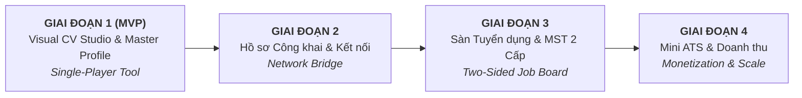
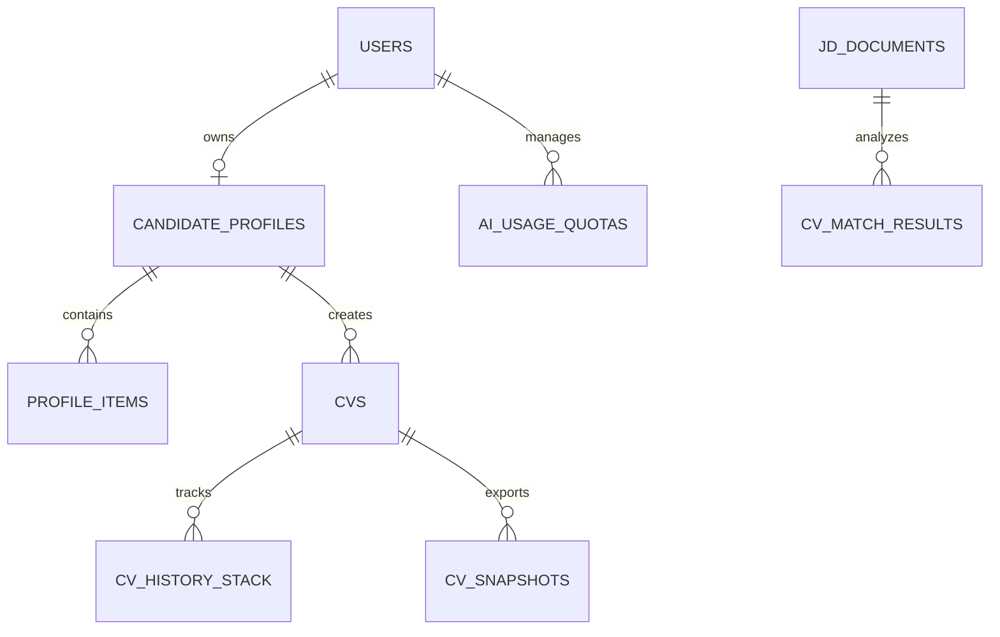

# PROFILEHUB — ĐẶC TẢ HỆ THỐNG VÀ NGHIỆP VỤ HỢP NHẤT
**Phiên bản:** 0.4.1 (Unified Strategic Specification)  
**Ngày cập nhật:** 14/10/2026  
**Chiến lược cốt lõi:**  
1. **Phương án A:** Tập trung 100% nguồn lực MVP cho Ứng viên (Candidate-Centric) & Công cụ tạo CV theo JD tối ưu.  
2. **Visual CV Editor (Không dùng Chatbot):** Chỉnh sửa trực quan dạng WYSIWYG với **Cây bút sửa tại chỗ (Inline Edit)** kết hợp **Trợ lý AI theo ngữ cảnh (Contextual AI Actions)** giúp tối ưu trải nghiệm và giảm 90% chi phí Token.  
3. **Cơ chế Đồng bộ Opt-in:** Không tự động ghi đè dữ liệu; thông báo và cho phép người dùng chủ động chọn trường đồng bộ.  
4. **Lộ trình 4 giai đoạn toàn diện:** Định hình rõ bước chuyển mình từ Công cụ cá nhân $\rightarrow$ Mạng lưới chia sẻ $\rightarrow$ Sàn việc làm 2 chiều $\rightarrow$ Nền tảng ATS & Doanh thu.

---

## MỤC LỤC
1. [Lộ trình Chiến lược Sản phẩm & Kỹ thuật (4-Phase Roadmap)](#mục-1-lộ-trình-chiến-lược-sản-phẩm--kỹ-thuật-4-phase-roadmap)
2. [Phạm vi sản phẩm MVP (In-Scope vs Deferred)](#mục-2-phạm-vi-sản-phẩm-mvp)
3. [Quy tắc nghiệp vụ cốt lõi (Core Business Rules)](#mục-3-quy-tắc-nghiệp-vụ-cốt-lõi)
4. [Kiến trúc Visual CV Editor & Trợ lý AI Ngữ cảnh (Contextual AI)](#mục-4-kiến-trúc-visual-cv-editor--trợ-lý-ai-ngữ-cảnh)
5. [Cơ chế Giao dịch Undo/Redo Trực quan](#mục-5-cơ-chế-giao-dịch-undoredo-trực-quan)
6. [Danh mục Use Case MVP v0.4.1](#mục-6-danh-mục-use-case-mvp-v041)
7. [Đặc tả Chi tiết Use Case trọng yếu](#mục-7-đặc-tả-chi-tiết-use-case-trọng-yếu)
8. [Mô hình Dữ liệu & Thiết kế API gợi ý](#mục-8-mô-hình-dữ-liệu--thiết-kế-api-gợi-ý)
9. [Kịch bản Kiểm thử & Tiêu chuẩn Nghiệm thu (Test Scenarios)](#mục-9-kịch-bản-kiểm-thử--tiêu-chuẩn-nghiệm-thu)
10. [Hạng mục Tồn lưu cho Giai đoạn tiếp theo (Deferred Backlog)](#mục-10-hạng-mục-tồn-lưu-cho-giai-đoạn-tiếp-theo)

---

## MỤC 1. LỘ TRÌNH CHIẾN LƯỢC SẢN PHẨM & KỸ THUẬT (4-PHASE ROADMAP)

Để đảm bảo ProfileHub không bị "sốc vận hành", giải quyết triệt để bài toán con gà - quả trứng (Chicken & Egg problem) của sàn tuyển dụng và tối ưu hóa ngân sách token, hệ thống được thiết kế theo 4 giai đoạn tiến hóa:



### 1.1 Giai đoạn 1: Visual CV Studio & Master Profile (MVP — Tháng 1 đến Tháng 3)
* **Trọng tâm sản phẩm:** Công cụ cá nhân (Single-player utility) giúp ứng viên tạo CV bám sát JD tốt nhất thị trường với chi phí vận hành siêu tiết kiệm.
* **Tính năng cốt lõi:**
  * Master Profile cá nhân bảo mật (quản lý kỹ năng, kinh nghiệm, dự án chứng minh).
  * Bóc tách JD (văn bản dán hoặc tải file PDF/Word).
  * Đối chiếu hồ sơ với JD (Matching bằng luật giải thích được).
  * **Visual CV Editor (Inline Editing):** Bấm cây bút `[✏️]` để sửa tay trực tiếp hoặc bấm các nút tác vụ AI ngữ cảnh (*Viết lại theo JD, Rút gọn, Thêm từ khóa*).
  * Quản lý Undo/Redo trực quan (Ctrl+Z).
  * Xuất tệp PDF chuẩn mực tiếng Việt.
  * Cơ chế đồng bộ có chọn lọc (Opt-in Sync) từ Master Profile.
* **Kiến trúc & Hạ tầng:**
  * Modular Monolith (Node.js/TypeScript hoặc Go + PostgreSQL).
  * Redis Cache + Hàng đợi không đồng bộ (BullMQ/Celery) để render PDF và gọi LLM API.
* **Tiêu chí qua cổng (Exit Criteria chuyển sang Giai đoạn 2):**
  * Tối thiểu 2.000 ứng viên đăng ký tài khoản hoạt động.
  * Tỷ lệ hoàn thiện Master Profile $\ge 60\%$.
  * Tỷ lệ xuất PDF thành công đạt $99.5\%$.
  * Chi phí token trung bình cho một bản CV hoàn thiện $< 0.05\$$.

### 1.2 Giai đoạn 2: Hồ sơ Công khai & Cầu nối Chia sẻ (Network Bridge — Tháng 4 đến Tháng 5)
* **Trọng tâm sản phẩm:** Biến CV tĩnh thành hồ sơ năng lực trực tuyến, chuẩn bị sẵn nguồn dữ liệu ứng viên chất lượng cao trước khi mở cửa cho Nhà tuyển dụng.
* **Tính năng cốt lõi:**
  * Chia sẻ hồ sơ qua liên kết ngoài (`profilehub.vn/p/username`) có mật khẩu hoặc thời hạn.
  * Portfolio view: Gắn bằng chứng dự án thực tế (link Github, Figma, bài báo, website chạy thực tế).
  * Kiểm soát quyền riêng tư nâng cao theo **Nghị định 13/2023/NĐ-CP** (chủ động bật/tắt hiển thị SĐT, email).
* **Kiến trúc & Hạ tầng:**
  * Tích hợp CDN (Cloudflare), Server-Side Rendering (SSR) hoặc Static Generation (SSG) cho các trang hồ sơ công khai để tối ưu SEO.
* **Tiêu chí qua cổng (Exit Criteria chuyển sang Giai đoạn 3):**
  * Tích lũy tối thiểu 10.000 Master Profiles đạt chuẩn (có ít nhất 2 kinh nghiệm/dự án có bằng chứng).
  * Lượt xem trang hồ sơ công khai đạt 50.000 lượt/tháng.

### 1.3 Giai đoạn 3: Phân hệ Doanh nghiệp & Sàn Tuyển dụng (Job Board Launch — Tháng 6 đến Tháng 8)
* **Trọng tâm sản phẩm:** Kích hoạt chiều thứ hai của nền tảng — Nhà tuyển dụng (Recruiter) tiếp cận ứng viên chất lượng.
* **Tính năng cốt lõi:**
  * Đăng ký doanh nghiệp, quy trình xác thực **MST 2 cấp** (Cấp 1: Khớp MST tra cứu; Cấp 2: Tích xanh qua email tên miền công ty/giấy ủy quyền).
  * Đăng tin tuyển dụng có cấu trúc & Hàng đợi kiểm duyệt tin (Moderation Queue).
  * Recruiter tìm kiếm & lọc ứng viên (chỉ xem thông tin công khai; SĐT bị ẩn hoàn toàn).
  * Gửi lời mời kết nối (thời gian chờ 3-5 ngày sau khi từ chối, tối đa 2 lần gửi lại).
  * Nộp đơn ứng tuyển với bản chụp CV bất biến (`CVSnapshot`).
* **Kiến trúc & Hạ tầng:**
  * Tích hợp Search Engine chuyên dụng (**Typesense** hoặc **Elasticsearch**) để tìm kiếm và lọc ứng viên/tin tuyển dụng tốc độ cao.
  * Cơ chế Rate-limiting và chống bot scraping dữ liệu ứng viên.
* **Tiêu chí qua cổng (Exit Criteria chuyển sang Giai đoạn 4):**
  * Tối thiểu 100 doanh nghiệp xác thực Cấp 2 (tích xanh) tham gia đăng tin.
  * Tỷ lệ ứng viên phản hồi lời mời kết nối $\ge 35\%$.

### 1.4 Giai đoạn 4: Quản trị Tuyển dụng, AI Nâng cao & Thương mại hóa (Tháng 9 trở đi)
* **Trọng tâm sản phẩm:** Hoàn thiện doanh thu và trở thành công cụ tuyển dụng chuyên nghiệp (Mini ATS).
* **Tính năng cốt lõi:**
  * **Mini ATS:** Quản lý quy trình phỏng vấn theo Kanban, ghi chú nội bộ, mẫu thư mời/từ chối.
  * **Trao đổi nội bộ:** Kênh nhắn tin an toàn giữa Candidate và Recruiter sau khi có kết nối.
  * **AI Matching Giai đoạn 2:** Nâng cấp từ luật trọng số sang **Semantic Vector Search (RAG/Embeddings)** sau khi đã có Golden Dataset kiểm định độ tin cậy.
  * **Monetization Engine:**
    * Bán gói lượt AI nâng cao cho Ứng viên (thanh toán qua MoMo/VNPay/Thẻ).
    * Bán gói đăng tin và mở khóa liên hệ cho Doanh nghiệp.

---

## MỤC 2. PHẠM VI SẢN PHẨM MVP (IN-SCOPE VS DEFERRED)

### 2.1 In-Scope (MVP - Giai đoạn 1)
1. **Xác thực & Bảo mật ứng viên:** Đăng ký bằng email, đăng nhập, khôi phục mật khẩu, phiên làm việc an toàn.
2. **Master Profile (Hồ sơ gốc tập trung):** Họ tên, headline, nơi ở, tóm tắt, kinh nghiệm, học vấn, kỹ năng, dự án (làm bằng chứng cho kỹ năng), chứng chỉ.
3. **Quyền riêng tư trường nhạy cảm:** Thiết lập ẩn/hiện SĐT, mạng xã hội, email liên hệ.
4. **Nhập & Bóc tách JD (Job Description):** Dán văn bản hoặc tải tệp PDF/Word; bóc tách tự động: chức danh, kỹ năng bắt buộc/ưu tiên, năm kinh nghiệm, từ khóa.
5. **Matching có giải thích (Giai đoạn 1):** Đối chiếu Master Profile với JD theo thuật toán luật trọng số, hiển thị mức độ phù hợp (Cao/Trung bình/Thấp) kèm bằng chứng khớp và phần còn thiếu.
6. **Visual CV Editor (Trình soạn thảo trực quan):**
   * Hiển thị CV trực quan theo mẫu.
   * Di chuột (hover) vào dòng/mục hiển thị icon cây bút `[✏️]`.
   * Bấm cây bút mở popover tại chỗ: Sửa tay tự do HOẶC bấm nút AI tác vụ nhanh.
7. **Trợ lý AI Ngữ cảnh (Contextual AI Actions - Tiết kiệm Token):**
   * Nút tác vụ nhanh: *[⚡ Viết lại theo JD]*, *[🎯 Nhấn mạnh kỹ năng]*, *[✂️ Rút gọn vừa trang]*.
   * Cơ chế Surgical Prompting: Chỉ gửi 1 đoạn văn bản hiện tại + từ khóa JD, nhận về kết quả sau ~1s, không tốn token chat.
8. **Undo/Redo trực quan (Ctrl+Z / Ctrl+Y):** Hoàn tác/làm lại các thao tác sửa tay hoặc áp dụng AI tại chỗ.
9. **Đồng bộ Opt-in (Opt-in Sync):** Phát hiện chênh lệch thông tin chung giữa Master Profile và CV nháp, cho phép ứng viên chọn cập nhật từng trường.
10. **Xuất PDF:** Xuất CV dạng tệp PDF chuẩn mực, hỗ trợ chuẩn xác tiếng Việt có dấu.
11. **Bản ghi Đồng ý & Quản lý Hạn mức AI:** Thu thập chấp thuận bảo vệ dữ liệu theo NĐ 13/2023; quản lý hạn mức sử dụng (1 click AI action = 1 credit).

### 2.2 Deferred Scope (Chuyển sang Giai đoạn 2, 3, 4)
* Phân hệ Nhà tuyển dụng, Quản lý công ty, Phân quyền thành viên.
* Sàn việc làm: Đăng tin, Duyệt tin, Tìm việc làm, Ứng tuyển trực tiếp.
* Quy trình tra cứu xác thực MST doanh nghiệp.
* Nhắn tin nội bộ, Lời mời kết nối, Xin quyền xem SĐT.
* Cổng thanh toán trực tuyến mua gói cước.

---

## MỤC 3. QUY TẮC NGHIỆP VỤ CỐT LÕI (CORE BUSINESS RULES)

* **BR-01 (Kiểm soát quyền Máy chủ):** Mọi thao tác đọc, sửa, xóa, xuất PDF đều phải xác thực `user_id` tại backend; tuyệt đối không tin tưởng client.
* **BR-02 (Nguyên tắc Opt-in Sync):** Thay đổi ở Master Profile **không được tự ý ghi đè** lên CV nháp. Hệ thống chỉ bật cờ báo lệch (`has_profile_drift = true`) và hiển thị banner để người dùng quyết định có cập nhật hay không.
* **BR-03 (Chống Bịa đặt - Zero Hallucination Policy):** AI không bao giờ được tự sinh kỹ năng, công ty, thành tích hoặc số liệu ngoài nội dung Master Profile. Bất kỳ từ ngữ viết lại nào đều phải bám sát sự thật có trong hồ sơ gốc.
* **BR-04 (Quyền quyết định tối thượng của Ứng viên):** Mọi đề xuất của AI (dù viết lại hay rút gọn) chỉ được đưa vào CV khi người dùng bấm nút **[Áp dụng]** trên popover. Không có hành động AI nào được tự động ghi đè lên CV mà không có sự kích hoạt và xác nhận của người dùng.
* **BR-05 (Bảo vệ Dữ liệu Định danh - Privacy by Design):** Khi gửi đoạn văn bản lên AI để viết lại, backend **tuyệt đối không gửi kèm** SĐT, Email cá nhân, Địa chỉ nhà, CMND/CCCD.
* **BR-06 (Tính toán Hạn mức AI Minh bạch):**
  * Người dùng tự sửa tay bằng cây bút: **Hoàn toàn miễn phí (0 credit, 0 token)**.
  * Người dùng bấm nút tác vụ AI (*Viết lại theo JD, Rút gọn*): Trừ **01 credit** sau khi kết quả trả về thành công.
  * Nếu AI bị lỗi, quá thời gian (timeout) hoặc người dùng bấm Hủy: **Không trừ credit**.
* **BR-07 (Bất biến của tệp xuất PDF):** Bản tệp PDF đã xuất là một snapshot cố định. Mọi chỉnh sửa tiếp theo ở CV nháp hoặc Master Profile không làm thay đổi tệp đã tải về.
* **BR-08 (Xử lý an toàn đầu vào JD):** Văn bản JD dán vào hoặc tệp tải lên được xem là dữ liệu thô không đáng tin cậy. Backend phải strip toàn bộ các đoạn mã hoặc chỉ dẫn prompt injection trước khi phân tích.

---

## MỤC 4. KIẾN TRÚC VISUAL CV EDITOR & TRỢ LÝ AI NGỮ CẢNH

### 4.1 Bố cục Trình soạn thảo Trực quan (Visual CV Editor Layout)
Thay thế hoàn toàn bố cục 2 cột chia đôi màn hình tốn diện tích, ProfileHub sử dụng giao diện tập trung trực quan (Single Canvas View) hỗ trợ hoàn hảo cả Desktop và Mobile/Tablet:

```
+--------------------------------------------------------------------------+
|  [ <-- Danh sách CV ]    CV Ứng tuyển Frontend - Công ty ABC   [ Xuất PDF ]|
|  [ Undo (Ctrl+Z) ] [ Redo (Ctrl+Y) ]               [ Còn: 15 lượt AI ]   |
+--------------------------------------------------------------------------+
|                                                                          |
|       +----------------------------------------------------------+       |
|       | NGUYỄN VĂN A                                             |       |
|       | Frontend Engineer  [✏️]                                  |       |
|       | SĐT: 0912*** (Đang ẩn) | Email: nguyen***@gmail.com      |       |
|       | -------------------------------------------------------- |       |
|       | KỸ NĂNG CHÍNH [✏️]                                        |       |
|       | • ReactJS, TypeScript, Next.js, Redux, Tailwind CSS      |       |
|       |                                                          |       |
|       | KINH NGHIỆM LÀM VIỆC                                     |       |
|       | Công ty Công nghệ XYZ (2024 - 2026)                      |       |
|       | Chức danh: Frontend Developer                            |       |
|       | • Phát triển hệ thống quản trị bằng React [✏️]            |       |
|       |   [Popover xuất hiện khi bấm cây bút]                     |       |
|       |   +----------------------------------------------------+ |       |
|       |   | SỬA TAY TRỰC TIẾP:                                 | |       |
|       |   | [Phát triển hệ thống quản trị bằng React.........] | |       |
|       |   |                                                    | |       |
|       |   | ✨ GỢI Ý NHANH TỪ AI (THEO JD):                     | |       |
|       |   | [ ⚡ Viết lại theo JD ] [ 🎯 Thêm KPI ] [ ✂️ Rút gọn] | |       |
|       |   |                                                    | |       |
|       |   | 💡 Đề xuất: "Tối ưu hóa hiệu năng giao diện Web,   | |       |
|       |   | đạt chuẩn Core Web Vitals..."                      | |       |
|       |   | [ Áp dụng gợi ý này ]      [ Lưu sửa tay ] [ Hủy ] | |       |
|       |   +----------------------------------------------------+ |       |
|       | • Tối ưu tốc độ tải trang...                             |       |
|       +----------------------------------------------------------+       |
|                                                                          |
+--------------------------------------------------------------------------+
```

### 4.2 Thiết kế Tác vụ AI Ngữ cảnh (Surgical Prompting)
Thay vì gửi toàn bộ CV và chat qua lại, mỗi khi người dùng bấm vào một nút tác vụ AI trên popover cây bút, một request độc lập siêu nhẹ (Stateless) được gửi đến API:

#### Request Payload gửi đi:
```json
{
  "cv_id": "cv-draft-101",
  "target_field": "experience.item_1.bullet_points.0",
  "current_text": "Phát triển hệ thống quản trị bằng React",
  "action_type": "REWRITE_FOR_JD",
  "jd_context": {
    "target_title": "Senior Frontend Developer",
    "relevant_keywords": ["React performance", "Core Web Vitals", "State management"]
  }
}
```

#### Prompt khuôn mẫu ở Backend (Chỉ ~150 tokens):
```
Bạn là chuyên gia cố vấn nghề nghiệp. Hãy viết lại câu mô tả kinh nghiệm sau đây của ứng viên để làm nổi bật sự phù hợp với các từ khóa công việc được cung cấp.
Quy tắc bất di bất dịch:
- Giữ đúng sự thật, không bịa đặt số liệu hoặc công nghệ ứng viên chưa nêu.
- Sử dụng động từ hành động mạnh mẽ, văn phong súc tích tiếng Việt.
- Độ dài tối đa: 1-2 câu (dưới 40 từ).

Đoạn văn gốc: "{current_text}"
Từ khóa JD mục tiêu: {relevant_keywords}
Đầu ra mong muốn: Chỉ trả về duy nhất 1 câu văn bản hoàn thiện, không giải thích.
```

#### Response nhận về (Chỉ ~30 tokens):
```json
{
  "suggested_text": "Phát triển và tối ưu hệ thống quản trị doanh nghiệp bằng React, cải thiện hiệu năng tải trang đạt chuẩn Core Web Vitals.",
  "tokens_used": 185
}
```
$\rightarrow$ **Hiệu quả:** Phản hồi dưới 1 giây, tiết kiệm 95% chi phí so với mô hình chat, không có chữ thừa!

---

## MỤC 5. CƠ CHẾ GIAO DỊCH UNDO/REDO TRỰC QUAN

Khi không dùng chat, cơ chế Undo/Redo trở về đúng bản chất thanh thoát và đáng tin cậy nhất: **State Stack (Ngăn xếp trạng thái)**.

1. **Ghi nhận State:**
   * Mỗi khi người dùng bấm **[Lưu sửa tay]** hoặc bấm **[Áp dụng gợi ý này]** từ popover AI $\rightarrow$ Hệ thống lưu một snapshot giá trị trước/sau của trường dữ liệu đó.
2. **Thực hiện Undo (Ctrl+Z):**
   * Hoàn tác ngay lập tức giá trị trường dữ liệu vừa sửa về trạng thái trước đó.
   * Cập nhật tức thì lên màn hình canvas.
3. **Thực hiện Redo (Ctrl+Y):**
   * Phục hồi lại giá trị vừa Undo nếu chưa có thao tác sửa mới chèn vào.
4. **Phân nhánh mới (Fork):**
   * Nếu sau khi Undo, người dùng bấm cây bút sửa một nội dung khác $\rightarrow$ Ngăn xếp Redo tự động dọn sạch để đảm bảo tính nhất quán của dòng thời gian.

---

## MỤC 6. DANH MỤC USE CASE MVP v0.4.1

| Mã Use Case | Tên Use Case | Phân loại | Mức độ ưu tiên | Trạng thái |
|---|---|---|---|---|
| **UC-CAN-001** | Đăng ký tài khoản ứng viên | Candidate Core | **Must-have** | Chốt (Confirmed) |
| **UC-CAN-002** | Đăng nhập và quản lý phiên | Candidate Core | **Must-have** | Chốt (Confirmed) |
| **UC-CAN-003** | Khôi phục tài khoản | Candidate Core | **Must-have** | Chốt (Confirmed) |
| **UC-CAN-004** | Thiết lập Master Profile ban đầu | Profile Core | **Must-have** | Chốt (Confirmed) |
| **UC-CAN-005** | Cập nhật các mục Master Profile | Profile Core | **Must-have** | Chốt (Confirmed) |
| **UC-CAN-006** | Xem trước Master Profile & kiểm tra độ hoàn thiện | Profile Core | **Should-have** | Chốt (Confirmed) |
| **UC-CAN-007** | Thiết lập quyền riêng tư theo trường dữ liệu | Privacy Core | **Must-have** | Chốt (Confirmed) |
| **UC-CAN-008** | Khởi tạo bản CV mới từ Master Profile & JD | CV Studio Core | **Must-have** | Chốt (Confirmed) |
| **UC-CAN-009** | Sửa nội dung CV bằng Cây bút (Inline Edit) | CV Studio Core | **Must-have** | **Mới chuẩn hóa** |
| **UC-CAN-010** | Áp dụng Tác vụ AI Ngữ cảnh tại chỗ | CV Studio Core | **Must-have** | **Mới chuẩn hóa** |
| **UC-CAN-011** | Hoàn tác / Làm lại thao tác (Undo/Redo) | CV Studio Core | **Must-have** | **Mới chuẩn hóa** |
| **UC-CAN-012** | Xuất tệp CV định dạng PDF | Export Core | **Must-have** | Chốt (Confirmed) |
| **UC-CAN-013** | Quản lý danh sách các bản CV đã tạo | CV Management | **Should-have** | Chốt (Confirmed) |
| **UC-CAN-020** | Nhập & Bóc tách yêu cầu Job Description (JD) | AI Matching | **Must-have** | Chốt (Confirmed) |
| **UC-CAN-021** | Đối chiếu hồ sơ với JD (Matching có giải thích) | AI Matching | **Must-have** | Chốt (Confirmed) |
| **UC-SYS-001** | Đồng bộ có chọn lọc Master Profile sang CV (Opt-in) | System Core | **Must-have** | Chốt (Confirmed) |
| **UC-SYS-003** | Quản lý hạn mức tác vụ AI & Bản ghi đồng ý | Privacy / Quota | **Must-have** | Chốt (Confirmed) |
| **UC-CAN-019** | Xóa tài khoản & Xuất dữ liệu cá nhân (NĐ 13/2023) | Privacy Core | **Should-have** | Chốt (Confirmed) |

*Tổng cộng: 18 Use Cases tinh gọn, tập trung cao độ và sẵn sàng triển khai 100%.*

---

## MỤC 7. ĐẶC TẢ CHI TIẾT USE CASE TRỌNG YẾU

### UC-CAN-009: Sửa nội dung CV bằng Cây bút (Inline Edit)
* **Actor:** Ứng viên (Candidate).
* **Mục tiêu:** Chỉnh sửa nhanh, trực quan bất kỳ trường thông tin nào trên bản CV mà không cần rời màn hình canvas.
* **Luồng chính (Main Flow):**
  1. Candidate mở bản CV nháp trong Visual CV Editor.
  2. Candidate di chuột (hover) vào trường muốn sửa (ví dụ: Tóm tắt nghề nghiệp hoặc một gạch đầu dòng kinh nghiệm) $\rightarrow$ Icon cây bút `[✏️]` xuất hiện.
  3. Candidate click vào icon cây bút $\rightarrow$ Hệ thống mở Popover chỉnh sửa tại chỗ.
  4. Candidate chỉnh sửa văn bản trong ô nhập liệu.
  5. Candidate bấm **[Lưu sửa tay]** (hoặc gõ phím Enter / Ctrl+Enter).
  6. Hệ thống kiểm tra dữ liệu hợp lệ:
     - Ghi nhận trạng thái cũ/mới vào Undo Stack.
     - Cập nhật giá trị mới trực tiếp lên Canvas CV.
     - Đóng Popover.
* **Luồng thay thế (Alternative Flow):**
  * *A1 (Hủy bỏ):* Candidate bấm nút **[Hủy]** hoặc click ra ngoài vùng popover $\rightarrow$ Đóng popover, giữ nguyên giá trị cũ.

---

### UC-CAN-010: Áp dụng Tác vụ AI Ngữ cảnh tại chỗ (Contextual AI Actions)
* **Actor:** Ứng viên (Candidate). Hệ thống: AI Service, Quota Service.
* **Mục tiêu:** Nhận gợi ý viết lại bám sát JD từ AI cho một câu hoặc một đoạn cụ thể một cách nhanh chóng, tiết kiệm token.
* **Luồng chính (Main Flow):**
  1. Tại Popover của cây bút, Candidate bấm một trong các nút tác vụ nhanh:
     * `[⚡ Viết lại theo JD]` (Default)
     * `[🎯 Nhấn mạnh từ khóa]`
     * `[✂️ Rút gọn vừa trang]`
  2. System kiểm tra hạn mức AI (`UsageQuota`). Nếu hết hạn, hiển thị thông báo và giữ nguyên nội dung (E1).
  3. System gửi đoạn văn bản hiện tại + từ khóa JD tương ứng lên AI Service (Surgical Prompt).
  4. AI Service trả về đoạn văn bản đề xuất.
  5. Popover hiển thị khối *"💡 Gợi ý từ AI"* bên dưới ô nhập liệu cùng nút **[Áp dụng gợi ý này]**.
  6. Candidate xem xét:
     * Nếu ưng ý: Bấm **[Áp dụng gợi ý này]** $\rightarrow$ Hệ thống điền văn bản gợi ý vào CV, ghi nhận Undo Stack, trừ 01 credit hạn mức và đóng popover.
     * Nếu muốn chỉnh sửa thêm: Candidate bấm vào dòng gợi ý để copy lên ô nhập liệu, sửa thêm bằng tay rồi mới bấm Lưu.
* **Luồng ngoại lệ (Exception Flow):**
  * *E1 (Hết hạn mức AI):* Hiển thị thông báo: *"Bạn đã sử dụng hết lượt AI trong ngày. Vui lòng chỉnh sửa thủ công hoặc quay lại sau."*
  * *E2 (Lỗi kết nối / AI Timeout):* Báo lỗi kết nối, không trừ credit, cho phép thử lại.

---

### UC-CAN-011: Hoàn tác / Làm lại thao tác (Undo/Redo)
* **Actor:** Ứng viên (Candidate).
* **Mục tiêu:** Dễ dàng sửa sai khi lỡ bấm nhầm hoặc không ưng ý kết quả vừa áp dụng.
* **Luồng chính (Main Flow):**
  1. Candidate bấm nút **[Undo]** (hoặc Ctrl+Z / Cmd+Z).
  2. Hệ thống lấy bản ghi gần nhất trong `UndoStack`:
     * Đưa trường dữ liệu liên quan trở về `before_value`.
     * Đẩy bản ghi đó sang `RedoStack`.
     * Cập nhật tức thì lên màn hình.
  3. Nút [Redo] sáng lên, cho phép Candidate phục hồi lại thao tác nếu muốn.

---

## MỤC 8. MÔ HÌNH DỮ LIỆU & THIẾT KẾ API GỢI Ý

### 8.1 Mô hình Dữ liệu Tinh gọn (Database Schema)



1. **`users`:** `id`, `email`, `password_hash`, `full_name`, `status`, `created_at`.
2. **`candidate_profiles` (Master Profile):** `id`, `user_id`, `headline`, `city`, `summary`, `privacy_settings` (JSON), `updated_at`.
3. **`profile_items`:** `id`, `profile_id`, `section_type` (EDUCATION/EXPERIENCE/SKILL/PROJECT), `content` (JSON), `order_index`.
4. **`cvs` (Bản CV Nháp):** `id`, `profile_id`, `target_job_title`, `template_id`, `cv_content` (JSON cấu trúc cây), `has_profile_drift` (boolean), `version`, `updated_at`.
5. **`cv_history_stack` (Undo/Redo):** `id`, `cv_id`, `field_path`, `before_value`, `after_value`, `created_at`.
6. **`jd_documents`:** `id`, `user_id`, `raw_text`, `parsed_data` (JSON: title, skills, keywords), `created_at`.
7. **`cv_match_results`:** `id`, `profile_id`, `jd_id`, `score_level` (HIGH/MEDIUM/LOW), `match_details` (JSON: matched, missing).
8. **`ai_usage_quotas`:** `id`, `user_id`, `daily_limit` (mặc định 20 lượt), `used_today`, `reset_at`.
9. **`cv_snapshots` (Bản xuất PDF):** `id`, `cv_id`, `pdf_url`, `snapshot_content` (JSON frozen), `created_at`.

### 8.2 Thiết kế API Endpoint Tinh gọn (Stateless Endpoints)
* `POST /api/v1/auth/register` — Đăng ký tài khoản.
* `POST /api/v1/auth/login` — Đăng nhập & lấy token.
* `GET /api/v1/profile/master` — Lấy dữ liệu Master Profile.
* `PUT /api/v1/profile/master` — Cập nhật Master Profile (tự động bật cờ `has_profile_drift` cho các CV nháp).
* `POST /api/v1/jds/parse` — Bóc tách văn bản hoặc file JD.
* `POST /api/v1/matching/evaluate` — Đối chiếu Master Profile với JD.
* `POST /api/v1/cvs` — Khởi tạo bản CV mới từ Master Profile + JD.
* `GET /api/v1/cvs/{cvId}` — Lấy chi tiết bản CV nháp và trạng thái drift.
* `PATCH /api/v1/cvs/{cvId}/inline-edit` — Sửa tay trực tiếp một trường (Ghi nhận Undo).
* `POST /api/v1/cvs/{cvId}/ai-action` — Gọi tác vụ AI ngữ cảnh cho một trường cụ thể (Surgical Prompting).
* `POST /api/v1/cvs/{cvId}/undo` — Hoàn tác thao tác gần nhất.
* `POST /api/v1/cvs/{cvId}/redo` — Làm lại thao tác vừa hoàn tác.
* `POST /api/v1/cvs/{cvId}/sync-profile` — Đồng bộ các trường được chọn từ Master Profile.
* `POST /api/v1/cvs/{cvId}/export-pdf` — Dựng và tải tệp PDF chuẩn.

---

## MỤC 9. KỊCH BẢN KIỂM THỬ & TIÊU CHUẨN NGHIỆM THU (TEST SCENARIOS)

| ID | Nhóm kiểm thử | Kịch bản kiểm thử | Kết quả mong đợi |
|---|---|---|---|
| **TS-01** | Xác thực | Đăng ký tài khoản hợp lệ, xác nhận email, đăng nhập. | Đăng nhập thành công, phát hành token hợp lệ. |
| **TS-02** | Master Profile | Cập nhật mục Kỹ năng và gắn kèm Dự án làm bằng chứng. | Dữ liệu lưu đúng liên kết; bằng chứng hiển thị rõ ràng. |
| **TS-03** | Opt-in Sync | Sửa Số điện thoại tại Master Profile, mở lại bản CV nháp cũ. | CV nháp **không tự đổi SĐT**, hiện Banner báo lệch; bấm đồng ý mới cập nhật. |
| **TS-04** | Inline Edit (Sửa tay) | Bấm cây bút `[✏️]` ở dòng kinh nghiệm, sửa chữ và bấm Lưu. | Dòng chữ đổi ngay tức thì, **không tốn credit AI**, ghi nhận vào Undo stack. |
| **TS-05** | AI Action (Viết lại) | Bấm cây bút, bấm nút `[⚡ Viết lại theo JD]`. | Nhận được câu gợi ý sau $\le 1.5$s; bấm "Áp dụng" câu mới nhảy vào CV; trừ 01 credit AI. |
| **TS-06** | Hủy bỏ AI | Bấm nút AI, nhận câu gợi ý nhưng không thích và bấm nút `[Hủy]`. | CV giữ nguyên văn bản cũ; **không bị trừ credit AI**. |
| **TS-07** | Undo / Redo | Sửa 1 câu bằng cây bút $\rightarrow$ Nhấn Ctrl+Z $\rightarrow$ Nhấn Ctrl+Y. | Ctrl+Z khôi phục câu cũ; Ctrl+Y phục hồi câu mới; canvas cập nhật mượt mà. |
| **TS-08** | Bảo vệ Dữ liệu | Bắt gói tin gửi lên API của AI Service khi bấm nút AI Action. | Gói tin chỉ chứa đúng 1 câu cần sửa + từ khóa JD; **hoàn toàn không chứa** SĐT, Email, Địa chỉ của ứng viên. |
| **TS-09** | Hết hạn mức AI | Dùng hết 20 lượt AI trong ngày rồi bấm nút AI Action. | Hiện thông báo hết lượt, không gọi sang LLM API; các tính năng sửa tay và xuất PDF vẫn dùng bình thường. |
| **TS-10** | Xuất PDF | Bấm nút "Xuất PDF" trên thanh công cụ CV Studio. | Tải về tệp PDF chuẩn, hiển thị đúng font tiếng Việt có dấu, căn lề chuẩn, không tràn trang. |

---

## MỤC 10. HẠNG MỤC TỒN LƯU CHO GIAI ĐOẠN TIẾP THEO (DEFERRED BACKLOG)

Toàn bộ các yêu cầu dưới đây đã được lưu trữ an toàn trong backlog kiến trúc, sẵn sàng kích hoạt theo đúng **Roadmap 4 giai đoạn** tại Mục 1:

1. **Giai đoạn 2 (Hồ sơ Công khai & Kết nối):**
   * Trang Public Profile qua URL rút gọn (`profilehub.vn/p/username`).
   * Portfolio View gắn minh chứng dự án (Github, Behance, Live links).
   * Cơ chế cấp quyền xem SĐT theo từng liên kết chia sẻ.
2. **Giai đoạn 3 (Phân hệ Doanh nghiệp & Sàn Tuyển dụng):**
   * Xác thực MST 2 cấp (Cấp 1: API MST; Cấp 2: Tích xanh qua email domain/ủy quyền).
   * Đăng tin tuyển dụng & Hàng đợi kiểm duyệt tin (Moderation Queue).
   * Recruiter tìm kiếm ứng viên ẩn danh, gửi lời mời kết nối (thời gian chờ 3-5 ngày).
   * Nộp đơn ứng tuyển với bản chụp CV bất biến (`CVSnapshot`).
3. **Giai đoạn 4 (Mini ATS & Monetization Engine):**
   * Quản lý trạng thái ứng viên theo bảng Kanban (Đã xem $\rightarrow$ Phỏng vấn $\rightarrow$ Tuyển).
   * Kênh trao đổi tin nhắn nội bộ trong hệ thống.
   * Semantic Vector Matching (Giai đoạn 2 của AI Matching).
   * Tích hợp cổng thanh toán trực tuyến (MoMo/VNPay) để bán gói AI cho Ứng viên và gói đăng tin cho Doanh nghiệp.
