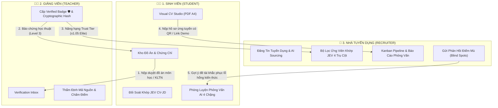

# 📚 ProfileHub Product Documentation (Single Source of Truth)

Tài liệu chuẩn hóa kiến trúc sản phẩm, luồng vận hành và đặc tả nghiệp vụ của nền tảng **ProfileHub — Verified Academic & AI Career Ecosystem**.

Tất cả các tài liệu dưới đây đại diện cho hệ thống đang được triển khai thực tế trên mã nguồn, loại bỏ toàn bộ các khái niệm thử nghiệm cũ (như chatbot discovery, mạng xã hội).

---

## 🗺️ 1. Bản Đồ Tài Liệu Hệ Thống

| Thứ tự | Tệp tài liệu | Phân loại | Tóm tắt vai trò trong hệ thống | Mã nguồn đối ứng (Code Mapping) |
| :---: | :--- | :--- | :--- | :--- |
| **01** | [`vision.md`](./vision.md) | **Tầm nhìn & Định vị** | Tuyên ngôn sứ mệnh và 3 trụ cột giá trị cốt lõi: Xác thực học thuật, Tuyển dụng theo bằng chứng, và Vòng lặp phản hồi tuyển dụng. | [`src/pages/public/`](../../src/pages/public) |
| **02** | [`prd.md`](./prd.md) | **Yêu cầu sản phẩm (PRD)** | Yêu cầu chức năng tổng quan của 3 tác tử: Sinh viên (Student), Giảng viên (Teacher) và Doanh nghiệp tuyển dụng (Recruiter). | [`src/App.tsx`](../../src/App.tsx), [`src/components/layout/Sidebar.tsx`](../../src/components/layout/Sidebar.tsx) |
| **03** | [`luong_chinh_he_thong.md`](./luong_chinh_he_thong.md) | **Luồng vận hành cốt lõi** | Bản đồ tương tác toàn diện của 5 luồng chính: Quản lý & duyệt đồ án, AI CV Builder, Tuyển dụng thông minh, Luyện phỏng vấn AI, và Phản hồi lỗ hổng kiến thức. | Toàn bộ các trang nghiệp vụ `src/pages/` |
| **04** | [`roadmap.md`](./roadmap.md) | **Lộ trình Sản phẩm & Phân kỳ P0-P2** | Kiến trúc dữ liệu Master Profile $\rightarrow$ CV Draft $\rightarrow$ CV Snapshot, 10 tính năng P0 MVP, quy chuẩn kiểm tra chất lượng (Rule Engine) và 6 tác vụ AI Surgical Rewrite. | [`src/services/cvQualityCheckService.ts`](../../src/services/cvQualityCheckService.ts), [`src/components/cv/InlineEditPopover.tsx`](../../src/components/cv/InlineEditPopover.tsx) |
| **05** | [`ProfileHub_Unified_Spec_v0.4.md`](./ProfileHub_Unified_Spec_v0.4.md) | **Đặc tả Visual CV Studio** | Kiến trúc Visual CV Editor (WYSIWYG với cây bút sửa tại chỗ `[✏️]`), cơ chế AI Ngữ cảnh (Surgical Prompting tiết kiệm token), Ngăn xếp Undo/Redo và Đồng bộ Opt-in. | [`src/pages/student/CVBuilder.tsx`](../../src/pages/student/CVBuilder.tsx), [`src/components/cv/InteractiveCVCanvas.tsx`](../../src/components/cv/InteractiveCVCanvas.tsx), [`src/services/aiCvService.ts`](../../src/services/aiCvService.ts) |
| **06** | [`jev_cv_jd_matching_spec.md`](./jev_cv_jd_matching_spec.md) | **Thuật toán Matching JEV** | Đặc tả công thức tính điểm so khớp CV – JD theo 4 Trụ Cột Bằng Chứng (**Job Evidence Verification - JEV**) và thang phân cấp minh chứng (Level 0 $\rightarrow$ Level 3). | [`src/services/aiRecruitmentService.ts`](../../src/services/aiRecruitmentService.ts), [`src/pages/recruiter/AIRecruitmentAssistant.tsx`](../../src/pages/recruiter/AIRecruitmentAssistant.tsx), [`server/src/types/aiMatching.types.ts`](../../server/src/types/aiMatching.types.ts) |
| **07** | [`ai_interview_prep_framework.md`](./ai_interview_prep_framework.md) | **Phòng phỏng vấn AI** | Khung luyện phỏng vấn thực chiến 4 chặng: Elevator Pitch, Deep-Dive Đồ Án, Giả lập sự cố hệ thống, và Bào chữa lỗ hổng kỹ năng; kèm cơ chế Tái hiệu chuẩn cấp bậc (Up-Leveling). | [`src/pages/student/CVBuilder.tsx`](../../src/pages/student/CVBuilder.tsx) (Defense Briefing), [`src/pages/recruiter/AIRecruitmentAssistant.tsx`](../../src/pages/recruiter/AIRecruitmentAssistant.tsx) (Talent Calibration) |
| **08** | [`tieuchidanhgia.md`](./tieuchidanhgia.md) | **Tiêu chuẩn chất lượng CV** | Bộ quy chuẩn đánh giá từng mục trên CV, cấu trúc câu mô tả dự án theo công thức *Action Verb + Task/Tech + Quantified Impact* (STAR). | [`src/services/starDiagnosticService.ts`](../../src/services/starDiagnosticService.ts), [`src/services/pageBudgetService.ts`](../../src/services/pageBudgetService.ts) |
| **09** | [`ProfileHub_Use_Case_Story.docx`](./ProfileHub_Use_Case_Story.docx) | **Kịch bản Use Case** | Tài liệu tham khảo kịch bản người dùng và câu chuyện nghiệp vụ thực tế. | Tài liệu tham khảo |
| **10** | [`danh_gia_luong_ung_vien_va_toi_uu_ux.md`](./danh_gia_luong_ung_vien_va_toi_uu_ux.md) | **Phản biện UX & Tinh gọn luồng** | Báo cáo chi tiết 4 điểm nghẽn "lằng ngoằng" từ góc nhìn ứng viên thực tế và phương án tinh gọn luồng 3 bước (Lean UX Architecture). | [`src/pages/student/Dashboard.tsx`](../../src/pages/student/Dashboard.tsx), [`src/pages/student/CVBuilder.tsx`](../../src/pages/student/CVBuilder.tsx) |
| **11** | [`tinhnangmoi.md`](./tinhnangmoi.md) | **Đặc tả Trạm Tác Chiến War Room** | Giải pháp tự note lịch phỏng vấn, kích hoạt đề ôn tập theo công ty và bộ bẫy đồ án (Self-scheduled War Room). | [`src/pages/student/Dashboard.tsx`](../../src/pages/student/Dashboard.tsx), [`src/services/selfInterviewService.ts`](../../src/services/selfInterviewService.ts) |
| **12** | [`Fix.md`](./Fix.md) | **Kế hoạch Tối ưu Bố cục & Luồng** | Tổng hợp vấn đề bội thực nút bấm AI, sắp xếp lại vị trí tính năng và lộ trình đưa giao diện về chuẩn quen mắt (Canva/Notion/TopCV). | [`src/pages/student/CVBuilder.tsx`](../../src/pages/student/CVBuilder.tsx), [`src/components/layout/Sidebar.tsx`](../../src/components/layout/Sidebar.tsx), [`src/pages/student/CVManagementPage.tsx`](../../src/pages/student/CVManagementPage.tsx) |
| **13** | [`real_market_salary_spec.md`](./real_market_salary_spec.md) | **AI & Python Crawler Lương Thực Tế** | Đặc tả kiến trúc con bot Python thu thập dữ liệu lương thực tế từ ITviec/TopCV/TopDev, bóc tách Regex/AI và thống kê phân vị P25-P50-P75. | [`server/python/salary_crawler/`](../../server/python/salary_crawler), [`src/services/salaryBenchmarkService.ts`](../../src/services/salaryBenchmarkService.ts) |
| **14** | [`ui.md`](./ui.md) | **Đặc Tả UI & Motion: Intro 2D Elevated CV** | Thiết kế hoạt họa tờ CV A4 nổi bổng sắc nét (2D Elevated Motion), khử răng cưa font chữ và kịch bản chuyển cảnh tại Modal & Canvas. | [`src/components/cv/CreateCvFlowModal.tsx`](../../src/components/cv/CreateCvFlowModal.tsx), [`src/pages/student/CVBuilder.tsx`](../../src/pages/student/CVBuilder.tsx) |

---

## 🔍 2. Khảo Sát & Ứng Dụng JEV (Job Evidence Verification) Trong Hệ Thống

### 2.1. JEV là gì?
**JEV (Job Evidence Verification)** là thuật toán và triết lý cốt lõi của ProfileHub nhằm **thay thế hệ thống ATS truyền thống**. 
* **ATS truyền thống:** Chỉ đếm số lần xuất hiện của từ khóa kỹ năng thô (dễ bị gian lận bằng kỹ thuật Keyword-Stuffing hoặc tự khai không có thật).
* **ProfileHub JEV:** Chỉ tính điểm năng lực khi kỹ năng đó được bảo chứng bằng **đồ án thực tế, sản phẩm chạy thật (Live Demo), mã nguồn GitHub** và đỉnh cao là **Huy hiệu kiểm định của Giảng viên đại học (Verified Badge 🛡️)**.

### 2.2. Vị trí JEV trong Codebase thực tế
JEV đang được kích hoạt và sử dụng trực tiếp tại các vị trí then chốt sau:
1. **Frontend Recruitment Engine ([`src/services/aiRecruitmentService.ts`](../../src/services/aiRecruitmentService.ts)):**
   * Định nghĩa cấu trúc `CandidateJevPillars` và hàm tính điểm `matchCandidatesWithJob()`.
   * Áp dụng chính xác công thức toán học JEV 4 Trụ Cột:
     $$\text{JEV\_Score} = \left( 0.30 \times S_{\text{Skill}} + 0.40 \times S_{\text{Evidence}} + 0.20 \times S_{\text{Impact}} + 0.10 \times S_{\text{Alignment}} \right) \times \text{TrustMultiplier}$$
   * Thang bậc minh chứng `AiEvidenceLevel`:
     * `Level 0: unverified_claim` (0.30 - Chỉ tự khai báo danh sách)
     * `Level 1: self_documented` (0.60 - Có mô tả dự án nhưng không có link)
     * `Level 2: live_artifact` (0.85 - Có link GitHub Repo hoặc Web Live Demo)
     * `Level 3: institutional_verified` (1.00 - Có xác nhận của Giảng viên)
   * Hệ số bảo chứng `TrustMultiplier`:
     * `VERIFIED_ELITE`: $\times 1.05$ (Có từ 2 đồ án Giảng viên duyệt)
     * `HIGH_TRUST`: $\times 1.02$ (Có 1 đồ án Giảng viên duyệt)
     * `MODERATE`: $\times 1.00$ (Có link GitHub/Demo)
     * `UNVERIFIED`: $\times 0.95$ (Không có bằng chứng)
   * Rào chắn chống gian lận `antiStuffingRisk`: Tự động cảnh báo `HIGH` / `MEDIUM` nếu ứng viên khai báo nhiều kỹ năng nhưng không có đồ án nào tương ứng.

2. **Giao diện Nhà tuyển dụng ([`src/pages/recruiter/AIRecruitmentAssistant.tsx`](../../src/pages/recruiter/AIRecruitmentAssistant.tsx)):**
   * Tích hợp **Modal kiểm tra chuyên sâu JEV (`Detailed Candidate JEV Inspection Modal`)**.
   * Trực quan hóa chi tiết điểm số từng trụ cột (Kỹ năng 30%, Bằng chứng 40%, Số liệu định lượng 20%, Định hướng 10%).
   * Hiển thị Huy hiệu `🛡️ VERIFIED_ELITE`, danh sách bằng chứng thực tế và cảnh báo rủi ro chém gió.

3. **Backend Types ([`server/src/types/aiMatching.types.ts`](../../server/src/types/aiMatching.types.ts)):**
   * Cung cấp các kiểu dữ liệu và alias chuẩn cho toàn hệ thống: `JevEvidenceLevel`, `JevMatchResult`, `JevSkillFitPillar`, `JevEvidenceDepthPillar`, `JevImpactComplexityPillar`, `JevAlignmentPillar`.

---

## 🏛️ 3. Kiến Trúc 3 Tác Tử & Luồng Dữ Liệu Khép Kín

---

## 📌 4. Nguyên Tắc Cốt Lõi (Core Tenets)
1. **Evidence-Driven (Bằng chứng thực tế):** Không đánh giá ứng viên bằng từ khóa suông; mọi kỹ năng đều cần đồ án, mã nguồn GitHub, Live Demo hoặc bảo chứng của Giảng viên.
2. **Visual & Surgical AI (Tối ưu trải nghiệm & Chi phí):** Không dùng chatbot rườm rà trong luồng tạo CV; sử dụng Visual Editor trực quan với các tác vụ AI ngữ cảnh siêu nhẹ (Surgical Prompting).
3. **Privacy by Design (Bảo vệ dữ liệu):** Tuân thủ Nghị định 13/2023/NĐ-CP; các trường nhạy cảm (SĐT, Email, GPA) luôn được bảo vệ và chỉ công khai khi có sự đồng ý của ứng viên.
