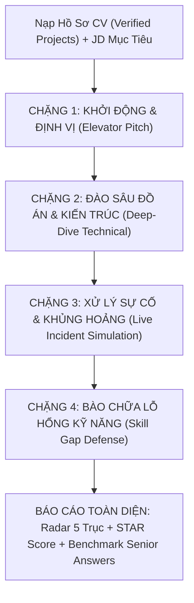
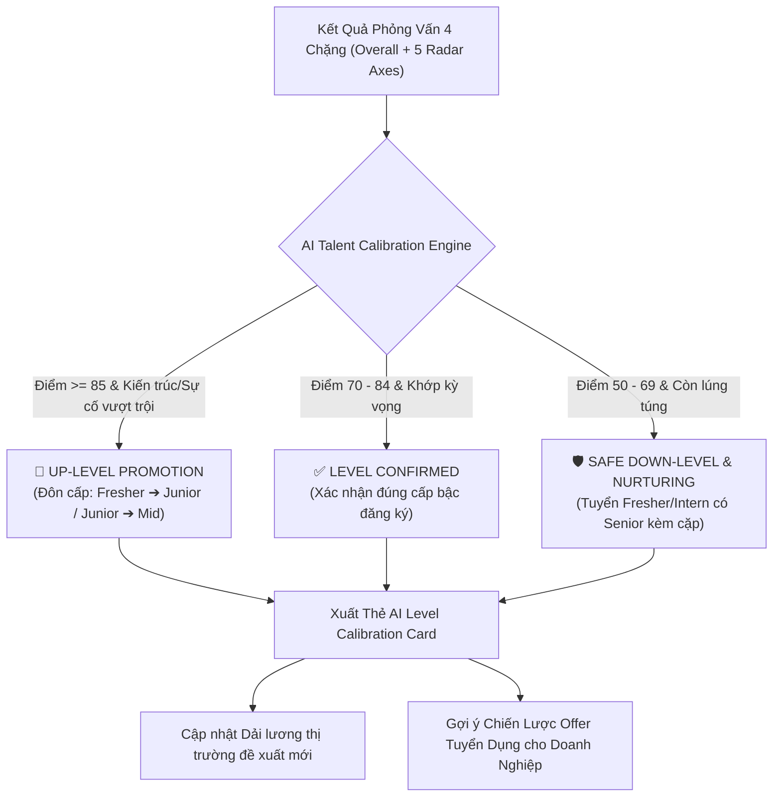

# 🎙️ AI Interview Preparation Framework v2.0
## Enterprise Adaptive Interview Engine (Khung Luyện Phỏng Vấn Thực Chiến Đa Tầng)

---

## 1. TỔNG QUAN & BỐI CẢNH (OVERVIEW)

### 1.1. Vấn đề của các công cụ phỏng vấn AI truyền thống
- Các câu hỏi lý thuyết sách vở dạng *"Virtual DOM là gì?", "Design Thinking có mấy bước?", "Nêu định nghĩa OOP"* mang tính học vẹt, ai cũng tra cứu được trong 30 giây và **không phản ánh năng lực thực tế**.
- Khi đi phỏng vấn tại các doanh nghiệp công nghệ, Tech Lead và Hiring Manager **không hỏi lý thuyết suông** mà xoáy trực tiếp vào:
  1. **Quyết định kiến trúc & Đánh đổi kỹ thuật (Trade-offs)** trong đồ án CV.
  2. **Bóc tách tính xác thực của số liệu** (Metrics, Profiling, Bottlenecks).
  3. **Phản xạ xử lý sự cố thực tế khi hệ thống gặp khủng hoảng** (Live Incident & Crash).
  4. **Khả năng tự học và bảo vệ kỹ năng còn thiếu so với JD** (Skill Gap Defense).

### 1.2. Mục tiêu của Framework v2.0
Chuyển đổi hoàn toàn từ hình thức "trả lời câu hỏi lý thuyết đơn lẻ" sang **Phiên Phỏng Vấn Thực Chiến 4 Chặng (4-Stage Adaptive Tech Interview)** mô phỏng chính xác buổi phỏng vấn 45 phút của các tập đoàn công nghệ.

---

## 2. QUY TRÌNH PHỎNG VẤN 4 CHẶNG (4-STAGE INTERVIEW FLOW)

---

### 🟢 CHẶNG 1: KHỞI ĐỘNG & ĐỊNH VỊ NĂNG LỰC (Elevator Pitch & Role Positioning)
- **Mục tiêu:** Đánh giá khả năng tóm tắt giá trị bản thân trong 60–90 giây, sự tự tin và định hướng chuyên môn.
- **Dạng câu hỏi AI:**
  > *"Hãy giới thiệu ngắn gọn về bản thân, điểm mạnh kỹ thuật nổi bật nhất của bạn và lý do vì sao phong cách làm việc của bạn phù hợp với vị trí [Tên JD] tại công ty?"*
- **Tiêu chí chấm:**
  - Cấu trúc rõ ràng: Quá khứ (Học vấn/Kinh nghiệm) $\rightarrow$ Hiện tại (Thế mạnh cốt lõi) $\rightarrow$ Tương lai (Đóng góp cho công ty).
  - Tránh đọc lại nguyên văn CV.

---

### 🔵 CHẶNG 2: ĐÀO SÂU ĐỒ ÁN & QUYẾT ĐỊNH KIẾN TRÚC (Deep-Dive Technical & Trade-offs)
- **Mục tiêu:** Bóc tách sâu vào đồ án verified trong CV, kiểm tra mức độ hiểu sâu kiến trúc và tính xác thực của số liệu.
- **Các tầng câu hỏi AI:**
  1. **Quyết định công nghệ (Tech Stack Rationale & Trade-offs):**
     > *"Trong đồ án [Tên Đồ Án], bạn chọn [Công nghệ A] thay vì [Công nghệ B]. Hãy phân tích ưu và nhược điểm khi đưa ra quyết định này? Khi quy mô người dùng tăng gấp 10 lần, kiến trúc này bộc lộ điểm nghẽn gì?"*
  2. **Bóc tách số liệu đo lường (Quantified Metrics Deep-Dive):**
     > *"Bạn ghi trong CV đã tối ưu [Số liệu X, ví dụ: giảm 35% response time]. Bạn đã dùng công cụ gì để đo (Profiler, APM, Lighthouse)? Bottleneck cụ thể nằm ở đâu (Database index, Network payload hay Re-render loop)?"*
- **Cơ chế Hỏi Vặn (Dynamic Follow-up Probing):**
  - Nếu ứng viên trả lời chung chung (*"Em dùng Caching để tối ưu"*), AI lập tức hỏi vặn:
    > *"Cụ thể bạn dùng Cache ở tầng nào (Browser, Redis, CDN hay Database Query)? Chiến lược Cache Invalidation (xóa cache khi dữ liệu thay đổi) của bạn là gì?"*

---

### 🟠 CHẶNG 3: GIẢ LẬP XỬ LÝ SỰ CỐ & KHỦNG HOẢNG HỆ THỐNG (Live Incident & Stress Scenario)
- **Mục tiêu:** Đánh giá tư duy phản xạ, khả năng cô lập lỗi và bình tĩnh giải quyết vấn đề dưới áp lực cao.
- **Các kịch bản sự cố thực tế:**
  1. *Database Connection Pool Exhaustion:* Hệ thống sập lúc giờ cao điểm, CPU 99%, API trả về 504 Gateway Timeout.
  2. *Memory Leak & Crash Loop:* Ứng dụng Node.js/React bị tràn bộ nhớ (OOM) sau 2 tiếng chạy trên Production.
  3. *Race Condition / Data Inconsistency:* Hai người dùng cùng đặt mua sản phẩm cuối cùng tại 1 thời điểm.
  4. *Third-party API Failure:* Cổng thanh toán VNPay/Stripe bị lỗi treo khiến toàn bộ luồng checkout bị nghẽn.
- **Dạng câu hỏi AI:**
  > *"Vào lúc 12h trưa ngày Flash Sale, hệ thống [Vị trí JD] ghi nhận lỗi [Sự cố X]. Bạn có 15 phút để xử lý. Hãy nêu 3 bước đầu tiên bạn sẽ thực hiện để cô lập lỗi, giảm thiểu thiệt hại và phương án rollback an toàn?"*

---

### 🟣 CHẶNG 4: BÀO CHỮA LỖ HỔNG KỸ NĂNG SO VỚI JD (Skill Gap Defense & Growth Mindset)
- **Mục tiêu:** Tập dượt cách ứng biến tự tin khi bị NTD hỏi về các kỹ năng bắt buộc trong JD mà ứng viên chưa từng làm.
- **Dạng câu hỏi AI:**
  > *"JD yêu cầu thành thạo [Kỹ năng Y, ví dụ: Docker & Kubernetes, CI/CD, Microservices], nhưng trong hồ sơ của bạn chưa có đồ án nào áp dụng thực tế. Nếu được nhận vào dự án, bạn sẽ lên lộ trình tự học và chứng minh năng lực này trong 2 tuần đầu tiên như thế nào?"*
- **Tiêu chí chấm:**
  - Thái độ trung thực (không nói dối hay chém gió).
  - Khả năng chuyển giao kiến thức tương đương (Transferable Skills).
  - Lộ trình hành động cụ thể (Actionable Learning Plan).

---

## 3. CƠ CHẾ ĐÁNH GIÁ THEO KHUNG STAR & RADAR 5 TRỤ CỘT

Sau khi hoàn thành 4 chặng, hệ thống AI tổng hợp **Báo Cáo Phỏng Vấn Toàn Diện (Interview Assessment Report)**:

### 3.1. Ma trận Radar 5 Trục Năng Lực (0 - 100 điểm)
1. **Core Technical Depth (Độ sâu kỹ thuật & Kiến trúc):** Hiểu rõ bản chất công nghệ, trade-offs, không dùng buzzwords.
2. **Project Grounding (Tính xác thực & Thực chiến đồ án):** Nắm chắc mã nguồn đồ án, số liệu đo lường có căn cứ.
3. **Crisis & Incident Solving (Tư duy xử lý sự cố & Áp lực):** Phản xạ logic, có phương án cô lập lỗi và rollback rõ ràng.
4. **STAR Communication (Cấu trúc diễn đạt STAR):** Trình bày mạch lạc theo Situation $\rightarrow$ Task $\rightarrow$ Action $\rightarrow$ Result.
5. **Growth Mindset & Culture (Tố chất học hỏi & Văn hóa):** Thái độ cầu tiến, tự tin khi đối mặt với lỗ hổng kỹ năng.

### 3.2. Bảng Xếp Loại Kết Quả Phỏng Vấn
| Điểm Số | Xếp Loại | Đánh Giá Tương Ứng |
| :---: | :---: | :--- |
| **90 - 100** | 🏆 **Strong Hire** | Phong độ xuất sắc, sẵn sàng nhận việc ngay, tư duy Senior. |
| **80 - 89** | 🟢 **Hire** | Năng lực tốt, trả lời chắc chắn, có thể onboard nhanh. |
| **70 - 79** | 🟡 **Leaning Hire** | Đạt yêu cầu cơ bản, cần cải thiện thêm kỹ năng xử lý sự cố. |
| **50 - 69** | 🟠 **Needs Improvement** | Thiếu chiều sâu kỹ thuật, câu trả lời còn mơ hồ, cần luyện tập thêm. |
| **< 50** | 🔴 **Reject / No Hire** | Trả lời sai bản chất, không nắm được đồ án của chính mình. |

---

## 4. CƠ CHẾ TÁI HIỆU CHUẨN CẤP BẬC HẬU PHỎNG VẤN (POST-INTERVIEW LEVEL CALIBRATION)

Hệ thống AI tự động đối chiếu giữa **Trình độ ban đầu khai báo trên CV** (Intern / Fresher / Junior / Mid-Level / Senior) với **Biểu hiện thực tế qua 4 chặng phỏng vấn** để đưa ra quyết định tái định giá năng lực:

### 4.1. Quy tắc Tái Hiệu Chuẩn Cấp Bậc (Calibration Matrix)
1. **🚀 Up-Level Promotion (Đôn cấp bậc):**
   - **Điều kiện:** Đăng ký level thấp (ví dụ *Fresher/Intern*) nhưng đạt điểm tổng thể $\ge 85\%$, trong đó Chặng 2 (Kiến trúc) $\ge 80\%$ và Chặng 3 (Sự cố) $\ge 78\%$.
   - **Tác động:** Tự động nâng mức đề xuất lên *Junior / Mid-Level*, điều chỉnh tăng $25\% - 40\%$ dải lương thị trường, và gợi ý HR gửi Offer trần để giữ chân nhân tài Fast-Track.
2. **🛡️ Safe Down-Level & Nurturing (Tuyển dụng an toàn kèm cặp):**
   - **Điều kiện:** Đăng ký level cao (*Junior/Mid*) nhưng phỏng vấn chỉ đạt $50\% - 68\%$, gặp khó khăn trong xử lý sự cố.
   - **Tác động:** Thay vì đánh trượt (*Reject*), hệ thống đề xuất tuyển dụng ở cấp bậc an toàn kèm 1 Senior Mentor trong 3 tháng thử việc.
3. **✅ Level Confirmed (Khớp đúng chuẩn):**
   - **Điều kiện:** Điểm phỏng vấn ổn định ($70\% - 84\%$), câu trả lời đúng chuẩn level đăng ký.

---

## 5. TÍCH HỢP HỆ THỐNG (SYSTEM INTEGRATION)

- **Frontend:** Trang [`src/pages/student/AIInterviewPrep.tsx`](file:///C:/Users/ADMIN/Desktop/STUDY/profilehub/src/pages/student/AIInterviewPrep.tsx) cung cấp giao diện Phòng Phỏng Vấn AI tương tác 4 chặng với bộ đếm giờ, câu hỏi xoáy, báo cáo 5 trục Radar và Thẻ Tái hiệu chuẩn cấp bậc [`src/components/student/AILevelCalibrationCard.tsx`](file:///C:/Users/ADMIN/Desktop/STUDY/profilehub/src/components/student/AILevelCalibrationCard.tsx).
- **Service Engine:** [`src/services/aiInterviewService.ts`](file:///C:/Users/ADMIN/Desktop/STUDY/profilehub/src/services/aiInterviewService.ts) xử lý thuật toán phân tích CV + JD, sinh câu hỏi đa tầng, kích hoạt câu hỏi vặn follow-up, tính điểm ma trận 5 trục và hàm `calculateLevelCalibration`.
- **Recruiter Assistant:** [`src/pages/recruiter/AIRecruitmentAssistant.tsx`](file:///C:/Users/ADMIN/Desktop/STUDY/profilehub/src/pages/recruiter/AIRecruitmentAssistant.tsx) hiển thị đề xuất Up-Level / On-target Offer Strategy trong modal thẩm định ứng viên.
- **Feedback Loop:** Tích hợp trực tiếp với phân hệ Nhà tuyển dụng [`src/services/feedbackService.ts`](file:///C:/Users/ADMIN/Desktop/STUDY/profilehub/src/services/feedbackService.ts) để bù đắp các điểm mù (Blind Spots) cho sinh viên.
