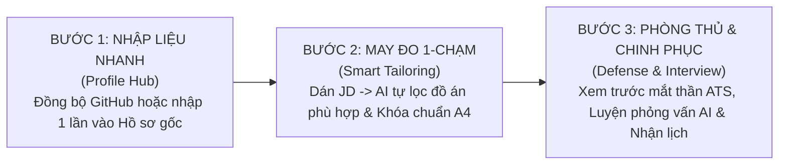

# BÁO CÁO PHẢN BIỆN TRẢI NGHIỆM ỨNG VIÊN (CANDIDATE UX CRITIQUE) & ĐỀ XUẤT TINH GỌN LUỒNG SẢN PHẨM

> **Tài liệu:** Đánh giá trải nghiệm người dùng thực tế (UX Audit & Flow Optimization)  
> **Dự án:** ProfileHub - AI Career Operating System  
> **Góc nhìn thẩm định:** Ứng viên thực tế (Sinh viên IT / Developer / Người tìm việc)  
> **Vị trí lưu trữ:** `docs/product/danh_gia_luong_ung_vien_va_toi_uu_ux.md`  
> **Thời điểm xuất bản:** 29/10/2026  

---

## 1. TỔNG QUAN NHẬN ĐỊNH

* **Về mặt công nghệ & nghiệp vụ lõi:** Hệ thống có nền tảng thuật toán rất mạnh, tư duy kiến trúc sâu, giải quyết trúng các "tử huyệt" kỹ thuật mà TopCV hay ITviec bỏ ngỏ (Chẩn đoán STAR định lượng, Mắt thần ATS, Bằng chứng đồ án Proof-of-Work, CV Heatmap và AI Mock Interview 4 chặng).
* **Về mặt luồng người dùng (UX Flow):** **Vẫn còn nhiều điểm "lằng ngoằng" và đang mắc hội chứng "Bội thực tính năng" (Feature Dumping).** Giao diện bày biện quá nhiều khối chức năng cùng lúc, có quá nhiều nút bấm trùng lặp và lạm dụng cửa sổ popup (Modal Hell), khiến ứng viên bị quá tải nhận thức (Cognitive Overload).

---

## 2. BỐN ĐIỂM "LẰNG NGOẰNG" GÂY NGHẼN TRẢI NGHIỆM NHẤT

### 2.1. "Ma trận tạo CV" – Quá nhiều lối vào cho cùng một mục đích
* **Hiện trạng:** Khi ứng viên muốn tạo 1 bản CV, họ bắt gặp nút tạo CV ở khắp mọi nơi với nhiều danh xưng khác nhau:
  1. Banner tím đầu Dashboard: *"Tạo & Tối ưu CV"*.
  2. Sidebar nút nổi bật: `+ Tạo CV (AI hoặc Tự viết)`.
  3. Sidebar mục xổ xuống (Submenu): Chia làm 3 nhánh nhỏ: *"AI Tạo CV Khớp JD"*, *"Tự Chọn Mẫu & Viết CV"*, *"AI CV Builder & Coach"*.
  4. Trong trang Quản lý CV (`/cv-manager`): Lại có nút tạo mới, nút tạo từ JD, nút import.
  5. Trong trang Việc làm (`/student/jobs`): Mỗi việc làm lại có nút tạo CV khớp JD.
* **Tâm lý ứng viên:** Bị hoang mang bởi hội chứng *Paradox of Choice*. Ứng viên tự hỏi: *"Bấm nút nào mới là đúng chuẩn? Hai nút này khác gì nhau?"*. Việc có quá nhiều đường dẫn không làm sản phẩm tiện hơn mà chỉ làm ứng viên do dự trước khi hành động.

### 2.2. Dashboard đang là "Showroom trưng bày" thay vì "Trung tâm hành động"
* **Hiện trạng:** Khi vừa đăng nhập vào Dashboard, ứng viên bị "dội" vào mắt hàng loạt khối dữ liệu xếp chồng:
  * Banner CV -> 2 Card lớn (Profile vs. CV Manager) -> Banner Việc làm -> Lịch phỏng vấn -> Thanh hoàn thiện % -> 4 Thẻ thống kê -> CV Heatmap -> Danh sách đồ án.
* **Tâm lý ứng viên:** Dashboard hiện tại giống như một bản báo cáo tổng kết của Admin hơn là bàn làm việc của một người đi xin việc. Ứng viên chỉ muốn biết nhanh 3 điều:
  1. *Hôm nay tôi có lịch phỏng vấn nào cần chuẩn bị không?*
  2. *Hồ sơ của tôi nộp đến đâu rồi, HR có xem không?*
  3. *Hệ thống khuyên tôi làm gì tiếp theo ngay bây giờ?*

### 2.3. "Modal Hell" (Bão Popup) trong CV Builder
* **Hiện trạng:** Khi vào `/cv-builder`, ứng viên bị bao vây bởi hơn 8 Modal độc lập:
  * Bấm STAR -> Nhảy Modal STAR to đùng.
  * Bấm Mắt Thần ATS -> Nhảy Modal ATS.
  * Bấm Quality Check -> Nhảy Modal Quality Check.
  * Bấm Application Pitch -> Nhảy Modal Pitch.
  * Bấm Phòng thủ phỏng vấn -> Nhảy Modal Project Defense.
  * Bấm Cấu hình Section -> Nhảy Modal Settings.
* **Tâm lý ứng viên:** Mỗi lần muốn xem gợi ý hay kiểm tra lỗi, một cửa sổ popup to đùng nhảy ra che mất trang CV đang viết. Ứng viên phải mở popup -> đọc -> tắt popup -> quay lại trang CV để sửa -> rồi lại mở popup khác. Việc "đứt gãy ngữ cảnh" (Context Switching) này gây mệt mỏi và ức chế khi soạn thảo lâu.

### 2.4. Sự nhập nhằng giữa "Hồ sơ gốc (Profile)" và "CV Builder"
* **Hiện trạng:** Có trang `/profile` (nhập thông tin cá nhân, đồ án, kỹ năng) và trang `/cv-builder` (cũng cho sửa thông tin, thêm đồ án, sửa kỹ năng).
* **Tâm lý ứng viên:** Ứng viên băn khoăn: *"Nếu tôi sửa tên dự án hay tech stack trong CV thì trong Hồ sơ cá nhân có tự đổi không? Hay tôi phải vào Profile gõ lại lần nữa?"*. Cảnh báo "Profile Drift" (lệch dữ liệu) khiến ứng viên cảm thấy hệ thống đang bắt họ phải bận tâm về cơ chế đồng bộ dữ liệu nội bộ.

---

## 3. PHƯƠNG ÁN TINH GỌN LUỒNG (LEAN UX BLUEPRINT)

Để đưa trải nghiệm người dùng lên chuẩn mượt mà tương đương các sản phẩm SaaS cao cấp hàng đầu (như Linear, Notion, Raycast), luồng trải nghiệm cần được quy hoạch lại theo nguyên tắc: **"Gom lối vào – Giảm Modal – Dashboard hướng hành động"**.

### 3.1. Tinh giản Sidebar & Hợp nhất thành "1 Cửa Tạo CV"
* **Đề xuất:** Xóa bỏ toàn bộ các mục con gây rối trong Sidebar. Chỉ giữ lại duy nhất 1 mục:
  * 📁 **Quản Lý CV** (`/cv-manager`)
* Trên thanh menu hoặc góc màn hình, chỉ để duy nhất **1 nút hành động**: `[ + Tạo CV Mới ]`.
* Khi ứng viên bấm vào, chỉ mở một cửa sổ lựa chọn 2 luồng rõ ràng:
  * 🎯 **Lựa chọn 1 (Khuyên dùng): "Tạo CV may đo theo Job cụ thể"** -> Dán link/JD tuyển dụng -> AI tự trích xuất đồ án và kinh nghiệm phù hợp từ Profile để tạo CV.
  * 🎨 **Lựa chọn 2: "Tự viết & Chọn mẫu tự do"** -> Chọn mẫu A4 trắng để tự soạn thảo theo ý muốn.

### 3.2. Quy hoạch lại Dashboard thành 3 phân vùng "Hành động dẫn hướng"
Thay vì xếp 8–10 khối rời rạc, gom toàn bộ Dashboard thành 3 vùng trọng tâm:
1. **Phân vùng 1: Tiêu điểm hôm nay (Action Required):**
   * *Nếu có lịch hẹn:* Hiện thẻ lịch phỏng vấn nổi bật (Link Google Meet + Nút xác nhận/đổi giờ + Nút "Luyện phỏng vấn AI ngay").
   * *Nếu không có lịch:* Hiện một gợi ý thông minh (Smart Next Action): *"Hồ sơ React của bạn đang khớp 92% với 3 vị trí mới mở tại TP.HCM. [Xem và Ứng tuyển ngay]"*.
2. **Phân vùng 2: Nhịp đập ứng tuyển (Application Pulse):**
   * Hợp nhất các chỉ số thành 1 hàng ngang tinh gọn:
     `Đơn Ứng Tuyển: 6` | `Đang Phỏng Vấn: 2` | `Lượt HR Xem CV: 18 lượt (Heatmap)` | `Đồ Án Verified: 4/5`.
3. **Phân vùng 3: Kho bằng chứng năng lực (Proof-of-Work Quick Access):**
   * Hiển thị 3 đồ án Verified mạnh nhất kèm mã Smart QR để ứng viên bấm copy hoặc tải nhanh card chia sẻ.

### 3.3. Khai tử "Modal Hell" – Chuyển đổi thành "AI Copilot Side-Panel"
* **Đề xuất:** Trong trang `/cv-builder`, loại bỏ các Modal to che màn hình. Chuyển toàn bộ các trợ lý thông minh thành **1 Dock Panel bên phải** với các tab chuyển đổi tức thì:
  * **Tab 1: ATS & Check:** Tự động chấm điểm trực tiếp, phát hiện dòng bị tràn trang A4, từ khóa thiếu hụt so với JD.
  * **Tab 2: STAR Coach:** Ứng viên click vào bất kỳ gạch đầu dòng nào trên CV, panel bên phải tự động phân tích và đưa ra câu hỏi bóc tách số liệu Google XYZ. Bấm 1 nút là câu văn trên CV tự đổi.
  * **Tab 3: Defense Briefing:** Xem ngay bộ câu hỏi bẫy kỹ thuật và trade-off tương ứng với dự án đang chọn mà không cần rời mắt khỏi trang CV.
* **Lợi ích:** Ứng viên vừa nhìn thấy trang giấy CV A4 vừa thấy AI phản hồi liên tục trong cùng một tầm mắt, không có popup nào nhảy ra ngắt quãng.

### 3.4. Định hình rõ nguyên tắc: Profile là "Gốc", CV là "Nhánh"
* **Nguyên tắc:** Hồ sơ cá nhân (`/profile`) là **Kho dữ liệu mẹ (Single Source of Truth)** lưu trữ toàn bộ lịch sử học tập, đồ án, chứng chỉ.
* Mỗi bản CV chỉ là một **"Bộ lọc mục tiêu" (Targeted View)** trích xuất từ kho dữ liệu mẹ đó.
* Khi ứng viên tối ưu một câu văn trong CV bằng chuẩn STAR, hệ thống chỉ cần hỏi nhẹ: *"Bạn có muốn cập nhật câu văn ấn tượng này vào Hồ sơ gốc không? [Có] [Chỉ lưu cho CV này]"*.

---

## 4. BẢNG SO SÁNH TRẢI NGHIỆM TRƯỚC VÀ SAU KHI TINH GỌN

| Tiêu chí đánh giá | Luồng hiện tại (Còn cồng kềnh) | Luồng tối ưu đề xuất (Lean & Smooth) |
| :--- | :--- | :--- |
| **Số thao tác để tạo 1 CV khớp JD** | **5 bước:** Dashboard -> Xem Jobs -> Bấm Tạo CV -> Mở Modal chọn -> Chuyển sang Builder -> Chỉnh sửa. | **2 bước:** Bấm `+ Tạo CV` -> Dán JD -> Vào thẳng bản CV đã được AI may đo chuẩn xác. |
| **Trải nghiệm tại Dashboard** | Bị "ngợp" thông tin bởi hơn 8 khối chức năng xếp chồng; không rõ việc cần làm nhất. | Rõ ràng, trực quan: Nắm được lịch phỏng vấn hôm nay, nhịp đập hồ sơ và hành động tiếp theo. |
| **Thao tác trong CV Builder** | Bấm nút -> Nhảy Modal che màn hình -> Tắt Modal -> Sửa text -> Lại mở Modal khác. | Màn hình chia đôi: Trái là trang CV A4, Phải là Copilot Panel phản hồi tức thì theo thời gian thực. |
| **Tâm lý người dùng** | Cảm giác như đang dùng một phần mềm doanh nghiệp phức tạp (Enterprise Tool). | Cảm giác mượt mà, định hướng hành động dứt khoát như các sản phẩm hiện đại (Linear / Notion). |

---

## 5. HÀNH TRÌNH ỨNG VIÊN LÝ TƯỞNG (THE IDEAL 3-STEP HAPPY PATH)



---

## 6. SƠ ĐỒ THAO TÁC CỦA ỨNG VIÊN KHI SỬ DỤNG HỆ THỐNG (CANDIDATE ACTION BLUEPRINT)

Dưới đây là cẩm nang hướng dẫn chi tiết từng bước thao tác thực tế mà một ứng viên (đặc biệt là sinh viên/fresher) cần thực hiện khi sử dụng ProfileHub từ ngày đầu tiên cho đến khi nhận được Offer việc làm:

| Bước | Giai đoạn | Trang thao tác | Thao tác cụ thể của ứng viên | Tính năng sử dụng | Kết quả đạt được |
| :---: | :--- | :--- | :--- | :--- | :--- |
| **1** | **Xây dựng Hồ sơ gốc** *(Baseline Profile)* | `/profile` hoặc `/projects` | • Cập nhật thông tin cá nhân, trường đại học, GPA.<br>• Thêm 2-3 đồ án thực tế (kèm link GitHub & Live Demo).<br>• Gắn tag các công nghệ đã sử dụng (React, Node, SQL...). | • `MyProfile`<br>• `AddProjectModal`<br>• `GitHubQuickImportBar` | Có một **"Kho dữ liệu mẹ" (Master Profile)** sạch sẽ, không cần nhập lại lần 2. |
| **2** | **Khảo sát việc làm & Dải lương** | `/dashboard` hoặc `/student/jobs` | • Xem danh sách tin tuyển dụng đối tác đang mở.<br>• Tra cứu dải lương thị trường theo vị trí mình định nộp. | • `StudentJobs`<br>• `SalaryBenchmarkModal` (AI tính P50-P85 & đòn bẩy đồ án) | Nắm chắc mức lương thị trường (VD: Fresher React 11-15 triệu) để tự tin deal lương. |
| **3** | **May đo CV khớp JD 1-Chạm** | `/student/jobs` hoặc `/cv-manager` | • Bấm nút **"AI Tạo CV Khớp JD"** ngay trên bài đăng hoặc dán text JD từ TopCV/ITviec vào. | • `GenerateCvFromJdModal`<br>• `CreateCvFlowModal`<br>• `cvService.generateTailoredCVFromJD` | Có ngay 1 bản CV mục tiêu được sắp xếp lại các dự án phù hợp nhất với JD đó trong 10 giây. |
| **4** | **Chuẩn hóa số liệu & Kiểm tra ATS** | `/cv-builder` | • Soạn thảo trực tiếp trên trang giấy A4 (Inline Edit).<br>• Bấm **STAR Diagnostic** để AI phỏng vấn bóc tách số liệu thật.<br>• Bật **Mắt Thần ATS** để xem văn bản thô máy quét đọc.<br>• Canh chỉnh **Page Budget Bar** đúng 1-2 trang A4. | • `StarCvDiagnosticModal`<br>• `AtsParserEyeModal`<br>• `CVQualityCheckModal`<br>• `pageBudgetService` | Bản CV đạt điểm chất lượng cao (>85đ), câu chữ có trọng lượng, không lo bị loại tự động ở vòng gửi xe. |
| **5** | **Xuất bản & Minh chứng năng lực** | `/cv-builder` | • Bấm **Tải PDF A4** sắc nét để gửi nhà tuyển dụng.<br>• In mã **Smart QR Code** lên góc CV để HR quét là mở link demo sản phẩm chạy thật. | • `InteractiveCVCanvas` (Print A4)<br>• `BusinessCardModal`<br>• `/showcase/:id` (Public Portfolio) | CV vừa tinh gọn vừa có bằng chứng năng lực thực tế (Proof-of-Work) chinh phục Tech Lead. |
| **6** | **Nộp đơn & Luyện phỏng vấn AI** | `/student/jobs` & `/dashboard` | • Bấm **Ứng tuyển ngay** chỉ với 1 click.<br>• Bấm **"Luyện Phỏng Vấn AI (4 Chặng)"** để thử thách trước: Elevator Pitch, Hỏi xoáy đồ án, Xử lý sự cố sập hệ thống (Live Incident). | • `addToSharedPipeline`<br>• `AiMockInterviewModal`<br>• `aiMockInterviewService` | Tự tin 100% trước khi bước vào phòng phỏng vấn chính thức với doanh nghiệp. |
| **7** | **Theo dõi HR & Xác nhận lịch hẹn** | `/dashboard` | • Xem **CV Heatmap** xem HR đọc phần nào lâu nhất.<br>• Khi nhận lời mời: Bấm **Xác nhận lịch ngay** hoặc bấm **Đổi giờ** để đề xuất khung giờ mới. | • `CvHeatmapWidget`<br>• `pipelineSync` (Reschedule & Google Meet Link) | Chủ động lịch trình phỏng vấn, không bị bỏ lỡ cơ hội việc làm. |

---

## 7. DANH MỤC TÍNH NĂNG ỨNG VIÊN CẦN TRONG TỪNG GIAI ĐOẠN

Để đảm bảo đáp ứng trọn vẹn toàn bộ vòng đời tìm việc, ứng viên cần một tập hợp các tính năng công nghệ phân bổ qua 5 giai đoạn:

```
[Giai đoạn 1: Chuẩn bị]  ──► [Giai đoạn 2: Tạo CV] ──► [Giai đoạn 3: Kiểm duyệt] ──► [Giai đoạn 4: Ứng tuyển] ──► [Giai đoạn 5: Phỏng vấn]
```

### 7.1. Giai đoạn 1: Chuẩn bị & Quản lý dữ liệu gốc
1. **Master Profile Manager:** Quản lý tập trung học vấn, GPA, kỹ năng, chứng chỉ và giải thưởng.
2. **Project Portfolio Hub:** Đăng tải đồ án thực tế kèm link GitHub, web demo và tài liệu kỹ thuật.
3. **GitHub Quick Importer:** Kéo repository từ GitHub về tạo đồ án tự động mà không phải gõ tay.
4. **Institutional Verification (Verified Badge 🛡️):** Xác nhận đồ án từ Giảng viên đại học làm bảo chứng uy tín.

### 7.2. Giai đoạn 2: Tạo & Cá nhân hóa CV theo công việc
1. **1-Click JD-to-CV Tailor:** Dán bất kỳ mô tả công việc nào để tạo CV khớp từ khóa trong 10 giây.
2. **Multi-version CV Repository:** Lưu trữ và quản lý độc lập nhiều bản CV theo từng công ty (VD: *CV - React FPT*, *CV - NodeJS Momo*).
3. **Application Pitch Generator:** Tự động soạn thư giới thiệu/lời chào ứng tuyển ngắn giải trình vì sao mình phù hợp.
4. **Visual CV Canvas (WYSIWYG):** Sửa trực tiếp từng câu chữ ngay trên trang giấy A4.

### 7.3. Giai đoạn 3: Kiểm soát kỹ thuật & Định dạng chuẩn
1. **STAR & Google XYZ Diagnostic:** Chẩn đoán câu văn, bắt lỗi từ ngữ mơ hồ và phỏng vấn lấy số liệu đo lường thật.
2. **ATS Parser Eye-View Simulator:** Hiển thị màn hình văn bản thô mà máy quét ATS nhìn thấy; cảnh báo bẫy layout 2 cột.
3. **Page Budget Real-time Meter:** Khóa cứng trang giấy A4, chống tình trạng tràn 1-2 dòng sang trang sau.
4. **Quality Check Rule Engine:** Tự động rà soát thiếu trường bắt buộc, bullet quá dài hoặc font chữ lỗi.

### 7.4. Giai đoạn 4: Minh chứng năng lực & Ứng tuyển
1. **Smart QR Business Card:** Tạo mã QR in trực tiếp lên CV giấy/PDF để NTD quét mở bản demo online.
2. **Interactive Public Showcase (`/showcase/:id`):** Trang portfolio trực tuyến (không cần đăng nhập) dành cho Tech Lead kiểm chứng code.
3. **1-Click Job Application:** Nộp đơn trực tiếp vào các doanh nghiệp đối tác với bản Active CV đã chọn.

### 7.5. Giai đoạn 5: Theo dõi, Luyện tập & Đàm phán
1. **CV Engagement Heatmap & Live Visit Feed:** Thống kê số lượt xem, thời gian đọc trung bình và mục được HR dừng lại lâu nhất.
2. **AI Salary Benchmark:** Khảo sát dải lương P50-P85 theo vị trí, tech stack và dùng đồ án làm đòn bẩy đàm phán.
3. **AI Mock Interview 4-Stage Adaptive:** Mô phỏng phòng phỏng vấn 4 chặng: Elevator Pitch, Hỏi sâu đồ án, Sập hệ thống Live Incident và Bào chữa lỗ hổng kỹ năng.
4. **Two-way Interview Reschedule:** Nhận link Google Meet, xác nhận tham gia hoặc yêu cầu đổi giờ trực tiếp trên hệ thống.

---

## 8. LỘ TRÌNH TÍNH NĂNG PHÁT TRIỂN TRONG TƯƠNG LAI (FUTURE ROADMAP)

Để tiếp tục nâng tầm ProfileHub vượt lên trên các đối thủ toàn cầu, đây là 5 tính năng đột phá được đưa vào kế hoạch phát triển tiếp theo:

```
┌────────────────────────────────────────────────────────────────────────┐
│             LỘ TRÌNH TÍNH NĂNG TƯƠNG LAI (FUTURE ROADMAP)              │
├─────────────────────────┬─────────────────────────┬────────────────────┤
│ Giai đoạn 1 (Ngắn hạn)  │ Giai đoạn 2 (Trung hạn) │ Giai đoạn 3 (Dài)  │
├─────────────────────────┼─────────────────────────┼────────────────────┤
│ • 1-Click PDF Importer  │ • Personal Kanban Board │ • AI Voice Mock    │
│ • English Tech Resume   │ • Chrome Job Clipper    │ • Creative Layouts │
└─────────────────────────┴─────────────────────────┴────────────────────┘
```

### 8.1. Tính năng 1: Bộ nạp CV cũ 1-Chạm (1-Click PDF Resume Importer)
* **Bài toán:** Ứng viên mới vào thường lười nhập lại từ đầu vì đã có sẵn file PDF làm từ TopCV, Canva hay LinkedIn.
* **Giải pháp:** 
  * Cung cấp nút `[ Tải Lên CV Cũ (PDF / DOCX) ]`.
  * AI bóc tách thông tin tự động (Học vấn, Công ty, Đồ án, Kỹ năng) và điền sẵn vào ProfileHub chỉ trong 10 giây.
  * Ứng viên chỉ việc bấm nút tối ưu hóa STAR mà không phải gõ lại bàn phím.

### 8.2. Tính năng 2: Chuyển đổi ngôn ngữ Tiếng Anh chuẩn IT (English Tech Resume Translator)
* **Bài toán:** Ứng viên nộp công ty Product, Outsource cao cấp hoặc làm Remote bắt buộc phải nộp CV tiếng Anh, nhưng việc tự dịch qua Google Dịch thường bị ngô nghê và sai thuật ngữ kỹ thuật.
* **Giải pháp:**
  * Thêm nút `[ Dịch Sang Tiếng Anh Chuẩn IT 1-Click ]`.
  * Chuyển hóa toàn bộ câu văn sang hệ động từ hành động mạnh mẽ của kỹ sư quốc tế (*Architected, Orchestrated, Engineered, Spearheaded, Refactored*).

### 8.3. Tính năng 3: Bảng Kanban Quản lý Ứng tuyển Đa Kênh (Personal Application Tracker)
* **Bài toán:** Ứng viên nộp đơn ở nhiều nơi (TopCV, ITviec, LinkedIn, gửi email trực tiếp) và thường xuyên quên mất mình đã nộp bản CV nào, link JD cũ viết gì.
* **Giải pháp:**
  * Trang `/student/tracker` dạng bảng Kanban kéo thả 5 cột:
    1. `Đang ngắm (Wishlist)`
    2. `Đã nộp đơn (Applied)` (Lưu kèm link JD và bản CV cụ thể đã dùng để nộp)
    3. `Đang phỏng vấn (Interviewing)` (Vòng 1 HR, Vòng 2 Technical, Vòng 3 Culture)
    4. `Nhận Offer (Offered)` (Ghi chú mức lương, hạn phản hồi)
    5. `Lưu trữ / Từ chối (Archived)`

### 8.4. Tính năng 4: Tiện ích mở rộng lưu tin tuyển dụng (ProfileHub Job Clipper Extension)
* **Bài toán:** Ứng viên lướt LinkedIn hay ITviec thấy việc làm hay muốn đưa ngay về ProfileHub để tạo CV.
* **Giải pháp:**
  * Một Chrome Extension nhỏ gọn: Khi đang mở bất kỳ trang tuyển dụng nào, ứng viên bấm 1 click là tiện ích tự động cào tên công ty, mức lương và toàn văn JD lưu thẳng vào tài khoản ProfileHub để AI may đo CV ngay lập tức.

### 8.5. Tính năng 5: Đa dạng hóa mẫu thiết kế cho các ngành ngoài Tech (Creative & Business Templates)
* **Bài toán:** Hiện tại giao diện tập trung sâu vào khối ngành Kỹ thuật/IT. Nếu ứng viên làm UI/UX Designer, Marketing hay Kinh doanh bước vào sẽ thấy thiếu các mẫu có tính thẩm mỹ sáng tạo cao.
* **Giải pháp:**
  * Bổ sung 3-4 bộ mẫu giao diện mới: *Creative Portfolio, Bold Editorial, Modern Marketing* với bảng màu tương phản, bố cục phá cách nhưng vẫn đảm bảo trích xuất dữ liệu chuẩn xác.

---

## 9. KẾT LUẬN

ProfileHub đã sở hữu những "vũ khí" công nghệ mạnh nhất trên thị trường tuyển dụng hiện nay. Bằng việc thực hiện cuộc tái cấu trúc tinh giản: **Gom lối vào -> Giảm Modal -> Hướng hành động tại Dashboard** và bám sát lộ trình bổ sung các tính năng nâng cao (Import PDF cũ, Chuyển ngữ tiếng Anh, Kanban đa kênh), sản phẩm sẽ trở thành một **Hệ điều hành sự nghiệp toàn diện không có đối thủ cạnh tranh**.

