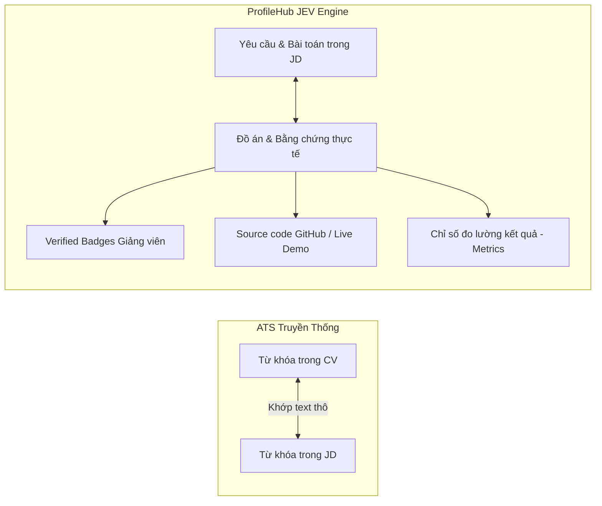
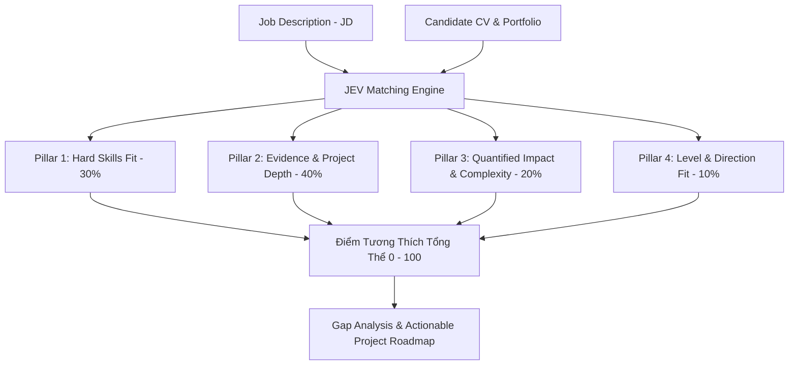
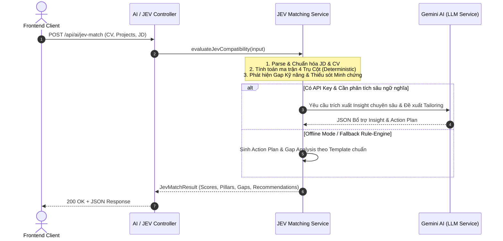

# 📄 TÀI LIỆU KIẾN TRÚC & QUY CHUẨN TÍNH NĂNG JEV (JOB EVIDENCE VERIFICATION) MATCHING
## Đánh Giá Tương Thích CV – JD Dựa Trên Bằng Chứng Thực Tế

> **Tài liệu đặc tả kiến trúc tính năng đánh giá tương thích giữa CV (Hồ sơ ứng viên) và JD (Mô tả công việc)**  
> *Phiên bản:* `1.0.0` | *Dự án:* ProfileHub  
> *Trọng tâm:* Evidence-Driven Match Engine & Anti-Keyword Stuffing

---

## 📌 1. Bối Cảnh & Đặt Vấn Đề (Problem Statement)

### 1.1. Thực trạng các giải pháp Matching hiện nay
1. **Hệ thống ATS truyền thống (Keyword-based Matching):**
   - Chỉ đếm số lần xuất hiện của từ khóa kỹ năng (vd: tìm thấy chữ *"Docker"*, *"React"* trong CV thì tăng điểm).
   - Dễ bị ứng viên gian lận bằng kỹ thuật **Keyword-Stuffing** (chèn từ khóa ẩn màu trắng hoặc liệt kê danh sách kỹ năng không có thật).
   - **Hoàn toàn không biết ứng viên đã dùng kỹ năng đó để giải quyết bài toán gì, độ khó ra sao.**

2. **Các công cụ Matching bằng LLM thông thường (Generic LLM Prompting):**
   - Phụ thuộc hoàn toàn vào một câu prompt tự do gửi tới OpenAI / Gemini.
   - Kết quả mang tính định tính, điểm số dao động ngẫu nhiên (non-deterministic), không có căn cứ giải trình rõ ràng cho nhà tuyển dụng và sinh viên.

---

## 🎯 2. Tại Sao Chọn JEV (Job Evidence Verification)?

**JEV (Job Evidence Verification)** là giải pháp đánh giá tương thích đặt **Minh chứng thực tế (Evidence) và Năng lực kiểm chứng (Verification)** làm trọng tâm:



### 🏆 3 Điểm Nổi Bật Vượt Trội của JEV:

1. **Chống gian lận CV (Anti-Gaming & Anti-Keyword Stuffing):**
   - Kỹ năng chỉ được tính trọng số tối đa khi gắn liền với **Bằng chứng cấp cao** (Level 2: Live Demo/Github hoặc Level 3: Verified Badge từ Giảng viên/Doanh nghiệp).
   - Kỹ năng chỉ ghi tên suông (Self-claim) chỉ nhận tối đa 30% trọng số.

2. **Mô hình tính điểm 4 Trụ Cột Đa Chiều (4-Pillar Deterministic Matrix):**
   - Điểm số được cấu thành từ 4 thành phần minh bạch, có thể giải trình được (*Explainable AI*).

3. **Phân tích Lỗ hổng & Gợi ý Đồ án Hành động (Actionable Gap-Filling Recommendations):**
   - Không chỉ báo "Không phù hợp", JEV chỉ ra cụ thể: *Thiếu kỹ năng gì $\rightarrow$ Cần thực hiện đồ án mẫu nào với Tech Stack và độ phức tạp tương đương để bù đắp*.

---

## 📐 3. Khung 4 Trụ Cột Đánh Giá JEV (4-Pillar Scoring Architecture)

Tổng điểm tương thích được tính toán dựa trên 4 trụ cột với trọng số chuẩn hóa:

$$\text{JEV\_Score} = \left( 0.30 \times S_{\text{Skill}} + 0.40 \times S_{\text{Evidence}} + 0.20 \times S_{\text{Impact}} + 0.10 \times S_{\text{Alignment}} \right) \times \text{TrustMultiplier}$$



### 3.1. Chi tiết 4 Trụ Cột:

| Trụ Cột | Trọng số | Tiêu chí đánh giá chi tiết | Công thức / Quy tắc tính |
| :--- | :---: | :--- | :--- |
| **1. Hard Skills Fit** | **30%** | • Phủ các kỹ năng cốt lõi (*Must-have*).<br>• Phủ các kỹ năng bổ trợ (*Nice-to-have*).<br>• Khớp ngữ nghĩa công nghệ tương đương (*Semantic Alias*). | $\frac{\text{Matched Core} \times 2 + \text{Matched Nice}}{\text{Total Core} \times 2 + \text{Total Nice}} \times 100$ |
| **2. Evidence Depth (JEV Core)** | **40%** | • Kỹ năng có đồ án chứng minh.<br>• Phân cấp bậc minh chứng (Level 0 $\rightarrow$ Level 3).<br>• Đồ án có tính liên quan trực tiếp đến bài toán JD. | $\sum (\text{Project\_Relevance} \times \text{Level\_Multiplier})$ |
| **3. Quantified Impact** | **20%** | • Có số liệu đo lường cụ thể (%, latency, user, điểm số đồ án).<br>• Áp dụng công thức chuẩn: *Action Verb + Task/Tech + Metric*. | Đo lường mật độ & chất lượng metrics trong các dự án chính. |
| **4. Alignment & Level** | **10%** | • Cấp độ kinh nghiệm phù hợp (Intern/Fresher/Junior).<br>• Định hướng nghề nghiệp khớp với vị trí ứng tuyển. | So khớp Career Goal & Cấp độ năm học/kinh nghiệm. |

---

## 🛡️ 4. Thang Phân Cấp Minh Chứng (JEV Evidence Levels)

Mỗi kỹ năng hoặc dự án trong CV được phân loại thành 4 cấp độ kiểm chứng:

```
[Level 0: Self-claim]  ──> [Level 1: Project Text]  ──> [Level 2: Artifact/Demo]  ──> [Level 3: Verified Badge]
   (Trọng số: 0.30)           (Trọng số: 0.60)              (Trọng số: 0.85)             (Trọng số: 1.00)
```

1. **Level 0 (Tự khai - Self-claim):** Ứng viên chỉ gõ tên kỹ năng trong danh sách, không có đồ án nào đi kèm.
2. **Level 1 (Mô tả đồ án - Descriptive Project):** Có tên đồ án và mô tả nhiệm vụ, nhưng không có link hoặc bằng chứng vật lý.
3. **Level 2 (Minh chứng sống - Live Artifact):** Có đính kèm liên kết GitHub repository, Live Demo URL, hoặc Video minh họa hoạt động.
4. **Level 3 (Kiểm định độc lập - Institutional Verified):** Có Giảng viên hướng dẫn / Mentor / Doanh nghiệp cấp **Verified Badge** và mã định danh trên ProfileHub.

---

## ⚡ 5. Quy Trình Xử Lý Backend (Hybrid Pipeline)



---

## 📊 6. Hợp Đồng Dữ Liệu Đầu Ra (API Contract & Output Schema)

```typescript
export interface JevMatchResponse {
  overall_score: number; // 0 - 100
  match_rating: 'STANDOUT_MATCH' | 'STRONG_FIT' | 'POTENTIAL_FIT' | 'NEEDS_DEVELOPMENT';
  trust_index: {
    verified_project_count: number;
    total_project_count: number;
    verification_ratio: number; // 0..1
    trust_tier: 'VERIFIED_ELITE' | 'HIGH_TRUST' | 'MODERATE' | 'UNVERIFIED';
  };
  pillars: {
    skill_fit: { score: number; matched_core: string[]; missing_core: string[]; matched_secondary: string[]; missing_secondary: string[] };
    evidence_depth: { score: number; top_contributing_projects: Array<{ id: string; title: string; evidence_level: string; relevance_score: number }> };
    impact_complexity: { score: number; metric_density: number; feedback: string };
    alignment_level: { score: number; level_match: boolean; note: string };
  };
  gap_analysis: Array<{
    skill_or_topic: string;
    importance: 'CRITICAL' | 'IMPORTANT' | 'NICE_TO_HAVE';
    current_evidence_level: number;
    gap_description: string;
    remediation_roadmap: {
      suggested_project_title: string;
      project_objective: string;
      recommended_tech_stack: string[];
      target_metrics: string;
    };
  }>;
  cv_coaching_tips: string[];
}
```
