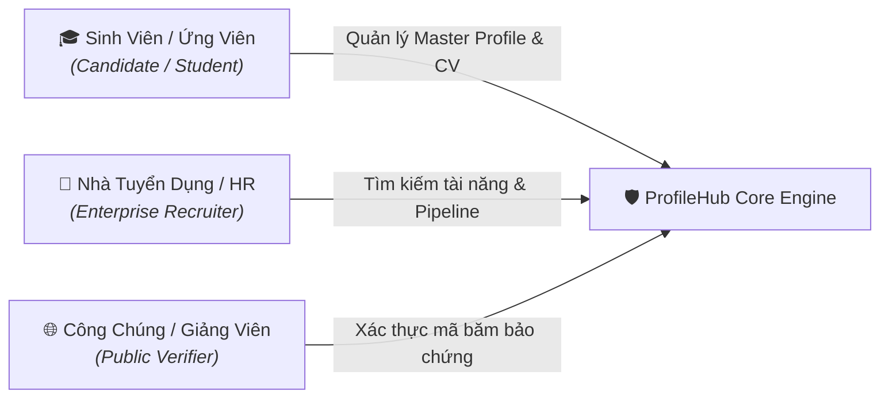
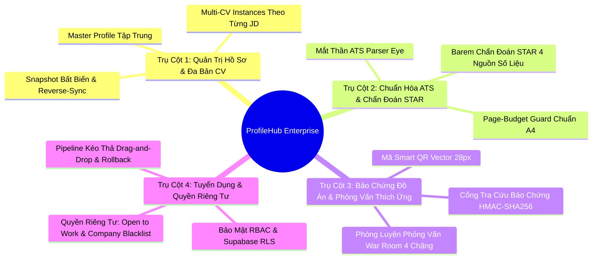

# ĐẶC TẢ YÊU CẦU SẢN PHẨM HỢP NHẤT (PRODUCT SPECIFICATION)
# NỀN TẢNG HỒ SƠ NGHỀ NGHIỆP DỰA TRÊN BẰNG CHỨNG PROFILEHUB
> **Mã tài liệu:** `SPEC-PRODUCT-PROFILEHUB-2026`  
> **Thư mục lưu trữ:** [`profilehub/docs/product/spec.md`](file:///C:/Users/ADMIN/Desktop/STUDY/profilehub/docs/product/spec.md)  
> **Phiên bản:** v2.6 Enterprise — Cập nhật toàn diện tháng 11/2026  
> **Chiến lược cốt lõi:** Evidence-Based Career Platform · Zero-Hallucination AI · Defense-in-Depth Security (RBAC & RLS) · Candidate Privacy & Discovery Control  
> **Đối tượng tài liệu:** Product Owner, Solution Architect, UI/UX Designer, Kỹ sư phần mềm, Hội đồng nghiệm thu thực tập

---

## 1. Bối Cảnh, Vấn Đề Thực Tiễn & Triết Lý Sản Phẩm

### 1.1. Nghịch Lý Tuyển Dụng Ngành Công Nghệ Thông Tin (The Tech Hiring Paradox)
Trong bối cảnh thị trường lao động công nghệ ngày càng cạnh tranh và chọn lọc khắt khe, ứng viên mới tốt nghiệp hoặc lập trình viên cấp độ khởi đầu (Fresher / Junior) luôn gặp phải một nghịch lý nan giải: **"Doanh nghiệp đòi hỏi kinh nghiệm thực tế, nhưng ứng viên không thể tích lũy kinh nghiệm nếu không được tuyển dụng."**

Khảo sát các nền tảng tạo CV phổ biến hiện nay (như Canva, TopCV hoặc các mẫu đồ họa trên mạng) bộc lộ ba lỗ hổng nghiêm trọng:
1. **Thiên về hình thức, rỗng về chất lượng:** Khuyến khích ứng viên chia 2 cột màu mè, chèn biểu đồ thanh phần trăm kỹ năng vô căn cứ (`Java 90%`, `React 85%`) mà không có sản phẩm chứng minh.
2. **Cái bẫy máy quét ATS (Applicant Tracking System):** Khi nộp hồ sơ vào các tập đoàn công nghệ lớn sử dụng ATS quốc tế (Workday, Taleo, Greenhouse), layout 2 cột đồ họa thường bị máy quét bóc tách xáo trộn trật tự câu từ, làm ứng viên bị loại oan uổng ngay từ vòng gửi xe.
3. **Hiện tượng thổi phồng số liệu viển vông (Fake Metrics):** Ứng viên tự bịa ra những con số kinh doanh ảo (`tăng doanh thu 30%`, `tiết kiệm 2 tỷ chi phí vận hành` cho một bài tập lớn môn học), dẫn đến việc bị Tech Lead đánh trượt vì thiếu trung thực (Dishonesty) khi bước vào vòng phỏng vấn kỹ thuật.

### 1.2. Triết Lý Cốt Lõi: "Evidence First, Data First, AI Second"
ProfileHub xác lập một nguyên lý bất biến: **Đồ án môn học, Khóa luận tốt nghiệp và Dự án mã nguồn mở là hạt nhân năng lực uy tín nhất của sinh viên.**
* **Bằng chứng có thể kiểm chứng (Verifiable Proof):** Biến mã nguồn GitHub, bài thuyết trình, bản thiết kế Figma và link Live Demo chạy thực tế thành tài sản nghề nghiệp minh bạch.
* **Nguyên tắc "Zero-Hallucination":** AI chỉ đóng vai trò Trợ lý cấu trúc (Structuring Assistant) và Huấn luyện viên (Coach), tuyệt đối không tự ý bịa đặt công nghệ hay thổi phồng số liệu không có trong hồ sơ gốc.
* **Bảo mật và Quyền riêng tư theo chiều sâu (Defense-in-Depth):** Tôn trọng tuyệt đối quyền kiểm soát thông tin của sinh viên theo Nghị định 13/2023/NĐ-CP (quyền ẩn CV khỏi công ty chỉ định, bật/tắt chế độ tìm việc).

---

## 2. Các Bên Tham Gia & Chân Dung Người Dùng (Personas & Actors)



### 2.1. Ứng Viên / Sinh Viên (Student / Candidate)
* **Đặc điểm:** Sinh viên đại học năm 3, năm 4 hoặc mới tốt nghiệp; có nhiều đồ án môn học nhưng chưa biết cách làm nổi bật năng lực kỹ thuật và gặp khó khăn trong việc viết bullet chuẩn STAR.
* **Mục tiêu:** Tạo CV bám sát yêu cầu từng tin tuyển dụng (JD) trong 3 giây; tự tin vượt qua máy quét ATS; luyện tập phỏng vấn trước khi gặp nhà tuyển dụng; bảo mật thông tin trước công ty hiện tại.

### 2.2. Nhà Tuyển Dụng / Kỹ Sư Phỏng Vấn (Recruiter / Tech Interviewer)
* **Đặc điểm:** HR, Talent Acquisition hoặc Tech Lead tại các công ty công nghệ; cần tuyển đúng người có kỹ năng thực chiến, không có thời gian đọc những bản CV chung chung hoặc chém gió.
* **Mục tiêu:** Tiếp cận Kho Ứng Viên đã qua xác thực đồ án (Verified Talent Pool); trực tiếp kiểm tra Live Demo và mã nguồn GitHub; quản lý quy trình phỏng vấn trực quan bằng Kanban kéo thả.

### 2.3. Người Kiểm Định / Công Chúng (Public Verifier / Auditor)
* **Đặc điểm:** Giảng viên hướng dẫn, người xét duyệt học bổng hoặc doanh nghiệp đối tác muốn xác thực tính nguyên bản của đồ án.
* **Mục tiêu:** Tra cứu mã băm mật mã học (HMAC/SHA-256 Digest) qua đường dẫn `/verify/:code` để khẳng định đồ án không bị đạo nhái hoặc làm giả.

---

## 3. Các Trụ Cột Nghiệp Vụ Cốt Lõi (Core Functional Pillars)



---

## 4. Đặc Tả Chi Tiết Yêu Cầu Chức Năng (Functional Requirements)

### FR-001: Kiến Trúc Phân Tách Master Profile & Multi-CV Instances
* **Mô tả:** Hệ thống phân định rạch ròi giữa **Kho Dữ Liệu Gốc (Master Profile)** và **Các Bản Thể CV Độc Lập (CV Instances)**.
* **Quy tắc nghiệp vụ:**
  * Mỗi người dùng có duy nhất một Master Profile chứa toàn bộ kinh nghiệm, đồ án, kỹ năng và chứng chỉ.
  * Khi tạo CV cho một vị trí tuyển dụng, hệ thống tạo bản sao độc lập (Deep Clone). Chỉnh sửa trên CV phái sinh không làm biến đổi hồ sơ gốc.
  * **Cơ chế Đồng Bộ Ngược (Opt-in Reverse-Sync):** Khi ứng viên gọt giũa một bullet đồ án trên CV trở nên xuất sắc, hệ thống hiển thị thông báo gợi ý đồng bộ ngược về Master Profile để tái sử dụng.
  * **Bản Chụp Bất Biến (Immutable Snapshot):** Khi xuất bản hoặc nộp đơn, hệ thống chụp lại trạng thái CV tại thời điểm đó để phục vụ đối chiếu phỏng vấn sau này.

### FR-002: Bóc Tách JD & May Đo CV Bằng AI Cục Bộ (AI CV Tailoring Engine)
* **Mô tả:** Đối chiếu hồ sơ ứng viên với bản mô tả công việc (JD) dán vào hệ thống.
* **Quy tắc nghiệp vụ:**
  * Trích xuất chính xác các từ khóa kỹ năng cứng (Hard Skills), kỹ năng mềm (Soft Skills) và công nghệ trọng tâm từ JD.
  * Tính toán **Điểm Tương Thích (Match Score 0-100%)** dựa trên tỷ lệ giao thoa từ khóa và độ tương đồng đồ án.
  * Tự động tái sắp xếp thứ tự hiển thị: Đưa đồ án và kỹ năng liên quan mật thiết nhất với JD lên vị trí ưu tiên đầu trang.
  * Liệt kê danh sách **Từ Khóa Còn Thiếu (Missing Keywords)** để ứng viên chủ động bổ sung nếu bản thân thực sự có kỹ năng đó.
  * **Cơ chế Dự Phòng (Offline Fallback):** Nếu API AI quá tải hoặc timeout, thuật toán luật cục bộ tự động phân tích từ khóa mà không làm gián đoạn luồng công việc.

### FR-003: Mắt Thần ATS (ATS Parser Eye) & Bố Cục Harvard Chuẩn Mực
* **Mô tả:** Mô phỏng cơ chế bóc tách văn bản thô (Plain-Text Parsing) của các hệ thống ATS hàng đầu thế giới (Workday, Taleo, Greenhouse).
* **Quy tắc nghiệp vụ:**
  * Hiển thị chế độ xem song song: Một bên là giao diện đồ họa, một bên là góc nhìn chuỗi thuần (Raw Text View) mà Robot ATS nhìn thấy.
  * Phát hiện và cảnh báo tức thì các bẫy định dạng: Layout 2 cột chia đôi, biểu đồ thanh phần trăm kỹ năng, icon đồ họa thay chữ cái.
  * Cung cấp nút chuyển đổi 1-click sang **Chuẩn Harvard 1 cột (Single-Column Standard)**, đảm bảo ATS trích xuất đúng 100% trật tự thời gian và tiêu đề.

### FR-004: Trợ Lý Chẩn Đoán STAR & Khung Số Liệu Tái Hiện Được
* **Mô tả:** Đánh giá chất lượng diễn đạt từng dòng kinh nghiệm và đồ án theo phương pháp luận STAR (Situation, Task, Action, Result).
* **Quy tắc nghiệp vụ:**
  * Quét phát hiện các động từ hành động thụ động, sáo rỗng ("tham gia", "hỗ trợ", "tìm hiểu").
  * **Barem Số Liệu Kỹ Thuật (Reproducible Metrics Barem):** Bác bỏ các số liệu kinh doanh bịa đặt, hướng dẫn ứng viên trích xuất 4 nguồn số liệu kỹ thuật hoàn toàn có thật từ đồ án:
    1. *Lighthouse Performance:* Điểm tối ưu hóa tải trang, giảm dung lượng bundle JS/CSS.
    2. *Vitest / Jest Code Coverage:* Tỷ lệ kiểm thử tự động, số lượng test cases pass.
    3. *k6 / Apache Benchmark:* Tải đồng thời (RPS), độ trễ phản hồi (p95 latency).
    4. *Database EXPLAIN ANALYZE:* Tỷ lệ giảm thời gian thực thi truy vấn sau khi đánh chỉ mục Index.

### FR-005: Bộ Canh Giữ Trang In (Page-Budget Guard) & Điều Tiết Mật Độ
* **Mô tả:** Giám sát thời gian thực chiều cao render của nội dung CV so với khổ giấy tiêu chuẩn quốc tế A4 (chiều cao 297mm).
* **Quy tắc nghiệp vụ:**
  * Thanh tiến trình Page-Budget hiển thị trực quan: Màu xanh lá (chuẩn 1 trang $\le 95\%$), Màu vàng (tiệm cận ngưỡng 95-100%), Màu đỏ (tràn sang trang 2 vô ích $\ge 100\%$).
  * Khi nội dung bị tràn sang trang thứ hai chỉ vì vài dòng chữ lẻ loi, cung cấp tính năng **Tự Động Nén Mật Độ (Auto Tighten Density)**: Giảm nhẹ padding, khoảng cách dòng và kích thước font (trong giới hạn dễ đọc) để co vừa vặn trong 1 trang duy nhất.

### FR-006: Mã Smart QR Vector 28px Minh Chứng Thực Tế
* **Mô tả:** Nhúng mã phản hồi nhanh định dạng vector (SVG 28x28px) ngay tại góc tiêu đề đồ án trên bản in giấy/PDF.
* **Quy tắc nghiệp vụ:**
  * Mã QR liên kết trực tiếp đến Demo chạy thực tế (Live URL), kho mã nguồn GitHub hoặc video thuyết trình.
  * Nhà tuyển dụng khi cầm bản in giấy chỉ cần dùng điện thoại quét mã là mở ngay giao diện sản phẩm đang hoạt động, xóa tan hoàn toàn nghi vấn "đồ án trên giấy".

### FR-007: Cổng Tra Cứu Bảo Chứng Công Khai Bằng Mật Mã Học (HMAC-SHA256)
* **Mô tả:** Cấp chứng chỉ định danh bảo chứng không thể làm giả cho từng đồ án đã qua kiểm định chất lượng.
* **Quy tắc nghiệp vụ:**
  * Khi đồ án được xác thực, hệ thống tính toán mã băm mật mã học từ tổ hợp: `student_id + project_id + title + repository_url + timestamp`.
  * Cung cấp cổng tra cứu công khai tại đường dẫn `/verify/:verification_code`.
  * Bất kỳ ai truy cập đường dẫn này đều xem được báo cáo kiểm định minh bạch: Tên sinh viên, người hướng dẫn, thời gian thẩm định, điểm đánh giá và mã băm toàn vẹn dữ liệu.

### FR-008: Phòng Luyện Phỏng Vấn War Room & Hiệu Chuẩn Cấp Bậc / Dải Lương
* **Mô tả:** Môi trường giả lập phỏng vấn thực chiến theo JD với 4 chặng thích ứng.
* **Quy tắc nghiệp vụ:**
  * *Chặng 1 (Elevator Pitch):* Luyện tập giới thiệu bản thân trong 60 giây ấn tượng.
  * *Chặng 2 (STAR Deep-Dive):* AI đóng vai Tech Lead đào sâu vào các quyết định kỹ thuật và kiến trúc đồ án.
  * *Chặng 3 (Live Incident):* Giả lập sự cố hệ thống bất ngờ (database sập, rò rỉ bộ nhớ, nghẽn mạng) kiểm tra phản xạ ứng biến.
  * *Chặng 4 (Bào chữa lỗ hổng - Gap Defense):* Đặt câu hỏi chất vấn vào các công nghệ trong JD mà ứng viên còn thiếu.
  * **Biểu Đồ Radar 5 Trục:** Đánh giá tổng kết năng lực (Kiến trúc, Giải quyết vấn đề, Tự tin, Diễn đạt, Tư duy hệ thống).
  * **Hiệu Chuẩn Cấp Bậc (Level Calibration):** Đưa ra khuyến nghị định vị cấp bậc thực tế (Fresher, Junior 1, Junior 2) và dải lương thị trường tương ứng.

### FR-009: Bảng Kanban Theo Dõi Tiến Trình Nộp Đơn (Application Pipeline Tracker)
* **Mô tả:** Hệ thống Kanban 6 cột dành cho ứng viên tự quản lý toàn bộ các chiến dịch nộp hồ sơ.
* **Quy tắc nghiệp vụ:**
  * 6 giai đoạn rõ ràng: `[1. Đã nộp]` $\rightarrow$ `[2. HR phản hồi]` $\rightarrow$ `[3. Bài Test]` $\rightarrow$ `[4. Phỏng vấn]` $\rightarrow$ `[5. Nhận Offer]` $\rightarrow$ `[6. Tạm dừng / Từ chối]`.
  * Mỗi thẻ công ty gắn chặt với bản CV cụ thể đã gửi đi. Bấm 1-click mở lại đúng bản CV đó để tránh bị "lệch tủ" khi nhà tuyển dụng gọi điện thoại phỏng vấn nhanh.

### FR-010: Phân Hệ Tuyển Dụng Recruiter, RBAC & Row Level Security (RLS)
* **Mô tả:** Cổng thông tin chuyên biệt dành cho doanh nghiệp tìm kiếm tài năng và quản lý quy trình tuyển chọn.
* **Quy tắc nghiệp vụ:**
  * **Kiểm soát truy cập theo vai trò (RBAC):** Middleware phía Backend kiểm tra nghiêm ngặt `requireRole(['recruiter', 'admin'])`. Sinh viên cố tình gọi API nhà tuyển dụng sẽ bị từ chối với mã `403 Forbidden`.
  * **Chính sách Row Level Security (RLS) trên Database:** Recruiter chỉ có quyền đọc và chỉnh sửa các ứng viên trong Pipeline của chính mình; Sinh viên chỉ xem được tiến trình của bản thân.
  * **Tìm Kiếm Ứng Viên Bằng Chứng (Evidence-Based Search):** Lọc ứng viên theo chuyên ngành, GPA, số lượng đồ án Verified và kỹ năng thực tế.

### FR-011: Quyền Riêng Tư Ứng Viên: Open to Work & Company Blacklist
* **Mô tả:** Trao quyền tự chủ hoàn toàn cho ứng viên trong việc kiểm soát mức độ hiển thị hồ sơ.
* **Quy tắc nghiệp vụ:**
  * **Công tắc "Sẵn sàng nhận việc" (Open to Work):** Khi bật, hồ sơ xuất hiện trong Kho Tìm Ứng Viên. Khi tắt, hồ sơ lập tức ẩn hoàn toàn khỏi toàn bộ doanh nghiệp.
  * **Danh Sách Công Ty Bị Chặn (Company Blacklist):** Sinh viên nhập tên các doanh nghiệp không muốn cho xem hồ sơ (ví dụ: công ty hiện tại đang thực tập hoặc các đơn vị đối thủ).
  * Bộ lọc tìm kiếm của Recruiter tự động loại bỏ các ứng viên đã chặn tên công ty của họ, bảo vệ an toàn danh tính và quyền riêng tư theo Nghị định 13/2023/NĐ-CP.

### FR-012: Trải Nghiệm Kéo Thả (Drag & Drop) & Đồng Bộ Pipeline Tuyển Dụng
* **Mô tả:** Giao diện Kanban kéo thả trực quan theo chuẩn HTML5 Native (không phụ thuộc thư viện nặng).
* **Quy tắc nghiệp vụ:**
  * Thẻ ứng viên có thuộc tính kéo (`draggable={true}`), icon nắm kéo `GripVertical`, hiệu ứng mờ 40% khi đang di chuyển.
  * Các cột STAGES là vùng thả (Drop Zones): Tự động đổi màu viền nét đứt và hiển thị thông báo hướng dẫn khi rê chuột qua.
  * **Cập Nhật Lạc Quan (Optimistic UI):** Vị trí thẻ chuyển đổi tức thì (0ms). Hệ thống âm thầm gửi API cập nhật Supabase Database.
  * **Tự Động Kích Hoạt Nghiệp Vụ:** Khi kéo thẻ vào cột `Phỏng Vấn`, hệ thống tự động mở Modal Đặt Lịch Phỏng Vấn với dữ liệu ứng viên đã điền sẵn.
  * **Cơ Chế Khôi Phục An Toàn (Rollback):** Nếu mạng gặp sự cố hoặc API từ chối, thẻ tự động hoàn trả về vị trí cũ kèm thông báo giải thích rõ ràng.

---

## 5. Kịch Bản Người Dùng & Tiêu Chuẩn Nghiệm Thu (User Scenarios)

### Kịch Bản 1: Sinh viên tạo CV chuẩn Harvard theo JD công ty mục tiêu
* **Điều kiện tiên quyết:** Sinh viên đã đăng nhập và có Master Profile chứa ít nhất 2 đồ án.
* **Hành động:** Dán đoạn văn bản JD vị trí "Frontend React Developer" vào modal tạo CV.
* **Kết quả mong đợi:** 
  * Hệ thống tính ra Điểm tương thích (ví dụ: 88%).
  * Đồ án sử dụng React/TypeScript được đẩy lên đầu trang.
  * Các từ khóa thiếu sót được đánh dấu để bổ sung.
  * CV hiển thị dưới dạng Harvard 1 cột, thanh Page-Budget báo 92% (vừa khít 1 trang A4).
  * Xuất file PDF sắc nét, mã QR vector in ở góc đồ án quét mở đúng trang web demo.

### Kịch Bản 2: Sinh viên cấu hình quyền riêng tư và chặn công ty thực tập
* **Điều kiện tiên quyết:** Sinh viên có đồ án xuất sắc trong Kho Talent Pool nhưng đang thực tập tại "Công ty ABC".
* **Hành động:** Mở modal "Quyền Riêng Tư & Ẩn CV", nhập "Công ty ABC" vào danh sách chặn và nhấn Lưu.
* **Kết quả mong đợi:**
  * Hệ thống lưu vào cơ sở dữ liệu và phát sự kiện cập nhật tức thì.
  * Khi tài khoản HR của "Công ty ABC" đăng nhập vào cổng Candidate Search, ứng viên này hoàn toàn không xuất hiện trong kết quả tìm kiếm.
  * Các nhà tuyển dụng của công ty khác vẫn xem được hồ sơ và huy hiệu "Open to Work" bình thường.

### Kịch Bản 3: Nhà tuyển dụng duyệt ứng viên và kéo thả vào vòng Phỏng vấn
* **Điều kiện tiên quyết:** Nhà tuyển dụng đăng nhập tài khoản doanh nghiệp đã cấp quyền.
* **Hành động:** Tại trang Candidate Pipeline, nắm thẻ ứng viên "Nguyễn Văn A" từ cột `Đã chọn` và kéo thả sang cột `Phỏng vấn`.
* **Kết quả mong đợi:**
  * Cột `Phỏng vấn` chuyển viền nét đứt màu tím nổi bật trong quá trình rê chuột.
  * Khi thả chuột, thẻ lập tức nằm gọn trong cột `Phỏng vấn`.
  * Modal "Hẹn Lịch Phỏng Vấn" tự động bật lên với tên ứng viên đã điền sẵn.
  * Dữ liệu đồng bộ thành công lên Supabase Cloud Database.

---

## 6. Tiêu Chí Thành Công Nghiệm Thu Kỹ Thuật (Success Criteria)

Các chỉ số đo lường chất lượng sản phẩm phải độc lập với công nghệ và kiểm chứng được:

| Mã tiêu chí | Chỉ số định lượng / Định tính | Phương thức đo lường & Tiêu chuẩn nghiệm thu |
| :---: | :--- | :--- |
| **SC-001** | **Độ Vừa Vặn Khổ Giấy In A4** | 100% bản xuất PDF của CV 1 trang có chiều cao nằm trong khoảng $\le 297mm$, không xuất hiện trang thứ 2 trắng hoặc rớt lẻ loi 1 dòng. |
| **SC-002** | **Độ Chính Xác Bóc Tách ATS** | Chuỗi văn bản thô bóc tách từ CV trích xuất đúng 100% thứ tự các mục Tiêu đề $\rightarrow$ Kỹ năng $\rightarrow$ Đồ án $\rightarrow$ Học vấn theo quy tắc đọc từ trên xuống dưới. |
| **SC-003** | **Thời Gian Phản Hồi Sinh CV** | Thời gian từ lúc bấm "Tạo CV theo JD" đến khi bản CV hiển thị hoàn chỉnh $< 3.0$ giây; nếu mất kết nối mạng, hệ thống chuyển sang Fallback cục bộ dưới $500ms$. |
| **SC-004** | **Tính Toàn Vẹn Mã Smart QR** | 100% mã QR in trên bản cứng hoặc file PDF quét bằng camera điện thoại thông thường mở chính xác liên kết Live Demo hoặc trang tra cứu `/verify/:code`. |
| **SC-005** | **Hiệu Quả Bảo Mật Phân Quyền RBAC** | 100% request từ tài khoản sinh viên gửi tới endpoint `/api/recruiter/*` bị chặn trả về mã `403 Forbidden`. Không rò rỉ dữ liệu qua API. |
| **SC-006** | **Tỷ Lệ Chặn Ẩn Hồ Sơ Riêng Tư** | 100% ứng viên tắt Open to Work hoặc chặn Công ty X hoàn toàn biến mất khỏi kết quả tìm kiếm của nhà tuyển dụng thuộc Công ty X. |
| **SC-007** | **Độ Trễ Tương Tác Kéo Thả (Kanban)** | Phản hồi cập nhật giao diện khi thả thẻ ứng viên diễn ra tức thì $\le 50ms$ (Optimistic UI), có cơ chế hoàn trả vị trí nếu mạng đứt. |
| **SC-008** | **Độ Tin Cậy Bộ Kiểm Thử (Test Suite)** | Tỷ lệ kiểm thử tự động đạt **100% Pass** trên toàn bộ các test suites (tối thiểu 40 test files, $\ge 165$ test cases), `tsc --noEmit` đạt 0 lỗi. |

---

## 7. Yêu Cầu Phi Chức Năng (Non-Functional Requirements)

1. **Hiệu Năng & Tải Trang (Performance):**
   * Thời gian hiển thị nội dung đầu tiên (FCP) dưới 1.2 giây trên mạng 4G tiêu chuẩn.
   * Bundle production được nén gzip tối ưu, chia nhỏ các module lớn bằng dynamic imports.
2. **Khả Năng Vận Hành Ngoại Tuyến (Offline-Resilience):**
   * Sử dụng cơ chế lưu trữ kép thông minh (Dual-Storage Seam): Dữ liệu luôn có bản cache an toàn tại LocalStorage, tự động khôi phục khi làm việc offline hoặc mạng chập chờn.
3. **Tuân Thủ Pháp Lý & An Toàn Dữ Liệu:**
   * Tuân thủ Nghị định 13/2023/NĐ-CP về Bảo vệ dữ liệu cá nhân tại Việt Nam: Số điện thoại và thông tin liên hệ nhạy cảm của sinh viên mặc định được bảo vệ và chỉ chia sẻ khi có sự đồng thuận phỏng vấn.
4. **Chuẩn Mực Mã Nguồn (Code Quality Standards):**
   * 100% TypeScript trong chế độ Strict Mode, cấm sử dụng kiểu `any` vô căn cứ.
   * Toàn bộ các tương tác mutation quan trọng đều có bài Unit Test bao bọc.

---

## 8. Lộ Trình Phát Triển 4 Giai Đoạn (Evolutionary Roadmap)

```
[GIAI ĐOẠN 1: MVP] ────────► [GIAI ĐOẠN 2: BRIDGE] ────────► [GIAI ĐOẠN 3: SÀN VIỆC LÀM] ────────► [GIAI ĐOẠN 4: ENTERPRISE]
• Visual CV Studio           • Portfolio View công khai       • Xác thực MST doanh nghiệp       • Hệ thống Mini ATS hoàn chỉnh
• ATS Parser Eye             • Chia sẻ bảo chứng QR           • Đăng tin tuyển dụng chuẩn hóa    • Semantic Vector Search (RAG)
• Chẩn đoán STAR             • Cổng tra cứu HMAC-SHA256       • Pipeline Kanban Kéo Thả         • Cổng thanh toán gói dịch vụ
• Page-Budget Guard A4       • Tuân thủ Nghị định 13/NĐ-CP    • Phân quyền RBAC & RLS           • Calibration tự động theo dữ liệu
```

* **Hiện trạng hoàn thành:** Toàn bộ Giai đoạn 1 và phần lớn Giai đoạn 2, 3 (RBAC, RLS, Reverse Recruiting, Pipeline Drag & Drop, Candidate Privacy) đã được kiểm thử và đưa vào vận hành thực tế trên nhánh `profilehub_v1`.

---

## 9. Giả Định & Giới Hạn Phạm Vi (Assumptions & Out-of-Scope)

### Giả Định (Assumptions)
* Người dùng sử dụng các trình duyệt hiện đại (Chrome, Edge, Firefox, Safari) hỗ trợ HTML5 Drag and Drop API và LocalStorage.
* Các đồ án của sinh viên được lưu trữ trên các nền tảng mã nguồn mở phổ biến (GitHub, GitLab) hoặc có link demo truy cập được qua giao thức HTTPS.

### Giới Hạn Ngoài Phạm Vi Hiện Tại (Out-of-Scope)
* Không tích hợp cổng thanh toán trực tuyến tiền thật (MoMo, VNPAY) trong phiên bản học thuật này (dành cho Giai đoạn 4 thương mại hóa).
* Không tự động gọi điện hoặc gửi SMS trực tiếp qua tổng đài viễn thông (sử dụng email mailto và đường link Google Meet thay thế).
* Không can thiệp sửa đổi nội dung mã nguồn trong repository GitHub của sinh viên (chỉ đọc và trích xuất số liệu kiểm định).

---
*Tài liệu này được biên soạn và bảo toàn tại [`profilehub/docs/product/spec.md`](file:///C:/Users/ADMIN/Desktop/STUDY/profilehub/docs/product/spec.md) để làm căn cứ quy chiếu duy nhất cho toàn bộ hệ thống ProfileHub.*
