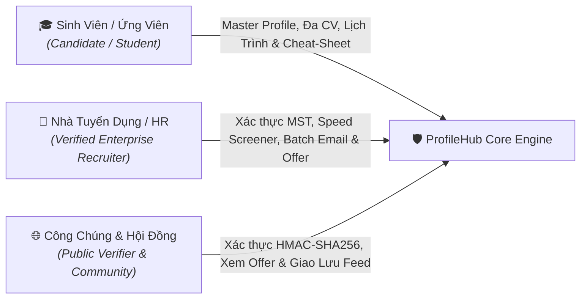
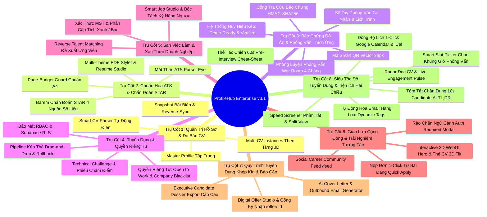

# ĐẶC TẢ YÊU CẦU SẢN PHẨM HỢP NHẤT (PRODUCT SPECIFICATION)
# NỀN TẢNG HỒ SƠ NGHỀ NGHIỆP DỰA TRÊN BẰNG CHỨNG PROFILEHUB
> **Mã tài liệu:** `SPEC-PRODUCT-PROFILEHUB-2026`  
> **Thư mục lưu trữ:** [`profilehub/docs/product/spec.md`](file:///C:/Users/ADMIN/Desktop/STUDY/profilehub/docs/product/spec.md)  
> **Phiên bản:** v3.1 Enterprise — Bổ sung Phân hệ Siêu Tốc Độ Tuyển Dụng & Tiện Ích Hai Chiều tháng 11/2026  
> **Chiến lược cốt lõi:** Evidence-Based Career Platform · Zero-Hallucination AI · Defense-in-Depth Security (RBAC & RLS) · Candidate Privacy & Discovery Control · Full-Cycle Recruitment Bridge · Maximum Operational Velocity  
> **Đối tượng tài liệu:** Product Owner, Solution Architect, UI/UX Designer, Kỹ sư phần mềm, Hội đồng nghiệm thu thực tập

---

## 1. Bối Cảnh, Vấn Đề Thực Tiễn & Triết Lý Sản Phẩm

### 1.1. Nghịch Lý Tuyển Dụng Ngành Công Nghệ Thông Tin (The Tech Hiring Paradox)
Trong bối cảnh thị trường lao động công nghệ ngày càng cạnh tranh và chọn lọc khắt khe, ứng viên mới tốt nghiệp hoặc lập trình viên cấp độ khởi đầu (Fresher / Junior) luôn gặp phải một nghịch lý nan giải: **"Doanh nghiệp đòi hỏi kinh nghiệm thực tế, nhưng ứng viên không thể tích lũy kinh nghiệm nếu không được tuyển dụng."**

Khảo sát các nền tảng tạo CV phổ biến hiện nay (như Canva, TopCV hoặc các mẫu đồ họa trên mạng) bộc lộ ba lỗ hổng nghiêm trọng:
1. **Thiên về hình thức, rỗng về chất lượng:** Khuyến khích ứng viên chia 2 cột màu mè, chèn biểu đồ thanh phần trăm kỹ năng vô căn cứ (`Java 90%`, `React 85%`) mà không có sản phẩm chứng minh.
2. **Cái bẫy máy quét ATS (Applicant Tracking System):** Khi nộp hồ sơ vào các tập đoàn công nghệ lớn sử dụng ATS quốc tế (Workday, Taleo, Greenhouse), layout 2 cột đồ họa thường bị máy quét bóc tách xáo trộn trật tự câu từ, làm ứng viên bị loại oan uổng ngay từ vòng gửi xe.
3. **Hiện tượng thổi phồng số liệu viển vông (Fake Metrics):** Ứng viên tự bịa ra những con số kinh doanh ảo (`tăng doanh thu 30%`, `tiết kiệm 2 tỷ chi phí vận hành` cho một bài tập lớn môn học), dẫn đến việc bị Tech Lead đánh trượt vì thiếu trung thực (Dishonesty) khi bước vào vòng phỏng vấn kỹ thuật.

### 1.2. Triết Lý Cốt Lõi: "Evidence First, Data First, AI Second"
ProfileHub xác lập một nguyên lý bất biến: **Đồ án môn học, Khóa luận tốt nghiệp và Dự án mã nguồn mở là hạt nhân năng lực uy tín nhất của sinh viên.**
* **Bằng chứng có thể kiểm chứng (Verifiable Proof):** Biến mã nguồn GitHub, bài thuyết trình, bản thiết kế Figma và link Live Demo chạy thực tế thành tài sản nghề nghiệp minh bạch.
* **Nguyên tắc "Zero-Hallucination":** AI chỉ đóng vai trò Trợ lý cấu trúc (Structuring Assistant) và Huấn luyện viên (Coach), tuyệt đối không tự ý bịa đặt công nghệ hay thổi phồng số liệu không có trong hồ sơ gốc.
* **Bảo mật và Quyền riêng tư theo chiều sâu (Defense-in-Depth):** Tôn trọng tuyệt đối quyền kiểm soát thông tin của sinh viên theo Nghị định 13/2023/NĐ-CP (quyền ẩn CV khỏi công ty chỉ định, bật/tắt chế độ tìm việc).
* **Kết nối tuyển dụng khép kín (End-to-End Recruitment Loop):** Không chỉ dừng lại ở công cụ tạo CV cá nhân, hệ thống kết nối đa chiều giữa Ứng viên, Doanh nghiệp đã xác thực MST, Cộng đồng nghề nghiệp và Cổng ký nhận Thư mời làm việc (Digital Offer Portal).
* **Tối đa hóa vận tốc & Tiện ích hai chiều (Maximum Velocity & Frictionless Synergy):** Giảm thiểu tối đa thời gian chờ đợi và thao tác thừa cho cả Sinh viên (nhắc lịch tự động, cheat-sheet bỏ túi, radar đọc CV) và HR (duyệt phím tắt 3 giây, email hàng loạt, chọn lịch phỏng vấn tự động).

---

## 2. Các Bên Tham Gia & Chân Dung Người Dùng (Personas & Actors)



### 2.1. Ứng Viên / Sinh Viên (Student / Candidate)
* **Đặc điểm:** Sinh viên đại học năm 3, năm 4 hoặc mới tốt nghiệp; có nhiều đồ án môn học nhưng chưa biết cách làm nổi bật năng lực kỹ thuật và gặp khó khăn trong việc viết bullet chuẩn STAR.
* **Mục tiêu:** Tạo CV bám sát yêu cầu từng tin tuyển dụng (JD) trong 3 giây; tự tin vượt qua máy quét ATS; luyện tập phỏng vấn trước khi gặp nhà tuyển dụng; bảo mật thông tin trước công ty hiện tại; chủ động theo dõi lịch phỏng vấn và nhận Thư mời việc làm trực tuyến; có công cụ ôn tập tốc hành 60 giây trước giờ phỏng vấn và đồng bộ lịch học với lịch phỏng vấn không lo trùng giờ.

### 2.2. Nhà Tuyển Dụng / Kỹ Sư Phỏng Vấn (Recruiter / Tech Interviewer)
* **Đặc điểm:** HR, Talent Acquisition hoặc Tech Lead tại các công ty công nghệ; cần tuyển đúng người có kỹ năng thực chiến, không có thời gian đọc những bản CV chung chung hoặc chém gió.
* **Mục tiêu:** Được cấp Tích Xanh doanh nghiệp qua MST minh bạch; tiếp cận Kho Ứng Viên đã qua xác thực đồ án (Verified Talent Pool); trực tiếp kiểm tra Live Demo và mã nguồn GitHub; quản lý quy trình phỏng vấn trực quan bằng Kanban kéo thả; duyệt hàng loạt hồ sơ bằng phím tắt trong vài giây; gửi thông báo phỏng vấn/từ chối hàng loạt tự động; phát hành Thư mời nhận việc (Digital Offer) chuyên nghiệp.

### 2.3. Người Kiểm Định / Công Chúng (Public Verifier / Community)
* **Đặc điểm:** Giảng viên hướng dẫn, người xét duyệt học bổng, nhà tuyển dụng đối tác hoặc bạn bè đồng nghiệp trên mạng xã hội nghề nghiệp.
* **Mục tiêu:** Tra cứu mã băm mật mã học (HMAC/SHA-256 Digest) qua đường dẫn `/verify/:code` để khẳng định đồ án không bị đạo nhái hoặc làm giả; giao lưu kinh nghiệm phỏng vấn và chia sẻ cơ hội trên Community Feed.

---

## 3. Các Trụ Cột Nghiệp Vụ Cốt Lõi (Core Functional Pillars)



---

## 4. Đặc Tả Chi Tiết Yêu Cầu Chức Năng (Functional Requirements)

### FR-001: Kiến Trúc Phân Tách Master Profile & Multi-CV Instances
* **Mô tả:** Hệ thống phân định rạch ròi giữa **Kho Dữ Liệu Gốc (Master Profile)** và **Các Bản Thể CV Độc Lập (CV Instances)**.
* **Quy tắc nghiệp vụ:**
  * Mỗi người dùng có duy nhất một Master Profile chứa toàn bộ kinh nghiệm, đồ án, kỹ năng và chứng chỉ.
  * Khi tạo CV cho một vị trí tuyển dụng, hệ thống tạo bản sao độc lập (Deep Clone). Chỉnh sửa trên CV phái sinh không làm biến đổi hồ sơ gốc.
  * **Cơ chế Đồng Bộ Ngược (Opt-in Reverse-Sync):** Khi ứng viên gọt giũa một bullet đồ án trên CV trở nên xuất sắc, hệ thống hiển thị thông báo gợi ý đồng bộ ngược về Master Profile để tái sử dụng.
  * **Bản Chụp Bất Biến (Immutable Snapshot):** Khi xuất bản hoặc nộp đơn, hệ thống chụp lại trạng thái CV tại thời điểm đó để phục vụ đối chiếu phỏng vấn sau này.

### FR-002: Bóc Tách JD & May Đo CV Bằng AI Cục Bộ (AI CV Tailoring Engine)
* **Mô tả:** Đối chiếu hồ sơ ứng viên với bản mô tả công việc (JD) dán vào hệ thống.
* **Quy tắc nghiệp vụ:**
  * Trích xuất chính xác các từ khóa kỹ năng cứng (Hard Skills), kỹ năng mềm (Soft Skills) và công nghệ trọng tâm từ JD.
  * Tính toán **Điểm Tương Thích (Match Score 0-100%)** dựa trên tỷ lệ giao thoa từ khóa và độ tương đồng đồ án.
  * Tự động tái sắp xếp thứ tự hiển thị: Đưa đồ án và kỹ năng liên quan mật thiết nhất với JD lên vị trí ưu tiên đầu trang.
  * Liệt kê danh sách **Từ Khóa Còn Thiếu (Missing Keywords)** để ứng viên chủ động bổ sung nếu bản thân thực sự có kỹ năng đó.
  * **Cơ chế Dự Phòng (Offline Fallback):** Nếu API AI quá tải hoặc timeout, thuật toán luật cục bộ tự động phân tích từ khóa mà không làm gián đoạn luồng công việc.

### FR-003: Mắt Thần ATS (ATS Parser Eye) & Bố Cục Harvard Chuẩn Mực
* **Mô tả:** Mô phỏng cơ chế bóc tách văn bản thô (Plain-Text Parsing) của các hệ thống ATS hàng đầu thế giới (Workday, Taleo, Greenhouse).
* **Quy tắc nghiệp vụ:**
  * Hiển thị chế độ xem song song: Một bên là giao diện đồ họa, một bên là góc nhìn chuỗi thuần (Raw Text View) mà Robot ATS nhìn thấy.
  * Phát hiện và cảnh báo tức thì các bẫy định dạng: Layout 2 cột chia đôi, biểu đồ thanh phần trăm kỹ năng, icon đồ họa thay chữ cái.
  * Cung cấp nút chuyển đổi 1-click sang **Chuẩn Harvard 1 cột (Single-Column Standard)**, đảm bảo ATS trích xuất đúng 100% trật tự thời gian và tiêu đề.

### FR-004: Trợ Lý Chẩn Đoán STAR & Khung Số Liệu Tái Hiện Được
* **Mô tả:** Đánh giá chất lượng diễn đạt từng dòng kinh nghiệm và đồ án theo phương pháp luận STAR (Situation, Task, Action, Result).
* **Quy tắc nghiệp vụ:**
  * Quét phát hiện các động từ hành động thụ động, sáo rỗng ("tham gia", "hỗ trợ", "tìm hiểu").
  * **Barem Số Liệu Kỹ Thuật (Reproducible Metrics Barem):** Bác bỏ các số liệu kinh doanh bịa đặt, hướng dẫn ứng viên trích xuất 4 nguồn số liệu kỹ thuật hoàn toàn có thật từ đồ án:
    1. *Lighthouse Performance:* Điểm tối ưu hóa tải trang, giảm dung lượng bundle JS/CSS.
    2. *Vitest / Jest Code Coverage:* Tỷ lệ kiểm thử tự động, số lượng test cases pass.
    3. *k6 / Apache Benchmark:* Tải đồng thời (RPS), độ trễ phản hồi (p95 latency).
    4. *Database EXPLAIN ANALYZE:* Tỷ lệ giảm thời gian thực thi truy vấn sau khi đánh chỉ mục Index.

### FR-005: Bộ Canh Giữ Trang In (Page-Budget Guard) & Điều Tiết Mật Độ
* **Mô tả:** Giám sát thời gian thực chiều cao render của nội dung CV so với khổ giấy tiêu chuẩn quốc tế A4 (chiều cao 297mm).
* **Quy tắc nghiệp vụ:**
  * Thanh tiến trình Page-Budget hiển thị trực quan: Màu xanh lá (chuẩn 1 trang $\le 95\%$), Màu vàng (tiệm cận ngưỡng 95-100%), Màu đỏ (tràn sang trang 2 vô ích $\ge 100\%$).
  * Khi nội dung bị tràn sang trang thứ hai chỉ vì vài dòng chữ lẻ loi, cung cấp tính năng **Tự Động Nén Mật Độ (Auto Tighten Density)**: Giảm nhẹ padding, khoảng cách dòng và kích thước font (trong giới hạn dễ đọc) để co vừa vặn trong 1 trang duy nhất.

### FR-006: Mã Smart QR Vector 28px Minh Chứng Thực Tế
* **Mô tả:** Nhúng mã phản hồi nhanh định dạng vector (SVG 28x28px) ngay tại góc tiêu đề đồ án trên bản in giấy/PDF.
* **Quy tắc nghiệp vụ:**
  * Mã QR liên kết trực tiếp đến Demo chạy thực tế (Live URL), kho mã nguồn GitHub hoặc video thuyết trình.
  * Nhà tuyển dụng khi cầm bản in giấy chỉ cần dùng điện thoại quét mã là mở ngay giao diện sản phẩm đang hoạt động, xóa tan hoàn toàn nghi vấn "đồ án trên giấy".

### FR-007: Cổng Tra Cứu Bảo Chứng Công Khai Bằng Mật Mã Học (HMAC-SHA256)
* **Mô tả:** Cấp chứng chỉ định danh bảo chứng không thể làm giả cho từng đồ án đã qua kiểm định chất lượng.
* **Quy tắc nghiệp vụ:**
  * Khi đồ án được xác thực, hệ thống tính toán mã băm mật mã học từ tổ hợp: `student_id + project_id + title + repository_url + timestamp`.
  * Cung cấp cổng tra cứu công khai tại đường dẫn `/verify/:verification_code`.
  * Bất kỳ ai truy cập đường dẫn này đều xem được báo cáo kiểm định minh bạch: Tên sinh viên, người hướng dẫn, thời gian thẩm định, điểm đánh giá và mã băm toàn vẹn dữ liệu.

### FR-008: Phòng Luyện Phỏng Vấn War Room & Hiệu Chuẩn Cấp Bậc / Dải Lương
* **Mô tả:** Môi trường giả lập phỏng vấn thực chiến theo JD với 4 chặng thích ứng.
* **Quy tắc nghiệp vụ:**
  * *Chặng 1 (Elevator Pitch):* Luyện tập giới thiệu bản thân trong 60 giây ấn tượng.
  * *Chặng 2 (STAR Deep-Dive):* AI đóng vai Tech Lead đào sâu vào các quyết định kỹ thuật và kiến trúc đồ án.
  * *Chặng 3 (Live Incident):* Giả lập sự cố hệ thống bất ngờ (database sập, rò rỉ bộ nhớ, nghẽn mạng) kiểm tra phản xạ ứng biến.
  * *Chặng 4 (Bào chữa lỗ hổng - Gap Defense):* Đặt câu hỏi chất vấn vào các công nghệ trong JD mà ứng viên còn thiếu.
  * **Biểu Đồ Radar 5 Trục:** Đánh giá tổng kết năng lực (Kiến trúc, Giải quyết vấn đề, Tự tin, Diễn đạt, Tư duy hệ thống).
  * **Hiệu Chuẩn Cấp Bậc (Level Calibration):** Đưa ra khuyến nghị định vị cấp bậc thực tế (Fresher, Junior 1, Junior 2) và dải lương thị trường tương ứng.

### FR-009: Bảng Kanban Theo Dõi Tiến Trình Nộp Đơn (Application Pipeline Tracker)
* **Mô tả:** Hệ thống Kanban 6 cột dành cho ứng viên tự quản lý toàn bộ các chiến dịch nộp hồ sơ.
* **Quy tắc nghiệp vụ:**
  * 6 giai đoạn rõ ràng: `[1. Đã nộp]` $\rightarrow$ `[2. HR phản hồi]` $\rightarrow$ `[3. Bài Test]` $\rightarrow$ `[4. Phỏng vấn]` $\rightarrow$ `[5. Nhận Offer]` $\rightarrow$ `[6. Tạm dừng / Từ chối]`.
  * Mỗi thẻ công ty gắn chặt với bản CV cụ thể đã gửi đi. Bấm 1-click mở lại đúng bản CV đó để tránh bị "lệch tủ" khi nhà tuyển dụng gọi điện thoại phỏng vấn nhanh.

### FR-010: Phân Hệ Tuyển Dụng Recruiter, RBAC & Row Level Security (RLS)
* **Mô tả:** Cổng thông tin chuyên biệt dành cho doanh nghiệp tìm kiếm tài năng và quản lý quy trình tuyển chọn.
* **Quy tắc nghiệp vụ:**
  * **Kiểm soát truy cập theo vai trò (RBAC):** Middleware phía Backend kiểm tra nghiêm ngặt `requireRole(['recruiter', 'admin'])`. Sinh viên cố tình gọi API nhà tuyển dụng sẽ bị từ chối với mã `403 Forbidden`.
  * **Chính sách Row Level Security (RLS) trên Database:** Recruiter chỉ có quyền đọc và chỉnh sửa các ứng viên trong Pipeline của chính mình; Sinh viên chỉ xem được tiến trình của bản thân.
  * **Tìm Kiếm Ứng Viên Bằng Chứng (Evidence-Based Search):** Lọc ứng viên theo chuyên ngành, GPA, số lượng đồ án Verified và kỹ năng thực tế.

### FR-011: Quyền Riêng Tư Ứng Viên: Open to Work & Company Blacklist
* **Mô tả:** Trao quyền tự chủ hoàn toàn cho ứng viên trong việc kiểm soát mức độ hiển thị hồ sơ.
* **Quy tắc nghiệp vụ:**
  * **Công tắc "Sẵn sàng nhận việc" (Open to Work):** Khi bật, hồ sơ xuất hiện trong Kho Tìm Ứng Viên. Khi tắt, hồ sơ lập tức ẩn hoàn toàn khỏi toàn bộ doanh nghiệp.
  * **Danh Sách Công Ty Bị Chặn (Company Blacklist):** Sinh viên nhập tên các doanh nghiệp không muốn cho xem hồ sơ (ví dụ: công ty hiện tại đang thực tập hoặc các đơn vị đối thủ).
  * Bộ lọc tìm kiếm của Recruiter tự động loại bỏ các ứng viên đã chặn tên công ty của họ, bảo vệ an toàn danh tính và quyền riêng tư theo Nghị định 13/2023/NĐ-CP.

### FR-012: Trải Nghiệm Kéo Thả (Drag & Drop) & Đồng Bộ Pipeline Tuyển Dụng
* **Mô tả:** Giao diện Kanban kéo thả trực quan theo chuẩn HTML5 Native (không phụ thuộc thư viện nặng).
* **Quy tắc nghiệp vụ:**
  * Thẻ ứng viên có thuộc tính kéo (`draggable={true}`), icon nắm kéo `GripVertical`, hiệu ứng mờ 40% khi đang di chuyển.
  * Các cột STAGES là vùng thả (Drop Zones): Tự động đổi màu viền nét đứt và hiển thị thông báo hướng dẫn khi rê chuột qua.
  * **Cập Nhật Lạc Quan (Optimistic UI):** Vị trí thẻ chuyển đổi tức thì (0ms). Hệ thống âm thầm gửi API cập nhật Supabase Database.
  * **Tự Động Kích Hoạt Nghiệp Vụ:** Khi kéo thẻ vào cột `Phỏng Vấn`, hệ thống tự động mở Modal Đặt Lịch Phỏng Vấn với dữ liệu ứng viên đã điền sẵn.
  * **Cơ Chế Khôi Phục An Toàn (Rollback):** Nếu mạng gặp sự cố hoặc API từ chối, thẻ tự động hoàn trả về vị trí cũ kèm thông báo giải thích rõ ràng.

### FR-013: Xác Thực Mã Số Thuế Doanh Nghiệp (MST) & Phân Cấp Tích Xanh / Bạc Chống Mạo Danh
* **Mô tả:** Cơ chế xác thực định danh pháp lý của nhà tuyển dụng qua Mã Số Thuế (MST) và email doanh nghiệp nhằm xóa bỏ vấn nạn lừa đảo, mạo danh tuyển dụng sinh viên.
* **Quy tắc nghiệp vụ:**
  * **Kiểm tra định dạng & Registry:** Kiểm tra định dạng MST 10 hoặc 13 chữ số theo quy chuẩn Tổng Cục Thuế. Tra cứu tự động tên công ty, địa chỉ trụ sở và tình trạng hoạt động.
  * **Phân cấp Huy hiệu Tin Cậy (Trust Badging):**
    * *Tích Xanh Doanh Nghiệp (Verified Employer / Gold-Blue Badge):* Cấp cho tài khoản xác thực thành công MST hợp lệ kết hợp OTP gửi về Work Email có tên miền công ty trùng khớp.
    * *Tích Bạc Tiềm Năng (Silver Badge):* Cấp cho tài khoản có MST hợp lệ nhưng sử dụng email cá nhân (cần chờ xác minh giấy tờ).
  * **Hiển thị minh bạch:** Huy hiệu Tích Xanh xuất hiện trang trọng trên mọi bài đăng tuyển dụng, thư mời làm việc và hồ sơ công ty; tin tuyển dụng chưa xác minh sẽ bị cảnh báo hoặc giới hạn lượt tiếp cận ứng viên.

### FR-014: Studio Đăng Tin Tuyển Dụng & Bóc Tách Kỹ Năng Ngược (Smart Job Studio & Reverse Candidate Matching)
* **Mô tả:** Công cụ soạn thảo tin tuyển dụng thông minh cho HR kết hợp thuật toán đề xuất ứng viên ngược.
* **Quy tắc nghiệp vụ:**
  * **Ngân hàng mẫu chuẩn hóa (Job Template Bank):** Cung cấp sẵn các mẫu tuyển dụng chuẩn mực cho các vị trí: Frontend Developer, Backend Node.js/Java, Fullstack, AI/Data Engineer, Mobile React Native/Flutter.
  * **Tự động bóc tách từ khóa JD:** Khi HR nhập mô tả công việc, thuật toán trích xuất tức thì danh sách kỹ năng cốt lõi (Required Skills), kỹ năng ưu tiên (Nice-to-have) và phân loại cấp bậc.
  * **Cơ chế Reverse Matching tức thì:** Ngay khi lưu tin tuyển dụng, hệ thống quét Kho Tài Năng (Verified Talent Pool) và hiển thị danh sách các ứng viên có đồ án và kỹ năng phù hợp nhất kèm Điểm Tương Thích (%) để HR chủ động liên hệ.

### FR-015: Hệ Thống Huy Hiệu Kép Bảo Chứng Đồ Án (Demo-Ready & Verified Dual-Badge System)
* **Mô tả:** Hệ thống đánh giá và gắn nhãn chứng nhận chất lượng kỹ thuật 2 cấp độ cho từng đồ án sinh viên.
* **Quy tắc nghiệp vụ:**
  * **Huy hiệu Demo-Ready:** Đồ án có đường link Live Demo chạy thực tế (Vercel, Render, Firebase Hosting, Netlify), phản hồi HTTP 200, giao diện hoạt động và không bị lỗi 404/500.
  * **Huy hiệu Verified:** Đồ án có repository GitHub công khai với cấu trúc mã nguồn rõ ràng, lịch sử commit minh bạch, hoặc đã được giảng viên/hội đồng thẩm định cấp mã HMAC-SHA256.
  * Hiển thị biểu tượng trực quan trên thẻ đồ án trong CV, trang cá nhân và kết quả tìm kiếm của nhà tuyển dụng.

### FR-016: Bộ Bóc Tách CV Thông Minh & Tự Động Điền Master Profile (Smart CV Parser & Master Profile Auto-Populate)
* **Mô tả:** Khả năng nhập khẩu CV có sẵn định dạng PDF/DOCX/TXT để khởi tạo Master Profile nhanh chóng (giải quyết rào cản Cold-Start Onboarding).
* **Quy tắc nghiệp vụ:**
  * **Bóc tách đa cấu trúc:** Trích xuất thông tin cá nhân (Họ tên, Email, Số điện thoại, GitHub, LinkedIn), Tóm tắt bản thân, Danh sách kỹ năng, Học vấn, Kinh nghiệm làm việc và Dự án.
  * **Xem trước & Đối chiếu (Preview & Side-by-side Diff):** Trước khi lưu vào hệ thống, ứng viên được xem bảng dữ liệu đã bóc tách, có quyền chỉnh sửa, thêm bớt từng trường thông tin.
  * Sau khi xác nhận, dữ liệu tự động đồng bộ vào Master Profile mà không ghi đè mất mát các dữ liệu đã có.

### FR-017: Studio Tùy Biến Giao Diện & Xuất PDF Đa Mẫu Chuyên Nghiệp (Multi-Theme PDF Styler & Resume Studio)
* **Mô tả:** Bộ công cụ tạo kiểu dáng và xuất bản CV chuyên nghiệp chuẩn mực in ấn và tương thích ATS.
* **Quy tắc nghiệp vụ:**
  * **Bộ sưu tập chủ đề (Themes):**
    * *Harvard Classic:* Bố cục 1 cột truyền thống, đơn sắc, tối ưu 100% cho máy quét ATS và tập đoàn đa quốc gia.
    * *Modern Minimalist:* Thanh lịch, khoảng cách thoáng đãng, phân cấp typography sắc sảo.
    * *Tech Lead Slate / Dark:* Điểm nhấn xanh than/ghi xám công nghệ, làm nổi bật thông số kỹ thuật và đồ án.
  * **Tùy biến tham số trang:** Cho phép điều chỉnh Font chữ (Inter, Merriweather, Roboto), kích thước chữ (10pt, 11pt, 12pt), căn lề (Normal, Compact, Relaxed) và màu nhấn (Accent Color).
  * Xuất file PDF chất lượng cao, giữ nguyên văn bản có thể bôi đen (selectable text) và gắn mã Smart QR vector 28px.

### FR-018: Studio Soạn Thảo & Cổng Ký Nhận Thư Mời Nhận Việc Trực Tuyến (Digital Offer Studio & Public Offer Portal)
* **Mô tả:** Phân hệ số hóa quy trình phát hành và ký nhận Thư Mời Nhận Việc (Job Offer Letter).
* **Quy tắc nghiệp vụ:**
  * **Soạn thảo Offer Letter:** Recruiter soạn thảo thư mời trực tiếp từ Kanban thẻ ứng viên với các thông số: Vị trí, Mức lương gộp (Gross Salary), Thử việc (Probation), Ngày bắt đầu làm việc, Hạn chót phản hồi và Quyền lợi bảo hiểm/thưởng.
  * **Cổng Ký Nhận Công Khai Bảo Mật (`/offer/:id`):** Hệ thống sinh đường dẫn độc nhất kèm mã bảo mật token để gửi tới ứng viên.
  * **Tương tác Ký Nhận Kỹ Thuật Số (Digital Sign-off):** Ứng viên truy cập xem toàn bộ điều khoản và lựa chọn:
    * *Đồng ý nhận việc (Accept Offer):* Nhập chữ ký số xác nhận, hệ thống tự động cập nhật trạng thái trên Kanban sang "Đã chấp nhận Offer".
    * *Từ chối hoặc Đề xuất điều chỉnh (Decline / Counter):* Nhập lý do phản hồi lịch sự để gửi lại cho HR.

### FR-019: Báo Cáo Hồ Sơ Ứng Viên Chuyên Sâu Cho Cấp Quản Lý (Executive Candidate Dossier Export)
* **Mô tả:** Công cụ tổng hợp và xuất bản hồ sơ ứng viên cô đọng dành cho Tech Lead / Giám đốc Kỹ thuật trước giờ phỏng vấn.
* **Quy tắc nghiệp vụ:**
  * Tổng hợp toàn bộ dữ liệu ứng viên trong 1 tài liệu: Tóm tắt kinh nghiệm, Biểu đồ Radar 5 trục năng lực, Bằng chứng đồ án thực tế kèm link GitHub/Demo, Lịch sử phỏng vấn thử AI và Câu hỏi phỏng vấn đề xuất theo từng lỗ hổng kỹ thuật.
  * Tùy chọn ẩn/hiện thông tin liên hệ nhạy cảm theo cấu hình bảo mật.
  * Hỗ trợ in trực tiếp hoặc xuất tệp Dossier báo cáo chuẩn executive 1-click.

### FR-020: Mạng Xã Hội Nghề Nghiệp Thu Nhỏ & Bảng Tin Cộng Đồng (Social Career Community Feed)
* **Mô tả:** Bảng tin nghề nghiệp trực tuyến tại `/feed` kết nối sinh viên công nghệ, cựu sinh viên và các nhà tuyển dụng.
* **Quy tắc nghiệp vụ:**
  * **Bố cục 2 cột tối ưu thị giác:** Cột trái là các danh mục lọc chuyên sâu (Tất cả, Bài học kinh nghiệm, Đồ án xuất sắc, Cơ hội tuyển dụng, Thảo luận kỹ thuật); Cột giữa là dòng thời gian tin tức mượt mà.
  * **Tương tác chuẩn mạng xã hội:** Cho phép đăng bài viết kỹ thuật, đính kèm hình ảnh/link demo, bấm Thích, Bình luận trao đổi chuyên môn.
  * **Ứng tuyển tức thì (Quick Apply from Post):** Khi bài đăng thuộc loại Tin Tuyển Dụng, nút "Ứng tuyển nhanh" cho phép sinh viên chọn 1 bản CV trong kho và gửi kèm lời chào trong 5 giây.

### FR-021: Trải Nghiệm Tương Tác 3D WebGL & Thẻ CV Nghiêng Đa Chiều (Interactive 3D WebGL Hero & 3D Tilt Showcase)
* **Mô tả:** Điểm chạm giao diện đầu tiên tại Landing Page ứng dụng công nghệ đồ họa WebGL hiện đại.
* **Quy tắc nghiệp vụ:**
  * Khối Hero tích hợp thẻ CV tương tác hiệu ứng 3D Tilt mượt mà: Tự động điều chỉnh góc nghiêng và độ phản quang ánh sáng theo tọa độ chuột hoặc cảm biến con quay hồi chuyển trên điện thoại.
  * Làm nổi bật các thành phần cốt lõi của ProfileHub: Điểm ATS thực tế, Huy hiệu Verified và Mã QR quét tức thì.
  * **Hệ thống điều hướng thông minh (Smart Home Routing):** Nếu người dùng đã đăng nhập, tự động chuyển tiếp tới Dashboard quản lý hoặc Trang Cộng Đồng tùy theo vai trò, tránh lặp lại màn hình giới thiệu.

### FR-022: Rào Chắn Trải Nghiệm Khách & Khung Đăng Nhập Ngữ Cảnh (Contextual Auth Guard Modal)
* **Mô tả:** Cơ chế giữ chân người dùng vãng lai (Guest Experience) không gây đứt gãy mạch cảm xúc.
* **Quy tắc nghiệp vụ:**
  * Người dùng chưa đăng nhập được tự do duyệt Landing Page, đọc bài viết chia sẻ kinh nghiệm trên Community Feed và tìm kiếm danh sách việc làm.
  * Khi người dùng thực hiện các hành động cần danh tính (Ứng tuyển việc làm, Bấm thích bài viết, Thêm bình luận, Tạo CV), hệ thống không chuyển hướng trang ép buộc mà bật **AuthRequiredModal** với thông điệp ngữ cảnh rõ ràng ("Vui lòng đăng nhập để ứng tuyển vị trí này").
  * Lưu lại ý định hành động (Pending Action) để tự động hoàn thành ngay sau khi đăng nhập thành công.

### FR-023: Bộ May Đo Thư Ứng Tuyển & Email Gửi Nhà Tuyển Dụng Trực Tiếp (AI Cover Letter & Outbound Email Generator)
* **Mô tả:** Tự động tạo thư ứng tuyển (Cover Letter) và bản nháp email chuyên nghiệp gửi nhà tuyển dụng.
* **Quy tắc nghiệp vụ:**
  * Dựa trên vị trí ứng tuyển, tên công ty và bản CV đã chọn, hệ thống tạo Cover Letter chuẩn chỉnh theo phong cách chuyên nghiệp, bám sát các dự án và kỹ năng liên quan nhất.
  * Sinh bản nháp Email đầy đủ: Tiêu đề chuẩn mực (`[Ứng Tuyển] Vị trí - Họ Tên`), Nội dung ngắn gọn súc tích, đính kèm link hồ sơ và mã xác thực bảo chứng đồ án.
  * Tích hợp nút `Gửi Email` mở ngay ứng dụng Mail mặc định (qua giao thức `mailto:`) hoặc sao chép nhanh vào Clipboard.

### FR-024: Sổ Tay Phỏng Vấn Cá Nhân & Quản Lý Lịch Trình Chủ Động (Candidate Personal Interview Tracker & Smart Coach)
* **Mô tả:** Giải quyết bài toán Cold-Start từ phía doanh nghiệp: Cho phép sinh viên tự quản lý toàn bộ các buổi phỏng vấn ngoài đời thực.
* **Quy tắc nghiệp vụ:**
  * Sinh viên tự thêm lịch phỏng vấn đến từ các nguồn khác (TopCV, ITviec, LinkedIn, Email ngoài).
  * Lưu trữ thông tin: Tên công ty, Vị trí, Ngày giờ, Hình thức (Online: link Google Meet/Zoom; Offline: địa chỉ văn phòng), Vòng phỏng vấn (HR Screening, Tech, Manager).
  * **Gắn kết bản CV:** Chọn bản CV đã nộp cho công ty đó để ôn luyện trước giờ G.
  * Mở phòng luyện phỏng vấn AI giả lập (War Room) tương ứng với vị trí đó chỉ với 1 click.

### FR-025: Hệ Thống Thử Thách Kỹ Thuật Đầu Vào & Phiếu Chấm Điểm (Technical Challenge & Scorecard Evaluation)
* **Mô tả:** Phân hệ giao bài test kỹ thuật và chấm điểm năng lực ứng viên giữa Recruiter và Student.
* **Quy tắc nghiệp vụ:**
  * Nhà tuyển dụng phát đề bài thử thách (Coding Challenge, Case Study) với thời hạn cụ thể kèm tài liệu hướng dẫn.
  * Sinh viên nhận thông báo, thực hiện và nộp bài (URL GitHub Repository, Link Live Demo, Tệp đính kèm).
  * Tích hợp Phiếu Chấm Điểm Tiêu Chuẩn (Scorecard) cho Tech Lead: Đánh giá chất lượng cấu trúc mã nguồn, độ sạch thuật toán, khả năng mở rộng và kỹ năng giải quyết vấn đề.

### FR-026: Chế Độ Duyệt Hồ Sơ Thần Tốc & Bàn Phím Phím Tắt Cho HR (Recruiter Speed Screener & Keyboard Navigation)
* **Mô tả:** Giao diện duyệt hồ sơ tốc độ cao dạng chia đôi (Split View) kết hợp điều khiển hoàn toàn bằng phím tắt bàn phím (Keyboard Shortcuts), giúp HR tăng tốc độ sàng lọc lên gấp 5 lần.
* **Quy tắc nghiệp vụ:**
  * **Bố cục chia đôi (Dual Split-Pane):** 
    * *Nửa trái:* Danh sách thẻ ứng viên thu gọn theo thứ tự nộp/điểm tương thích.
    * *Nửa phải:* Bản xem trước CV đầy đủ kết hợp khung nhúng Live Demo đồ án và điểm JEV cốt lõi.
  * **Hệ thống phím tắt tiêu chuẩn (Keyboard Shortcuts):**
    * Phím `J` / `K` (hoặc mũi tên Lên/Xuống): Di chuyển tới ứng viên tiếp theo / trước đó.
    * Phím `A` (Accept / Advance): Chuyển ứng viên vào vòng Phỏng vấn kế tiếp.
    * Phím `T` (Test): Mở modal giao bài thử thách kỹ thuật (Take-home Challenge).
    * Phím `R` (Reject): Đánh dấu từ chối kèm mẫu lý do phản hồi lịch sự.
    * Phím `O` (Open / View Details): Mở toàn màn hình xem chi tiết đồ án và mã nguồn GitHub.
    * Phím `Esc`: Đóng chế độ Speed Screener trở về Kanban Pipeline.
  * **Cập nhật tức thì (Zero-Lag Transition):** Chuyển đổi giữa các ứng viên dưới $50ms$ nhờ cơ chế pre-fetch bộ đệm cục bộ, loại bỏ hoàn toàn hiện tượng xoay tròn chờ tải trang.

### FR-027: Bộ Đồng Bộ Lịch Phỏng Vấn Đa Nền Tảng & Đếm Ngược Hạn Chót Bài Test (Interview Calendar Sync & Challenge Deadline Countdown)
* **Mô tả:** Tiện ích quản lý thời gian đa nền tảng dành cho sinh viên, đồng bộ trực tiếp lịch phỏng vấn và nhắc nhở hạn chót nộp bài test kỹ thuật.
* **Quy tắc nghiệp vụ:**
  * **Đồng bộ 1-Click đa nền tảng:**
    * Nút `[📅 Thêm vào Google Calendar]`: Sinh URL Google Calendar chuẩn RFC 5545 tự động điền sẵn Tiêu đề, Thời gian bắt đầu/kết thúc, Địa điểm/Link họp Google Meet và Ghi chú chuẩn bị.
    * Nút `[Tải file .ics]`: Xuất file iCalendar tương thích tức thì với Apple Calendar, Microsoft Outlook và các ứng dụng lịch trên di động.
  * **Bộ đếm ngược hạn chót (Deadline Countdown Widget):**
    * Khi ứng viên nhận bài test kỹ thuật có thời hạn (ví dụ: 48 giờ hoặc 7 ngày), hệ thống hiển thị đồng hồ đếm ngược trực quan với 3 trạng thái màu: Xanh lá ($> 24$h), Vàng ($12-24$h), Đỏ ngắt cảnh báo ($< 12$h).
    * Cung cấp nút nhắc hẹn tự động 3 tiếng trước giờ nộp bài để sinh viên kiểm tra lần cuối (Pre-flight Submission Check).

### FR-028: Chọn Khung Giờ Phỏng Vấn Tự Động Hai Chiều (Dual-Sided Smart Slot Picker)
* **Mô tả:** Cơ chế đặt lịch phỏng vấn thông minh kiểu Calendly loại bỏ hoàn toàn chuỗi email trao đổi giờ giấc qua lại giữa HR và Sinh viên.
* **Quy tắc nghiệp vụ:**
  * **Phía Nhà tuyển dụng:** Khi kéo ứng viên sang vòng `Phỏng Vấn`, HR tích chọn 3 đến 5 khung giờ rảnh của doanh nghiệp (ví dụ: Thứ Tư 14:00-15:00, Thứ Năm 09:30-10:30, Thứ Sáu 15:00-16:00) kèm hình thức phỏng vấn (Online Meet hoặc Offline).
  * **Phía Sinh viên:** Nhận được thông báo kèm giao diện chọn khung giờ trực quan trên Dashboard và Email. Sinh viên chọn 1 khung giờ vừa vặn nhất với lịch học/lịch thi tại trường.
  * **Chốt lịch tự động (Instant Booking Lock):** Ngay khi sinh viên bấm xác nhận, hệ thống tự động khóa khung giờ đó, sinh link phòng họp Google Meet duy nhất, cập nhật trạng thái trên Kanban của HR thành "Đã Chốt Lịch", đồng thời gửi vé lịch hẹn (.ics) đến email của cả hai bên.

### FR-029: Tự Động Hóa Email Tuyển Dụng Hàng Loạt (Batch Outbound Messaging with Dynamic Merge Tags)
* **Mô tả:** Khả năng chọn nhiều ứng viên cùng lúc trên Pipeline Kanban để gửi email thông báo, thư mời test hoặc thư từ chối cá nhân hóa hàng loạt.
* **Quy tắc nghiệp vụ:**
  * **Chọn lọc hàng loạt (Multi-Select Toolbar):** Cho phép HR tích chọn hàng loạt thẻ ứng viên trong một cột trạng thái (hoặc nút "Chọn tất cả trong cột").
  * **Bộ mẫu email thông minh (Smart Template Library):**
    * *Mẫu Mời Phỏng Vấn:* Kèm link chọn khung giờ Smart Slot Picker.
    * *Mẫu Giao Bài Test:* Kèm đề bài thử thách và hạn chót nộp bài.
    * *Mẫu Cảm Ơn & Từ Chối Lịch Sự:* Động viên ứng viên, nêu bật điểm sáng đồ án và lưu hồ sơ vào Talent Pool cho các cơ hội tương lai.
  * **Thẻ biến động cá nhân hóa (Merge Tags):** Tự động thay thế các tham số động: `{candidate_name}`, `{job_title}`, `{top_project_name}`, `{company_name}`, `{recruiter_name}` để mỗi email gửi đi đều mang tính cá nhân, ấm áp và chuyên nghiệp.

### FR-030: Thẻ Tác Chiến Bỏ Túi 60 Giây Trước Giờ Phỏng Vấn (60s Pre-Interview Pocket Cheat-Sheet)
* **Mô tả:** Bản tóm tắt siêu cô đọng tối ưu hóa cho màn hình điện thoại di động giúp ứng viên ôn tập thần tốc trong 60 giây trước khi bước vào phòng phỏng vấn.
* **Quy tắc nghiệp vụ:**
  * Bấm nút `[⚡ Thẻ Tác Chiến 60s]` trên Dashboard hoặc Sổ tay phỏng vấn để mở bảng điều khiển bỏ túi được AI chắt lọc từ CV và JD:
    1. *Elevator Pitch 3 câu:* Giới thiệu bản thân ấn tượng trong 30 giây.
    2. *3 Số Liệu Kỹ Thuật Đinh (Killer Metrics):* Các con số thực tế nhất từ đồ án (VD: *Lighthouse 96*, *p95 latency 120ms*, *150 RPS*, *85% unit test coverage*).
    3. *1 Câu Chuyện Vượt Khó (STAR Challenge):* Tóm tắt bug hiểm nhất đã gặp trong đồ án và cách tự sửa.
    4. *3 Câu Hỏi Hay Dành Cho Nhà Tuyển Dụng:* Các câu hỏi sâu sắc về văn hóa kỹ thuật và kiến trúc hệ thống để ứng viên hỏi ngược lại HR/Tech Lead ở cuối buổi phỏng vấn.
  * Giao diện dạng Flashcard trượt cảm ứng mượt mà trên mobile, hoạt động ngoại tuyến không cần mạng.

### FR-031: Radar Thông Báo Tương Tác Hồ Sơ Thời Gian Thực (Real-time Candidate Read Receipt & Engagement Pulse)
* **Mô tả:** Hệ thống đo lường và thông báo mức độ quan tâm của nhà tuyển dụng đối với hồ sơ và đồ án của sinh viên.
* **Quy tắc nghiệp vụ:**
  * Khi nhà tuyển dụng mở CV, xem chi tiết chứng chỉ bảo chứng `/verify/:code`, click mở repository GitHub hoặc Live Demo của ứng viên, hệ thống ghi nhận thời gian xem và phần nội dung được tập trung nhất.
  * Phát thông báo tương tác thời gian thực trên chuông thông báo của sinh viên: *"Một nhà tuyển dụng thuộc Công ty Công nghệ đã xem đồ án 'E-Commerce Platform' của bạn trong 90 giây và nhấp vào Live Demo"*.
  * Tôn trọng bảo mật: Ẩn danh tính cá nhân của HR cho đến khi HR chủ động bấm kết nối hoặc gửi lời mời phỏng vấn.

### FR-032: Tóm Tắt Nhanh Chân Dung Ứng Viên 10 Giây (10-Second Candidate AI TL;DR & Red-Flag Screener)
* **Mô tả:** Thẻ tóm tắt năng lực 3 gạch đầu dòng gắn trực tiếp trên mỗi thẻ ứng viên trong danh sách tìm kiếm và Pipeline Kanban của HR.
* **Quy tắc nghiệp vụ:**
  * Tự động trích xuất và hiển thị tức thì 3 thông tin cốt lõi mà không cần mở CV:
    * 🟢 **Điểm kỹ thuật mạnh nhất (Technical Core):** Kỹ năng thành thạo nhất có đồ án Live Demo chứng minh (VD: *React/TypeScript + Redux Toolkit*).
    * 🟡 **Bằng chứng đồ án nổi bật (Key Proof):** Tên đồ án có điểm kiểm định cao nhất kèm huy hiệu Verified và số lượng commit.
    * 🔴 **Điểm cần lưu ý / Kiểm tra trong phỏng vấn (Screening Attention):** Khoảng trống kỹ năng so với JD (VD: *Chưa thấy kinh nghiệm triển khai Docker/CI-CD*).
  * Giúp HR ra quyết định phân loại sơ bộ trong 10 giây mà không bị quá tải thông tin.

---

## 5. Kịch Bản Người Dùng & Tiêu Chuẩn Nghiệm Thu (User Scenarios)

### Kịch Bản 1: Sinh viên tạo CV chuẩn Harvard theo JD công ty mục tiêu
* **Điều kiện tiên quyết:** Sinh viên đã đăng nhập và có Master Profile chứa ít nhất 2 đồ án.
* **Hành động:** Dán đoạn văn bản JD vị trí "Frontend React Developer" vào modal tạo CV.
* **Kết quả mong đợi:** 
  * Hệ thống tính ra Điểm tương thích (ví dụ: 88%).
  * Đồ án sử dụng React/TypeScript được đẩy lên đầu trang.
  * Các từ khóa thiếu sót được đánh dấu để bổ sung.
  * CV hiển thị dưới dạng Harvard 1 cột, thanh Page-Budget báo 92% (vừa khít 1 trang A4).
  * Xuất file PDF sắc nét, mã QR vector in ở góc đồ án quét mở đúng trang web demo.

### Kịch Bản 2: Sinh viên cấu hình quyền riêng tư và chặn công ty thực tập
* **Điều kiện tiên quyết:** Sinh viên có đồ án xuất sắc trong Kho Talent Pool nhưng đang thực tập tại "Công ty ABC".
* **Hành động:** Mở modal "Quyền Riêng Tư & Ẩn CV", nhập "Công ty ABC" vào danh sách chặn và nhấn Lưu.
* **Kết quả mong đợi:**
  * Hệ thống lưu vào cơ sở dữ liệu và phát sự kiện cập nhật tức thì.
  * Khi tài khoản HR của "Công ty ABC" đăng nhập vào cổng Candidate Search, ứng viên này hoàn toàn không xuất hiện trong kết quả tìm kiếm.
  * Các nhà tuyển dụng của công ty khác vẫn xem được hồ sơ và huy hiệu "Open to Work" bình thường.

### Kịch Bản 3: Nhà tuyển dụng duyệt ứng viên và kéo thả vào vòng Phỏng vấn
* **Điều kiện tiên quyết:** Nhà tuyển dụng đăng nhập tài khoản doanh nghiệp đã cấp quyền.
* **Hành động:** Tại trang Candidate Pipeline, nắm thẻ ứng viên "Nguyễn Văn A" từ cột `Đã chọn` và kéo thả sang cột `Phỏng vấn`.
* **Kết quả mong đợi:**
  * Cột `Phỏng vấn` chuyển viền nét đứt màu tím nổi bật trong quá trình rê chuột.
  * Khi thả chuột, thẻ lập tức nằm gọn trong cột `Phỏng vấn`.
  * Modal "Hẹn Lịch Phỏng Vấn" tự động bật lên với tên ứng viên đã điền sẵn.
  * Dữ liệu đồng bộ thành công lên Supabase Cloud Database.

### Kịch Bản 4: Doanh nghiệp xác thực MST nhận Tích Xanh và đăng tin qua Smart Job Studio
* **Điều kiện tiên quyết:** Nhà tuyển dụng đăng ký tài khoản với Mã Số Thuế doanh nghiệp hợp lệ.
* **Hành động:** Nhập MST tại trang hồ sơ công ty và bấm Xác Thực; sau đó mở Smart Job Studio chọn mẫu "Node.js Backend Developer" để đăng tin.
* **Kết quả mong đợi:**
  * Hệ thống kiểm tra hợp lệ, gửi OTP xác thực Work Email và cấp ngay Huy hiệu Tích Xanh Doanh Nghiệp (Verified Employer).
  * Tin tuyển dụng được trích xuất kỹ năng cốt lõi (`Node.js`, `Express`, `PostgreSQL`, `Docker`).
  * Khung Reverse Matching hiển thị ngay 3 ứng viên sinh viên có đồ án backend xuất sắc nhất trong hệ thống kèm điểm tương thích $\ge 85\%$.

### Kịch Bản 5: Doanh nghiệp phát hành Offer Letter và ứng viên ký nhận trực tuyến
* **Điều kiện tiên quyết:** Ứng viên đã vượt qua vòng phỏng vấn cuối cùng trên Pipeline Kanban.
* **Hành động:** Nhà tuyển dụng mở "Offer Studio Modal", điền mức lương 15.000.000 VNĐ, ngày nhận việc và nhấn "Phát Hành Thư Mời"; Ứng viên mở đường link `/offer/:id` nhận được.
* **Kết quả mong đợi:**
  * Hệ thống sinh đường dẫn bảo mật duy nhất cho thư mời.
  * Trang Cổng Ký Nhận hiển thị trang trọng với logo công ty có Tích Xanh và toàn bộ điều khoản đãi ngộ.
  * Ứng viên nhấn "Chấp Nhận Lời Mời Làm Việc", thẻ ứng viên trên Kanban của HR tự động chuyển sang cột `Đã Nhận Offer` với trạng thái ký nhận thành công.

### Kịch Bản 6: Sinh viên bóc tách CV cũ tự động điền vào Master Profile
* **Điều kiện tiên quyết:** Sinh viên mới lập tài khoản, chưa có dữ liệu Master Profile nhưng đã có sẵn file CV PDF trên máy tính.
* **Hành động:** Mở Modal "Nhập CV Thông Minh" và kéo thả file CV vào vùng tải lên.
* **Kết quả mong đợi:**
  * Thuật toán bóc tách thành công họ tên, liên kết GitHub, trường đại học, danh sách công nghệ và 2 đồ án lớn.
  * Bảng xem trước hiển thị song song cho phép sinh viên kiểm tra và điều chỉnh.
  * Sau khi bấm "Lưu vào Master Profile", toàn bộ hồ sơ gốc được điền đầy đủ trong 2 giây mà không cần gõ phím thủ công.

### Kịch Bản 7: Người dùng vãng lai khám phá Cộng Đồng và ứng tuyển nhanh qua Auth Guard
* **Điều kiện tiên quyết:** Người dùng chưa đăng nhập, đang lướt xem bài viết tại `/feed`.
* **Hành động:** Thấy bài đăng tuyển dụng thực tập Frontend hấp dẫn và bấm nút "Ứng tuyển nhanh".
* **Kết quả mong đợi:**
  * Hệ thống không đẩy người dùng ra trang trắng hay báo lỗi mà hiển thị hộp thoại `AuthRequiredModal` thân thiện với giải thích: "Đăng nhập hoặc đăng ký tài khoản để ứng tuyển vị trí này".
  * Sau khi đăng nhập thành công, hệ thống mở ngay hộp thoại chọn bản CV phù hợp để nộp đơn mà không làm mất bài đăng đang xem dở.

### Kịch Bản 8: HR duyệt nhanh 30 ứng viên bằng Speed Screener phím tắt và gửi email hàng loạt
* **Điều kiện tiên quyết:** Vị trí tuyển dụng nhận được 30 đơn ứng tuyển mới tại cột `Đã Nộp`.
* **Hành động:** HR bấm phím `Space` để mở Speed Screener; dùng phím `J` / `K` duyệt từng CV và bấm `A` để chọn 5 ứng viên tốt nhất vào vòng phỏng vấn, bấm `R` cho các ứng viên chưa phù hợp. Sau đó tại cột từ chối, bấm `Gửi Email Hàng Loạt`.
* **Kết quả mong đợi:**
  * Toàn bộ 30 hồ sơ được duyệt xong trong dưới 4 phút mà không cần dùng chuột click mở từng tab.
  * 25 ứng viên chưa phù hợp nhận được thư cảm ơn ấm áp cá nhân hóa kèm tên đồ án trong 1-click.
  * 5 ứng viên đạt yêu cầu được chuyển sang cột `Phỏng Vấn`.

### Kịch Bản 9: HR và Sinh viên chốt lịch phỏng vấn tự động qua Smart Slot Picker
* **Điều kiện tiên quyết:** Ứng viên vừa được chuyển vào cột `Phỏng Vấn`.
* **Hành động:** HR chọn 3 khung giờ rảnh và bấm gửi; Sinh viên mở thông báo trên Dashboard, nhấp chọn khung giờ "Thứ Năm 14:00" và bấm Xác Nhận; sau đó bấm "Thêm vào Google Calendar".
* **Kết quả mong đợi:**
  * Lịch phỏng vấn lập tức được xác nhận cho cả hai bên, phòng họp Google Meet tự động sinh link.
  * Sinh viên mở Google Calendar thấy sự kiện đã tạo sẵn với đầy đủ thông tin chuẩn bị.
  * Không phát sinh bất kỳ email trao đổi qua lại nào về việc xin đổi giờ.

### Kịch Bản 10: Sinh viên mở Thẻ tác chiến 60s trên điện thoại ôn nhanh trước giờ G
* **Điều kiện tiên quyết:** Sinh viên chuẩn bị bước vào phỏng vấn kỹ thuật online trong 10 phút nữa.
* **Hành động:** Mở ProfileHub trên điện thoại di động, chạm vào nút `[⚡ Thẻ Tác Chiến 60s]`.
* **Kết quả mong đợi:**
  * Màn hình Flashcard hiển thị 3 chỉ số then chốt (Lighthouse 98, RPS 180, Test coverage 88%), 1 tóm tắt STAR xử lý memory leak và 3 câu hỏi gợi ý hỏi lại nhà tuyển dụng.
  * Sinh viên đọc lướt trong 60 giây và tự tin bước vào buổi phỏng vấn mà không bị rối loạn thông tin.

---

## 6. Tiêu Chí Thành Công Nghiệm Thu Kỹ Thuật (Success Criteria)

Các chỉ số đo lường chất lượng sản phẩm phải độc lập với công nghệ và kiểm chứng được bằng dữ liệu thực nghiệm:

| Mã tiêu chí | Chỉ số định lượng / Định tính | Phương thức đo lường & Tiêu chuẩn nghiệm thu |
| :---: | :--- | :--- |
| **SC-001** | **Độ Vừa Vặn Khổ Giấy In A4** | 100% bản xuất PDF của CV 1 trang có chiều cao nằm trong khoảng $\le 297mm$, không xuất hiện trang thứ 2 trắng hoặc rớt lẻ loi 1 dòng. |
| **SC-002** | **Độ Chính Xác Bóc Tách ATS** | Chuỗi văn bản thô bóc tách từ CV trích xuất đúng 100% thứ tự các mục Tiêu đề $\rightarrow$ Kỹ năng $\rightarrow$ Đồ án $\rightarrow$ Học vấn theo quy tắc đọc từ trên xuống dưới. |
| **SC-003** | **Thời Gian Phản Hồi Sinh CV** | Thời gian từ lúc bấm "Tạo CV theo JD" đến khi bản CV hiển thị hoàn chỉnh $< 3.0$ giây; nếu mất kết nối mạng, hệ thống chuyển sang Fallback cục bộ dưới $500ms$. |
| **SC-004** | **Tính Toàn Vẹn Mã Smart QR** | 100% mã QR in trên bản cứng hoặc file PDF quét bằng camera điện thoại thông thường mở chính xác liên kết Live Demo hoặc trang tra cứu `/verify/:code`. |
| **SC-005** | **Hiệu Quả Bảo Mật Phân Quyền RBAC** | 100% request từ tài khoản sinh viên gửi tới endpoint `/api/recruiter/*` bị chặn trả về mã `403 Forbidden`. Không rò rỉ dữ liệu qua API. |
| **SC-006** | **Tỷ Lệ Chặn Ẩn Hồ Sơ Riêng Tư** | 100% ứng viên tắt Open to Work hoặc chặn Công ty X hoàn toàn biến mất khỏi kết quả tìm kiếm của nhà tuyển dụng thuộc Công ty X. |
| **SC-007** | **Độ Trễ Tương Tác Kéo Thả (Kanban)** | Phản hồi cập nhật giao diện khi thả thẻ ứng viên diễn ra tức thì $\le 50ms$ (Optimistic UI), có cơ chế hoàn trả vị trí nếu mạng đứt. |
| **SC-008** | **Độ Tin Cậy Bộ Kiểm Thử (Test Suite)** | Tỷ lệ kiểm thử tự động đạt **100% Pass** trên toàn bộ các test suites (tối thiểu **56 test files, 306 test cases**), `tsc --noEmit` đạt 0 lỗi. |
| **SC-009** | **Độ Chính Xác Xác Thực MST** | 100% mã số thuế 10-13 số được kiểm định cấu trúc hợp lệ; cấp Tích Xanh chính xác khi hoàn tất xác thực email doanh nghiệp; cảnh báo ngay với MST giả mạo. |
| **SC-010** | **Độ Toàn Vẹn Cổng Ký Nhận Offer** | 100% thư mời nhận việc phát hành tạo đường dẫn công khai `/offer/:id` duy nhất có mã hóa token bảo vệ; cập nhật trạng thái đồng bộ tức thì trên Pipeline khi ứng viên ký nhận. |
| **SC-011** | **Thời Gian Bóc Tách CV Thông Minh** | Tải lên file CV PDF/DOCX bóc tách và điền dữ liệu vào Master Profile hoàn thành trong $< 2.5$ giây với độ chính xác trường thông tin cơ bản $\ge 90\%$. |
| **SC-012** | **Trải Nghiệm Đồ Họa 3D Mượt Mà** | Hiệu ứng 3D Tilt Card và WebGL Hero duy trì tỷ lệ khung hình ổn định $\ge 60$ FPS trên các trình duyệt tiêu chuẩn, không gây giật lag trình duyệt. |
| **SC-013** | **Độ Trễ Thao Tác Speed Screener** | Thời gian phản hồi khi bấm phím tắt `J`/`K`/`A`/`R` trên Speed Screener diễn ra tức thì $\le 50ms$; nội dung CV và Live Demo tải trước (pre-fetched) dưới $100ms$. |
| **SC-014** | **Độ Chuẩn Xác Định Dạng Lịch Lịch Hẹn** | 100% liên kết Google Calendar và file `.ics` xuất ra tuân thủ chuẩn RFC 5545, tính toán đúng múi giờ `Asia/Ho_Chi_Minh` (GMT+7) và tích hợp đúng link họp trực tuyến. |
| **SC-015** | **Tỷ Lệ Thành Công Khóa Lịch Hai Chiều** | 100% giao dịch chọn khung giờ Smart Slot Picker không xảy ra xung đột kép (double-booking); tự động cập nhật trạng thái Kanban của HR dưới $200ms$. |

---

## 7. Yêu Cầu Phi Chức Năng (Non-Functional Requirements)

1. **Hiệu Năng & Tải Trang (Performance):**
   * Thời gian hiển thị nội dung đầu tiên (FCP) dưới 1.2 giây trên mạng 4G tiêu chuẩn.
   * Bundle production được nén tối ưu, chia nhỏ các module lớn bằng dynamic imports (`React.lazy`).
   * Các thao tác phím tắt Speed Screener duy trì độ mượt 60 FPS không gây nghẽn Main Thread.
2. **Khả Năng Vận Hành Ngoại Tuyến & Chống Lỗi (Offline-Resilience & Fallbacks):**
   * Sử dụng cơ chế lưu trữ kép thông minh (Dual-Storage Seam): Dữ liệu luôn có bản cache an toàn tại LocalStorage, tự động khôi phục khi làm việc offline hoặc mạng chập chờn.
   * Tất cả các dịch vụ gọi AI bên ngoài (OpenRouter/Gemini) đều có tầng thuật toán luật cục bộ (Deterministic Heuristic Fallback) đảm bảo hệ thống không bao giờ bị tê liệt khi bên thứ ba gặp sự cố.
   * Thẻ tác chiến 60s (Cheat-Sheet) lưu trữ bản snapshot offline tại LocalStorage để ứng viên mở xem ngay cả khi vào thang máy hoặc nơi sóng yếu.
3. **Tuân Thủ Pháp Lý & An Toàn Dữ Liệu:**
   * Tuân thủ nghiêm ngặt Nghị định 13/2023/NĐ-CP về Bảo vệ dữ liệu cá nhân tại Việt Nam: Số điện thoại và thông tin liên hệ nhạy cảm của sinh viên mặc định được bảo vệ và chỉ chia sẻ khi có sự đồng thuận phỏng vấn hoặc chấp nhận offer.
   * Radar đo lường lượt đọc CV không lưu trữ IP hay thông tin danh tính cá nhân chi tiết của người xem, chỉ ghi nhận dữ liệu thống kê tổng hợp (Aggregated Telemetry).
4. **Chuẩn Mực Mã Nguồn (Code Quality Standards):**
   * 100% TypeScript trong chế độ Strict Mode, cấm sử dụng kiểu `any` vô căn cứ.
   * Toàn bộ các tương tác mutation và logic nghiệp vụ quan trọng đều có bài Unit Test và Integration Test bao bọc.

---

## 8. Lộ Trình Phát Triển 4 Giai Đoạn (Evolutionary Roadmap)

```
[GIAI ĐOẠN 1: MVP] ────────► [GIAI ĐOẠN 2: BRIDGE] ────────► [GIAI ĐOẠN 3: SÀN VIỆC LÀM] ────────► [GIAI ĐOẠN 4: ENTERPRISE]
• Visual CV Studio           • Portfolio View công khai       • Xác thực MST doanh nghiệp       • Mini ATS Doanh Nghiệp hoàn chỉnh
• ATS Parser Eye             • Chia sẻ bảo chứng QR           • Đăng tin Job Studio chuẩn hóa   • Semantic Vector Search (RAG AI)
• Chẩn đoán STAR             • Cổng tra cứu HMAC-SHA256       • Pipeline Kanban Kéo Thả         • Cổng thanh toán gói dịch vụ
• Page-Budget Guard A4       • Tuân thủ Nghị định 13/NĐ-CP    • Phân quyền RBAC & RLS           • Calibration tự động theo dữ liệu
• Multi-Theme PDF Styler     • Sổ tay phỏng vấn cá nhân       • Digital Offer & Dossier Export  • Tích hợp hệ thống nhân sự ERP
                             • Speed Screener phím tắt        • Smart Slot Picker đặt lịch      • Batch Outbound Messaging
```

* **Hiện trạng hoàn thành:** Toàn bộ Giai đoạn 1 (MVP), Giai đoạn 2 (Bridge) và phần lớn Giai đoạn 3 (Sàn việc làm 2 chiều, MST Tích Xanh, Smart Job Studio, Digital Offer Portal, Community Feed, Candidate Privacy & Pipeline Kéo Thả, Speed Screener & Smart Scheduling) đã được hoàn thiện, kiểm thử tự động với 56 test files (306 test cases pass 100%) và vận hành ổn định trên nhánh `profilehub_v1`.

---

## 9. Giả Định & Giới Hạn Phạm Vi (Assumptions & Out-of-Scope)

### Giả Định (Assumptions)
* Người dùng sử dụng các trình duyệt hiện đại (Chrome, Edge, Firefox, Safari) hỗ trợ HTML5 Drag and Drop API, WebGL, LocalStorage và phím tắt bàn phím chuẩn.
* Các đồ án của sinh viên được lưu trữ trên các nền tảng mã nguồn mở phổ biến (GitHub, GitLab) hoặc có link demo truy cập được qua giao thức HTTPS.

### Giới Hạn Ngoài Phạm Vi Hiện Tại (Out-of-Scope)
* Không tích hợp cổng thanh toán trực tuyến tiền thật (MoMo, VNPAY, Stripe) trong phiên bản học thuật này (dành cho Giai đoạn 4 thương mại hóa).
* Không tự động gọi điện hoặc gửi SMS trực tiếp qua tổng đài viễn thông (sử dụng email `mailto:`, Google Calendar và đường link họp trực tuyến Google Meet/Zoom thay thế).
* Không can thiệp sửa đổi nội dung mã nguồn trong repository GitHub của sinh viên (chỉ đọc và trích xuất số liệu kiểm định).

---
*Tài liệu này được biên soạn, cập nhật và bảo toàn tại [`profilehub/docs/product/spec.md`](file:///C:/Users/ADMIN/Desktop/STUDY/profilehub/docs/product/spec.md) để làm căn cứ quy chiếu chuẩn mực duy nhất cho toàn bộ hệ thống ProfileHub.*
