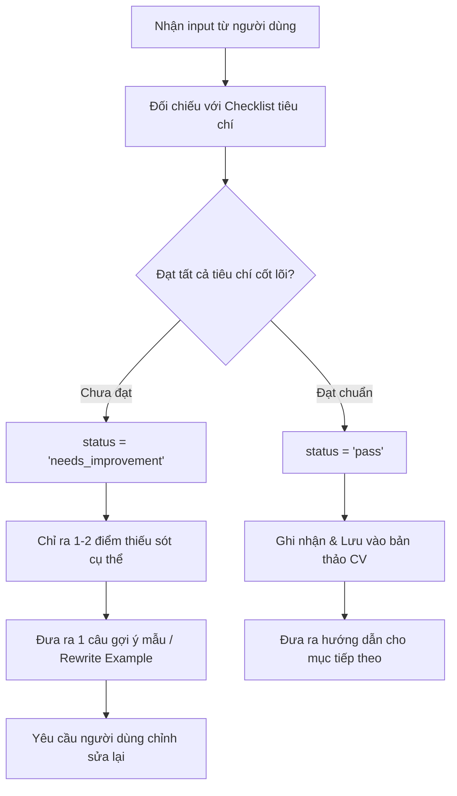

# 🎯 BỘ TIÊU CHÍ ĐÁNH GIÁ VÀ NÂNG CAO CHẤT LƯỢNG CV (CV EVALUATION & COACHING RUBRICS)

> **Tài liệu chuẩn hóa tiêu chí đánh giá và hướng dẫn viết CV dành cho AI Coach & Hệ thống ProfileHub.**  
> *Được trích xuất và tối ưu hóa dựa trên tài liệu hướng dẫn nhà tuyển dụng `stepwritecv`.*

---

## 📌 1. Triết Lý & Nguyên Tắc Cốt Lõi (Core Principles)

1. **Interview-Driven (Mục tiêu phỏng vấn):** CV không phải là bản tự thuật toàn bộ cuộc đời, mà là công cụ tiếp thị cá nhân được thiết kế để **giành lấy lời mời phỏng vấn**.
2. **Evidence-Based (Dựa trên bằng chứng thực tế):** Mọi kỹ năng và kinh nghiệm cần có sản phẩm minh chứng (Mã nguồn GitHub, Link Demo, Giảng viên kiểm định *Verified Badge*).
3. **Quantified Impact (Định lượng kết quả):** Sử dụng số liệu và tỷ lệ phần trăm (`% tăng trưởng`, `số lượng người dùng`, `thời gian tối ưu`) thay vì mô tả định tính mơ hồ.
4. **Single-Column & ATS-Friendly (Bố cục tối ưu):** Ưu tiên cấu trúc 1 cột rõ ràng, mạch lạc, dễ quét mắt nhanh và tương thích với các hệ thống ATS.

---

## 📋 2. Bảng Tiêu Chí Chi Tiết Từng Mục (Section-by-Section Rubrics)

### 2.1. Bố Cục & Thông Tin Cá Nhân (Layout & Contact Info)

| Tiêu chí | Yêu cầu chuẩn | Lỗi thường gặp cần sửa |
| :--- | :--- | :--- |
| **Bố cục (Layout)** | Cấu trúc 1 cột rõ ràng, phân chia các khối nội dung rành mạch. | Dùng layout 2 cột chật chội, khó đọc trên màn hình di động/hệ thống ATS. |
| **Thông tin liên hệ** | • Họ tên, Vị trí ứng tuyển mục tiêu.<br>• Email chuyên nghiệp, Số điện thoại.<br>• Link Portfolio, GitHub, LinkedIn (bấm trực tiếp được). | • Ghi địa chỉ nhà chi tiết (dễ gây bất lợi vùng miền).<br>• Thiếu đường link dẫn tới sản phẩm thực tế. |

---

### 2.2. Tóm Tắt Nghề Nghiệp (Professional Summary)

* **Vị trí:** Đặt ngay đầu CV (bên dưới thông tin liên hệ).
* **Độ dài chuẩn:** 2 – 4 câu súc tích (khoảng 40 – 70 từ).

| Điểm kiểm tra | Đạt tiêu chuẩn (Pass) ✅ | Cần cải thiện (Needs Work) ⚠️ |
| :--- | :--- | :--- |
| **Định hướng** | Xác định rõ vị trí ứng tuyển mục tiêu (vd: *Frontend Developer*, *Data Analyst*). | Chung chung: *"Mong muốn tìm kiếm công việc phù hợp để phát triển bản thân"*. |
| **Thế mạnh công nghệ** | Liệt kê 3 – 4 kỹ năng / công nghệ cốt lõi thành thạo nhất. | Không nhắc đến công nghệ chính hoặc kể lan man. |
| **Văn phong** | Khẳng định giá trị thực tế mang lại cho dự án/doanh nghiệp. | Dùng từ sáo rỗng: *"chăm chỉ"*, *"ham học hỏi"*, *"nhiệt tình"*. |

---

### 2.3. Đồ Án & Kinh Nghiệm Làm Việc (Projects & Experience)

* **Trình tự thời gian:** **Reverse Chronological** (Sắp xếp từ mới nhất ➔ cũ nhất).
* **Công thức mô tả hành động:**  
  $$\text{Action Verb (Động từ hành động)} + \text{Task / Tech (Nhiệm vụ & Công nghệ)} + \text{Quantified Impact (Kết quả định lượng)}$$

| Điểm kiểm tra | Tiêu chuẩn đánh giá |
| :--- | :--- |
| **1. Tính cụ thể của bài toán** | Nêu rõ sản phẩm giải quyết vấn đề gì, cho đối tượng nào. |
| **2. Tech Stack rõ ràng** | Ghi rõ ngôn ngữ, framework, cơ sở dữ liệu, công cụ triển khai. |
| **3. Số liệu đo lường (Metric)** | Có ít nhất 1 con số cụ thể (ví dụ: *tăng 30% tốc độ tải*, *phục vụ 500+ sinh viên*, *đạt điểm 9.2/10*). |
| **4. Bằng chứng liên kết** | Có link GitHub repo, link Demo sống hoặc nhãn Verified từ Giảng viên. |

> **Ví dụ so sánh:**
> * ❌ *Chưa đạt:* "Tham gia làm web bán hàng bằng React và Node.js với bạn cùng lớp."
> * ✅ *Đạt chuẩn:* "Phát triển hệ thống E-commerce bằng React, Node.js và PostgreSQL; tích hợp thanh toán VNPay và tối ưu câu truy vấn giúp giảm 35% thời gian phản hồi API (Link Demo & Verified bởi GVHD)."

---

### 2.4. Kỹ Năng Chuyên Môn (Technical Skills)

* **Phân nhóm rõ ràng:**
  * **Languages:** JavaScript, TypeScript, Python, Java...
  * **Frameworks/Libraries:** React, Next.js, Node.js, Spring Boot...
  * **Databases & Cloud:** PostgreSQL, MongoDB, Docker, Supabase, AWS...
  * **Tools & Practices:** Git, CI/CD, Agile/Scrum, RESTful API...
* **Tiêu chí loại bỏ:** Chỉ giữ lại các kỹ năng liên quan trực tiếp đến vị trí ứng tuyển. Loại bỏ kỹ năng cơ bản không cần thiết (vd: MS Word đối với lập trình viên).

---

## 🤖 3. Quy Chuẩn Đánh Giá Cho AI (System Prompt Guidelines)

Khi AI tiếp nhận input từ người dùng, hãy tuân theo quy trình phản hồi sau:



---

## 📦 4. Cấu Trúc JSON Chuẩn Phản Hồi Của AI (AI Output Schema)

```json
{
  "section": "summary | experience | project | skills",
  "status": "pass | needs_improvement",
  "score": 85,
  "criteria_checklist": [
    {
      "criterion": "Có con số định lượng kết quả",
      "passed": false,
      "feedback": "Chưa có số liệu đo lường hiệu quả hoặc % tăng trưởng."
    },
    {
      "criterion": "Nêu rõ Tech Stack",
      "passed": true,
      "feedback": "Đã nêu rõ React, Node.js và PostgreSQL."
    }
  ],
  "concise_feedback": "Nội dung dự án rất tốt, tuy nhiên bạn nên bổ sung thêm 1 con số cụ thể về kết quả đạt được (ví dụ: số người dùng thử nghiệm hoặc điểm số đồ án).",
  "suggested_improvement": "Ví dụ: '...tối ưu giao diện giúp tăng 30% tốc độ tải trang và đạt điểm đồ án 9.5/10.'",
  "next_prompt": "Sau khi bạn hoàn thiện mục này, chúng ta sẽ chuyển sang phần Kỹ năng chuyên môn!"
}
```
