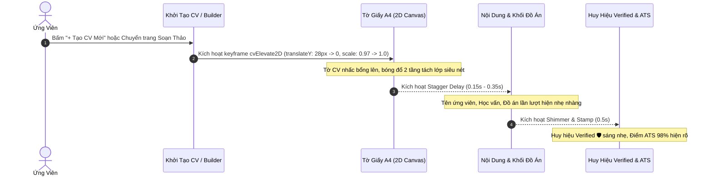

# 🎨 Đặc Tả Thiết Kế Giao Diện & Hoạt Họa: Intro 2D Elevated CV Nổi Lên Sắc Nét (ui.md)

> **Tài liệu tham chiếu:** Ngôn ngữ thiết kế chuyển động phẳng cao cấp (2D Flat Motion & Crisp Elevation) trên ProfileHub.  
> **Thư mục lưu trữ:** `profilehub/docs/product/ui.md`  
> **Trạng thái:** Đặc tả thiết kế UI/UX & Kỹ thuật hoạt họa (Motion & UI Specification).

---

## 📌 1. Triết Lý Thiết Kế & Định Nghĩa (Design Philosophy)

### 1.1. Tại sao chọn "2D Nổi Lên Sắc Nét" thay vì 3D?
* **Nhược điểm của hiệu ứng 3D (Three.js/WebGL):** 
  * Chữ và đường viền trên tờ CV dễ bị méo góc, răng cưa hoặc mờ nét (Anti-aliasing blur) khi xoay trong không gian 3 chiều.
  * Tốn tài nguyên GPU, làm quạt máy tính kêu to và gây giật khung hình (lag) trên máy cấu hình văn phòng hoặc điện thoại.
* **Sức mạnh của 2D Elevated Motion:**
  * **Độ sắc nét tuyệt đối 100% (Vector Pixel-Crisp):** Giữ nguyên độ nét của font chữ (Inter, Be Vietnam Pro), các đường viền tóc (hairline borders 1px) và huy hiệu bảo chứng.
  * **Cảm giác cao cấp (Tactile Physical Feel):** Tờ giấy A4 như một tài liệu danh giá được nhấc bổng lên từ mặt bàn kính, tạo cảm giác chuyên nghiệp, trang trọng chuẩn phong cách của **Linear, Stripe, Apple và Pitch.com**.
  * **Siêu nhẹ:** Sử dụng hoàn toàn CSS Hardware Acceleration (`transform`, `opacity`, `filter: drop-shadow`), chạy mượt mà 60–120 FPS mà không tiêu tốn RAM hay pin.

---

## 🎬 2. Kịch Bản Hoạt Họa Chuyển Động (Motion Choreography & Timeline)

Toàn bộ chuỗi chuyển động diễn ra trong vòng **0.65 giây** với 3 tầng hiệu ứng nối tiếp (Staggered Layers):

```
Thời gian (Giây):  0.0s         0.2s         0.4s         0.55s        0.65s
                  |------------|------------|------------|------------|
Tầng 1: Paper     [==== Nhấc bổng & Đổ bóng đa tầng 2D ====>]
Tầng 2: Content                [==== Các mục trượt nhẹ vào vị trí ====>]
Tầng 3: Badges                                           [== Đóng dấu Verified & Lướt sáng ==]
```



### Chi tiết các pha chuyển động:
1. **Pha 1: Nhấc Bổng & Bung Bóng (0.0s – 0.45s):**
   * Tờ CV bắt đầu từ vị trí thấp hơn 28px (`translateY(28px)`), độ thu nhỏ nhẹ (`scale(0.97)`), độ mờ (`opacity: 0`).
   * Trượt lên vị trí cân bằng với đường cong gia tốc tự nhiên: `cubic-bezier(0.16, 1, 0.3, 1)`.
   * Cùng lúc đó, bóng đổ 2D chuyển từ bóng sát mặt bàn sang **bóng bổng đa tầng (Multi-tier Ambient Shadow)** tạo chiều sâu tách biệt hoàn toàn với hình nền.
2. **Pha 2: Trượt Nội Dung Nối Đuôi (0.2s – 0.5s):**
   * Các khối trong CV không hiện đồng loạt mà xuất hiện so le (Stagger effect) cách nhau 50ms:
     * Header & Họ tên $\rightarrow$ Mục tiêu $\rightarrow$ Học vấn $\rightarrow$ Khối Đồ án Proof-of-Work.
3. **Pha 3: Đóng Dấu Bảo Chứng & Lướt Sáng (0.5s – 0.65s):**
   * Huy hiệu **"Verified 🛡️"** và **"ATS 98%"** xuất hiện với hiệu ứng nhún nhẹ (Spring Pop).
   * Một dải sáng mờ (Linear Shimmer) lướt chéo qua bề mặt tờ CV từ trái sang phải, tạo cảm giác tờ giấy vừa được "in nhiệt" sắc cạnh.

---

## 📍 3. Chi Tiết Hai Điểm Chạm Áp Dụng (Touchpoints)

---

### Điểm Chạm 1: Modal Khởi Tạo CV Mới (`CreateCvFlowModal.tsx`)

#### Vị trí:
Nằm ở màn hình chọn phương thức khởi tạo và chọn mẫu A4 (`initialStep = 'manual_studio'`).

#### Bố cục giao diện 2 cột:
* **Cột trái (45%):** Danh sách chọn Mẫu CV (Classic ATS, Tech Specialist, Minimalist...), chọn Bảng màu (Navy, Emerald, Tech Indigo, Charcoal) và chọn dữ liệu gốc.
* **Cột phải (55%):** **Khu vực Sân Khấu Trưng Bày CV (Elevated Stage)**.
  * Tờ CV A4 mô phỏng (tỷ lệ chuẩn $210 \times 297$) nổi bổng lơ lửng ngay giữa màn hình trên nền tối mờ (`bg-slate-900/60 dark:bg-black/60`).
  * Khi người dùng click chuyển sang mẫu CV khác hoặc đổi màu sắc: Tờ CV có độ nhún nhẹ (subtle scale dip 0.99) rồi nổi lên trở lại với giao diện mới trong **0.25 giây**, tạo cảm giác tương tác phản hồi tức thì.

---

### Điểm Chạm 2: Trình Soạn Thảo Canvas (`CVBuilder.tsx`)

#### Vị trí:
Ngay khi người dùng hoàn tất bước khởi tạo và chuyển trang vào màn hình soạn thảo chính.

#### Trải nghiệm:
* Thay vì trang giấy A4 xuất hiện khô khốc và tĩnh lặng:
* Toàn bộ khung giấy A4 trung tâm thực hiện hiệu ứng **"Intro Unfold / Lift-Up"** nổi bật lên trước mặt người dùng.
* Tạo ấn tượng tâm lý: *"Một trang giấy in cao cấp vừa được trải lên bàn làm việc dành riêng cho bạn"*.
* Đưa lại cảm giác hứng khởi để ứng viên bắt đầu gõ từng dòng nội dung.

---

## 💻 4. Mã Nguồn Kỹ Thuật CSS & Component Minh Họa

### 4.1. Bộ CSS Keyframes Khử Nhòe & Đổ Bóng Đa Tầng

```css
/* Thêm vào index.css hoặc module CSS của CV Studio */

@keyframes cvElevate2D {
  0% {
    opacity: 0;
    transform: translateY(28px) scale(0.97);
    box-shadow: 0 4px 6px -1px rgba(0, 0, 0, 0.05);
  }
  100% {
    opacity: 1;
    transform: translateY(0) scale(1);
    /* 3 lớp bóng đổ 2D tạo chiều sâu tách nền siêu sắc nét */
    box-shadow: 
      0 0 0 1px rgba(0, 0, 0, 0.08),             /* Viền mảnh tách nền */
      0 8px 20px -4px rgba(15, 23, 42, 0.12),    /* Bóng gần mềm mại */
      0 24px 50px -12px rgba(15, 23, 42, 0.22);  /* Bóng xa nâng bổng */
  }
}

@keyframes cvShimmerSweep {
  0% {
    transform: translateX(-150%) skewX(-20deg);
  }
  100% {
    transform: translateX(200%) skewX(-20deg);
  }
}

/* Lớp định hình tờ CV nổi bổng sắc nét */
.cv-paper-elevated {
  animation: cvElevate2D 0.55s cubic-bezier(0.16, 1, 0.3, 1) forwards;
  will-change: transform, box-shadow, opacity;
  backface-visibility: hidden;          /* Khử nhòe font chữ trên trình duyệt */
  -webkit-font-smoothing: subpixel-antialiased; /* Giữ chữ nét căng từng pixel */
  transform-style: flat;                /* Giữ nguyên bản chất 2D phẳng, không biến dạng phối cảnh */
}

/* Dải sáng lướt qua khi vừa nổi lên */
.cv-shimmer-effect {
  position: relative;
  overflow: hidden;
}

.cv-shimmer-effect::after {
  content: '';
  position: absolute;
  top: 0;
  left: 0;
  width: 60%;
  height: 100%;
  background: linear-gradient(
    90deg,
    transparent 0%,
    rgba(255, 255, 255, 0.25) 50%,
    transparent 100%
  );
  animation: cvShimmerSweep 0.8s ease-in-out 0.4s 1 forwards;
  pointer-events-none;
}
```

---

### 4.2. Component Mẫu Trưng Bày CV Nổi Bổng (`ElevatedCvPreviewCard.tsx`)

```tsx
import React from 'react';
import { ShieldCheck, Sparkles, CheckCircle2 } from 'lucide-react';

interface ElevatedCvPreviewCardProps {
  templateName: string;
  primaryColor: string;
  candidateName?: string;
  roleTitle?: string;
}

export const ElevatedCvPreviewCard: React.FC<ElevatedCvPreviewCardProps> = ({
  templateName,
  primaryColor,
  candidateName = 'NGUYỄN VĂN AN',
  roleTitle = 'Fullstack Software Engineer'
}) => {
  return (
    <div className="relative flex items-center justify-center p-6 sm:p-10 perspective-none">
      {/* Nền quầng sáng Ambient Glow phía sau */}
      <div 
        className="absolute w-72 h-96 rounded-full blur-3xl opacity-25 pointer-events-none transition-colors duration-500"
        style={{ backgroundColor: primaryColor }}
      />

      {/* TỜ GIẤY CV A4 NỔI BỔNG 2D */}
      <div 
        className="cv-paper-elevated cv-shimmer-effect relative w-full max-w-[340px] aspect-[1/1.414] bg-white dark:bg-[#0c101c] rounded-2xl border border-slate-200/90 dark:border-slate-800 p-5 flex flex-col justify-between transition-transform duration-300 hover:-translate-y-1"
      >
        {/* Góc trên: Huy hiệu ATS & Verified */}
        <div className="flex items-center justify-between pb-3 border-b border-slate-100 dark:border-slate-800/80">
          <div className="flex items-center gap-1.5 px-2 py-0.5 rounded-full bg-emerald-50 dark:bg-emerald-950/60 border border-emerald-200 dark:border-emerald-800 text-[10px] font-bold text-emerald-700 dark:text-emerald-300">
            <CheckCircle2 size={11} />
            <span>Chuẩn ATS: 98%</span>
          </div>

          <div className="flex items-center gap-1 px-2 py-0.5 rounded-full bg-indigo-50 dark:bg-indigo-950/60 border border-indigo-200 dark:border-indigo-800 text-[10px] font-bold text-indigo-700 dark:text-indigo-300">
            <ShieldCheck size={11} className="text-indigo-600 dark:text-indigo-400" />
            <span>Proof-of-Work Verified</span>
          </div>
        </div>

        {/* Thân CV: Mô phỏng cấu trúc A4 sắc nét */}
        <div className="space-y-3.5 my-auto">
          {/* Header CV */}
          <div>
            <div className="h-3.5 w-3/4 rounded-sm bg-slate-900 dark:bg-slate-100 font-black text-xs tracking-tight flex items-center px-1 text-white">
              {candidateName}
            </div>
            <div 
              className="text-[11px] font-bold mt-1 tracking-wide"
              style={{ color: primaryColor }}
            >
              {roleTitle}
            </div>
          </div>

          {/* Dòng mô phỏng nội dung (Skeleton lines với độ nét cao) */}
          <div className="space-y-1.5 pt-1">
            <div className="h-1.5 w-full bg-slate-200 dark:bg-slate-800 rounded-full" />
            <div className="h-1.5 w-5/6 bg-slate-200 dark:bg-slate-800 rounded-full" />
            <div className="h-1.5 w-4/6 bg-slate-200 dark:bg-slate-800 rounded-full" />
          </div>

          {/* Khối Đồ Án Proof-of-Work tiêu biểu */}
          <div className="p-2.5 rounded-xl border border-slate-200/80 dark:border-slate-800 bg-slate-50/70 dark:bg-[#131b2e] space-y-1.5">
            <div className="flex items-center justify-between text-[10px] font-extrabold text-slate-800 dark:text-slate-200">
              <span>E-Commerce High-Throughput</span>
              <span className="text-emerald-600 dark:text-emerald-400">🛡️ Giảng viên duyệt</span>
            </div>
            <div className="flex gap-1">
              <span className="text-[9px] px-1.5 py-0.2 rounded bg-white dark:bg-slate-800 text-slate-600 dark:text-slate-300 border border-slate-200 dark:border-slate-700">React</span>
              <span className="text-[9px] px-1.5 py-0.2 rounded bg-white dark:bg-slate-800 text-slate-600 dark:text-slate-300 border border-slate-200 dark:border-slate-700">Golang</span>
              <span className="text-[9px] px-1.5 py-0.2 rounded bg-white dark:bg-slate-800 text-slate-600 dark:text-slate-300 border border-slate-200 dark:border-slate-700">Kafka</span>
            </div>
          </div>
        </div>

        {/* Chân CV: Tên mẫu & Kích cỡ chuẩn A4 */}
        <div className="pt-2 border-t border-slate-100 dark:border-slate-800/80 flex items-center justify-between text-[9.5px] text-slate-400 font-semibold">
          <span>Mẫu: {templateName}</span>
          <span>Bản in A4 • 210 × 297 mm</span>
        </div>
      </div>
    </div>
  );
};
```

---

## 🎯 5. Kế Hoạch Triển Khai Thực Tế (Integration Tasks)

| Mã Task | Vị trí áp dụng | Nội dung triển khai | Hiệu quả đạt được |
| :---: | :--- | :--- | :--- |
| **UI-01** | `src/index.css` | Khai báo keyframe `@keyframes cvElevate2D` và class `.cv-paper-elevated` với tính năng khử nhòe font chữ. | Sẵn sàng hiệu ứng CSS toàn cục không cần cài thêm thư viện. |
| **UI-02** | `CreateCvFlowModal.tsx` | Nhúng component preview `ElevatedCvPreviewCard` vào cột bên phải của modal khởi tạo CV. | Người dùng vừa chọn mẫu là thấy ngay tờ CV nổi bổng lên sắc nét. |
| **UI-03** | `CVBuilder.tsx` | Gắn class hoạt họa `.cv-paper-elevated` vào thẻ bao bọc trang in `<div className="w-[210mm] min-h-[297mm]...">`. | Khi vào trình soạn thảo, tờ giấy A4 xuất hiện với cảm giác trang trọng, chuyên nghiệp. |

---

> 💡 **Tóm kết:**  
> Giải pháp **Intro 2D Elevated CV Nổi Lên Sắc Nét** tạo bước đột phá về cảm giác thị giác: **Đậm chất công nghệ cao cấp nhưng không hề cồng kềnh**, giữ trọn vẹn sự tinh tế và sắc nét của văn bản học thuật trên ProfileHub.
